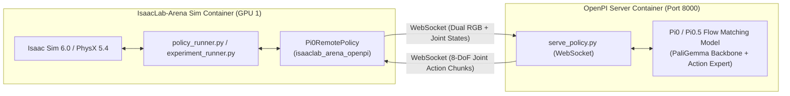

# OpenPI ($\pi_0$ / $\pi_{0.5}$) Implementation & Evaluation Plan

This document outlines the architecture, setup, and execution workflow for evaluating Physical Intelligence's **OpenPI ($\pi_0$ and $\pi_{0.5}$)** vision-language-action (VLA) foundation models on the DROID robotic embodiment within `isaaclab-arena-private`.

---

## 1. Executive Summary & Architecture

The private arena instance has a pre-built pipeline for OpenPI, encompassing server image construction, model checkpoint caching, and closed-loop WebSocket execution. The server image, based on a specific Physical Intelligence OpenPI pinned commit, downloads model checkpoints from cloud storage and launches a high-throughput WebSocket server to manage policy execution.

`isaaclab-arena-private` has native, first-class support for OpenPI ($\pi_0$ and $\pi_{0.5}$) already built into the repository under the `isaaclab_arena_openpi` package.

The architecture operates via a decoupled two-process model:
1. **OpenPI Server** (`serve_policy.py` in a dedicated Docker container):
   - Hosts the $\pi_0$ / $\pi_{0.5}$ model weights in GPU memory.
   - Computes continuous flow-matched joint actions conditioned on incoming camera feeds and language goals.
   - Serves action chunk sequences over a persistent **WebSocket** connection.
2. **Arena Policy Runner** (`policy_runner.py` inside the Isaac Sim / IsaacLab container):
   - Streams the dual DROID camera images (`external_camera_rgb` and `wrist_camera_rgb`) and current joint states to the server.
   - Applies the returned joint trajectory positions to the simulated Franka arm with Robotiq 2F-85 gripper at 50 Hz.



---

## 2. Step-by-Step Guide to Using OpenPI with DROID

### Step 1: Launch the OpenPI Inference Server (Terminal 1)

Arena includes a turnkey script that clones Physical Intelligence’s repository at the pinned commit, builds the container image, caches the ~11 GB model weights from Google Cloud Storage, and starts the WebSocket server:

```bash
./isaaclab_arena_openpi/docker/run_openpi_server.sh
```

- **Default Model**: Serves `pi05` (`gs://openpi-assets-simeval/pi05_droid_jointpos`).
- **Older $\pi_0$ Variant**: Pass `-v pi0` to serve the original $\pi_0$ model checkpoint (`gs://openpi-assets-simeval/pi0_droid_jointpos`).
- **Port Note**: By default, OpenPI listens on port `8000` via WebSockets. (If port `8000` is occupied by a local vLLM instance, pass a custom port to the server script and provide `--remote_port <PORT>` to the Arena client).

Wait until the server initialization outputs:
```text
INFO:websockets.server:server listening on 0.0.0.0:8000
```
Keep this terminal session active.

---

### Step 2: Run Closed-Loop Rollouts in IsaacLab (Terminal 2)

Inside the IsaacLab-Arena Docker container (launchable via `./docker/run_docker.sh` or through `docker exec`), run `policy_runner.py` configured with `Pi0RemotePolicy`:

#### Option A: Single Environment Rollout
Execute a targeted manipulation task on the standard maple table:

```bash
/isaac-sim/python.sh isaaclab_arena/evaluation/policy_runner.py \
  --headless \
  --enable_cameras \
  --num_envs 1 \
  --num_episodes 3 \
  --policy_type isaaclab_arena_openpi.policy.pi0_remote_policy.Pi0RemotePolicy \
  --remote_host 127.0.0.1 \
  --remote_port 8000 \
  --openpi_embodiment_adapter droid \
  --policy_variant pi05 \
  --language_instruction "Pick up the tomato soup can and place it in the blue container." \
  pick_and_place_maple_table \
    --embodiment droid_abs_joint_pos \
    --pick_up_object soup_can_ycb_robolab \
    --destination_location bin_b03_vomp_robolab
```

#### Option B: With Generated Scene Graph YAML (Experiment 02 Scenes)
To evaluate OpenPI on procedurally or agentically generated scene configurations (such as the Arm B / Arm C test-time spatial deduction scenes):

```bash
/isaac-sim/python.sh isaaclab_arena/evaluation/policy_runner.py \
  --env_graph_spec_yaml artifacts/test_arm_b_droid.yaml \
  --policy_type isaaclab_arena_openpi.policy.pi0_remote_policy.Pi0RemotePolicy \
  --remote_host 127.0.0.1 \
  --remote_port 8000 \
  --openpi_embodiment_adapter droid \
  --policy_variant pi05 \
  --headless \
  --enable_cameras \
  --record_camera_video \
  --output_base_dir outputs/openpi_eval_arm_b
```

#### Option C: Shipped 9-Variation Benchmark Suite
Arena provides a standardized 3×3 grid evaluation across 9 variations of objects (Rubik's cube, soup cans, fruits, mugs), table surfaces, and HDR environments:

```bash
/isaac-sim/python.sh isaaclab_arena/evaluation/experiment_runner.py \
  --headless \
  --experiment_config isaaclab_arena_environments/experiment_configs/droid_pnp_srl_openpi_experiment.yaml \
  --output_base_dir ./outputs/openpi_benchmark \
  --record_camera_video
```

---

## 3. Important Checklist for OpenPI on DROID

> [!IMPORTANT]
> **1. Embodiment Action Space Matching**:
> Always specify **`droid_abs_joint_pos`** in your scene YAML or CLI invocation (`--embodiment droid_abs_joint_pos`). 
> $\pi_0$ and $\pi_{0.5}$ command **8-DoF absolute joint positions** (7 Franka Panda arm joints + 1 Robotiq finger joint).
> **Do not use `droid_differential_ik`**, as differential IK expects a 7-dimensional Cartesian delta pose action, which triggers an immediate shape mismatch error (`expected: 7, received: 8`).

> [!NOTE]
> **2. Camera Alignment**:
> The `Pi0DroidAdapter` in `isaaclab_arena_openpi` automatically extracts and formats the dual DROID camera feeds:
> - `external_camera_rgb` (shoulder / external perspective)
> - `wrist_camera_rgb` (eye-in-hand gripper perspective)
> Both feeds are downsampled and converted to the exact tensor format expected by OpenPI's observation transform pipeline.

> [!TIP]
> **3. Hardware & VRAM Allocation**:
> OpenPI runs under JAX/PyTorch with `XLA_PYTHON_CLIENT_MEM_FRACTION=0.5`. On an RTX 5090 (32 GB) or RTX PRO 6000 (96 GB), OpenPI consumes approximately **10–12 GB VRAM**.
> - In a dual-GPU system: Run OpenPI on **GPU 0** alongside text generation or host processes, while dedicating **GPU 1** entirely to Isaac Sim and rendering.
> - When sharing GPU 1: Ensure Isaac Sim's offscreen Vulkan context and camera buffers leave at least 14 GB of headroom before launching the server.

---

## 4. Model Capabilities & Comparison Matrix

| Feature / Metric | Physical Intelligence OpenPI ($\pi_{0.5}$) | NVIDIA Project GR00T (N1.6-DROID) |
| :--- | :--- | :--- |
| **VLA Backbone** | PaliGemma + continuous flow-matching expert | Qwen architecture + flow-matching / diffusion head |
| **Action Space** | 8-DoF Joint Positions (`droid_abs_joint_pos`) | 8-DoF Joint Positions (`droid_abs_joint_pos`) |
| **DROID Pretraining** | Trained on full DROID + cross-embodiment data | Trained on Open X-Embodiment (OXE_DROID subset) |
| **Dexterity & Fine Control** | Exceptionally high; dynamic re-grasping | Solid baseline; fast linear trajectories |
| **Zero-Shot OOD Generalization** | ~40% – 65% success across unmapped kitchens/scenes | Strong on in-distribution table scenes; sensitive to tight clearances |
| **Inference Latency** | ~50 – 90 ms per chunk (WebSocket client) | ~15 ms per chunk (ZeroMQ streaming) |
| **Memory Footprint** | ~10 – 12 GB VRAM | ~6.9 – 7.5 GB VRAM |
| **Arena Native Integration** | `isaaclab_arena_openpi.policy.pi0_remote_policy.Pi0RemotePolicy` | `isaaclab_arena_gr00t.policy.gr00t_remote_closedloop_policy.Gr00tRemoteClosedloopPolicy` |
