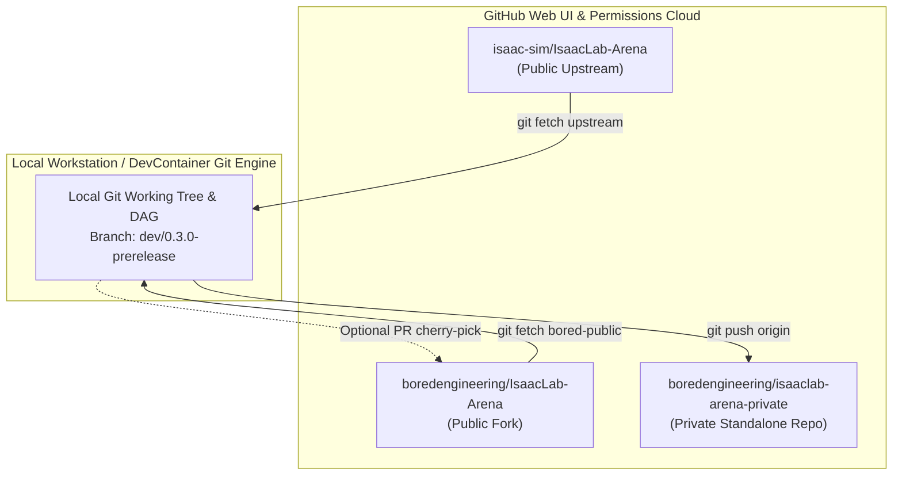
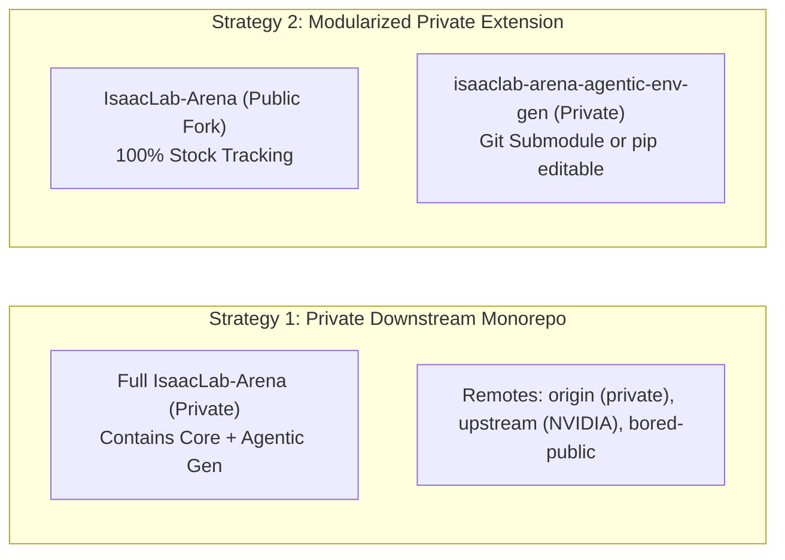
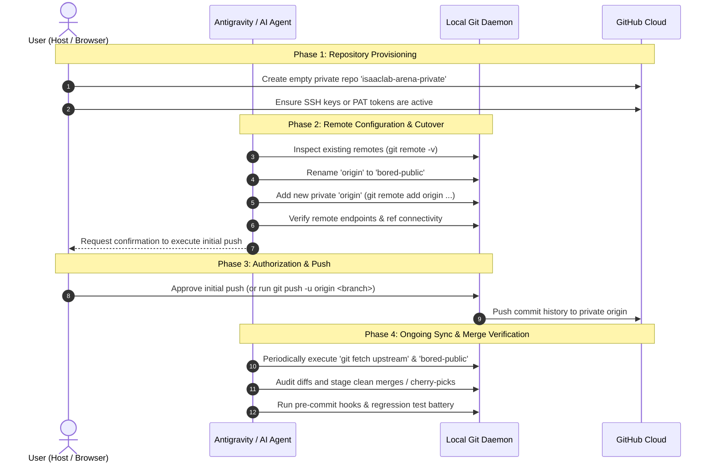

# Private Repository Migration: Mental Models, Architecture, and Action Playbook

**Document ID:** `PLAN-PRIVATE-REPO-01`  
**Status:** Approved for Brainstorming & Mental Model Validation  
**Date:** 2026-10-16  
**Target Workspaces:** `IsaacLab-Arena` (`dev/0.3.0-prerelease`) & Agentic Environment Generation  
**Parent Invariants:** [`AGENTS.md`](../../../../AGENTS.md)  
**Related Documents:**
* [`../local-inference/experiment_01_findings.md`](../local-inference/experiment_01_findings.md)
* [`../local-inference/hardening_plan.md`](../local-inference/hardening_plan.md)

---

## 1. Executive Summary & Intent

This document establishes the architectural mental model, comparative strategies, and user-agent division of labor required to transition our proprietary **Agentic Environment Generation Tooling** into a private GitHub repository, while maintaining continuous, seamless synchronization with:
1. **NVIDIA Upstream:** [`https://github.com/isaac-sim/IsaacLab-Arena`](https://github.com/isaac-sim/IsaacLab-Arena) (`upstream`)
2. **Public BoredEngineering Fork:** [`https://github.com/boredengineering/IsaacLab-Arena`](https://github.com/boredengineering/IsaacLab-Arena) (`bored-public`)

---

## 2. Core Mental Models

### Mental Model 1: Git as a Decentralized Directed Graph vs. GitHub Fork Semantics

A common point of friction is conflating **GitHub UI fork mechanics** with **Git decentralized architecture**:



* **GitHub UI Rules:** GitHub treats forks as linked nodes in a public network. A public fork *cannot* be toggled to private directly in repository settings without detaching from the fork network.
* **Git Protocol Rules:** Git remotes are merely named URLs pointing to Git object databases. A single local clone can pull commit graphs from five public remotes and push to a private remote without GitHub ever needing to link them.

---

### Mental Model 2: Strategy Comparison (Monorepo Mirror vs. Modular Extension)

We evaluate two distinct architectural paths to achieve privacy:



| Evaluation Dimension | Strategy 1: Private Downstream Monorepo | Strategy 2: Modularized Private Extension |
| :--- | :--- | :--- |
| **Immediate Setup Effort** | **Minimal (15 minutes)**. Reconfigure remotes and push. | **Moderate (1–2 days)**. Extract modules, adjust import paths, configure submodule/pip. |
| **Workflow Disruption** | **Zero**. Existing Docker mounts, test scripts, and paths remain identical. | **Low**. Requires mounting external private repo into Docker container. |
| **Upstream Sync Complexity** | Must resolve merge conflicts across modified core files during `git merge upstream/main`. | **Zero merge conflicts** on the agentic tooling; base repo pulls cleanly from NVIDIA. |
| **IP Isolation Rigor** | Entire repository is private (including Arena foundation code). | Only proprietary agentic IP is in the private repo; Arena remains a clean public fork. |
| **Open-Source Contribution** | Requires careful cherry-picking to push public PRs without leaking private commits. | Trivial: base repo is already clean; contribute upstream directly. |

---

## 3. Division of Labor: User Actions vs. Agent Actions

Because agents run within a bounded DevContainer/terminal without browser authentication or GitHub administrative privileges, tasks are strictly partitioned:



### Detailed Responsibility Matrix:

#### What the User Must Perform:
1. **Create the GitHub Private Repository:**
   * Go to GitHub $\rightarrow$ New Repository.
   * Name: `isaaclab-arena-private` (or preferred name).
   * Visibility: **Private**.
   * **Do NOT** initialize with a `README`, `.gitignore`, or license (it must remain completely empty).
2. **Authenticate the Local Host / DevContainer:**
   * Ensure host SSH keys (`~/.ssh/id_ed25519` or `~/.ssh/id_rsa`) or GitHub CLI (`gh auth login`) have write access to the new private repository.
3. **Approve Destructive or Network Pushes:**
   * As mandated by [`AGENTS.md`](../../../../AGENTS.md), explicitly approve `git commit` and `git push origin` operations.
4. **Public Fork Lifecycle Decision:**
   * Decide whether to keep `boredengineering/IsaacLab-Arena` public (for contributing upstream PRs) or delete/archive it to protect previously pushed commits.

#### What the Agent Can Perform:
1. **Remote Re-wiring:**
   * Safely alias existing remotes (`origin` $\rightarrow$ `bored-public`, new private URL $\rightarrow$ `origin`, NVIDIA $\rightarrow$ `upstream`).
2. **Connectivity Validation:**
   * Test read access to NVIDIA upstream and bored-public without altering working trees.
3. **Preflight Sync & Merge Simulation:**
   * Run `git fetch --all`.
   * Simulate branch merges using `git merge --no-commit --no-ff` in a temporary branch to diagnose conflicts before touching active development branches.
4. **Verification & Hardening Test Execution:**
   * Run the 3-phase test harness (`run-tests` skill) and `pre-commit` linters on merged branches to guarantee upstream changes didn't break Arena APIs.

---

## 4. Execution Playbook: Strategy 1 (Private Downstream Monorepo)

This is the immediate, zero-friction procedure.

### Step 1: User Provisions Private Repo on GitHub
* Create empty private repo: `git@github.com:<username-or-org>/isaaclab-arena-private.git`.

### Step 2: Agent Reconfigures Local Remotes
Run inside the workspace:

```bash
# 1. Inspect current configuration
git remote -v

# 2. Rename current public origin to 'bored-public'
git remote rename origin bored-public

# 3. Add the new private repository as primary 'origin'
git remote add origin git@github.com:<username-or-org>/isaaclab-arena-private.git

# 4. Verify upstream is set to NVIDIA
git remote set-url upstream https://github.com/isaac-sim/IsaacLab-Arena.git

# 5. Confirm remote ledger
git remote -v
```

Expected output:
```text
bored-public  https://github.com/boredengineering/IsaacLab-Arena.git (fetch & push)
origin        git@github.com:<username-or-org>/isaaclab-arena-private.git (fetch & push)
upstream      https://github.com/isaac-sim/IsaacLab-Arena.git (fetch & push)
```

### Step 3: Initial Push to Private Remote (User Approval Required)
Push the current development branch and tags:

```bash
# Push active branch to private origin
git push -u origin dev/0.3.0-prerelease

# Push all tags (releases, milestones)
git push origin --tags
```

### Step 4: Ongoing Periodic Sync Protocol (Pulling Upstream Changes)
When NVIDIA or bored-public publishes updates:

```bash
# 1. Fetch latest changes from all public remotes without modifying files
git fetch upstream
git fetch bored-public

# 2. Review what changed upstream
git log HEAD..upstream/main --oneline -n 15

# 3. Merge upstream changes into your private working branch
git merge upstream/main

# 4. Run tests and pre-commit hooks to verify stability
pre-commit run --all-files
pytest tests/

# 5. Push clean merge to private origin
git push origin dev/0.3.0-prerelease
```

### Step 5: Contributing Public Fixes Back Upstream (Clean Room PR Workflow)
When you author a bug fix or feature intended for public release:

```bash
# 1. Branch from clean public upstream
git checkout -b fix/public-camera-support upstream/main

# 2. Cherry-pick only the specific public commits
git cherry-pick <commit-hash>

# 3. Push to public boredengineering fork to open PR
git push bored-public fix/public-camera-support
```

---

## 5. Execution Playbook: Strategy 2 (Modular Private Extension)

If the team decides to extract the agentic tooling into a dedicated, isolated private package:

### Components to Extract:
1. **Core Package:** [`isaaclab_arena/agentic_environment_generation/`](../../../../isaaclab_arena/agentic_environment_generation/)
2. **Examples & Runners:** [`isaaclab_arena_examples/agentic_environment_generation/`](../../../../isaaclab_arena_examples/agentic_environment_generation/)
3. **Agent Skills & References:** [`.agents/skills/agentic-rdf-star-env-gen/`](../../../skills/agentic-rdf-star-env-gen/) and [`.agents/references/plans/`](../)
4. **Webapp & Dashboards:** `apps/workbench/` or `services/dashboard/`

### Extraction Architecture:
* Create a private repository: `git@github.com:<org>/isaaclab-arena-agentic-env-gen.git`.
* Structure as an installable Python package:
  ```text
  isaaclab-arena-agentic-env-gen/
  ├── pyproject.toml
  ├── setup.py
  ├── isaaclab_arena_agentic/
  │   ├── __init__.py
  │   ├── core/
  │   ├── critics/
  │   ├── spatial/
  │   └── telemetry/
  └── examples/
  ```
* In the base `IsaacLab-Arena` repo:
  * Mount the private extension via Git Submodule or Docker volume.
  * Execute `pip install -e /workspaces/isaaclab-arena-agentic-env-gen` inside the devcontainer.

---

## 6. Security, Git Hygiene & Public History Invariants

> [!WARNING]
> **Prior Commit Disclosure Warning:**
> If commits containing sensitive prompts, private infrastructure paths, or proprietary IP were already pushed to `https://github.com/boredengineering/IsaacLab-Arena`, they remain cached in GitHub's public event stream even if you switch remotes.
> 
> **Remediation Options:**
> 1. **Archive / Delete Public Fork:** If the public fork is deleted on GitHub, its commit objects are permanently pruned from public view.
> 2. **Git History Scrubbing:** Use `git filter-repo` to scrub sensitive strings or files if maintaining the public fork is mandatory.

---

## 7. Operational Acceptance Checklist

- [ ] Private repository created on GitHub with **Private** visibility.
- [ ] SSH / CLI authentication verified from workstation to private repo.
- [ ] Local remotes reconfigured (`origin` $\rightarrow$ private, `bored-public`, `upstream`).
- [ ] Active branch (`dev/0.3.0-prerelease`) pushed cleanly to private `origin`.
- [ ] Dry-run `git fetch upstream` and `git fetch bored-public` executed without errors.
- [ ] Branch protection rules applied to private `origin/main` or `origin/dev/*`.
