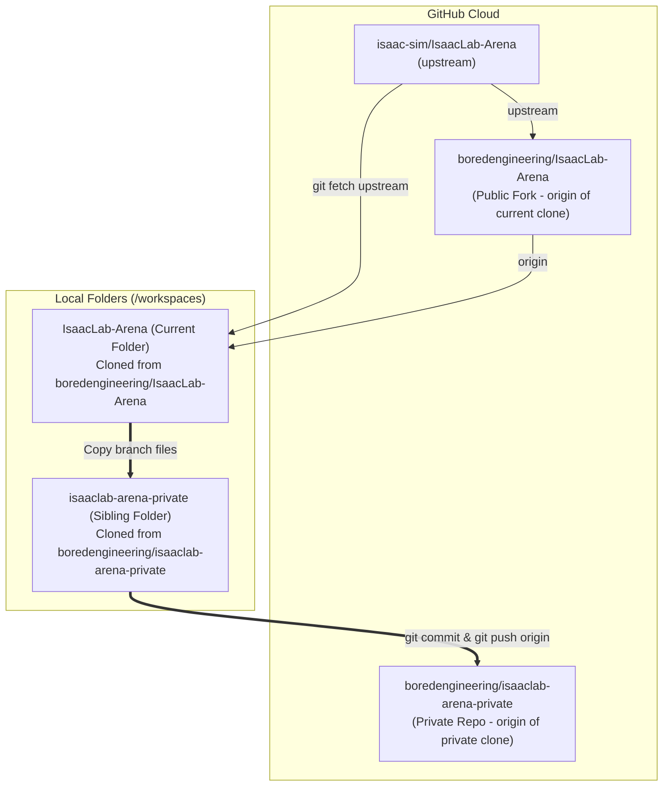

# Private Repository Migration Plan: Copy from Cloned Fork (`IsaacLab-Arena`) to `isaaclab-arena-private`

**Document ID:** `PLAN-PRIVATE-REPO-01`  
**Status:** Updated with Repository Topology & Empirical Feasibility Evaluation  
**Date:** 2026-10-16  
**Source Workspace (Current Cloned Fork):** `IsaacLab-Arena` (`origin` = `boredengineering/IsaacLab-Arena`)  
**Target Workspace (Private Clone):** [`../../../../../isaaclab-arena-private/`](../../../../../isaaclab-arena-private/) (`origin` = `boredengineering/isaaclab-arena-private`)  
**Parent Invariants:** [`AGENTS.md`](../../../../AGENTS.md)  
**Related Documents:**
* [`../local-inference/experiment_01_findings.md`](../local-inference/experiment_01_findings.md)
* [`../local-inference/hardening_plan.md`](../local-inference/hardening_plan.md)

---

## 1. Executive Summary & Repository Topology

Our setup consists of three GitHub repositories and two local workspace folders:

1. **Upstream (`upstream`):** [`https://github.com/isaac-sim/IsaacLab-Arena`](https://github.com/isaac-sim/IsaacLab-Arena) — NVIDIA's official public repository.
2. **Public Fork (`origin` of current repo `IsaacLab-Arena`):** [`https://github.com/boredengineering/IsaacLab-Arena`](https://github.com/boredengineering/IsaacLab-Arena) — Our fork of NVIDIA's repository, from which our current local workspace (`IsaacLab-Arena`) was cloned.
3. **Private Repository (`origin` of `isaaclab-arena-private`):** [`https://github.com/boredengineering/isaaclab-arena-private`](https://github.com/boredengineering/isaaclab-arena-private) — Our standalone private repository, cloned locally at `../isaaclab-arena-private`.

### The Goal
1. **Revert previous changes:**
   - Restore `origin` in our current cloned repository (`IsaacLab-Arena`) back to our fork (`https://github.com/boredengineering/IsaacLab-Arena.git`).
   - Clean and revert the local `../isaaclab-arena-private` folder and its GitHub remote (`boredengineering/isaaclab-arena-private`) back to the initial empty repository state (`main` with only `README.md`).
2. **Copy files branch-by-branch & push:**
   - Copy the tracked codebase files from our current cloned repository (`IsaacLab-Arena`) into the `../isaaclab-arena-private` folder, branch by branch (`main`, `release/0.3.0`, `release/0.3.1`, `dev/0.3.0-prerelease`).
   - Commit and push each branch directly from `../isaaclab-arena-private` to `boredengineering/isaaclab-arena-private`.



---

## 2. Diagnostic Root-Cause Analysis: Why `isaaclab-arena-private` Kept Giving "Not a Git Repository" Errors

Inspecting `../isaaclab-arena-private/.git` revealed **three exact causes** for why every branch operation in `isaaclab-arena-private` failed with a "not a git/github repository" error:

1. **Corrupted Half-Initialized Submodule in `.git/modules/` (Primary Cause):**
   - `../isaaclab-arena-private/.git/config` has `[submodule] active = .` enabled (set automatically by GitKraken/VS Code).
   - When a previous checkout of `dev/0.3.0-prerelease` tried to initialize submodules from `.gitmodules` (`git@github.com:boredengineering/Isaac-GR00T.git`), the clone failed midway and left behind a broken directory at `../isaaclab-arena-private/.git/modules/submodules/Isaac-GR00T/` containing **only a 54-byte `config` file** and **no `HEAD`, `refs/`, or `objects/`**.
   - Because `[submodule] active = .` is set, every subsequent `git checkout` or GUI branch operation inspects `.git/modules/submodules/Isaac-GR00T` and immediately crashes with `fatal: not a git repository`.
2. **2,600+ Dirty Untracked Files Left from Aborted Checkout:**
   - When that checkout aborted mid-flight at `17:42`, Git rolled `HEAD` back to `main` (`42e3eb9f`) but left 2,600+ unpacked files sitting as untracked (`??`) in `../isaaclab-arena-private/`, blocking clean branch switches.
3. **DevContainer UID Mismatch (`dubious ownership`):**
   - `../isaaclab-arena-private` is owned by host user `pwuser` (UID 1000), while the DevContainer runs as `root` (UID 0). Without `safe.directory` configured, Git inside the container refuses to run commands in `../isaaclab-arena-private`.

---

## 3. Feasibility Evaluation: Copying Files from `IsaacLab-Arena` to `isaaclab-arena-private`

### Verdict: **Yes — 100% Feasible**, with 4 Required Guardrails

We audited the current `/workspaces/IsaacLab-Arena` directory to evaluate what happens if we copy files into `../isaaclab-arena-private`. Here are the empirical measurements and required guardrails:

| Technical Factor | Empirical Measurement in `IsaacLab-Arena` | Risk if Ignored | How We Handle It Cleanly |
| :--- | :--- | :--- | :--- |
| **1. Disk Size vs. Tracked Files** | Raw folder is **43 GB** (`submodules/` 17 GB, `web/` caches 13 GB, `.venv`/`.hermes_backup` 7.9 GB, `outputs/` 5.2 GB). Actual Git-tracked files (`git ls-files`) are only **2,667 files (~450 MB)**. | A naive `cp -r` or `rsync` copies 42.5 GB of untracked build caches, virtualenvs, and `node_modules` into the private repo. | Copy **only Git-tracked files** for each branch using `git ls-files -z \| rsync --files-from=- -0`. |
| **2. Large Files & Git LFS** | Repo tracks **373 files (1,009 MB)** via Git LFS (`.gitattributes`), including `test_g1_hdf5_to_lerobot.hdf5` (**220 MB**). All 373 files are hydrated on disk. | GitHub rejects normal pushes containing any file > 100 MB (`test_g1_hdf5_to_lerobot.hdf5` is 220 MB). | Copy `.gitattributes` + pre-seed `../isaaclab-arena-private/.git/lfs/objects` from `IsaacLab-Arena/.git/lfs/objects` and run `git lfs install --local` before committing. |
| **3. Submodules (`IsaacLab` & `Isaac-GR00T`)** | Tracked in Git as `160000 commit <sha>` gitlinks + `.gitmodules`. In `dev/0.3.0-prerelease`, `.gitmodules` uses `git@github.com:...` SSH URLs while actual submodule clones use `https://github.com/...`. | Leaving `[submodule] active = .` or broken `.git/modules` causes `"not a git repository"` errors on checkout. | Remove broken `.git/modules`, disable auto-active submodule recursion in `isaaclab-arena-private/.git/config`, and record the exact `160000` submodule commit gitlinks (or vendor/HTTPS URLs). |
| **4. Branch Lineage** | 4 target branches: `main`, `release/0.3.0`, `release/0.3.1`, `dev/0.3.0-prerelease`. | Disconnected orphan branches cause GitHub PR/compare errors across branches. | Build branches sequentially in `isaaclab-arena-private` (`main` $\rightarrow$ `release/0.3.0` $\rightarrow$ `release/0.3.1` $\rightarrow$ `dev/0.3.0-prerelease`) so all 4 branches share a common root commit. |

---

## 4. Step-by-Step Execution Playbook

### Phase 1: Revert Everything & Return `isaaclab-arena-private` to Empty Repo

#### Step 1.1: Register `safe.directory` in DevContainer
```bash
git config --global --add safe.directory "$(realpath ../isaaclab-arena-private)"
git config --global --add safe.directory "$(realpath ../IsaacLab-Arena/submodules/IsaacLab)"
git config --global --add safe.directory "$(realpath ../IsaacLab-Arena/submodules/Isaac-GR00T)"
```

#### Step 1.2: Restore `origin` in Current `IsaacLab-Arena` Repo to Our Fork
Restore `origin` in `IsaacLab-Arena` back to `https://github.com/boredengineering/IsaacLab-Arena.git`:
```bash
git -C ../IsaacLab-Arena remote set-url origin https://github.com/boredengineering/IsaacLab-Arena.git
git -C ../IsaacLab-Arena fetch origin --prune
```
Verify `git -C ../IsaacLab-Arena remote -v`:
- `origin` $\rightarrow$ `https://github.com/boredengineering/IsaacLab-Arena.git`
- `upstream` $\rightarrow$ `https://github.com/isaac-sim/IsaacLab-Arena.git`

#### Step 1.3: Clean Up & Revert `../isaaclab-arena-private` to Initial Empty `main`
Remove the broken `.git/modules` stub, disable automatic submodule activation, wipe the 2,600+ untracked files from the aborted checkout, and delete the old remote branches on `boredengineering/isaaclab-arena-private`:
```bash
# 1. Remove corrupted half-initialized submodule metadata
rm -rf ../isaaclab-arena-private/.git/modules
git -C ../isaaclab-arena-private config --unset-all submodule.active || true

# 2. Reset working tree back to the single initial README.md commit (42e3eb9f)
git -C ../isaaclab-arena-private checkout -f main
git -C ../isaaclab-arena-private reset --hard 42e3eb9f
git -C ../isaaclab-arena-private clean -fdx

# 3. Delete the previously pushed branches on boredengineering/isaaclab-arena-private (Requires User Approval)
git -C ../isaaclab-arena-private push origin --delete dev/0.3.0-prerelease release/0.3.0 release/0.3.1
git -C ../isaaclab-arena-private fetch origin --prune
```

---

### Phase 2: Copy Tracked Files Branch-by-Branch into `isaaclab-arena-private`

#### Helper Procedure Used for Every Branch
To copy **only** the Git-tracked files (and exact submodule pointers) from a branch in `IsaacLab-Arena` into `isaaclab-arena-private` without copying the 42.5 GB of untracked build caches:

1. Pre-seed the Git LFS object cache once so LFS files (like the 220 MB `.hdf5`) don't have to be re-encoded:
   ```bash
   git -C ../isaaclab-arena-private lfs install --local
   mkdir -p ../isaaclab-arena-private/.git/lfs
   cp -rn ../IsaacLab-Arena/.git/lfs/objects ../isaaclab-arena-private/.git/lfs/
   ```
2. For each branch (`<branch>`):
   - Checkout `<branch>` in `IsaacLab-Arena`.
   - Create/checkout `<branch>` in `isaaclab-arena-private`.
   - Remove previously tracked files in `isaaclab-arena-private` (except `.git`) so deleted files between branches are accurately reflected.
   - Copy all tracked regular files (`git ls-files --stage | awk '$1 != "160000" {print $4}'`) from `IsaacLab-Arena` to `isaaclab-arena-private`.
   - Record the submodule gitlinks (`160000`) for `submodules/IsaacLab` and `submodules/Isaac-GR00T` using `git update-index --add --cacheinfo`.
   - Commit and push `<branch>` to `origin` (`boredengineering/isaaclab-arena-private`).

#### Branch Execution Order:
1. **`main`** (branched from initial `main` `42e3eb9f` in `isaaclab-arena-private`)
2. **`release/0.3.0`** (branched from `main` in `isaaclab-arena-private`)
3. **`release/0.3.1`** (branched from `release/0.3.0` in `isaaclab-arena-private`)
4. **`dev/0.3.0-prerelease`** (branched from `release/0.3.1` in `isaaclab-arena-private`, including our local inference, agentic env gen, and `.agents/references/plans` files)

---

## 5. Division of Labor: User vs. Agent

| Step | Action | Owner | Approval Gate |
| :--- | :--- | :--- | :--- |
| **1** | Restore `origin` in `IsaacLab-Arena` to `boredengineering/IsaacLab-Arena.git` & fix `safe.directory` | Agent | Safe local config |
| **2** | Clean `../isaaclab-arena-private` working tree & broken `.git/modules` back to empty `main` (`42e3eb9f`) | Agent | Confirm before `git clean` |
| **3** | Delete broken remote branches (`dev/0.3.0-prerelease`, `release/0.3.0`, `release/0.3.1`) on `boredengineering/isaaclab-arena-private` | Agent / User | **Explicit user approval required** |
| **4** | Copy tracked files branch-by-branch (`main`, `release/0.3.0`, `release/0.3.1`, `dev/0.3.0-prerelease`) into `../isaaclab-arena-private` | Agent | **Explicit user approval before `git commit` & `git push`** |
| **5** | Verify branch switching (`git checkout`) in `../isaaclab-arena-private` has zero errors | Agent | Post-migration check |

---

## 6. Operational Acceptance Checklist

- [x] `IsaacLab-Arena` `origin` restored to `https://github.com/boredengineering/IsaacLab-Arena.git` and `upstream` remains `https://github.com/isaac-sim/IsaacLab-Arena.git`.
- [x] Corrupted `../isaaclab-arena-private/.git/modules` removed and `../isaaclab-arena-private` reset cleanly to initial `main` (`42e3eb9f`).
- [x] Old remote branches (`dev/0.3.0-prerelease`, `release/0.3.0`, `release/0.3.1`) deleted from `boredengineering/isaaclab-arena-private`.
- [x] `main` tracked files copied into `../isaaclab-arena-private`, committed (`9674c99`), and pushed.
- [x] `release/0.3.0` tracked files copied into `../isaaclab-arena-private`, committed (`eb1a9f4`), and pushed.
- [x] `release/0.3.1` tracked files copied into `../isaaclab-arena-private`, committed (`db6928a`), and pushed.
- [x] `dev/0.3.0-prerelease` tracked files copied into `../isaaclab-arena-private`, committed (`ebb1575`), and pushed.
- [x] Submodules (`submodules/IsaacLab` and `submodules/Isaac-GR00T` + all 6 nested `external_dependencies`) initialized from pre-copied `.git/modules` with HTTPS `boredengineering` URLs.
- [x] Switching between all 4 branches in `../isaaclab-arena-private` succeeds with zero Git/GitHub errors.
