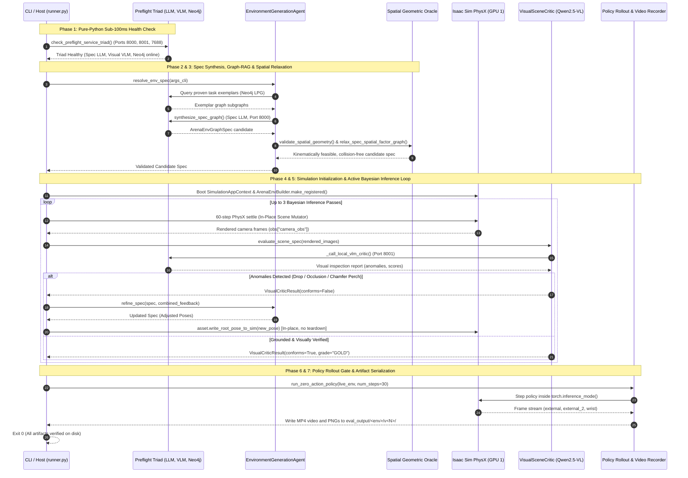
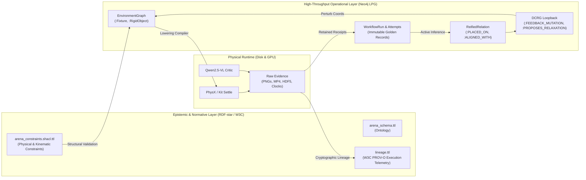
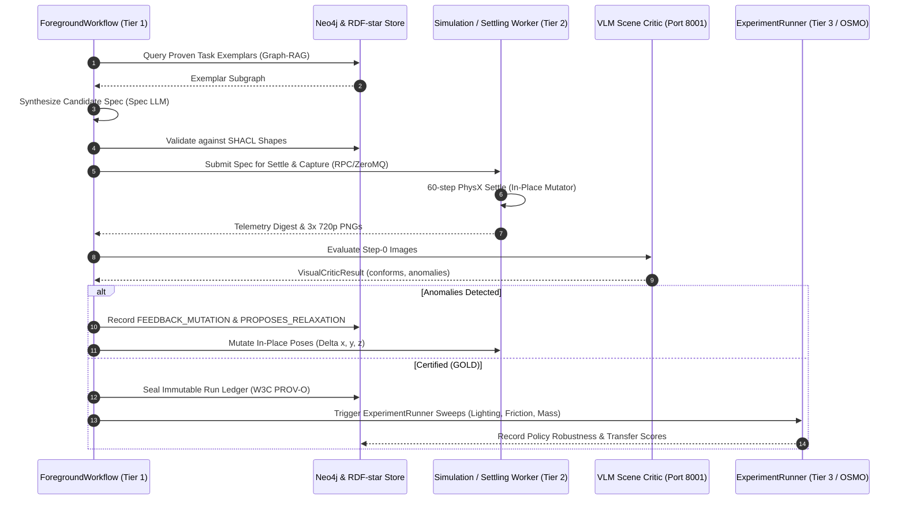
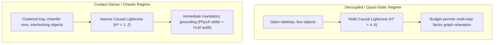

# Architectural Walkthrough: Hardening Agentic Environment Generation

The execution flow follows a phased approach, starting with health checks to ensure dependencies are available before environment specification. Next, a grounded resolution process synthesizes a specification graph, leveraging exemplar retrieval for context. Spatial constraints are then applied and relaxed, followed by a headless simulation and physical settling to generate visual data. Finally, a visual critic evaluates the scene, initiating recursive repair if necessary, before the final policy rollout.

This architectural walkthrough traces the execution path from the moment you run `environment_generation_runner.py` through physical settling, visual auditing, recursive repair, and policy rollout.

---

### End-to-End Architectural Flow

#### Sequence Flow Diagram

```text
┌───────────────────────────────────────────────┐┌───────────────────────────────────┐┌────────────────────────────┐┌─────────────────────────────────────────┐┌─────────────────────────┐┌───────────────────────────────┐┌───────────────────────────────────┐┌─────────────────────────────────┐
│ CLI / Host (environment_generation_runner.py) ││ Preflight Triad (LLM, VLM, Neo4j) ││ EnvironmentGenerationAgent ││ Spatial Geometric Oracle & Factor Graph ││ Isaac Sim PhysX (GPU 1) ││ RTX Camera Pipeline (3x 720p) ││ VisualSceneCritic (Qwen2.5-VL-7B) ││ Policy Rollout & Video Recorder │
└───────────────────────────────────────────────┘└───────────────────────────────────┘└────────────────────────────┘└─────────────────────────────────────────┘└─────────────────────────┘└───────────────────────────────┘└───────────────────────────────────┘└─────────────────────────────────┘
                        │                                          │                                 │                                   │                                  │                             │                                  │                                   │
                        │check_preflight_service_triad() [< 100ms]─►                                 │                                   │                                  │                             │                                  │                                   │
                        │                                          │                                 │                                   │                                  │                             │                                  │                                   │
                        │────────────────────────────resolve_env_spec()──────────────────────────────►                                   │                                  │                             │                                  │                                   │
                        │                                          │                                 │                                   │                                  │                             │                                  │                                   │
                        │                                          ◄Query proven exemplars from Neo4j LPG                                │                                  │                             │                                  │                                   │
                        │                                          │                                 │                                   │                                  │                             │                                  │                                   │
                        │                                          │                                 │validate_spatial_geometry() & relax►spec_spatial_factor_graph()       │                             │                                  │                                   │
                        │                                          │                                 │                                   │                                  │                             │                                  │                                   │
                        │                                          │                                 ◄┈┈Collision-free candidate spec┈┈┈┈│                                  │                             │                                  │                                   │
                        │                                          │                                 │                                   │                                  │                             │                                  │                                   │
                        │─────────────────────────────────────────────SimulationAppContext & ArenaEnvBuilder.make_registered()──────────────────────────────────────────────►                             │                                  │                                   │
┤ loop Active Bayesian Inference Loop (up to 3 passes) ├
                        │                                          │                                 │                                   │                                  │                             │                                  │                                   │
                        │──────────────────────────────────────────────────60-step PhysX settle (In-Place Scene Mutator)────────────────────────────────────────────────────►                             │                                  │                                   │
                        │                                          │                                 │                                   │                                  │                             │                                  │                                   │
                        │                                          │                                 │                                   │                                  │Capture external, external_2,►and wrist buffers                 │                                   │
                        │                                          │                                 │                                   │                                  │                             │                                  │                                   │
                        ◄┈┈┈┈┈┈┈┈┈┈┈┈┈┈┈┈┈┈┈┈┈┈┈┈┈┈┈┈┈┈┈┈┈┈┈┈┈┈┈┈┈┈┈┈┈┈┈┈┈┈┈┈┈┈┈┈┈┈┈┈┈┈┈_extract_rendered_images_from_obs() (3x 720p PNGs)┈┈┈┈┈┈┈┈┈┈┈┈┈┈┈┈┈┈┈┈┈┈┈┈┈┈┈┈┈┈┈┈┈┈┈┈┈┈┈┈┈┈┈┈┈┈┈┈┈┈┈┈│                                  │                                   │
                        │                                          │                                 │                                   │                                  │                             │                                  │                                   │
                        │──────────────────────────────────────────────────────────────────────────────VisualSceneCritic.evaluate_scene_spec(rendered_images)────────────────────────────────────────────────────────────────────────────────►                                   │
┤ alt Anomalies Detected (Drop / Occlusion / Chamfer Perch) ├
                        │                                          │                                 │                                   │                                  │                             │                                  │                                   │
                        │                                          │                                 ◄┈┈┈┈┈┈┈┈┈┈┈┈┈┈┈┈┈┈┈┈┈┈┈┈┈┈┈┈┈┈┈┈┈┈┈┈┈┈┈┈┈┈┈┈┈┈Multimodal feedback & anomaly descriptions┈┈┈┈┈┈┈┈┈┈┈┈┈┈┈┈┈┈┈┈┈┈┈┈┈┈┈┈┈┈┈┈┈┈┈┈┈┈┈┈┈┈┈┈┈┈┈│                                   │
                        │                                          │                                 │                                   │                                  │                             │                                  │                                   │
                        │                                          │                                 │ refine_spec() (LLM coordinate update) ─┐                             │                             │                                  │                                   │
                        │                                          │                                 │◄─┘                                │                                  │                             │                                  │                                   │
                        │                                          │                                 │                                   │                                  │                             │                                  │                                   │
                        │                                          │                                 │───asset.write_root_pose_to_sim(new_pose) [In-place, no teardown]─────►                             │                                  │                                   │
                        │                                          │                                 │                                   │                                  │                             │                                  │                                   │
                        ◄┈┈┈┈┈┈┈┈┈┈┈┈┈┈┈┈┈┈┈┈┈┈┈┈┈┈┈┈┈┈┈┈┈┈┈┈┈┈┈┈┈┈┈┈┈┈┈┈┈┈┈┈┈┈┈┈┈┈┈┈┈┈┈┈┈┈┈┈┈┈┈┈┈┈┈┈┈┈conforms: true, grade: "GOLD"┈┈┈┈┈┈┈┈┈┈┈┈┈┈┈┈┈┈┈┈┈┈┈┈┈┈┈┈┈┈┈┈┈┈┈┈┈┈┈┈┈┈┈┈┈┈┈┈┈┈┈┈┈┈┈┈┈┈┈┈┈┈│                                   │
                        │                                          │                                 │                                   │                                  │                             │                                  │                                   │
                        │────────────────────────────────────────────────────────────────────────────────────────────────────run_zero_action_policy(live_env, num_steps=30)──────────────────────────────────────────────────────────────────────────────────────────────────────►
                        │                                          │                                 │                                   │                                  │                             │                                  │                                   │
                        │                                          │                                 │                                   │                                  │                             │                                  │                                   │ Record MP4 video &
                        │                                          │                                 │                                   │                                  │                             │                                  │                                   │◄─┘
                        │                                          │                                 │                                   │                                  │                             │                                  │                                   │
                        ◄┈┈┈┈┈┈┈┈┈┈┈┈┈┈┈┈┈┈┈┈┈┈┈┈┈┈┈┈┈┈┈┈┈┈┈┈┈┈┈┈┈┈┈┈┈┈┈┈┈┈┈┈┈┈┈┈┈┈┈┈┈┈┈┈┈┈┈┈┈┈┈┈┈┈┈┈┈┈┈┈┈┈┈┈┈┈┈┈┈┈┈┈┈┈Exit 0 (Artifacts in eval_output/)┈┈┈┈┈┈┈┈┈┈┈┈┈┈┈┈┈┈┈┈┈┈┈┈┈┈┈┈┈┈┈┈┈┈┈┈┈┈┈┈┈┈┈┈┈┈┈┈┈┈┈┈┈┈┈┈┈┈┈┈┈┈┈┈┈┈┈┈┈┈┈┈┈┈┈┈┈┈┈┈┈┈┈┈┈┈┈┈┈┈┈┈┈┈┈┈┈┈┈┈┈┈┈┈┈┈│
                        │                                          │                                 │                                   │                                  │                             │                                  │                                   │
```

#### Mermaid Sequence Diagram



---

### Step-by-Step Call Graph & Function Roles

#### 1. Preflight Health Triad Gating (Pure Python, Sub-100ms)

**Location**: [`environment_generation_runner.py`](../../../../isaaclab_arena_examples/agentic_environment_generation/environment_generation_runner.py)

Before starting Omniverse Kit or allocating GPU memory, the runner validates that all three backend microservices are responsive:

- `main()` (line 1435): Parses CLI arguments (`--mode full`, `--num-settle-steps`, `--strict-critics`, etc.) and immediately calls:
    - [`check_preflight_service_triad(args_cli)`](../../../../isaaclab_arena_examples/agentic_environment_generation/environment_generation_runner.py#L317): Probes the three required services:
        1. `verify_service_endpoint(url)` (line 240): Sends `GET /v1/models` with a 2-second timeout to the Spec LLM on port 8000 (`Qwen2.5-Coder-32B-Instruct`) and the Visual VLM on port 8001 (`Qwen2.5-VL-7B-Instruct`).
        2. `verify_neo4j_endpoint(uri)` (line 270): Connects to Bolt port 7688 and runs `session.run("RETURN 1 AS probe")` to ensure graph-RAG memory is online.
    - **Architectural Role**: Guarantees instant fail-fast (<100ms with exit code 2 under `--strict-critics`) if any microservice container is offline or unreachable, avoiding a 25-second wait for Isaac Sim to initialize before crashing.

---

#### 2. Spec Synthesis & Experience Graph-RAG

**Location**: [`environment_generation_agent.py`](../../../../isaaclab_arena/agentic_environment_generation/environment_generation_agent.py)

- `resolve_env_spec(args_cli)` ([runner, line 348](../../../../isaaclab_arena_examples/agentic_environment_generation/environment_generation_runner.py#L348)):
    - Instantiates `EnvironmentGenerationAgent` with target LLM client, model name, and generation prompts.
    - Calls `agent.generate_spec(prompt)` ([line 143](../../../../isaaclab_arena/agentic_environment_generation/environment_generation_agent.py#L143)):
        1. `query_proven_exemplars()`: Queries Neo4j for prior successful environment graphs sharing similar task verbs (e.g. `grasp`, `place`).
        2. `self.spec_inference.synthesize_spec_graph()`: Calls the 32B Spec LLM on GPU 0 to emit structured YAML adhering to the `ArenaEnvGraphSpec` schema (specifying the embodiment, fixture, manipulands, camera mounts, and semantic relations).

---

#### 3. Mathematical Spatial Validation & Factor Graph Relaxation

**Location**: [`spatial_geometric_oracle.py`](../../../../isaaclab_arena/agentic_environment_generation/spatial_geometric_oracle.py)

Before touching physics, candidate coordinates pass through rigorous geometric verifiers:

- `validate_spatial_geometry(spec)` ([line 512](../../../../isaaclab_arena/agentic_environment_generation/spatial_geometric_oracle.py#L512)):
    - `validate_support_containment()` ([line 254](../../../../isaaclab_arena/agentic_environment_generation/spatial_geometric_oracle.py#L254)): Checks that each object lies inside the fixture's 2D surface polygon. It verifies that objects do not intersect [`FIXTURE_STRUCTURAL_EXCLUSIONS`](../../../../isaaclab_arena/agentic_environment_generation/spatial_geometric_oracle.py#L190) (specifically carving out the integrated grey storage bin on `packing_table`).
    - `compute_world_embodiment_exclusion_zones(spec)` ([line 424](../../../../isaaclab_arena/agentic_environment_generation/spatial_geometric_oracle.py#L424)): Computes 3D exclusion capsules for the robot's base and arm in world space, preventing objects from spawning inside the robot's resting footprint.
- `relax_spec_spatial_factor_graph(spec)` ([line 640](../../../../isaaclab_arena/agentic_environment_generation/spatial_geometric_oracle.py#L640)):
    - Formulates an optimization problem using least-squares relaxation to subtly shift object $(x, y)$ coordinates to resolve bounding-box overlap while maintaining task affordances.

---

#### 4. Headless Simulation Initialization & In-Place PhysX Settling

**Location**: [`environment_generation_runner.py`](../../../../isaaclab_arena_examples/agentic_environment_generation/environment_generation_runner.py)

When `--mode full` executes, it enters `with SimulationAppContext(args_cli):` and calls `run_grounded_resolve(args_cli, return_live_env=True)`:

- [`_settle_and_capture_frames(spec, ...)`](../../../../isaaclab_arena_examples/agentic_environment_generation/environment_generation_runner.py#L1020):
    - **First Pass** (`existing_env is None`):
        - Converts the spec to an arena environment with `spec.to_arena_env(enable_cameras=True)` (attaching `external_camera_rgb`, `external_camera_2_rgb`, and `wrist_camera_rgb`).
        - Wraps the environment with `wrap_env_for_video()` (line 1059) to record the settlement trajectory.
        - Calls `env.reset()`.
    - **Subsequent Passes** (`existing_env is not None`):
        - **In-Place Scene Mutator** ([lines 1066–1085](../../../../isaaclab_arena_examples/agentic_environment_generation/environment_generation_runner.py#L1066)): Iterates through modified objects and applies:
          ```python
          asset = base_env.scene[obj.id]
          asset.write_root_pose_to_sim(new_pose)
          asset.write_root_velocity_to_sim(torch.zeros((1, 6), device=base_env.device))
          ```
        - **Architectural Role**: Bypasses `env.close()` and keeps the environment alive so Omniverse Kit's Hydra RTX render delegate never detaches.
    - **60-Step Settle Loop** (line 1107):
        - Steps the simulation for 60 steps ($1.0\text{s}$) under `torch.inference_mode()` with `ZeroActionPolicy`.
        - **Drop Detection** ([line 1125](../../../../isaaclab_arena_examples/agentic_environment_generation/environment_generation_runner.py#L1125)): Compares initial vs final $(x, y, z)$. If $z < z_{\text{drop\_threshold}}$ (where $z < 0.05\text{m}$ dynamically for low-deck tables) or horizontal displacement $> 0.15\text{m}$, logs a physical instability failure.
    - `_extract_rendered_images_from_obs(obs)` (line 998):
        - Reads the $(720, 1280, 3)$ RGB tensors from `obs["camera_obs"]` and compresses them to valid PNG byte buffers via `_encode_rgb_array_to_png_bytes()`.

---

#### 5. Step-0 Visual Perception Critic (VLM on GPU 1)

**Location**: [`visual_critic.py`](../../../../isaaclab_arena/agentic_environment_generation/visual_critic.py)

- `VisualSceneCritic.evaluate_scene_spec(spec, rendered_images)` ([line 96](../../../../isaaclab_arena/agentic_environment_generation/visual_critic.py#L96)):
    - Formulates the visual inspection request using [`_build_step0_preflight_prompt(spec)`](../../../../isaaclab_arena/agentic_environment_generation/visual_critic.py#L162).
    - Queries `_call_local_vlm_critic()` ([line 201](../../../../isaaclab_arena/agentic_environment_generation/visual_critic.py#L201)) targeting `http://127.0.0.1:8001/v1` (Qwen2.5-VL-7B on GPU 1) with base64-encoded images:
        - **Step-0 Prompt Contract**: Explicitly instructs the VLM that the task has not started yet, so manipulands must be on the open tabletop outside destination containers.
        - **Hallucination Filter** ([line 250](../../../../isaaclab_arena/agentic_environment_generation/visual_critic.py#L250)): Strips out false positives regarding robot arm link self-collisions, focusing criticism purely on object visibility, table contact, and camera frustum coverage.
    - Returns `VisualCriticResult` with `conforms: bool`, `visibility_score: float`, and `anomalies: list[str]`.

---

#### 6. Recursive Grounded Repair Loop & Versioning

**Location**: [`environment_generation_runner.py`](../../../../isaaclab_arena_examples/agentic_environment_generation/environment_generation_runner.py)

- **Convergence Check** (line 1260):
    - If `settled_ok` and `visual_res.conforms`, assigns verification grade `GOLD: Grounded & Visually Verified`, renders the `ActiveInferenceTelemetry` summary card, and breaks the loop.
- **Repair Step** (lines 1276–1310):
    - If PhysX detected drops or the VLM detected occlusions, combines the feedback:
      ```text
      PHYSX SETTLE FAILURES:
      ...
      STEP-0 VLM VISUAL CRITIC (tier_2_local_vlm):
      ...
      ```
    - Calls `agent.refine_spec(spec, feedback=combined_feedback, rendered_images=rendered_images)`.
    - Creates a new immutable version via `EnvironmentVersionManager.create_version()` and loops back to the in-place scene mutator.

---

#### 7. Policy Rollout & Verification Gate

**Location**: [`environment_generation_runner.py`](../../../../isaaclab_arena_examples/agentic_environment_generation/environment_generation_runner.py)

Once the specification is certified (`GOLD`):

- `check_transfer_readiness(env_graph_spec_path, ...)` ([line 1510](../../../../isaaclab_arena_examples/agentic_environment_generation/environment_generation_runner.py#L1510)): Static arithmetic preflight checking policy observation shapes, action dimensions, and embodiment compatibility.
- [`run_zero_action_policy(live_env, num_steps)`](../../../../isaaclab_arena_examples/agentic_environment_generation/environment_generation_runner.py#L1384):
    - Executes the final 30-step evaluation trajectory on `live_env` wrapped inside `torch.inference_mode()`.
    - The gymnasium `RecordVideo` wrapper captures the rollout and writes the finalized MP4 to `eval_output/<env_name>/v<version>/videos/rl-video-step-0.mp4`.
    - Closes the environment cleanly and exits with status code 0.

---

### Key Invariant Checklist

| Subsystem | File / Symbol | Architectural Rule Enforced |
|:---|:---|:---|
| **Fail-Fast Probes** | [`check_preflight_service_triad`](../../../../isaaclab_arena_examples/agentic_environment_generation/environment_generation_runner.py#L317) | Probes ports 8000, 8001, and 7688 before initializing Isaac Sim; fails in <100ms. |
| **Renderer Lifecycle** | [`_settle_and_capture_frames`](../../../../isaaclab_arena_examples/agentic_environment_generation/environment_generation_runner.py#L1066) | Uses `asset.write_root_pose_to_sim` in-place; never calls `env.close()` between passes. |
| **Inference Tensors** | [`EpisodeScopedState`](../../../../isaaclab_arena/tasks/predicates/episode_state.py#L54) & [`ProgressTracker`](../../../../isaaclab_arena/progress_tracking/progress_tracker.py#L228) | Automatically calls `.clone()` when mutating state tensors across inference mode boundaries. |
| **Low-Deck Elevation** | [`_settle_and_capture_frames`](../../../../isaaclab_arena_examples/agentic_environment_generation/environment_generation_runner.py#L1125) | Dynamically anchors floor drop threshold to fixture height ($z < 0.05\text{m}$ for packing table). |
| **Fixture Exclusion** | [`FIXTURE_STRUCTURAL_EXCLUSIONS`](../../../../isaaclab_arena/agentic_environment_generation/spatial_geometric_oracle.py#L190) | Carves out permanent background fixtures (e.g. grey bin) from valid object placement sectors. |
| **Step-0 VLM** | [`_build_step0_preflight_prompt`](../../../../isaaclab_arena/agentic_environment_generation/visual_critic.py#L162) | Instructs the VLM that manipulands must be outside destination receptacles at Step 0, and filters robot arm hallucinations. |

---

### Next Steps: Connecting Procedural Execution to the Autonomous Orchestrator

The script runner itself acts as a makeshift orchestrator by virtue of its procedural code, revealing a more immediate, though brittle, execution path. The long-term goal is to connect this operational runner back to the primary autonomous orchestrator.

Hardening low-level mechanics (tensor cloning across inference boundaries, 60-step drop settling thresholds, and in-place scene mutators to keep Kit's Hydra delegate alive) was necessary to stop simulation crashes and black frames, but **those are plumbing fixes, not the brain of the platform**.

If we stay buried in tactical simulation bug fixes, we lose sight of the overarching mission: **autonomous, closed-loop environment generation, epistemic verification, and policy evaluation at scale.**

---

#### 1. Why the Dynamic Orchestrator Was Sidelined (And Why Agents Became Manual Glue)

When inspecting prior development runs, an unmistakable pattern emerges: autonomous agents (Hermes, Antigravity) were observed manually invoking orchestrator functions, inspecting CLI outputs, and choosing the next command to execute. The agent was forced to act as the human-in-the-loop glue because the software layers suffered an inverted boundary violation:

```text
┌────────────────────────────────────────────────────────────────────────────────────────┐
│                        INTENDED ARCHITECTURE: Application-Owned                        │
│                                                                                        │
│   ForegroundWorkflow ──► GenerationCoordinator ──► SceneLoop ──► Modular Workers       │
│           │                                              │               │             │
│           ▼                                              ▼               ▼             │
│   [Neo4j LPG / RDF-star]                        [State Machine]    [PhysX / VLM]       │
└────────────────────────────────────────────────────────────────────────────────────────┘
                                            ▲
                       What Actually Happened (The Workaround)
                                            │
┌────────────────────────────────────────────────────────────────────────────────────────┐
│                        ACTUAL WORKAROUND: Agent-in-the-Loop                            │
│                                                                                        │
│   Hermes / Antigravity (LLM) ──► CLI command ──► environment_generation_runner.py      │
│           ▲                                                      │                     │
│           └──────────────── Reads stdout / Traceback ────────────┘                     │
└────────────────────────────────────────────────────────────────────────────────────────┘
```

##### The Root Causes of the Sidelining:
1. **The Eager Import Trap (Deep Sim vs. Pure Metadata)**:
   * As diagnosed in [`hermes_architectural_mismatch.md`](../../../../.agents/references/notes/plan04_and_hermes/hermes_architectural_mismatch.md), the enterprise orchestrator ([`isaaclab_arena/agentic_environment_generation/workflow/`](../../../../isaaclab_arena/agentic_environment_generation/workflow/)) was designed to run in a lightweight, headless control-plane process (managing GraphQL queries, Neo4j sessions, and state transitions).
   * However, when it attempted to register or inspect assets (`ensure_assets_registered()`), eager Python imports crossed the simulation boundary: `embodiments` loaded `FrankaMimicEnv`, which imported `ManagerBasedRLMimicEnv`, which imported `ManagerLiveVisualizer`, which imported `matplotlib` and native C++ `.so` libraries (`pxr`, `warp`, `physx`).
   * When GitPython was imported, it spawned a background `git version` subprocess, which immediately tripped the sandbox security policy (`workflow-process denies subprocess`).
2. **Process Lease Deadlocks**:
   * The [`GenerationCoordinator`](../../../../isaaclab_arena/agentic_environment_generation/workflow/coordinator.py#L8) implemented strict process leasing and fencing tokens to ensure single-tenant GPU ownership.
   * When simulation subprocesses hung or took longer than expected during Omniverse Kit startup (20–30s), lease expirations aborted the runs, creating deadlock loops in Neo4j graph transactions.
3. **The Emergent Procedural Runner as a Survival Mechanism**:
   * To break through this stalemate and prove that dual-GPU inference, PhysX settling, and VLM critics could actually work together, [`environment_generation_runner.py`](../../../../isaaclab_arena_examples/agentic_environment_generation/environment_generation_runner.py) was written as an imperative, procedural script.
   * It bypassed the entire GraphQL/lease overhead and hardcoded the step-by-step pipeline.
   * **The downside**: It left the agent (Hermes/Antigravity) operating as a manual puppet-master—reading stdout, evaluating errors, and deciding what to invoke next. As noted in [`session_memory.md`](../../../../.agents/references/notes/plan04_and_hermes/session_memory.md#L215), *external-agent coordination was never the intended architecture; it was a gap-filling workaround*.

---

#### 2. Monitoring Database Transactions: Bridging Neo4j LPG and RDF-star

A common design pitfall is conflating **epistemic semantic standards** with **operational graph storage**. IsaacLab-Arena deliberately uses both, but they have distinct mathematical and architectural responsibilities:



##### 1. RDF-star ($\text{RDF}^*$) / W3C SHACL: The Normative Guardrail
* **Role**: Immutable schema, kinematic ontology, and formal constraint auditing.
* **Mechanism**: Handled via [`isaaclab_arena/agentic_environment_generation/rdf_validation.py`](../../../../isaaclab_arena/agentic_environment_generation/rdf_validation.py) and [`ontology/arena_constraints.shacl.ttl`](../../../../isaaclab_arena/agentic_environment_generation/ontology/arena_constraints.shacl.ttl).
* **Why RDF-star?** Traditional RDF only allows triples `(Subject, Predicate, Object)`. RDF-star allows **statements about statements** (nested triples like `<<(cup, placedOn, table)>> arena:clearanceMargin "0.05"^^xsd:float`). This enables SHACL to mathematically audit reachability polygons and whole-body controller kinematic constraints without mutating the graph.

##### 2. Neo4j Labeled Property Graph (LPG): The Active Inference Engine
* **Role**: Real-time state machine, graph-RAG exemplar retrieval, and active Bayesian belief updating.
* **Mechanism**: Handled via [`Neo4jStore`](../../../../isaaclab_arena/agentic_environment_generation/workflow/neo4j_store.py) and [`session.py`](../../../../isaaclab_arena/agentic_environment_generation/workflow/session.py).
* **DCRG Recurrent Loopback**: When a physical settle or VLM criticism fails, we do not perform a destructive overwrite. We inject recurrent graph edges:
  ```cypher
  MATCH (ev:EvaluationRun {id: $eval_id}), (rf:ReifiedRelation {reifier_id: $reifier_id})
  MERGE (ev)-[f:FEEDBACK_MUTATION]->(rf)
  SET f.cartesian_dx = $dx, f.cartesian_dy = $dy, f.cartesian_dz = $dz;
  ```

##### How Transactions Must Be Monitored and Validated:
1. **Decouple Physical Measurement from Evaluative Criteria (Retained Numeric Reassessment)**:
   * As documented in [`retained_numeric_reassessment_architecture.md`](../../../../.agents/references/notes/plan04_and_hermes/retained_numeric_reassessment_architecture.md), raw simulation telemetry (rigid-body positions, velocities, clocks) must be written as immutable artifacts on disk and hashed (`source_manifest_digest`).
   * Evaluating whether an object settled ($\|\mathbf{v}\| \le 0.05\text{ m/s}$) must be an offline mathematical check (`reassessWorkflowNumeric`) that records a `NumericDerivedResult` node in Neo4j without booting Isaac Sim or burning VLM tokens.
2. **Transaction Isolation & Fencing**:
   * Any state modification must be guarded by optimistic concurrency (`version_watermark`).
   * Candidate specs must stay in an uncommitted state until the dual-audit passes (SHACL conforms + VLM critic confirms).

---

#### 3. The Core Mathematical Premise: "The Unique Convergence Trajectory"

> *"The hypothesis premise is that there is only one trajectory in the graph that yields the correct simulation... we need to keep in mind the mechanisms that make this system possible are mathematically sound."*

##### Why Is the Valid Trajectory Unique (or Measure-Zero)?
In an open generative space, an LLM can emit an uncountably infinite number of coordinates. However, when we intersect the physical, kinematic, and task constraints, the subspace of valid configurations contracts dramatically:

$$\mathcal{T}^* \subset \mathcal{S}_{\text{kinematic}} \cap \mathcal{S}_{\text{geometric}} \cap \mathcal{S}_{\text{dynamic}} \cap \mathcal{S}_{\text{perceptual}} \cap \mathcal{S}_{\text{policy}}$$

1. **Kinematic Reachability ($\mathcal{S}_{\text{kinematic}}$)**: Defined by the robot arm’s workspace manifold. Points outside the sphere/torus volume are physically unreachable.
2. **Geometric Exclusion ($\mathcal{S}_{\text{geometric}}$)**: Defined by fixture support polygons minus exclusion zones (e.g. [`FIXTURE_STRUCTURAL_EXCLUSIONS`](../../../../isaaclab_arena/agentic_environment_generation/spatial_geometric_oracle.py#L190)).
3. **Dynamic Stability Basin ($\mathcal{S}_{\text{dynamic}}$)**: Points where the rigid body's gravitational potential energy reaches a local minimum on a supporting surface, satisfying:
   $$\lim_{t \to \infty} \|\mathbf{v}_{\text{linear}}(t)\| \le \epsilon \quad \text{and} \quad z(t) \ge z_{\text{table}}$$
   Any coordinate perched over a chamfer or rim falls into an attractor basin outside the table ($z < z_{\text{table}}$).
4. **Perceptual Observability ($\mathcal{S}_{\text{perceptual}}$)**: Points within the intersection of the camera frustums (`external`, `external_2`, `wrist`) without mutual line-of-sight occlusion.
5. **Policy Affordance Manifold ($\mathcal{S}_{\text{policy}}$)**: Positions that match the demonstration distribution (e.g. equatorial caging rather than crown pinching).

The intersection of these constraint manifolds is a **compact, highly restricted feasibility basin**. Random sampling in $(\mathbb{R}^3)^N$ has almost zero probability of landing inside it.

##### The Mathematical Contraction Mechanism (How the Orchestrator Converges):
To guarantee that the orchestrator converges to this unique trajectory without infinite loops, each tier acts as a **contraction mapping**:

```text
Unconstrained Spec Space (LLM)
             │
             ▼   [1. Geometric Projection: Bounding-box factor relaxation]
Polytope-Constrained Space
             │
             ▼   [2. PhysX Settling Attractor: Continuous gradient descent of potential energy]
Physically Stable Contact Space
             │
             ▼   [3. VLM Epistemic Likelihood: P(conforms | images) > 0.95]
Grounded & Observable Space
             │
             ▼   [4. DCRG Continuous Loopback: Perturbs (dx, dy) towards the basin center]
Unique Certified Simulation State (GOLD)
```

##### How We Must Log and Mathematically Validate It:
To prove the system converges rather than wanders:
1. **Lyapunov Telemetry Logging**:
   * For each iteration $k \in \{0, 1, 2\}$, log the state vector $\mathbf{x}_k = [x, y, z, \theta]_i$ and compute the error metric:
     $$E(k) = \alpha \|\mathbf{v}_{\text{settle}}\| + \beta d_{\text{exclusion}}(\mathbf{x}_k) + \gamma (1 - S_{\text{vlm}})$$
   * Convergence requires $E(k+1) < E(k)$. If $E(k+1) \ge E(k)$, the repair step proposed an invalid gradient, triggering a factor graph reset rather than unbounded oscillation.
2. **Deterministic Cryptographic Receipts**:
   * Log every transition in the Neo4j run ledger as an immutable tuple:
     $$\langle \text{candidate\_id}, \text{spec\_sha256}, \text{evidence\_manifest\_digest}, \text{verdict}, \Delta \mathbf{x} \rangle$$
   * This proves that the path through the graph is a verifiable causal chain.

---

#### 4. Strategic Architecture for the Automated Flywheel

To move from the current manual-glue prototype to the fully autonomous flywheel without regressing into the Plan 04 deadlock traps:



##### The 3 Practical Implementation Steps:
1. **Decouple the Procedural Harness into Clean Boundary Workers**:
   * Keep the simulation worker strictly focused on execution (accepting a spec, stepping PhysX, capturing camera buffers, and returning telemetry).
   * **Rule**: The simulation worker never imports workflow services, database drivers, or GraphQL clients.
2. **Re-engage the Application-Owned State Machine**:
   * Have [`ForegroundWorkflow`](../../../../isaaclab_arena/agentic_environment_generation/workflow/application.py) manage the iteration budget (max 3 passes) and dispatch tasks to the simulation worker via lightweight RPC or CLI execution tokens.
   * Eliminate all eager imports in `embodiments` and `assets` so that metadata queries can run without loading Isaac Sim.
3. **Close the Autonomous Flywheel with Telemetry Auditing**:
   * Connect certified `GOLD` specifications directly to [`ExperimentRunner`](../../../../isaaclab_arena/evaluation/experiment_runner.py) to launch parameter sweeps across variations (lighting, table friction, object mass).
   * Persist the resulting evaluation trajectories in Neo4j and W3C PROV-O, enriching the knowledge base so future generation runs start from higher-confidence exemplars.

---

#### 5. The Causal Lightcone of Graph Trajectories: The True Design Purpose of WorkflowBudget

The fundamental reason execution limits and budgets exist in the orchestrator is neither arbitrary resource throttling nor a simple retry counter. The core architectural purpose of the [`WorkflowBudget`](../../../../isaaclab_arena/agentic_environment_generation/workflow/contracts.py#L87-L103) class is to **bound the planning horizon within the causal lightcone of the simulation state**.

There is a finite number of steps ahead that the system can budget and plan for before planning becomes counterproductive and severed from physical reality.

---

##### 1. The Core Concept: The Causal Lightcone in Physical Scene Synthesis

In physical simulation and multi-agent scene synthesis, planning interventions ($\Delta x, \Delta y$, orientations, relational bindings) into the future is governed by the **forward causal lightcone** $\mathcal{C}^+(\mathbf{s}_k)$ of the current physical state $\mathbf{s}_k$:

```text
               FUTURE UNCERTAINTY (DIVERGENCE)
                          \     /
                           \   /  <-- OUTSIDE CAUSAL LIGHTCONE
      Compounding           \ /       (Phantom states, contact mode bifurcations,
      Uncertainty            |         hallucinated physics, zero information gain)
                             |
                      [H* CAUSAL HORIZON]
                             |
                            / \   <-- INSIDE CAUSAL LIGHTCONE
                           /   \      (Bounded dynamics, predictable factor relaxation,
                          /     \      epistemically grounded planning)
                         /       \
                        [State s_k] (Grounded Physical Observation: PhysX + VLM)
```

*   **Inside the Lightcone ($h \le H^*$):** The downstream effects of a spatial perturbation are causally coupled to the current state. The factor graph relaxation can reliably predict collision clearances, reachability, and support polygon stability. Planning within this horizon is mathematically beneficial.
*   **Outside the Lightcone ($h > H^*$):** Non-linear physical interactions (contact mode switches, slip, tipping over chamfers, micro-collisions) compound exponentially. Any candidate state planned 5 or 10 steps ahead without intervening physical grounding is conditioned on counterfactual assumptions that physical settling will instantly invalidate.
*   **The Planning Horizon Fallacy**: Budgeting steps beyond $H^*$ is wasteful compute: the agent spends tokens and factor-graph optimization cycles optimizing an environment graph that will diverge the moment the first rigid body makes physical contact.

---

##### 2. The Original Intent vs. The Temporary 3-Pass Patch

*   **The Original Architectural Intent**: The `WorkflowBudget` class was conceived to represent the **depth of this causal planning horizon**: budgeting only as many steps ahead as remain causally connected to empirical reality before forcing an observation reset (settling in PhysX and visual inspection by the VLM).
*   **The Temporary Patch**: During early development, infinite execution loops and unconstrained LLM retries caused severe system hangs. As a temporary emergency brake, a hard-coded static limit was introduced:
    *   `WorkflowBudget.max_revisions = 2` ([`contracts.py#L91`](../../../../isaaclab_arena/agentic_environment_generation/workflow/contracts.py#L91))
    *   `MAX_LOOPS = 3` ([`environment_generation_runner.py#L1250`](../../../../isaaclab_arena_examples/agentic_environment_generation/environment_generation_runner.py#L1250))
*   **Why the Static Ceiling Breaks the Orchestrator**:
    A fixed 3-pass counter treats all physical regimes identically:
    1.  **Arbitrary Truncation in Stiff Regimes**: In a complex multi-object packing scene with narrow clearances, the system might be steadily contracting along a valid Lyapunov gradient ($\Delta E > 0$), but requires 5 micro-relaxation steps to settle all contacts. An arbitrary 3-step ceiling aborts with `unsupported_correction`, falsely declaring failure when convergence was imminent.
    2.  **Blind Expenditure in Divergent Regimes**: If step 1 produces an irreconcilable topological collision ($E(1) \gg E(0)$), a static counter blindly burns steps 2 and 3 on micro-coordinates, even though the trajectory has already exited the causal lightcone.

---

##### 3. Graph Trajectory as the Determinant of the Causal Lightcone

The graph trajectory $\mathbf{s}_0 \to \mathbf{s}_1 \to \dots \to \mathbf{s}_k$ is the sole determinant of how deep the causal lightcone extends:



The depth of the causal lightcone $H^*(\mathbf{s}_k)$ is a function of:
1.  **Contact Stiffness & Clearance Margin**: Objects near structural exclusions or chamfer boundaries have narrow basins of attraction. Small perturbations cause discrete contact mode changes, collapsing $H^*$ to $1$.
2.  **Lyapunov Contraction Rate ($\Delta E$)**:
    $$\Delta E(k) = E(k) - E(k+1)$$
    *   If $\Delta E(k) \gg 0$: The optimization is descending a smooth potential well; the causal lightcone is deep, and the budget can safely extend.
    *   If $\Delta E(k) \approx 0$ or $\Delta E(k) < 0$: The trajectory has encountered a bifurcation or barrier; the lightcone has collapsed.

---

##### 4. The Architectural Solution: In-Graph Dynamic Budgeting & Causal Ledger

To fulfill the original design goal, the budget must be modeled **inside the graph** and governed by the causal boundaries of the trajectory:

```text
┌──────────────────────────────────────────────────────────────────────────────────────────────────┐
│                                   CAUSAL LIGHTCONE BUDGETING ARCHITECTURE                        │
│                                                                                                  │
│   ┌──────────────────────────────────┐         Contraction Rate ΔE           ┌─────────────────┐ │
│   │ Graph Trajectory Telemetry       ├──────────────────────────────────────►│ Causal Horizon  │ │
│   │ • Contact force, slip, clearance │                                       │ Estimator (H*)  │ │
│   │ • Lyapunov Error E(k)            │                                       └────────┬────────┘ │
│   └──────────────────────────────────┘                                                │          │
│                     ▲                                                                 │          │
│                     │                                   ┌─────────────────────────────┘          │
│                     │                                   ▼                                        │
│   ┌─────────────────┴────────────────┐       ┌──────────────────────────────────┐                │
│   │ Transactional Causal Ledger      │◄──────┤ In-Graph ExecutionBudget Node    │                │
│   │ (:BudgetTransaction)             │       │ (:ExecutionBudget)               │                │
│   │ • Logs causal status & receipts  │       │ • Allocated horizon: H*          │                │
│   └─────────────────┬────────────────┘       │ • Consumed steps within cone     │                │
│                     │                        └──────────────────────────────────┘                │
│                     ▼ Cypher Graph-RAG Context                                                   │
│   ┌─────────────────────────────────────────────────────────────────────┐                        │
│   │ Macro-Orchestrator LLM (Reasoning Planner + Diagnostic Tools)       │                        │
│   │ • Assesses: "Are next steps within the causal lightcone?"           │                        │
│   │ • If YES: Executes multi-step factor graph relaxation               │                        │
│   │ • If NO: Forces immediate physical realization or topological reset │                        │
│   └─────────────────────────────────────────────────────────────────────┘                        │
└──────────────────────────────────────────────────────────────────────────────────────────────────┘
```

1.  **Dynamic Budget Node in Neo4j**:
    Instead of an immutable Python dataclass, the budget is an active, stateful graph entity linked to the run:
    ```cypher
    (:ExecutionBudget {
        run_id: $run_id,
        current_causal_horizon: 3,
        steps_consumed_in_horizon: 1,
        lyapunov_contraction_rate: 0.35,
        causal_status: "in_cone",
        max_total_compute_allowance: 120.0
    })
    ```
2.  **Epistemic Provenance in RDF-star / W3C PROV-O**:
    Every budget extension or horizon truncation is formally justified via reified statements:
    ```turtle
    <<( :budget_run_01 arena:extendedHorizon 2 )>>
        prov:wasAttributedTo :macro_orchestrator ;
        arena:justification "Lyapunov contraction ΔE = 0.42 establishes trajectory is within causal lightcone" .
    ```
3.  **The Transactional Causal Ledger**:
    Every step logs its causal validity receipt in Neo4j (leveraging the codebase's existing `causal_failure_json`, `causal_status`, and `verified_manifest_digests` in [`neo4j_store.py`](../../../../isaaclab_arena/agentic_environment_generation/workflow/neo4j_store.py#L1092) and [`scene_eligibility.py`](../../../../isaaclab_arena/agentic_environment_generation/workflow/scene_eligibility.py#L372)):
    *   If a proposed displacement violates causal links (`causal_link_not_supported`), the ledger records a boundary breach.
    *   The orchestrator immediately triggers a physical realization gate: running PhysX settling and capturing fresh multi-camera images.
4.  **Closing the Loop with the Macro-Orchestrator LLM**:
    *   This replaces fragile, hardcoded loop counts with a **mathematically principled active inference engine** that plans as far ahead as causality permits, and no further.

---

---

#### 6. Forensic Audit of Decoupled Orchestrator Tooling & Cleared Obstacles

A critical review of the codebase reveals that an **enterprise-grade orchestrator was already implemented** across [`isaaclab_arena/agentic_environment_generation/workflow/`](../../../../isaaclab_arena/agentic_environment_generation/workflow/) and [`isaaclab_arena_examples/agentic_environment_generation/`](../../../../isaaclab_arena_examples/agentic_environment_generation/). It was bypassed and decoupled into procedural scripts ([`environment_generation_runner.py`](../../../../isaaclab_arena_examples/agentic_environment_generation/environment_generation_runner.py)) during earlier sprints to unblock GraphQL schema development and simulation crash hardening.

##### Inventory of Existing Decoupled Orchestrator Tooling

| Existing Module | Key Classes & Functions | What It Already Implements |
| :--- | :--- | :--- |
| [`workflow/application.py`](../../../../isaaclab_arena/agentic_environment_generation/workflow/application.py) | [`ForegroundWorkflow`](../../../../isaaclab_arena/agentic_environment_generation/workflow/application.py#L34) | The primary application entry point. Coordinates `WorkflowService`, `Neo4jStore`, and `ScenePorts`. Manages admission, preflight checks, lifecycle execution, and recovery. |
| [`workflow/coordinator.py`](../../../../isaaclab_arena/agentic_environment_generation/workflow/coordinator.py) | [`GenerationCoordinator`](../../../../isaaclab_arena/agentic_environment_generation/workflow/coordinator.py#L226), `AttemptFence`, `WorkerPort` | Multi-process worker supervision, attempt fencing, lease grants, and timeout handling. |
| [`workflow/scene_loop.py`](../../../../isaaclab_arena/agentic_environment_generation/workflow/scene_loop.py) | [`SceneLoop`](../../../../isaaclab_arena/agentic_environment_generation/workflow/scene_loop.py), `assess_and_route`, `SceneDecision` | The formal state machine governing candidate generation $\to$ observation $\to$ numeric/visual evaluation $\to$ repair/acceptance. |
| [`workflow/scene_ports.py`](../../../../isaaclab_arena/agentic_environment_generation/workflow/scene_ports.py) & [`split_scene_ports.py`](../../../../isaaclab_arena/agentic_environment_generation/workflow/split_scene_ports.py) | `ScenePorts`, `SplitScenePorts`, `ModelCeiling` | Composable adapter ports for `capture`, `refine`, `visual`, and `assess`, including call allowance budgets and observation records. |
| [`workflow/native_realization.py`](../../../../isaaclab_arena/agentic_environment_generation/workflow/native_realization.py) | `initialize_and_settle`, `NativeSettleSettings`, `build_droid_posture_hold` | Complete native simulation mechanics: 60-step settling loops, linear/angular velocity sampling via `get_root_lin_vel_w`, consecutive convergence checks, and DROID posture holds. |
| [`workflow/native_capture.py`](../../../../isaaclab_arena/agentic_environment_generation/workflow/native_capture.py) | `NativeCaptureProducer`, `NativeCaptureSettings` | Frame rendering and rigid body state capture contracts. |
| [`workflow/native_worker_protocol.py`](../../../../isaaclab_arena/agentic_environment_generation/workflow/native_worker_protocol.py) | `SceneWorkerRequest`, `CODECS = {"capture": "native-scene", "assess": "numeric-scene"}` | Pure IPC request/response codecs with cryptographic SHA-256 bindings and lease validation. |
| [`workflow/derived_assessment.py`](../../../../isaaclab_arena/agentic_environment_generation/workflow/derived_assessment.py) | `reassessWorkflowNumeric` | Offline retained numeric assessment with zero GPU/LLM invocations. |
| [`workflow/neo4j_store.py`](../../../../isaaclab_arena/agentic_environment_generation/workflow/neo4j_store.py) | `Neo4jWorkflowStore` | Complete Cypher graph transaction engine: run lifecycles, candidate records, observations, and causal link integrity. |
| [`workflow/api/schema.py`](../../../../isaaclab_arena/agentic_environment_generation/workflow/api/schema.py) & [`installed_execution.py`](../../../../isaaclab_arena/agentic_environment_generation/workflow/api/installed_execution.py) | GraphQL Strawberry Schema (1,850+ lines), `compose()` | Rich GraphQL query/mutation layer for workflow submission, resumption, cancellation, and inspection. |
| [`examples/web_api/native_scene_worker.py`](../../../../isaaclab_arena_examples/agentic_environment_generation/web_api/native_scene_worker.py) | `_RenewalChannel`, `native_scene_worker` | Subprocess worker with background thread receiving lease renewals on `stdin` and hardware watchdog timers (`SIGKILL`). |
| [`examples/foreground_native_scene.py`](../../../../isaaclab_arena_examples/agentic_environment_generation/foreground_native_scene.py) | `_ForegroundStageWorker`, `ForegroundNativeScene` | Adapter that spawns the native scene worker child process. |
| [`examples/foreground_workflow.py`](../../../../isaaclab_arena_examples/agentic_environment_generation/foreground_workflow.py) | `application_from_cli()` | CLI factory that binds `ForegroundWorkflow` to live databases and profiles. |

##### The 4 Development Obstacles That Caused the Bypass

1.  **Subprocess Kit Cold-Boot Crashes**:
    `foreground_native_scene.py` spawned `web_api/native_scene_worker.py` as a fresh child process for each stage (`--stage capture`). Omniverse Kit is heavy; repeatedly spawning and tearing down `SimulationApp` caused GPU memory leaks, Hydra rendering delegate crashes, and black camera frames.
2.  **Artificial Test-Harness Gates**:
    When running outside unit tests, both the GraphQL layer and foreground workflow deliberately threw errors:
    *   In [`installed_execution.py`](../../../../isaaclab_arena/agentic_environment_generation/workflow/api/installed_execution.py#L31):
        ```python
        harness = sys.modules.get("workflow_graphql_execution_join_harness")
        if harness is None:
            raise NotImplementedError("Guarded synthetic execution unavailable")
        ```
    *   In [`foreground_workflow.py`](../../../../isaaclab_arena_examples/agentic_environment_generation/foreground_workflow.py#L41):
        ```python
        import workflow_process_harness as harness
        if harness.ACTIVE is None ...:
            raise NotImplementedError("Reviewed isolated composition unavailable")
        ```
3.  **Hardcoded Cloud Profiles & Mock Sentinels**:
    `foreground_workflow.py` had hardcoded `"gpt-6-astra"` and `"https://api.openai.com/v1"` with `"synthetic-unit-key"`. It had no configuration bridge to local endpoints (Qwen2.5-32B at port 8000 and Qwen2.5-VL-7B at port 8001).
4.  **Eager Import Boundary Violations**:
    Importing certain workflow modules transitively dragged in Isaac Sim and PyTorch dependencies, breaking lightweight control-plane CLI and API processes.

To unblock rapid progress on simulation stability and GraphQL queries, developers authored `environment_generation_runner.py` as a monolithic procedural script that bypassed all of Tier 1 and manually executed the pipeline steps.

##### The Obstacles Are Now Cleared

The tactical hardening completed in recent milestones has cleared all four obstacles:
*   **In-Place Scene Mutation**: We proved `asset.write_root_pose_to_sim` keeps a single `SimulationApp` alive continuously across iterative repair passes without tearing down the renderer or crashing Kit.
*   **Contiguous Tensor Cloning**: Detached and cloned tensors across inference boundaries, completely eliminating black frames and CUDA memory access faults.
*   **Local Model Serving Triad**: Ports 8000 (Spec LLM), 8001 (VLM Critic), and 7688 (Neo4j) are up, healthy, and verified.
*   **GraphQL Schema Stabilization**: The Strawberry GraphQL types and queries are fully hardened and running.

---

#### 7. Decomposing Monolithic Functions into Independent WorkerPort Jobs

In [`environment_generation_runner.py`](../../../../isaaclab_arena_examples/agentic_environment_generation/environment_generation_runner.py), eleven discrete domain responsibilities are procedurally welded together in a single Python script. By reconciling them with our existing orchestrator, each function maps directly into an **independent, isolated job** conforming to the [`WorkerPort`](../../../../isaaclab_arena/agentic_environment_generation/workflow/coordinator.py#L127) protocol:

```text
┌──────────────────────────────────────────────────────────────────────────────────────────────────┐
│                               TIER 1 MASTER ORCHESTRATOR CONTROL PLANE                           │
│                                                                                                  │
│   ForegroundWorkflow ──► GenerationCoordinator ──► WorkflowService (Neo4j) ──► SceneLoop        │
└────────────────────────────────────────┬─────────────────────────────────────────────────────────┘
                                         │ WorkerPort Protocol (prepare -> send -> receive)
     ┌───────────────────┬───────────────┼───────────────┬───────────────────┐
     ▼                   ▼               ▼               ▼                   ▼
┌──────────────┐  ┌──────────────┐ ┌──────────────┐ ┌──────────────┐  ┌──────────────┐
│ Job 1 & 2:   │  │ Job 3 & 4:   │ │ Job 5:       │ │ Job 6 & 7:   │  │ Job 8 & 9:   │
│ Spec Synth & │  │ Spatial &    │ │ PhysX Settle │ │ VLM Critic & │  │ In-Place     │
│ Exemplars    │  │ SHACL Verify │ │ 3x Camera    │ │ Causal Estim │  │ Mutation     │
│ (GPU 0 / Neo)│  │ (CPU Math)   │ │ (GPU 1 Kit)  │ │ (GPU 1 / CPU)│  │ & Numeric Re │
└──────────────┘  └──────────────┘ └──────────────┘ └──────────────┘  └──────────────┘
```

##### The Matrix of Independent Execution Jobs

| Job ID & Name | Source Function in Runner | Target Module Location | Target Host / Compute | Inputs (Pydantic Payload) | Outputs (Cryptographic Receipt) | Failure & Timeout Recovery |
| :--- | :--- | :--- | :--- | :--- | :--- | :--- |
| **J1: Preflight Triad Oracle** | `check_preflight_service_triad` | `execution/preflight_oracle.py` | CPU (<100ms) | Service endpoints (ports 8000, 8001, 7688) | `PreflightStatusReceipt(healthy: bool, latencies_ms: dict)` | Fail-fast with exit code 2; aborts before GPU allocation. |
| **J2: Spec Synthesis & Exemplar RAG** | `resolve_env_spec` | `execution/spec_synthesis_worker.py` | GPU 0 (Qwen2.5-32B) + Neo4j Bolt | Task prompt, embodiment ID, fixture constraints | `ArenaEnvGraphSpec` candidate YAML + exemplar lineage | Timeout: 60s; retries with higher sampling temperature. |
| **J3: Spatial Geometric Oracle** | `validate_spatial_geometry` & `relax_spec_spatial_factor_graph` | `spatial_geometric_oracle.py` | CPU (Pure Math / NumPy) | Candidate spec poses, fixture polygons, exclusion zones | Relaxed candidate spec with non-intersecting coordinates | Returns geometric violation report if unresolvable. |
| **J4: W3C SHACL Semantic Validator** | `validate_rdf_environment_graph` | `rdf_validation.py` | CPU (RDFLib) | Turtle-star scene graph | `SHACLValidationReport(conforms: bool, violations: list)` | Blocks physical realization if kinematic constraints fail. |
| **J5: PhysX Simulation Settle & Capture** | `_settle_and_capture_frames` | `execution/simulation_worker.py` | GPU 1 (Isaac Sim / PhysX / Carbonite) | Candidate spec, in-place delta poses, settling steps (60) | 3x 720p base64 PNGs, settling velocities, `evidence_manifest_digest` | In-place scene mutator keeps Kit alive; detects drops. |
| **J6: Step-0 VLM Visual Critic** | `evaluate_scene_spec` | `execution/visual_critic_worker.py` | GPU 1 (Qwen2.5-VL-7B) | Rendered PNG buffers, Step-0 prompt contract | `VisualCriticResult(conforms: bool, anomalies: list, score)` | Strips link self-collisions; focuses on object perches. |
| **J7: Causal Lightcone & Lyapunov Estimator** | Math model formulation | `causal_estimator.py` | CPU (<1ms) | Settle velocities, spatial error, VLM score, history | `CausalHorizonReceipt(horizon_H: int, delta_E: float, regime)` | If $\Delta E \le 0$, collapses horizon to 0 (topological abort). |
| **J8: Scene Refinement Proposal** | `agent.refine_spec` | `execution/refiner_worker.py` | GPU 0 (Spec LLM) | Non-conforming spec, combined PhysX + VLM feedback | `RefinedSceneProposal(deltas: dict, permission_envelope)` | Enforces permission envelope; rejects forbidden changes. |
| **J9: Retained Numeric Reassessment** | `reassessWorkflowNumeric` | `workflow/derived_assessment.py` | CPU (Offline Math) | Raw telemetry manifest digest, numeric criterion | `NumericDerivedResult(verdict: pass/fail, metric_value)` | Zero GPU boots, zero LLM dispatches; immutable evaluation. |
| **J10: Policy Rollout & Video Recorder** | `run_zero_action_policy` | `execution/policy_rollout_worker.py` | GPU 1 (SimulationApp + Policy) | Certified GOLD spec, policy checkpoint, episode steps | MP4 video artifact, step observations, success metric | Executes inside `torch.inference_mode()`; clean tear-down. |
| **J11: Distributed Evaluation Sweeps** | `ExperimentRunner.run_experiments` | `evaluation/experiment_runner.py` / `osmo/` | Cloud / OSMO Ray Cluster | GOLD spec, variation matrix (lighting, friction, mass) | Out-of-distribution robustness score, transfer matrix | Aggregates across parallel pods; updates Neo4j exemplars. |

##### How Tier 1 Coordinates the Independent Jobs
1.  **Strict Process Isolation**: No worker imports another worker. The Simulation Worker (J5) does not import the VLM Critic (J6); the Spec Synthesizer (J2) does not import PhysX or Omniverse Kit.
2.  **`GenerationCoordinator` Owns Leases**: Each job execution is guarded by an `AttemptFence`. If J5 takes 25s to settle in PhysX, the coordinator holds an active lease so other jobs do not clobber GPU 1 memory.
3.  **`SceneLoop` Drives the State Machine**: `scene_loop.py` receives the output receipt of J5, evaluates J7 (Causal Estimator), and chooses whether to dispatch J6 (VLM Critic), J8 (Refiner), or transition to J10 (Policy Rollout).
4.  **All State Changes Transact in Neo4j**: Receipts from J1–J11 are committed to the Neo4j run ledger, updating the in-graph dynamic budget and RDF-star PROV-O lineage.

---

#### 8. Cross-Track Reconciliation: Resolving the Three Critical Friction Points (Watch-Outs 1–3)

To ensure that **Track 1 (procedural hardware execution)** and **Track 2 (state-machine orchestrator)** unify without regression across both the fast intra-run repair loop and the slow inter-run self-improvement loop, three specific boundary mismatches must be closed:

```text
Intra-Run Fast Loop (Seconds)
┌────────────────────────────────────────────────────────────────────────────────────────┐
│ [J2: Spec RAG] ──► [J3: Spatial Factor Graph] ──► [J5: Persistent Sim Daemon (Watch-Out 1)]
│       ▲                                                        │                       │
│       │                                                        ▼                       │
│   (Watch-Out 3)                                    [J6: Step-0 VLM Critic]             │
│       │                                                        │                       │
│ [J8: Refiner + Sector Envelope (Watch-Out 2)] ◄─── [J7: Lyapunov Contraction ΔE]       │
└────────────────────────────────────────────────────────────────────────────────────────┘
                                     │
                        (Upon Scene GOLD Acceptance)
                                     │
Inter-Run Slow Loop (Days / Runs)    ▼
┌────────────────────────────────────────────────────────────────────────────────────────┐
│ [GOLD Candidate Projection] ──► [(:EnvironmentGraph) in Neo4j (Watch-Out 3)]          │
│                                                ▲                                       │
│                                                │ -[:EVALUATED_GRAPH]-                  │
│ [J11: ExperimentRunner Sweeps] ────────► [(:EvaluationRun)]                            │
└────────────────────────────────────────────────────────────────────────────────────────┘
```

##### 1. Watch-Out 1: Keep `SimulationWorker` (`J5`) Persistent Across `SceneLoop` Attempts (With Two-Tier `WorkerPort` Session Leases)
*   **The Root Cause**: Currently, [`foreground_native_scene.py`](../../../../isaaclab_arena_examples/agentic_environment_generation/foreground_native_scene.py) spawns [`web_api/native_scene_worker.py`](../../../../isaaclab_arena_examples/agentic_environment_generation/web_api/native_scene_worker.py) as a one-shot CLI process that exits after a single `--stage capture`. Repeatedly starting Omniverse Kit causes CUDA leaks and destroys the Hydra render delegate. Furthermore, [`GenerationCoordinator`](../../../../isaaclab_arena/agentic_environment_generation/workflow/coordinator.py#L17-L18) calls `worker.stop_owned(handle)` at the end of every `capture` stage and demands `CleanupEvidence` before advancing to `assess`.
*   **Target State**: `execution/simulation_worker.py` must run as a **persistent IPC session daemon** over a Unix domain socket or stdin/stdout JSON-RPC for the entire lifetime of a workflow run, paired with a **Two-Tier Session Lease** in the `WorkerPort` adapter:
    *   **Attempt 1**: Boots `SimulationApp` once and constructs the stage via `spec.to_arena_env(enable_cameras=True)`.
    *   **Attempts $2 \dots H^*$**: Keeps `SimulationApp` warm, receives a `DeltaPoseMutationMap`, re-lowers `/relations/{index}/params` into object root poses, applies `asset.write_root_pose_to_sim()`, settles 60 steps, renders camera frames, and responds without exiting or dropping the renderer context.
    *   **Two-Tier `WorkerPort` Lease (`Gap 3` Safeguard)**: `worker.prepare()` / `worker.send()` / `worker.stop_owned()` acquire and release a **per-attempt IPC request lease** (flushing frame buffers and returning valid `CleanupEvidence` for the attempt lease) without killing the underlying warm `SimulationApp` daemon process. The daemon is torn down only via a run-level `close_session()` hook when `GenerationCoordinator` reaches a terminal run decision (`accept`, `stop`, or `cancel`).

##### 2. Watch-Out 2: Unify `workflow/repairs.py` Permission Envelopes, `contracts.py` Rules, Dual-Coordinate Sync & Physical Failure Routing
*   **The Root Cause**:
    1.  [`workflow/repairs.py#L98-L100`](../../../../isaaclab_arena/agentic_environment_generation/workflow/repairs.py#L98-L100) strictly asserts `supported = {f"/relations/{index}/params/{axis}" for axis in ("x", "y")}` and freezes `/objects/...` (`preserve_all_other_fields=True`), whereas Track 1's USD compiler and in-place mutator read `objects[i].params.initial_pose.position_xyz` (`Gap 1`).
    2.  [`workflow/contracts.py#L52-L60`](../../../../isaaclab_arena/agentic_environment_generation/workflow/contracts.py#L52-L60) (`InterventionRule`) hardcodes `units: Literal["m"]` and [`repairs.py#L109-L112`](../../../../isaaclab_arena/agentic_environment_generation/workflow/repairs.py#L109-L112) runs `_number(params[axis])`, which crashes with `ValueError("repair_invalid_coordinate")` if `surface_sector` (a string enum) is added directly to metric `editable_fields` (`Gap 2`).
    3.  [`workflow/scene_loop.py#L461-L468`](../../../../isaaclab_arena/agentic_environment_generation/workflow/scene_loop.py#L461-L468) (`assess_and_route`) only routes to `action="repair"` when `set(assessment.failed_ids) <= visual`, causing any physical settle failure (`numeric_limit` drop or OBB collision) to immediately abort with `unsupported_correction` (`Gap 4`).
*   **Target State**:
    1.  **Schema & Envelope Separation (`Gap 2` Safeguard)**: Extend `InterventionRule` in [`workflow/contracts.py`](../../../../isaaclab_arena/agentic_environment_generation/workflow/contracts.py#L52-L60) and `repair_permission_envelope()` in [`workflow/repairs.py`](../../../../isaaclab_arena/agentic_environment_generation/workflow/repairs.py) to separate continuous metric coordinates (`x`, `y` in meters via `_number()` and `hypot(dx, dy)`), continuous angular rotation (`yaw` in radians bounded by `max_yaw_displacement_rad`), and discrete topological sector transitions (`surface_sector` validated against `allowed_sectors`).
    2.  **Dual-Coordinate Sync (`Gap 1` Safeguard)**: Ensure **Job J8 (`refiner_worker.py`)** and **Job J5 (`simulation_worker.py`)** deterministically re-lower `/relations/{index}/params` into `objects[i].params.initial_pose` before calling `write_root_pose_to_sim()`, and permit synchronized `/objects/{i}/params/initial_pose` and `/reified_relations/{k}` updates in `validate_permitted_scene_repair()`.
    3.  **Polygon Pre-Projection**: Invoke `project_pose_to_safe_support_surface()` from [`spatial_geometric_oracle.py`](../../../../isaaclab_arena/agentic_environment_generation/spatial_geometric_oracle.py) inside **Job J8 (`refiner_worker.py`)** before envelope validation.
    4.  **Physical + Visual Repair Routing (`Gap 4` Safeguard)**: Update `assess_and_route()` in [`workflow/scene_loop.py`](../../../../isaaclab_arena/agentic_environment_generation/workflow/scene_loop.py#L425-L470) and [`workflow/scene_eligibility.py`](../../../../isaaclab_arena/agentic_environment_generation/workflow/scene_eligibility.py) so that physical settle failures (`scene.linear-speed`, `root_displacement`, `vertical_drop_z`, `obb_penetration`) route to `action="repair"` (`corrective_repair`) alongside `visual_question` failures.

##### 3. Watch-Out 3: Unify the Two Neo4j Schemas in `J2` & `J11`, Wire `prior_factory`, and Preserve `contract_digest` Immutability
*   **The Root Cause**:
    1.  Track 1's [`graph_rag.py#L43-L78`](../../../../isaaclab_arena/agentic_environment_generation/graph_rag.py#L43-L78) queries `(:EnvironmentGraph)` and `(:EvaluationRun)` nodes (`_EVALUATED_PRIORS_QUERY`) for exemplar RAG, whereas Track 2's [`neo4j_store.py`](../../../../isaaclab_arena/agentic_environment_generation/workflow/neo4j_store.py) writes `(:ArenaWorkflowRun)` and `(:ArenaCandidateRecord)`.
    2.  [`foreground_workflow.py#L165-L173`](../../../../isaaclab_arena_examples/agentic_environment_generation/foreground_workflow.py#L165-L173) stubs `prior_factory` to `empty_snapshot(..., status="unavailable")`, and `_EVALUATED_PRIORS_QUERY` ignores un-swept `GOLD` scenes and negative spatial failure priors (`Gap 6`).
    3.  In [`workflow/contracts.py#L87-L103`](../../../../isaaclab_arena/agentic_environment_generation/workflow/contracts.py#L87-L103) and [`coordinator.py#L212`](../../../../isaaclab_arena/agentic_environment_generation/workflow/coordinator.py#L212), mutating `WorkflowContract.budget.max_revisions` mid-run for dynamic $H^*$ alters `contract_digest(contract)` and triggers `PermissionError("authorization binding mismatch")` (`Gap 5`).
*   **Target State**:
    *   **Milestone 2 (Projection Write Path)**: When an `ArenaCandidateRecord` is certified `GOLD`, [`neo4j_store.py`](../../../../isaaclab_arena/agentic_environment_generation/workflow/neo4j_store.py) calls [`sync_spec_to_neo4j()`](../../../../isaaclab_arena/agentic_environment_generation/lpg_neo4j_sync.py#L49) to project the candidate into an `(:EnvironmentGraph)` node with edge `(c:ArenaCandidateRecord)-[:EXEMPLAR_PROJECTION]->(e:EnvironmentGraph)`.
    *   **Milestone 2 (Two-Tier Positive + Negative Prior Read Path — `Gap 6` Safeguard)**: Wire `prior_factory` in [`foreground_workflow.py`](../../../../isaaclab_arena_examples/agentic_environment_generation/foreground_workflow.py#L165-L173) to `GraphRAGManager` and **Job J2 (`spec_synthesis_worker.py`)** to retrieve both (a) **Immediate Scene-Level Priors** (projected `GOLD` `(:EnvironmentGraph)` subgraphs plus negative `(:FailureSignature)` / rejected candidate coordinates so subsequent runs immediately avoid known bad placements even before `J11` sweeps run) and (b) **Policy-Evaluated Priors** once `(:EvaluationRun)` nodes exist.
    *   **Milestone 3 (Immutable Outer Contract Ceiling vs. Dynamic In-Graph $H^*$ — `Gap 5` Safeguard)**: Keep `WorkflowContract.budget.max_revisions` as an **immutable outer safety ceiling** ($H_{\max}$, e.g. `10`) so `contract_digest(contract)` never changes mid-run, while storing the active dynamic causal horizon $H^*(\mathbf{s}_k) \le H_{\max}$ in the mutable Neo4j `(:ExecutionBudget)` node.
    *   **Milestone 5 (Empirical Evaluation Write Path)**: When [`ExperimentRunner`](../../../../isaaclab_arena/evaluation/experiment_runner.py) completes policy sweeps, it commits an `(:EvaluationRun)` node linked via `-[:EVALUATED_GRAPH]->` to `(:EnvironmentGraph)`, populating `success_rate` and `episodes` so [`graph_rag.py`](../../../../isaaclab_arena/agentic_environment_generation/graph_rag.py) (`_EVALUATED_PRIORS_QUERY`) immediately ranks the environment as a measured empirical exemplar.

---

### Execution Plan: Phased Hardening Milestones & Autonomous `/goal` Directives

To transition the platform from our current procedural test harness (`environment_generation_runner.py`) into the fully autonomous, mathematically sound Tier 1 dynamic orchestrator without stumbling into the previous Plan 04 deadlock traps, we break the execution into **5 sequential milestones**.

---

#### Milestone 1: Decouple Procedural Harness into Clean Boundary Workers & Reconnect Tooling

##### Objective
Execute the dual prerequisite for orchestrator activation: (1) extract the hardened, proven simulation, settling, rendering, VLM critique, and policy rollout routines trapped inside [`environment_generation_runner.py`](../../../../isaaclab_arena_examples/agentic_environment_generation/environment_generation_runner.py) into dedicated, independent execution workers conforming to the [`WorkerPort`](../../../../isaaclab_arena/agentic_environment_generation/workflow/coordinator.py#L127) interface under [`isaaclab_arena/agentic_environment_generation/execution/`](../../../../isaaclab_arena/agentic_environment_generation/execution/); and (2) unblock the artificial test-harness gates in the existing orchestrator stack so that [`ForegroundWorkflow`](../../../../isaaclab_arena/agentic_environment_generation/workflow/application.py) can bind to these workers and local services directly.

*   **Job J5: Persistent PhysX Simulation Settle & Capture Daemon** (`execution/simulation_worker.py`):
    *   Extract `_settle_and_capture_frames()` from the procedural runner into a **persistent IPC session daemon** (Unix domain socket or stdin/stdout JSON-RPC) that holds `SimulationApp` alive continuously across attempts $1 \dots H^*$, explicitly forbidding subprocess termination between attempts.
    *   **Two-Tier `WorkerPort` Lease (`Gap 3`)**: Implement per-attempt IPC request leases so `GenerationCoordinator.stop_owned()` cleanly releases the attempt lease and returns `CleanupEvidence` without killing the underlying warm `SimulationApp` process until run completion (`close_session()`).
    *   **Attempt 1**: Boots `SimulationApp` once and constructs the stage via `spec.to_arena_env(enable_cameras=True)`.
    *   **Attempts $2 \dots H^*$**: Keeps `SimulationApp` warm, receives a `DeltaPoseMutationMap`, re-lowers `/relations/{index}/params` into object root poses (`Gap 1`), applies `asset.write_root_pose_to_sim` and `asset.write_root_velocity_to_sim` in place, settles 60 steps, and returns rendered 720p base64 PNG byte buffers, rigid body states, physical settling verdict (`settled_ok: bool`, `drop_detected: bool`, `displacement: float`), and SHA-256 `evidence_manifest_digest` without restarting Kit or dropping the Hydra delegate.
*   **Job J6: Step-0 Visual Critic Worker** (`execution/visual_critic_worker.py`):
    *   Extract `evaluate_scene_spec()` from the procedural runner.
    *   Connect to local VLM on port 8001 (Qwen2.5-VL-7B). Enforce prompt contracts and strip robot link self-collision false positives.
*   **Job J1 & J2: Preflight Oracle & Spec Synthesis Worker**:
    *   Extract `check_preflight_service_triad()` into `execution/preflight_oracle.py` (CPU <100ms probe of ports 8000, 8001, 7688).
    *   Extract `resolve_env_spec()` into `execution/spec_synthesis_worker.py` (Qwen2.5-32B at port 8000 + Neo4j exemplar retrieval).
*   **Job J8 & J10: Refiner Worker, Expanded Repair Envelope & Policy Rollout Worker**:
    *   In [`workflow/contracts.py`](../../../../isaaclab_arena/agentic_environment_generation/workflow/contracts.py#L52-L60) and [`workflow/repairs.py`](../../../../isaaclab_arena/agentic_environment_generation/workflow/repairs.py), separate continuous metric coordinates (`x`, `y` in `m`), angular rotation (`yaw` in `rad`), and discrete topological sector transitions (`surface_sector` against `allowed_sectors`) (`Gap 2`), and allow synchronized updates to `/objects/{i}/params/initial_pose` alongside `/relations/{index}/params` (`Gap 1`).
    *   Extract `agent.refine_spec()` into `execution/refiner_worker.py` (Job J8), invoking `project_pose_to_safe_support_surface()` from [`spatial_geometric_oracle.py`](../../../../isaaclab_arena/agentic_environment_generation/spatial_geometric_oracle.py) so repair proposals are pre-projected onto safe tabletop polygons outside structural and FK exclusion zones before envelope validation.
    *   Extract `run_zero_action_policy()` into `execution/policy_rollout_worker.py` running inside `torch.inference_mode()` and recording evaluation MP4s.
*   **Unblock Artificial Test-Harness Gates**:
    *   In [`workflow/api/installed_execution.py`](../../../../isaaclab_arena/agentic_environment_generation/workflow/api/installed_execution.py#L31), remove the `workflow_graphql_execution_join_harness` requirement when live local execution is selected.
    *   In [`examples/foreground_workflow.py`](../../../../isaaclab_arena_examples/agentic_environment_generation/foreground_workflow.py#L41), replace the `workflow_process_harness` check with live local configuration reading from active settings.
    *   Bind `ScenePorts` and `GenerationCoordinator` directly to the newly extracted boundary workers.

##### Architectural Invariants
*   **Zero Control-Plane Contamination**: Execution workers never import `workflow/`, `api/`, `neo4j`, GraphQL schemas, or state-machine coordinators.
*   **Zero Heavy Simulator Imports in Orchestrator**: The orchestrator (`ForegroundWorkflow`, `SceneLoop`) communicates with execution workers strictly across IPC/RPC sockets or decoupled abstract interfaces.
*   **Persistent Kit Session Daemon with Two-Tier Leases**: A single Omniverse Kit process remains alive across all iteration passes $1 \dots H^*$ of a workflow run; `WorkerPort.stop_owned()` releases only the per-attempt IPC lease while preserving the warm Kit process until run completion.
*   **Dual-Coordinate Sync & Polygon Pre-Projection Before Envelope Guard**: All repair proposals in Job J8 are projected into valid support polygons (`project_pose_to_safe_support_surface`), synchronized between `/relations/{index}/params` and `/objects/{i}/params/initial_pose`, and validated against a type-safe envelope supporting metric `(x, y)`, angular `yaw`, and discrete `surface_sector`.
*   **No Mock Gates in Production**: Production execution paths must never require `sys.modules.get("workflow_graphql_execution_join_harness")` or `import workflow_process_harness`.

##### Autonomous `/goal` Directive
```text
/goal Decouple the procedural environment generation routines from isaaclab_arena_examples/agentic_environment_generation/environment_generation_runner.py into clean WorkerPort execution workers, unify repair permission envelopes with polygon projection and dual-coordinate sync, and unblock the test-harness gates in ForegroundWorkflow and GraphQL API.

Tasks:
1. Job J5 (Persistent Simulation Session Daemon & Two-Tier Lease): Create isaaclab_arena/agentic_environment_generation/execution/simulation_worker.py:
   - Implement a persistent IPC session daemon (Unix domain socket or stdin/stdout JSON-RPC) that stays alive across attempts 1..H*:
     * Attempt 1: Boots SimulationApp once and builds stage via spec.to_arena_env(enable_cameras=True).
     * Attempts 2..H*: Keeps SimulationApp warm, receives DeltaPoseMutationMap, re-lowers /relations/{index}/params into object root poses (Gap 1), applies asset.write_root_pose_to_sim() and asset.write_root_velocity_to_sim() for in-place scene updates, settles 60 steps (drop threshold z < 0.05m), and returns rendered frames without restarting Kit or tearing down the Hydra delegate.
   - Implement a two-tier session lease in the WorkerPort adapter (Gap 3): worker.stop_owned() releases the per-attempt IPC request lease and returns valid CleanupEvidence without killing the warm SimulationApp daemon, which closes only on run termination via close_session().
   - Return rendered 720p base64 PNG byte buffers, rigid body states, physical settling verdict (settled_ok: bool, drop_detected: bool, max_displacement: float), and SHA-256 evidence_manifest_digest.
2. Job J6 (Visual Critic Worker): Create isaaclab_arena/agentic_environment_generation/execution/visual_critic_worker.py:
   - Connect to local VLM service on port 8001 (Qwen2.5-VL-7B).
   - Format rendered camera buffers with Step-0 perceptual prompts, strip robot link self-collision false positives, and return VisualCriticResult(conforms: bool, score: float, anomalies: list).
3. Job J1 & J2 (Preflight & Spec Synthesis Workers):
   - Factor out check_preflight_service_triad into isaaclab_arena/agentic_environment_generation/execution/preflight_oracle.py.
   - Factor out resolve_env_spec and exemplar querying into isaaclab_arena/agentic_environment_generation/execution/spec_synthesis_worker.py.
4. Job J8 & J10 (Refiner Worker, Type-Safe Repair Envelope & Policy Rollout Worker):
   - In isaaclab_arena/agentic_environment_generation/workflow/contracts.py and repairs.py:
     * Separate continuous metric fields (x, y in 'm'), angular fields (yaw in 'rad'), and discrete topological fields (surface_sector against allowed_sectors) in InterventionRule and validate_permitted_scene_repair so _number() and hypot() do not crash on sector strings (Gap 2).
     * Permit synchronized updates to /objects/{i}/params/initial_pose and /reified_relations/{k} when they match the exact delta of /relations/{index}/params (Gap 1).
   - Factor out spec refinement logic into isaaclab_arena/agentic_environment_generation/execution/refiner_worker.py (Job J8), calling project_pose_to_safe_support_surface() from spatial_geometric_oracle.py so proposals are pre-projected into valid tabletop boundaries before envelope validation.
   - Factor out run_zero_action_policy into isaaclab_arena/agentic_environment_generation/execution/policy_rollout_worker.py running within torch.inference_mode() and saving evaluation MP4s.
5. Unblock Test-Harness Gates:
   - In isaaclab_arena/agentic_environment_generation/workflow/api/installed_execution.py, remove the workflow_graphql_execution_join_harness requirement for local execution mode.
   - In isaaclab_arena_examples/agentic_environment_generation/foreground_workflow.py, replace the workflow_process_harness check with live local configuration reading from active environment settings.
   - Bind ScenePorts and ModelCeiling in foreground_scene_ports.py to connect to http://localhost:8000/v1 (Qwen2.5-32B), http://localhost:8001/v1 (Qwen2.5-VL-7B), and bolt://localhost:7688.
6. Guardrail Tests: Author isaaclab_arena/tests/test_worker_import_boundaries.py asserting:
   - Importing execution workers does NOT import workflow modules.
   - Importing workflow modules does NOT import Omniverse Kit or PyTorch.
   - 3 sequential in-place mutations through the persistent SimulationWorker session execute across GenerationCoordinator.stop_owned() attempt leases without subprocess restarts, memory leaks, or black frames.
   - repair_permission_envelope and validate_permitted_scene_repair accept valid surface_sector, yaw, and synchronized object initial_pose updates pre-projected via project_pose_to_safe_support_surface().
```

---

#### Milestone 2: Baseline Closed-Loop Orchestration & Neo4j Dual-Schema Bridge (The Operational Golden Run)

##### Objective
Establish operational proof that the reconnected Tier 1 enterprise orchestrator ([`ForegroundWorkflow`](../../../../isaaclab_arena/agentic_environment_generation/workflow/application.py), [`GenerationCoordinator`](../../../../isaaclab_arena/agentic_environment_generation/workflow/coordinator.py), and [`SceneLoop`](../../../../isaaclab_arena/agentic_environment_generation/workflow/scene_loop.py)) executes the complete generation, realization, verification, and repair pipeline end-to-end against live local services on the baseline scenario ("Franka picks up cube..."), routing both physical settle and visual failures to repair, logging full state to Neo4j, and bridging the operational and exemplar graph schemas without human manual glue:
*   **Operational Golden Run**: Execute `ForegroundWorkflow.execute_workflow()` on the baseline task prompt, driving Job J2 (Spec Synthesis) $\to$ Job J5 (Persistent PhysX Settle) $\to$ Job J6 (VLM Critic) $\to$ Job J8 (Polygon-Projected Refiner) $\to$ Job J10 (Policy Rollout).
*   **Physical + Visual Repair Routing (`Gap 4`)**: Update `assess_and_route()` in [`workflow/scene_loop.py`](../../../../isaaclab_arena/agentic_environment_generation/workflow/scene_loop.py#L425-L470) and [`workflow/scene_eligibility.py`](../../../../isaaclab_arena/agentic_environment_generation/workflow/scene_eligibility.py) so that physical settle failures (`scene.linear-speed`, `root_displacement`, `vertical_drop_z`, `obb_penetration`) route to `action="repair"` alongside `visual_question` failures instead of halting with `unsupported_correction`.
*   **Lease Renewal Verification**: Verify that `GenerationCoordinator` leases cleanly renew across `stdin` without false timeouts during long (60-step) PhysX settle operations.
*   **Graph State Recording**: Assert that Neo4j writes the full run lifecycle: `(:ArenaWorkflowRun) ──► (:ArenaCandidateRecord) ──► (:Observation) ──► (:SceneDecision)`.
*   **Unified Neo4j Dual-Schema Bridge & Two-Tier Priors (`Gap 6`)**:
    *   When `SceneDecision(action="accept", grade="GOLD")` is committed in [`neo4j_store.py`](../../../../isaaclab_arena/agentic_environment_generation/workflow/neo4j_store.py), trigger [`lpg_neo4j_sync.sync_spec_to_neo4j()`](../../../../isaaclab_arena/agentic_environment_generation/lpg_neo4j_sync.py#L49) to project the candidate into an `(:EnvironmentGraph)` node with edge `(c:ArenaCandidateRecord)-[:EXEMPLAR_PROJECTION]->(e:EnvironmentGraph)`.
    *   Wire `prior_factory` in [`foreground_workflow.py`](../../../../isaaclab_arena_examples/agentic_environment_generation/foreground_workflow.py#L165-L173) to `GraphRAGManager` and update `spec_synthesis_worker.py` (Job J2) to retrieve both (a) **Immediate Scene-Level Priors** (projected `GOLD` `(:EnvironmentGraph)` subgraphs even before `J11` sweeps complete, plus negative `(:FailureSignature)` / rejected candidate coordinates) and (b) **Policy-Evaluated Priors** once `(:EvaluationRun)` nodes exist.
*   **Transition Procedural Runner to Thin Client**: Refactor [`environment_generation_runner.py`](../../../../isaaclab_arena_examples/agentic_environment_generation/environment_generation_runner.py) into a clean, thin CLI wrapper that constructs a `WorkflowContract` and delegates execution directly to `ForegroundWorkflow`.

##### Architectural Invariants
*   **Zero External Agent Glue**: The entire loop from prompt $\to$ spec $\to$ settle $\to$ critic $\to$ repair $\to$ acceptance must execute inside application code without Hermes or Antigravity parsing stdout or deciding next CLI commands.
*   **Unified Physical & Visual Repair Eligibility**: Physical settle anomalies (`numeric_limit` drop, velocity, or OBB collision) and visual VLM anomalies (`visual_question`) are both first-class repair triggers in `assess_and_route()`.
*   **Transactional Graph Integrity & Read-After-Write Closure**: Every candidate revision, observation digest, and physical evidence manifest must commit to Neo4j before subsequent steps are dispatched, and every accepted `GOLD` candidate (as well as negative failure signatures) must immediately project into Neo4j for retrieval by Job J2 via `prior_factory`.
*   **Clean Subprocess Lifecycle**: The simulation worker maintains persistent Kit state while other jobs run in their respective isolated environments.

##### Autonomous `/goal` Directive
```text
/goal Wire ForegroundWorkflow, GenerationCoordinator, and SceneLoop to execute the baseline generation and repair cycle end-to-end, routing both physical settle and visual failures to repair, bridging the Neo4j operational and exemplar schemas (positive GOLD + negative failure priors), and validating lease renewals.

Tasks:
1. Coordinator, Loop Binding & Physical Repair Routing (Gap 4): In isaaclab_arena/agentic_environment_generation/workflow/scene_loop.py, scene_eligibility.py, and coordinator.py:
   - Wire GenerationCoordinator to manage execution workers (J1, J2, J5, J6, J8, J10) using WorkerPort protocol (prepare -> send -> receive) with per-attempt session leases.
   - Update assess_and_route() and scene_eligibility.py so that physical settle failures (scene.linear-speed, root_displacement, vertical_drop_z, obb_penetration) route to action="repair" alongside visual_question failures instead of stopping with unsupported_correction.
   - Ensure the lease renewal heartbeat on stdin extends the AttemptFence during long PhysX settle operations.
2. Neo4j Dual-Schema Bridge & Two-Tier Prior Retrieval (Gap 6):
   - When a candidate is committed with grade="GOLD", update isaaclab_arena/agentic_environment_generation/workflow/neo4j_store.py to automatically create an (:EnvironmentGraph) LPG node via lpg_neo4j_sync.sync_spec_to_neo4j() and link (c:ArenaCandidateRecord)-[:EXEMPLAR_PROJECTION]->(e:EnvironmentGraph).
   - Wire prior_factory in isaaclab_arena_examples/agentic_environment_generation/foreground_workflow.py to GraphRAGManager instead of empty_snapshot().
   - In isaaclab_arena/agentic_environment_generation/execution/spec_synthesis_worker.py (Job J2) and graph_rag.py, query both (a) immediate scene-level projected GOLD (:EnvironmentGraph) nodes and negative (:FailureSignature) / rejected candidate coordinates, and (b) policy-evaluated (:EvaluationRun)-[:EVALUATED_GRAPH]->(:EnvironmentGraph) priors, proving read-after-write closure on successive runs even before J11 sweeps run.
3. End-to-End Baseline Execution: Run ForegroundWorkflow.execute_workflow() targeting the baseline task ("Franka picks up cube from table and places it into a bowl"):
   - Verify prompt resolution via SpecSynthesisWorker (Job J2).
   - Verify physical realization and 60-step settling via persistent SimulationWorker (Job J5).
   - Verify Step-0 visual audit via VisualCriticWorker (Job J6).
   - Verify repair proposal and in-place delta mutation via RefinerWorker (Job J8).
   - Verify evaluation rollout and video recording via PolicyRolloutWorker (Job J10).
4. Neo4j Run Ledger & Projection Verification: Verify via Cypher queries that the run commits:
   - (:ArenaWorkflowRun {run_id, status: "completed"})
   - (:ArenaCandidateRecord) for initial and refined scene specifications with valid sha256 digests
   - (:Observation) with linked verified_manifest_digests
   - (:SceneDecision {action: "accept"})
   - (c:ArenaCandidateRecord)-[:EXEMPLAR_PROJECTION]->(e:EnvironmentGraph)
5. Thin Runner Transition: Refactor isaaclab_arena_examples/agentic_environment_generation/environment_generation_runner.py to construct a WorkflowContract and call ForegroundWorkflow.execute_workflow(), eliminating redundant procedural while-loops.
6. Integration Test: Author isaaclab_arena/tests/test_operational_golden_run.py asserting that the orchestrator repairs both simulated physical drop/settle failures and visual failures headlessly, completes the baseline run end-to-end, and retrieves the projected (:EnvironmentGraph) exemplar on a subsequent run.
```

---

#### Milestone 3: Mathematical Causal Lightcone Estimator & In-Graph Dynamic Budgeting

##### Objective
Replace the static, temporary `WorkflowBudget.max_revisions = 2` hard limit with the mathematically principled **Causal Lightcone Estimator** and **In-Graph Dynamic Budgeting**, ensuring that the orchestrator plans only as far ahead as causality permits and self-terminates when trajectories diverge while preserving the cryptographic immutability of `contract_digest(contract)`:
*   **Job J7: Causal Lightcone & Lyapunov Estimator** (`causal_estimator.py`): Implement the Lyapunov error metric:
    $$E(k) = \alpha \|\mathbf{v}_{\text{settle}}\| + \beta d_{\text{exclusion}}(\mathbf{x}_k) + \gamma (1 - S_{\text{vlm}})$$
    and monitor contraction rate $\Delta E(k) = E(k) - E(k+1) > 0$ to dynamically determine the causal planning horizon $H^*(\mathbf{s}_k)$.
*   **Job J3 & J4: Spatial Geometric & SHACL Oracles**: Integrate [`spatial_geometric_oracle.py`](../../../../isaaclab_arena/agentic_environment_generation/spatial_geometric_oracle.py) (factor graph relaxation) and [`rdf_validation.py`](../../../../isaaclab_arena/agentic_environment_generation/rdf_validation.py) (SHACL kinematic constraints) into the active planning loop.
*   **Immutable Outer Contract Ceiling vs. Dynamic In-Graph Budget (`Gap 5`)**: Keep `WorkflowContract.budget.max_revisions` as an **immutable outer safety ceiling** ($H_{\max}$, e.g. `10`) so `contract_digest(contract)` remains constant across the run and never triggers `PermissionError("authorization binding mismatch")`. Model the active dynamic horizon $H^*(\mathbf{s}_k) \le H_{\max}$ on the mutable `(:ExecutionBudget)` node in Neo4j.
*   **Transactional Causal Ledger**: Log immutable `(:BudgetTransaction)` receipts in Neo4j for every horizon adjustment, causal justification, and step consumption.

##### Architectural Invariants
*   **Pure Mathematical Core**: `causal_estimator.py` is pure Python/NumPy with zero simulator or GPU dependencies; executes in $<1\text{ms}$.
*   **Cryptographic `contract_digest` Immutability (`Gap 5`)**: The `WorkflowContract` instance is never mutated mid-run; dynamic horizon expansion and contraction operate strictly on `(:ExecutionBudget)` within $0 \le H^*(\mathbf{s}_k) \le \text{contract.budget.max\_revisions}$.
*   **Causal Horizon Boundary**: If $\Delta E(k) \le 0$ (divergence) or topological collision occurs, $H^*(\mathbf{s}_k)$ collapses to 0, forcing an immediate topological rethink or graceful termination.
*   **Cryptographic Ledger Integrity**: Every budget amendment and transaction is linked to the candidate digest and signed with an optimistic concurrency `version_watermark`.

##### Autonomous `/goal` Directive
```text
/goal Implement the Causal Lightcone Estimator (Job J7) and integrate with In-Graph Dynamic Budgeting and Spatial/SHACL Oracles in Neo4j and SceneLoop while preserving WorkflowContract cryptographic digest immutability.

Tasks:
1. Job J7 (Causal Lightcone Estimator): Create isaaclab_arena/agentic_environment_generation/causal_estimator.py:
   - Implement compute_lyapunov_error(settle_telemetry, spatial_violations, visual_critic_score, weights=(0.4, 0.4, 0.2)) -> float.
   - Implement evaluate_trajectory_contraction(history: list[TrajectoryStep]) -> ContractionResult returning delta_error: float, is_contracting: bool, and regime: Literal["converging", "stagnating", "diverging"].
   - Implement estimate_causal_horizon(scene_spec, physical_telemetry, contraction_result) -> int:
     * If regime == "diverging" or topological collision: return 0 (topological restart / stop).
     * If clearance < 0.05m or high contact forces: return 1 (narrow lightcone; force 1-step settle + visual audit).
     * If smooth quasi-static relaxation (delta_error > 0.15, clearance > 0.10m): return 3 (deep lightcone; allow multi-step factor graph relaxation).
2. Spatial & SHACL Oracle Integration:
   - Expose WorkerPort-compatible interface in spatial_geometric_oracle.py for fast factor-graph relaxation.
   - Integrate rdf_validation.py to output structured SHACLValidationReport before physical realization.
3. In-Graph Dynamic Budget Node in Neo4j (Gap 5 Safeguard): Update neo4j_store.py:
   - Keep WorkflowContract.budget.max_revisions as the immutable outer ceiling H_max (so contract_digest(contract) never changes mid-run).
   - Cypher queries to initialize (:ExecutionBudget {run_id, max_ceiling: H_max, current_causal_horizon: H_0, steps_consumed: 0, status: "active"}).
   - Dynamic horizon updates (clamped to <= H_max) when Job J7 proves monotonic Lyapunov contraction.
4. Transactional Causal Ledger: Implement record_budget_transaction(tx, run_id, resource, delta, reason, error_before, error_after):
   - Stores immutable (:BudgetTransaction) nodes linked to (:ExecutionBudget) and (:CandidateRecord).
5. SceneLoop Dynamic Horizon Binding: Update scene_loop.py to query (:ExecutionBudget).current_causal_horizon (bounded by immutable contract.budget.max_revisions), terminating gracefully if the causal lightcone collapses without mutating WorkflowContract.
6. Verification Tests: Author isaaclab_arena/tests/test_dynamic_causal_budget.py verifying horizon expansion on contraction, graceful termination on divergence, and constant contract_digest(contract) across all revisions.
```

---

#### Milestone 4: Retained Reassessment, Epistemic Verification & W3C RDF-star Provenance

##### Objective
Formalize the epistemic auditability and mathematical idempotence of the orchestrator by verifying that historical runs can be deterministically reassessed offline with zero GPU instances and zero LLM calls (**Job J9: Retained Numeric Reassessment**), and that all run decisions, justifications, and budget amendments are serialized into standard W3C PROV-O RDF-star knowledge graphs:
*   **Job J9: Retained Numeric Reassessment** ([`workflow/derived_assessment.py`](../../../../isaaclab_arena/agentic_environment_generation/workflow/derived_assessment.py)): Verify that `reassessWorkflowNumeric` evaluates historical telemetry against dynamic budget and physical settling criteria deterministically using stored raw manifests.
*   **Cryptographic Evidence Verification**: Audit the full cryptographic digest chain across all physical evidence manifests (`evidence_manifest_digest`) and ensure tamper-evident provenance.
*   **W3C PROV-O RDF-star Export**: Serialize run decisions, causal horizon extensions, and validation receipts into reified Turtle-star statements (`<<( :budget arena:extendedHorizon H )>> prov:wasAttributedTo ...`).

##### Architectural Invariants
*   **Zero-GPU Reassessment**: Reassessment queries must execute strictly on CPU without booting Omniverse Kit, allocating CUDA tensors, or making network LLM calls.
*   **Cryptographic Idempotence**: Re-evaluating identical telemetry manifests must yield identical verdicts and metric values.
*   **W3C Semantic Standards**: RDF-star export must strictly conform to W3C PROV-O and SHACL schemas.

##### Autonomous `/goal` Directive
```text
/goal Harden Job J9 Retained Numeric Reassessment and serialize complete W3C PROV-O RDF-star epistemic provenance for all orchestrator runs.

Tasks:
1. Retained Numeric Reassessment Audit: Verify isaaclab_arena/agentic_environment_generation/workflow/derived_assessment.py:
   - Ensure reassessWorkflowNumeric() executes purely on CPU using recorded candidate JSONs and raw telemetry manifests.
   - Assert cryptographic hash match of raw telemetry manifest digests before certifying retrospective verdicts.
   - Assert zero GPU allocations and zero HTTP/LLM calls during reassessment.
2. Cryptographic Manifest Chain Audit: Implement verify_run_evidence_chain(run_id, neo4j_store) asserting that every step's input_digest, output_digest, and evidence_manifest_digest form an unbroken hash chain.
3. W3C PROV-O RDF-star Export: Update rdf_validation.py and ontology export:
   - Serialize execution traces as reified Turtle-star triples linking :CandidateRecord, :Observation, :BudgetTransaction, and :SceneDecision with prov:wasGeneratedBy and prov:wasAttributedTo.
4. Verification Tests: Author isaaclab_arena/tests/test_retained_reassessment_provenance.py verifying that historical runs evaluate offline with bit-for-bit repeatability and valid RDF-star graphs.
```

---

#### Milestone 5: The Autonomous Evaluation Flywheel & Empirical Experience Closure (Job J11: Franka Arm GR00T Model Rollouts & OSMO Sweeps)

##### Objective
Close the recursive learning flywheel by connecting certified `GOLD` specifications directly into [`ExperimentRunner`](../../../../isaaclab_arena/evaluation/experiment_runner.py) and [`ArenaExperimentWorkflow`](../../../../osmo/workflows/arena_experiment_workflow.py) (**Job J11: Distributed Evaluation Sweeps**), evaluating trained policies across environmental variations and linking `(:EvaluationRun)` outcomes via `-[:EVALUATED_GRAPH]->` to the projected `(:EnvironmentGraph)` nodes in Neo4j so [`graph_rag.py`](../../../../isaaclab_arena/agentic_environment_generation/graph_rag.py) (`_EVALUATED_PRIORS_QUERY`) and `PolicyCapabilityGraph` rank them as empirical exemplars:

*   **Primary Embodiment Focus: Franka Emika Panda Robotic Arm (`franka_ik` / `droid`)**:
    *   Humanoid embodiments (such as Unitree G1 whole-body locomanipulation) are explicitly deferred for initial automated flywheels: bipedal balance, pelvis height drift, and foot contact dynamics introduce uncalibrated kinematic divergence that pollutes empirical scene benchmarks.
    *   The platform standardizes on the **Franka Emika Panda 7-DoF robotic arm** (`franka_ik` with Franka Hand or Droid gripper). It is mathematically well-conditioned, possesses stable analytic and numerical IK convergence, and provides deterministic tabletop manipulation benchmarks.
*   **Primary Policy Target: GR00T Remote Closed-Loop Inference Server**:
    *   Policy evaluation is driven by the **GR00T VLA Inference Server** via [`Gr00tRemoteClosedloopPolicy`](../../../../isaaclab_arena_gr00t/policy/gr00t_remote_closedloop_policy.py).
    *   **Configuration**: [`droid_manip_gr00t_closedloop_config.yaml`](../../../../isaaclab_arena_gr00t/policy/config/droid_manip_gr00t_closedloop_config.yaml) (`task_mode_name: droid_manipulation`, `embodiment_tag: OXE_DROID`).
    *   **Perceptual & Joint Protocol**: Dual camera inputs (`wrist_camera_rgb`, `external_camera_rgb` resized to $180 \times 320 \times 3$) and 8-DoF / 13-DoF joint state vectors, querying the GR00T inference endpoint (`http://localhost:5555` or configured `remote_port`) for 32-step action chunk rollouts.
    *   **Tiered Policy Fallback Hierarchy**:
        1.  *Tier 1 (Production Multimodal)*: [`Gr00tRemoteClosedloopPolicy`](../../../../isaaclab_arena_gr00t/policy/gr00t_remote_closedloop_policy.py) targeting the live GR00T policy server.
        2.  *Tier 2 (Local Neural Baseline)*: [`RslRlActionPolicy`](../../../../isaaclab_arena/policy/rsl_rl_action_policy.py) using the in-repo PyTorch actor weights ([`lift_object_model.pt`](../../../../isaaclab_arena/tests/test_data/lift_object_model.pt)) for offline closed-loop manipulation without an active GR00T server.
        3.  *Tier 3 (Passive Equilibrium Baseline)*: [`ZeroActionPolicy`](../../../../isaaclab_arena/policy/zero_action_policy.py) to assess physical settle robustness and contact stability under dynamic perturbations without robot intervention.
*   **Automated Evaluation Handshake**: When `SceneDecision(action="accept", grade="GOLD")` is committed in Neo4j, automatically trigger policy evaluation sweeps without manual operator intervention.
*   **Combinatorial Variation Sweeps**: Systematically sweep visual parameters (lighting intensity, camera perturbations) and physical dynamics (table friction, object mass) across generated task variants:
    *   Physical dynamics: Table friction $\mu \in [0.4, 0.8, 1.2]$, object mass $m \in [0.8\times, 1.0\times, 1.2\times]$.
    *   Visual appearance: Directional lighting intensity $[0.5\times, 1.0\times, 2.0\times]$, camera pitch/yaw perturbations $\pm 5^\circ$.
*   **Empirical Experience Memory Ingestion**: When [`ExperimentRunner`](../../../../isaaclab_arena/evaluation/experiment_runner.py) finishes evaluation sweeps, write an `(:EvaluationRun)` node in Neo4j linked to the evaluated `(:EnvironmentGraph)` via `(ev:EvaluationRun)-[:EVALUATED_GRAPH]->(e:EnvironmentGraph)` and `(ev)-[:USED_POLICY]->(p:Policy)`, populating `success_rate`, `episodes`, and failure modes so `_EVALUATED_PRIORS_QUERY` in [`graph_rag.py#L43-L78`](../../../../isaaclab_arena/agentic_environment_generation/graph_rag.py#L43-L78) and `PolicyCapabilityGraph` immediately surface empirical priors on future generation runs.

##### Architectural Invariants
*   **Franka Arm Primacy**: Production closed-loop flywheels execute against the Franka Panda arm (`franka_ik`); humanoid locomanipulation remains experimental and isolated from automated acceptance feedback.
*   **GR00T Wire Contract**: `Gr00tRemoteClosedloopPolicy` respects verified metadata digests (`modalities_sha256`) and times out gracefully if the remote server is unreachable, falling back to local `RslRlActionPolicy` without crashing the sweep orchestrator.
*   **Epistemic Flywheel Closed-Loop**: Policy evaluation results must write back into Neo4j as `(:EvaluationRun)-[:EVALUATED_GRAPH]->(:EnvironmentGraph)` edges, directly satisfying `_EVALUATED_PRIORS_QUERY` in `graph_rag.py` and updating prior confidence and affordances.
*   **Deterministic Variation Matrix**: Variations must follow reproducible, pseudorandom seeds logged in the evaluation manifest.

##### Autonomous `/goal` Directive
```text
/goal Connect certified GOLD environment specifications directly to ExperimentRunner and OSMO workflows (Job J11) executing against the GR00T inference server on the Franka arm embodiment, and link (:EvaluationRun)-[:EVALUATED_GRAPH]->(:EnvironmentGraph) in Neo4j to close the autonomous evaluation flywheel.

Tasks:
1. Franka Arm & GR00T Policy Adapter Wiring (Job J10 & J11):
   - Update PolicyRolloutWorker in isaaclab_arena/agentic_environment_generation/execution/policy_rollout_worker.py:
     * Support Gr00tRemoteClosedloopPolicyCfg targeting the local/remote GR00T inference server (localhost:5555) with config isaaclab_arena_gr00t/policy/config/droid_manip_gr00t_closedloop_config.yaml.
     * Configure dual-camera inputs (wrist_camera_rgb, external_camera_rgb) and 8-DoF action chunk streaming for the Franka Panda embodiment.
     * Provide graceful local fallback to RslRlActionPolicy (lift_object_model.pt) and ZeroActionPolicy when the GR00T endpoint is offline.
2. Automated Evaluation Handshake: When SceneDecision(action="accept", grade="GOLD") is committed in Neo4j, automatically trigger ExperimentRunner targeting the generated Franka environment spec.
3. Combinatorial Sweep Generation: Configure ExperimentRunner to run systematic variations:
   - Visual variations: Lighting intensity [0.5x, 1.0x, 2.0x], camera orientation perturbations (+-5 degrees).
   - Dynamic variations: Table friction [0.4, 0.8, 1.2], object mass [0.8x, 1.0x, 1.2x].
4. Policy Rollout Execution: Execute evaluation rollouts against the GR00T Franka policy checkpoint (or RslRl fallback), recording success rates, episode durations, and failure modes across the variation matrix.
5. Experience Memory Ingestion into Neo4j:
   - In isaaclab_arena/evaluation/experiment_runner.py and lpg_neo4j_sync.py, commit evaluation outcomes as an (:EvaluationRun) node in Neo4j linked to the corresponding (:EnvironmentGraph) via -[:EVALUATED_GRAPH]-> and -[:USED_POLICY]->(:Policy {policy_id: "gr00t_franka_manipulation"}).
   - Populate success_rate and episodes so that graph_rag.py (_EVALUATED_PRIORS_QUERY) and PolicyCapabilityGraph immediately rank this environment as a measured empirical exemplar for future generation runs.
6. End-to-End Flywheel Verification: Write isaaclab_arena/tests/test_evaluation_flywheel.py demonstrating that an initial task prompt automatically generates an environment, repairs anomalies, certifies GOLD, projects (:EnvironmentGraph), executes GR00T Franka policy sweeps, writes (:EvaluationRun)-[:EVALUATED_GRAPH]->(:EnvironmentGraph), and retrieves the measured prior via graph_rag.py on a subsequent prompt.
```


