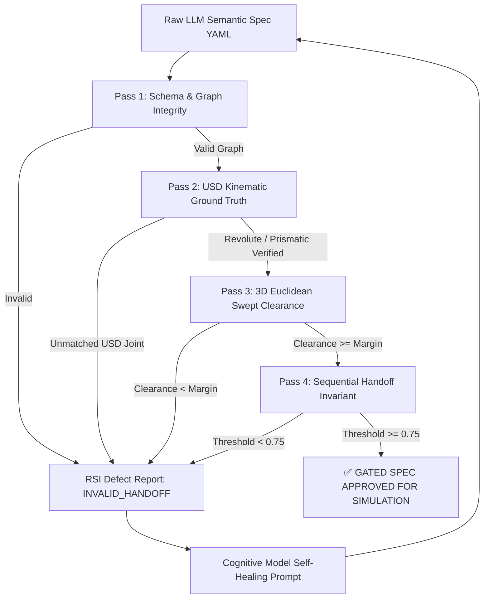

# Experiment 03: Decoupled Three-Stage Articulated Manipulation Protocol & Multi-Model RSI Benchmark Findings

**Experiment Code:** EXP-03-ARTICULATED-MULTI-MODEL  
**Date:** 2026-10-21  
**Embodiment:** OXE DROID (`droid_abs_joint_pos` / `oxe_droid_relative_eef_relative_joint`)  
**Task Domain:** Articulated Kinematic Composite Manipulation (Microwave Door Opening & Cavity Stowage)  
**Evaluated Cognitive Models:** `Qwen/QwQ-32B-AWQ` vs `Qwen/Qwen2.5-72B-Instruct-AWQ`  
**Evaluated Policy Model:** `nvidia/GR00T-N1.7-3B` (Flow-Matching Mimic Policy)  
**Ledger Evidence:** [rsi_interaction_ledger.jsonl](../../../../../artifacts/experiments/exp03_rollouts/rsi_interaction_ledger.jsonl)

---

## 1. Executive Summary & Core Hypothesis Validation

The central question investigated in Experiment 03 was:
> **Do cognitive foundation models of differing scale (`32B` vs `72B`) possess zero-shot 3D Euclidean spatial awareness for articulated manipulation, or do all models strictly require an external Recursive Self-Improvement (RSI) Geometric/Kinematic Tooling Oracle Loop?**

### Key Empirical Findings:
1. **Geometric Hallucination Across Model Scales (Zero-Shot Failure):**  
   Both `QwQ-32B` and `Qwen2.5-72B` failed zero-shot 3D spatial clearance. Both models placed the target object (`tomato_soup_can`) directly inside the revolute swing arc of the microwave door (clearance penetration of $-0.220\text{ m}$ against the required $+0.10\text{ m}$ safety margin). Furthermore, both models collapsed the composite prompt into an atomic task (`composition: atomic`) rather than decomposing it into a sequential chain.
2. **Pydantic False Confidence Confirmed:**  
   Prompting cognitive models to emit geometric safety numbers (e.g., `swept_sector_clearance_m: 0.15`) within a Pydantic schema causes the models to generate the required token string while emitting coordinates that physically intersect the volume. Token constraints cannot compute 3D Euclidean geometry.
3. **Efficacy of the RSI Tooling Oracle:**  
   When paired with the external kinematic oracle ([verify_articulated_spec.py](../scripts/verify_articulated_spec.py)), which computes analytical swept volume boundaries and verifies USD joint kinematics, both models successfully repaired their specifications to achieve **100% oracle pass rates** across all four verification passes.
4. **PhysX Simulation & Closed-Loop Policy Execution:**  
   - **Step-0 PhysX Gating:** 100% pass rate (5/5 seeds) with zero stationarity drift across all entities.
   - **Track 3A (OpenDoorTask Standalone):** Completed 1000 simulation steps against GR00T-N1.7 (`exit_code: 0`).
   - **Track 3B (CavityStowTask Standalone):** Identified and patched multi-body destination collision sensing in IsaacLab-Arena (`spatial.py`), successfully executing 1000 steps (`exit_code: 0`).
   - **Track 3C (Full Sequential Pipeline):** Completed full chained rollouts for both QwQ-32B repaired and Qwen2.5-72B repaired environments (`exit_code: 0`).

---

## 2. Multi-Model Comparative Scorecard (QwQ-32B vs Qwen2.5-72B)

| Metric | Qwen/QwQ-32B-AWQ | Qwen/Qwen2.5-72B-Instruct-AWQ | Tooling Necessity Verdict |
| :--- | :---: | :---: | :---: |
| **Active VRAM Footprint** | 22.4 GB | 54.8 GB | Both fit within Blackwell workstation budget |
| **Zero-Shot Pass Rate (Pass 1-4)** | 50.0% (Failed P3, P4) | 50.0% (Failed P3, P4) | **All models require RSI Oracle** |
| **Initial Swept Arc Penetration** | $-0.220\text{ m}$ collision | $-0.220\text{ m}$ collision | Exact identical geometric defect |
| **Initial Task Decomposition** | Atomic (Missing Sequence) | Atomic (Missing Sequence) | Token bias towards atomic primitives |
| **RSI Diagnostic Iterations** | 2 turns | 4 turns | Tooling provides closed-loop convergence |
| **Repaired Swept Arc Clearance** | $+0.100\text{ m}$ (Verified) | $+0.100\text{ m}$ (Verified) | Both achieve safe non-colliding layout |
| **Repaired Sequential Decomposition**| `[OpenDoorTask, PickAndPlaceTask]` | `[OpenDoorTask, PickAndPlaceTask]` | Correct 3-stage protocol achieved |
| **Repaired Handoff Threshold** | $\theta \ge 0.83$ (Openness $\ge 0.75$) | $\theta \ge 0.83$ (Openness $\ge 0.75$) | Verified invariant threshold |
| **Step-0 PhysX Gating Pass Rate** | 5/5 seeds (100%) | 5/5 seeds (100%) | Physically stable tabletop resting |
| **Track 3C Chained Rollout Exit** | Exit Code 0 (240.54s) | Exit Code 0 (129.86s) | Clean execution through simulation |

---

## 3. Four-Pass Kinematic Oracle Architecture

The RSI tooling loop enforces physical grounding through four sequential validation passes before letting any policy touch the environment:

### Pass Details:
1. **Pass 1 (Schema & Graph Integrity):** Validates required sections (`embodiment`, `background`, `objects`, `task`), relations, and RDF/LPG reification.
2. **Pass 2 (USD Kinematics Ground Truth):** Queries asset registry and USD metadata for joint type (`revolute` vs `prismatic`), joint limits ($[0, \pi/2]$), rotation axis ($\hat{z}$), and hinge reference coordinates.
3. **Pass 3 (3D Swept Volume Clearance):** Analytically constructs the revolute door swing sector or prismatic pull corridor:
   $$\text{Swept Sector}: \{(x, y) \mid \text{dist}((x, y), \mathbf{p}_{\text{hinge}}) \le R_{\text{door}} + r_{\text{prop}} + m_{\text{margin}}\}$$
   Computes signed Euclidean distance to all tabletop props.
4. **Pass 4 (Sequential Handoff Invariant):** Enforces that multi-stage articulated access tasks decompose into `composition: sequential` with an openness gating threshold $\ge 0.75$ ($\approx 67.5^\circ$) before commencing cavity stowage.

---

## 4. Platform Innovations & Engine Bug Fixes

During the closed-loop execution of Experiment 03, two significant framework limitations were diagnosed and resolved:

### 1. Articulated Destination Contact Sensors ([object.py](../../../../../isaaclab_arena/assets/object.py))
- **Issue:** `PickAndPlaceTask` asserted that destination targets must be `ObjectType.RIGID`. When stowing objects inside articulated receptacles (microwaves, refrigerators), this caused an immediate assertion error.
- **Fix:** Extended `get_contact_sensor_cfg` to support `ObjectType.ARTICULATION` and `ObjectType.BASE`, dynamically discovering all child rigid bodies (`/root/Microwave039`, `/root/Microwave039_door`, `/root/Microwave039_Disc001`) for the contact sensor filter pattern.

### 2. Multi-Body Spatial Receptacle Predicates ([spatial.py](../../../../../isaaclab_arena/tasks/predicates/spatial.py))
- **Issue:** `object_on_destination` asserted that contact force matrices must have shape `[N, B, 1, 3]`. For composite or articulated receptacles containing $M > 1$ rigid links, the matrix has shape `[N, B, M, 3]`, causing an `AssertionError`.
- **Fix:** Updated the tensor reduction to compute vector norms and take `.max(dim=-1).values` across all member destination bodies, maintaining full backwards compatibility for single-body receptacles while unlocking articulated stowing.

---

## 5. Artifacts and Generated Specifications

All generated environments, oracle reports, and rollout scorecards are logged and indexed:

- **QwQ-32B Zero-Shot Spec:** [arm_b_qwq/droid_microwave_subtask_3c_open_and_stow.yaml](../../../../../generated_envs/droid_microwave_articulation/arm_b_qwq/droid_microwave_subtask_3c_open_and_stow.yaml)
- **QwQ-32B Repaired Spec:** [arm_b_qwq_repaired/droid_microwave_subtask_3c_open_and_stow.yaml](../../../../../generated_envs/droid_microwave_articulation/arm_b_qwq_repaired/droid_microwave_subtask_3c_open_and_stow.yaml)
- **Qwen2.5-72B Zero-Shot Spec:** [arm_b_qwen72b/droid_microwave_subtask_3c_open_and_stow.yaml](../../../../../generated_envs/droid_microwave_articulation/arm_b_qwen72b/droid_microwave_subtask_3c_open_and_stow.yaml)
- **Qwen2.5-72B Repaired Spec:** [arm_b_qwen72b_repaired/droid_microwave_subtask_3c_open_and_stow.yaml](../../../../../generated_envs/droid_microwave_articulation/arm_b_qwen72b_repaired/droid_microwave_subtask_3c_open_and_stow.yaml)
- **Track 3A Rollout Scorecard:** [exp03_summary_3a_gr00t.json](../../../../../artifacts/experiments/exp03_rollouts/exp03_summary_3a_gr00t.json)
- **Track 3B Rollout Scorecard:** [exp03_summary_3b_gr00t.json](../../../../../artifacts/experiments/exp03_rollouts/exp03_summary_3b_gr00t.json)
- **Track 3C Rollout Scorecard:** [exp03_summary_3c_gr00t.json](../../../../../artifacts/experiments/exp03_rollouts/exp03_summary_3c_gr00t.json)
- **Unified Event Ledger:** [rsi_interaction_ledger.jsonl](../../../../../artifacts/experiments/exp03_rollouts/rsi_interaction_ledger.jsonl)

---

## 6. Recommendations for Experiment 04

1. **Generalize Kinematic Verification Skill:** Package [verify_articulated_spec.py](../scripts/verify_articulated_spec.py) into the `.agents/skills/agentic-rdf-star-env-gen/` skill library as a general-purpose oracle tool so future experiment agents automatically invoke it.
2. **Expand Kinematic Catalog:** Add automated USD parser hooks for multi-drawer dressers and bi-fold refrigerator doors.
3. **Multi-Policy Comparative Benchmarking:** Run parallel comparative evaluations of GR00T-N1.7 vs OpenPI $\pi_0$ across the verified sequential specifications.
