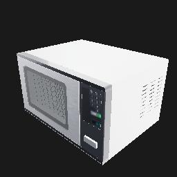
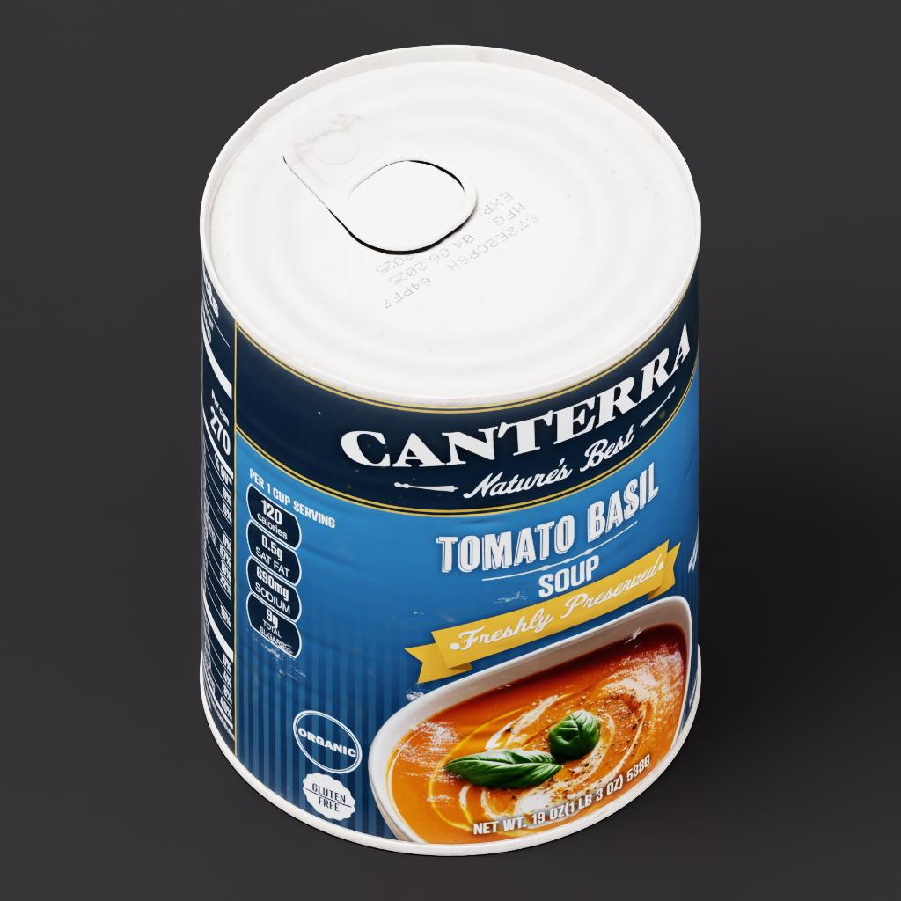
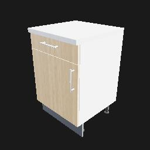
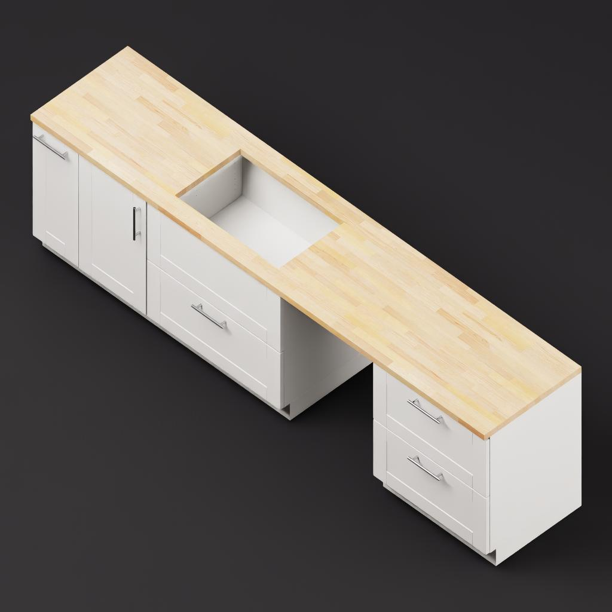
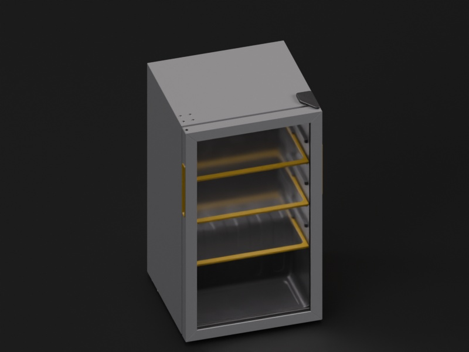
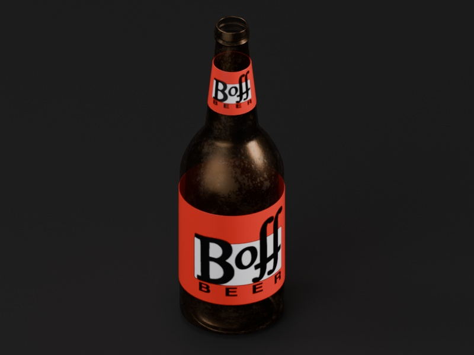
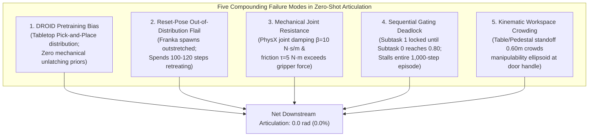
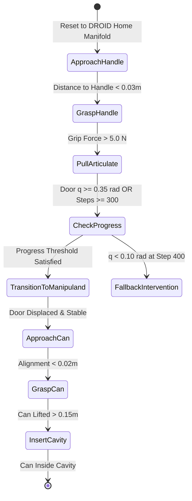
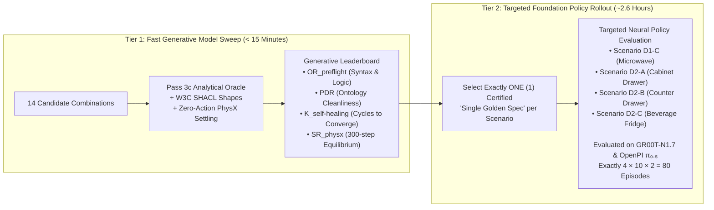

# Experiment 05: Closed-Loop VLA Articulation Grounding, OpenPI π₀.₅ Remediation & Scaled Cognitive Scene Decomposition Benchmarks

**Document Version:** 1.2.0  
**Date:** 2026-10-25  
**Status:** Approved for Implementation & Scaffolding  
**Authors / Researchers:** Antigravity & Renan  
**Target Architecture:** Dual-Blackwell Workstation (NVIDIA RTX PRO 6000 Blackwell 96 GB + NVIDIA GeForce RTX 5090 32 GB)  
**Governing Agent Skill:** [`arena-local-inference-experiments`](../../../../.agent/skills/arena-local-inference-experiments/SKILL.md)  
**Parent Specifications:**
- [`exp03_rollback_recovery_plan.md`](../exp03_rollback_recovery_plan.md) (Grounding & Pedestal Clearance Baseline)
- [`experiment_03.md`](./experiment_03.md) (Articulated Kinematics & Self-Healing Gating Review Matrix)
- [`.agents/references/agentic_env_generation/causality_notes.md`](../../agentic_env_generation/causality_notes.md) (Bayesian Semantic Reification Paradigm)
- [`.agents/references/agentic_env_generation/graph_topology_and_rdf_star_proof.md`](../../agentic_env_generation/graph_topology_and_rdf_star_proof.md) (Deterministic D-DAG Proof)
- [`.agents/references/agentic_env_generation/rdf_star_lpg_provo_plan.md`](../../agentic_env_generation/rdf_star_lpg_provo_plan.md) (Dual-Plane Semantic & Property Graph Architecture)

---

## Table of Contents

- [1. Executive Summary & Core Theoretical Principle](#1-executive-summary--core-theoretical-principle)
  - [1.1 The Critical Architectural Insight: Microwave vs. Drawer Ontological Split](#11-the-critical-architectural-insight-microwave-vs-drawer-ontological-split)
  - [1.2 Autonomous Self-Healing Loops with Dual Knowledge Graphs](#12-recursive-self-improvement-self-healing-with-dual-knowledge-graphs)
- [2. Finite Relational Graph Grammar & Dual-Ontology Specifications](#2-finite-relational-graph-grammar--dual-ontology-specifications)
  - [2.1 Formal Ontological Comparison: Microwave vs. Drawer](#21-formal-ontological-comparison-microwave-vs-drawer)
  - [2.2 RDF-star Representation](#22-rdf-star-representation)
  - [2.3 Neo4j Labeled Property Graph (LPG) Cypher Patterns](#23-neo4j-labeled-property-graph-lpg-cypher-patterns)
- [3. Mathematical Formulation of Motion Clearance Manifolds](#3-mathematical-formulation-of-motion-clearance-manifolds)
  - [3.1 Revolute Hinge Swept Volume ($\mathcal{V}_{	ext{revolute}}$) — Placed Articulated Prop](#31-revolute-hinge-swept-volume-mathcalv_textrevolute--placed-articulated-prop)
  - [3.2 Prismatic Linear Motion Stroke Corridor ($\mathcal{V}_{	ext{prismatic}}$) — Intrinsic Fixture Sub-Prim](#32-prismatic-linear-motion-stroke-corridor-mathcalv_textprismatic--intrinsic-fixture-sub-prim)
- [4. Software Architecture: Deterministic Motion Clearance Engine (`Pass 3c`)](#4-software-architecture-deterministic-motion-clearance-engine-pass-3c)
- [5. Autonomous Self-Healing Loops Architecture & Empirical Evaluation Methodology](#5-recursive-self-improvement-self-healing-architecture--empirical-evaluation-methodology)
  - [5.1 Theoretical Foundation: Bi-Level Harness Optimization](#51-theoretical-foundation-bi-level-harness-optimization)
  - [5.2 Four Empirical Criteria to Evaluate Genuine Self-Improvement](#52-four-empirical-criteria-to-evaluate-genuine-self-improvement)
  - [5.3 W3C SHACL Constraint Invariants](#53-w3c-shacl-constraint-invariants)
  - [5.4 The Ignition Test for Evolved Agent Harnesses](#54-the-ignition-test-for-evolved-agent-harnesses)
  - [5.5 The Orchestrator Architecture, Ternary Gating Logic & Epistemic Resolution Loop](#55-the-orchestrator-architecture-ternary-gating-logic--epistemic-resolution-loop)
- [🏁 Benchmark Suite: Multi-Domain Robotics Scenarios & Empirical Evaluation](#benchmark-suite-multi-domain-robotics-scenarios--empirical-evaluation)
  - [6. Multi-Domain Benchmark Scenario Catalog & Navigation Matrix](#6-multi-domain-benchmark-scenario-catalog--navigation-matrix)
  - [7. Benchmark Scenario D1-C: Sequential Microwave Open & Stow (Type A: Placed Prop)](#7-benchmark-scenario-d1-c-sequential-microwave-open--stow-type-a-placed-prop)
    - [7.1 Scenario Overview & Ontological Classification](#71-scenario-overview--ontological-classification)
    - [7.2 Verified Scene Asset Manifest & Visual Grounding](#72-verified-scene-asset-manifest--visual-grounding)
    - [7.3 Natural Language Scenario Prompt](#73-natural-language-scenario-prompt)
    - [7.4 Autonomous `/goal` Execution Prompt](#74-autonomous-goal-execution-prompt)
    - [7.5 Robust Validation Methodology & Acceptance Gate](#75-robust-validation-methodology--acceptance-gate)
  - [8. Benchmark Scenario D2-A: Prismatic Kitchen Base Cabinet Drawer Stow (Type B: Intrinsic Sub-Prim)](#8-benchmark-scenario-d2-a-prismatic-kitchen-base-cabinet-drawer-stow-type-b-intrinsic-sub-prim)
    - [8.1 Scenario Overview & Ontological Classification](#81-scenario-overview--ontological-classification)
    - [8.2 Verified Scene Asset Manifest & Visual Grounding](#82-verified-scene-asset-manifest--visual-grounding)
    - [8.3 Natural Language Scenario Prompt](#83-natural-language-scenario-prompt)
    - [8.4 Autonomous `/goal` Execution Prompt](#84-autonomous-goal-execution-prompt)
    - [8.5 Robust Validation Methodology & Acceptance Gate](#85-robust-validation-methodology--acceptance-gate)
  - [9. Benchmark Scenario D2-B: Sequential Counter Drawer Open, Stow & Close (Type B: Intrinsic Reversible Prismatic)](#9-benchmark-scenario-d2-b-sequential-counter-drawer-open-stow--close-type-b-intrinsic-reversible-prismatic)
    - [9.1 Scenario Overview & Ontological Classification](#91-scenario-overview--ontological-classification)
    - [9.2 Verified Scene Asset Manifest & Visual Grounding](#92-verified-scene-asset-manifest--visual-grounding)
    - [9.3 Natural Language Scenario Prompt](#93-natural-language-scenario-prompt)
    - [9.4 Autonomous `/goal` Execution Prompt](#94-autonomous-goal-execution-prompt)
    - [9.5 Robust Validation Methodology & Acceptance Gate](#95-robust-validation-methodology--acceptance-gate)
  - [10. Benchmark Scenario D2-C: Commercial Beverage Display Refrigerator Door Open & Beer Stow (Type B: Intrinsic Revolute Sub-Prim)](#10-benchmark-scenario-d2-c-commercial-beverage-display-refrigerator-door-open--beer-stow-type-b-intrinsic-revolute-sub-prim)
    - [10.1 Scenario Overview & Ontological Classification](#101-scenario-overview--ontological-classification)
    - [10.2 Verified Scene Asset Manifest & Visual Grounding](#102-verified-scene-asset-manifest--visual-grounding)
    - [10.3 Natural Language Scenario Prompt](#103-natural-language-scenario-prompt)
    - [10.4 Autonomous `/goal` Execution Prompt](#104-autonomous-goal-execution-prompt)
    - [10.5 Robust Validation Methodology & Acceptance Gate](#105-robust-validation-methodology--acceptance-gate)
  - [11. Head-to-Head Neural Policy Evaluation Protocol](#11-head-to-head-neural-policy-evaluation-protocol)
    - [11.1 Policy Specifications](#111-policy-specifications)
    - [11.2 Evaluation Metrics & Scorecard](#112-evaluation-metrics--scorecard)
  - [12. Systematic Multi-Model Reasoning Sweep & Evaluation Matrix (Protocol §23)](#12-systematic-multi-model-reasoning-sweep--evaluation-matrix-protocol-23)
    - [12.1 Master Model Zoo & Workstation Deployment Specifications](#121-master-model-zoo--workstation-deployment-specifications)
    - [12.2 Evaluation Metrics & Performance Scoring Rubric](#122-evaluation-metrics--performance-scoring-rubric)
    - [12.3 Candidate Model Combinations & End-to-End Evaluation Pipelines](#123-candidate-model-combinations--end-to-end-evaluation-pipelines)
    - [12.4 Empirical Performance Matrix Across Benchmark Groups (Tier 1 Cognitive Sweep)](#124-empirical-performance-matrix-across-benchmark-groups-tier-1-cognitive-sweep)
    - [12.5 Targeted Foundation Policy Benchmark on the "Single Golden Spec" (Tier 2 Neural Rollouts)](#125-targeted-foundation-policy-benchmark-on-the-single-golden-spec-tier-2-neural-rollouts)
    - [12.6 Illustrative Reference Scorecard & Scoring Walkthrough](#126-illustrative-reference-scorecard--scoring-walkthrough)
    - [12.7 Benchmark Execution Runtime Budget & Workstation Concurrency Architecture](#127-benchmark-execution-runtime-budget--workstation-concurrency-architecture)
- [13. Multi-Stage Execution Roadmap](#13-multi-stage-execution-roadmap)
- [14. Strict Boundaries & Invariants](#14-strict-boundaries--invariants)
- [15. OpenPI π₀.₅ Articulation Remediation Architecture & Dynamic Contact Physics](#15-openpi-π₀₅-articulation-remediation-architecture--dynamic-contact-physics)
  - [15.1 Architectural Diagnosis: Five Compounding Root Causes of Articulation Failure](#151-architectural-diagnosis-five-compounding-root-causes-of-articulation-failure)
  - [15.2 Step 1: Franka Panda DROID Home-Manifold Initialization (`PolicyHomeManifoldOracle`)](#152-step-1-franka-panda-droid-home-manifold-initialization-policyhomemanifoldoracle)
  - [15.3 Step 2: Mechanical Handle Affordance & Contact Physics Gearing](#153-step-2-mechanical-handle-affordance--contact-physics-gearing)
  - [15.4 Step 3: Hierarchical State Machine & Gating Deadlock Remediation](#154-step-3-hierarchical-state-machine--gating-deadlock-remediation)
  - [15.5 Step 4: Scenario D1-C Standoff & Manipulability Optimization](#155-step-4-scenario-d1-c-standoff--manipulability-optimization)
  - [15.6 Live OpenPI π₀.₅ Validation Protocol & Empirical Acceptance Gate](#156-live-openpi-π₀₅-validation-protocol--empirical-acceptance-gate)
- [16. Retrospective & Empirical Post-Mortem: Decoupling Generative Benchmarks from Downstream Policy Rollouts](#16-retrospective--empirical-post-mortem-decoupling-generative-benchmarks-from-downstream-policy-rollouts)
  - [16.1 The Combinatorial Cartesian Explosion Anti-Pattern](#161-the-combinatorial-cartesian-explosion-anti-pattern)
  - [16.2 The Two-Tier Decoupled Evaluation Mandate](#162-the-two-tier-decoupled-evaluation-mandate)
  - [16.3 Scientific Ledger & Publication Invariants](#163-scientific-ledger--publication-invariants)

---

## 1. Executive Summary & Core Theoretical Principle

In robotic workcell assembly, objects cannot occupy arbitrary continuous coordinates in free space. The physical world is governed by a **finite set of admissible spatial relationships** defined on a structured topological graph:
$$\mathcal{G} = (\mathcal{V}_{\text{entities}}, \mathcal{E}_{\text{relations}}, \mathcal{M}_{\text{manifolds}})$$

When an articulated asset is introduced into a scene, it changes the topological properties of the environment by carving out a **time-varying 3D dynamic swept exclusion volume**:
$$\mathcal{V}_{\text{motion}}(t) = \bigcup_{q \in [q_{\min}, q_{\max}]} \mathbf{T}_{\text{joint}}(q) \cdot \mathcal{B}_{\text{link}}$$

### 1.1 The Critical Architectural Insight: Microwave vs. Drawer Ontological Split

The core design principle uniting this experiment is that **articulated entities are not ontologically uniform**. As verified in the [NVIDIA SimReady Central OpenUSD Asset Catalog](https://huggingface.co/blog/nvidia/simready-central-assets-robotics-ai-factories), robotic environments feature two fundamentally distinct classes of articulation:

```
                                  ┌───────────────────────────────┐
                                  │   Articulated Scene Entity    │
                                  └───────────────┬───────────────┘
                                                  │
                 ┌────────────────────────────────┴────────────────────────────────┐
                 ▼                                                                 ▼
   ┌───────────────────────────────┐                               ┌───────────────────────────────┐
   │    Type A: Articulated Prop   │                               │ Type B: Intrinsic Sub-Prim    │
   │      (e.g., Microwave)        │                               │       (e.g., Drawer)          │
   ├───────────────────────────────┤                               ├───────────────────────────────┤
   │ • Standalone RigidObject      │                               │ • Built-in USDPrim Component  │
   │ • MUST be placed on a fixture │                               │ • Part of grounded Fixture    │
   │ • External support dependency │                               │ • Direct kinematic subtree    │
   │ • Motion sweeps OVER deck     │                               │ • Motion strokes INTO room    │
   │ • Swept sector partitions     │                               │ • Clearance against pedestal  │
   │   fixture surface sectors     │                               │   and room approach corridor  │
   └───────────────────────────────┘                               └───────────────────────────────┘
```

1. **Type A: Placed Articulated Prop (`microwave`)**:
   - In physical reality, a microwave is a portable tabletop appliance. It cannot stand in mid-air and does not rest directly on the floor. It must be placed *on top of* an existing grounded fixture (such as an `office_table`).
   - Its 3D base transform is dependent on the fixture's deck: $\mathbf{T}_{\text{microwave}} = \mathbf{T}_{\text{table}} \cdot \mathbf{T}_{\text{surface\_rel}}$.
   - Its revolute door hinge swings **across the table deck**. Any manipuland staged on that table must be placed on an admissible surface sector that leaves certified clearance ($\ge 0.15\text{ m}$) from the circular swept door arc.
2. **Type B: Intrinsic Fixture-Integrated Articulation (`drawer`)**:
   - A drawer is **not** an independent object placed on a table. It is an **intrinsic sub-prim (`USDPrim`)** integrated inside a grounded piece of furniture (such as an `office_desk` or `kitchen_counter`).
   - The desk itself rests directly on the floor ($Z_{\text{base}} = 0.0\text{ m}$).
   - The drawer's prismatic joint translates along a linear slide vector $\hat{\mathbf{u}}_{\text{slide}}$ **outward into the open room corridor / robot approach zone**.
   - Attempting to place a drawer on top of a table is a fatal **Category Mismatch Defect**.
   - The drawer's motion clearance manifold does not conflict with the table deck; rather, it extends outward where the robot pedestal stands. The clearance verification must guarantee that $\mathcal{V}_{\text{prismatic}} \cap \mathcal{B}_{\text{robot\_pedestal}} = \emptyset$ while preserving inverse-kinematics reachability to both the drawer handle and any staged manipulands.

### 1.2 Autonomous Self-Healing Loops with Dual Knowledge Graphs

Experiment 05 develops and validates the cognitive agent's ability to **autonomously recognize, differentiate, and self-heal** these two topological classes using:
- **RDF-star ($\text{RDF}^*$) & W3C SHACL**: Enforces strict semantic type invariants, preventing category confusion (e.g., rejecting attempts to treat an intrinsic drawer as a placed prop) and validating reified spatial constraints.
- **Neo4j Labeled Property Graph (LPG)**: Performs fast graph traversals, topological pattern matching, and episodic memory retrieval across prior successful/failed scenes.
- **Deterministic Software Motion Clearance Engine (`Pass 3c`)**: Computes analytical 2D/3D swept envelopes (revolute arcs and prismatic slide corridors) in pure Python *before* simulation launch, eliminating physics crashes and manipuland collisions at step 0.

---

## 2. Finite Relational Graph Grammar & Dual-Ontology Specifications

Scene topology in IsaacLab-Arena is strictly discrete and finite. Relationships are formal OWL/RDF-star object properties governed by W3C SHACL shape constraints:

### 2.1 Formal Ontological Comparison: Microwave vs. Drawer

| Ontological Dimension | Type A: Placed Articulated Prop (`microwave`) | Type B: Intrinsic Fixture Sub-Prim (`drawer`) |
| :--- | :--- | :--- |
| **RDF Class Hierarchy** | `arena:RigidObject`, `arena:ArticulatedProp` | `arena:USDPrim`, `arena:ArticulatedSubPrim` |
| **Parent Entity** | `arena:Fixture` (via `arena:placedOn` / `arena:placedOnSubSurface`) | `arena:Fixture` (via `arena:hasSubPrim`) |
| **Floor Grounding ($Z=0$)** | Indirect (grounded through supporting table/counter) | Direct (parent fixture rests on floor at $Z_{\text{base}} = 0.0\text{ m}$) |
| **Kinematic Frame** | Local origin relative to table surface sector | USD prim transform relative to fixture origin |
| **Joint Type** | Revolute hinge ($\theta \in [0^\circ, 90^\circ]$) | Prismatic slide ($s \in [0, L_{\text{stroke}}]$) |
| **Motion Sweep Direction** | Rotates horizontally across the table deck plane | Translates linearly outward into the room workspace |
| **Collision Threat** | Manipulands staged on the same table deck | Robot pedestal, approaching limbs, or floor-staged items |
| **Manipuland Invariant** | Staged in disjoint table sector (e.g. `front_left`) | Staged on desk top or stowed via `placedInside` cavity |
| **SHACL Enforcement** | Must have supporting fixture; door arc clear of props | FORBIDDEN from having `placedOn`; pedestal clear of stroke |

---

### 2.2 RDF-star ($\text{RDF}^*$) Representation

#### 2.2.1 Type A: Placed Articulated Prop (`microwave` on `office_table`)

```turtle
@prefix arena: <https://isaac-sim.github.io/arena/schema#> .
@prefix xsd:   <http://www.w3.org/2001/XMLSchema#> .

# Grounded Parent Fixture
:office_table a arena:Fixture, arena:Furniture ;
    arena:usdAsset "assets/office_table.usd" ;
    arena:isGrounded "true"^^xsd:boolean ;
    arena:groundZ "0.0"^^xsd:float ;
    arena:deckHeight "0.531"^^xsd:float ;
    arena:hasSubSurface :sector_front_left, :sector_front_right, :sector_back_right .

# Placed Articulated Prop
:microwave a arena:RigidObject, arena:ArticulatedProp ;
    arena:usdAsset "assets/Microwave039.usd" ;
    arena:jointType "revolute" ;
    arena:revoluteAxis "0.0 0.0 1.0" ;
    arena:revoluteSweepAngle "90.0"^^xsd:float ;
    arena:doorRadius "0.35"^^xsd:float .

# Reified Placement Relation with Surface Sector Binding
<< :r_micro | :microwave arena:placedOn :office_table >>
    arena:surfaceSector :sector_back_right ;
    arena:nominalZ "0.531"^^xsd:float ;
    arena:yawAngle "-90.0"^^xsd:float ;
    arena:sweptExclusionZone :sector_front_right .

# Staged Manipuland (Placed in Admissible Disjoint Sector)
:tomato_soup_can a arena:RigidObject, arena:Manipuland ;
    arena:usdAsset "assets/tomato_soup_can.usd" .

<< :r_soup | :tomato_soup_can arena:placedOn :office_table >>
    arena:surfaceSector :sector_front_left ;
    arena:nominalZ "0.531"^^xsd:float ;
    arena:motionClearanceMargin "0.18"^^xsd:float ;
    arena:isMotionAdmissible "true"^^xsd:boolean .
```

#### 2.2.2 Type B: Intrinsic Fixture Sub-Prim (`drawer` inside `office_desk`)

```turtle
@prefix arena: <https://isaac-sim.github.io/arena/schema#> .
@prefix xsd:   <http://www.w3.org/2001/XMLSchema#> .

# Grounded Fixture with Intrinsic Articulated Sub-Prim
:office_desk a arena:Fixture, arena:Furniture ;
    arena:usdAsset "assets/office_desk.usd" ;
    arena:isGrounded "true"^^xsd:boolean ;
    arena:groundZ "0.0"^^xsd:float ;
    arena:deckHeight "0.740"^^xsd:float ;
    arena:hasSubPrim :drawer_cabinet_prim ;
    arena:hasSubSurface :desk_top_deck .

# Intrinsic Sub-Prim (NOT placed; part of fixture kinematics)
:drawer_cabinet_prim a arena:USDPrim, arena:ArticulatedSubPrim ;
    arena:primPath "/World/office_desk/Cabinet_B_02" ;
    arena:jointType "prismatic" ;
    arena:slideAxis "1.0 0.0 0.0" ;
    arena:strokeLength "0.30"^^xsd:float ;
    arena:isIntrinsicComponent "true"^^xsd:boolean ;
    arena:cavityDimensions "0.35 0.28 0.12" .

# Manipuland Stowed Inside Cavity
:wooden_block a arena:RigidObject, arena:Manipuland ;
    arena:usdAsset "assets/wooden_block.usd" .

<< :r_block_stow | :wooden_block arena:placedInside :drawer_cabinet_prim >>
    arena:isContained "true"^^xsd:boolean ;
    arena:relativeOffset "0.0 0.0 0.05" .

# Robot Standoff Clearance from Prismatic Stroke Corridor
:franka_robot a arena:Embodiment ;
    arena:pedestalFootprint "0.40 0.40" .

<< :r_robot_stand | :franka_robot arena:standsNear :office_desk >>
    arena:standoffDistance "0.85"^^xsd:float ;
    arena:corridorClearance "0.12"^^xsd:float ;
    arena:intersectsStrokeCorridor "false"^^xsd:boolean .
```

---

### 2.3 Neo4j Labeled Property Graph (LPG) Cypher Patterns

#### Query 1: Introspect Articulation Topology (Distinguishing Prop vs. Intrinsic)
```cypher
MATCH (target:SceneEntity {id: $target_id})
OPTIONAL MATCH (parent:Fixture)-[:HAS_SUB_PRIM]->(target)
OPTIONAL MATCH (target)-[p:PLACED_ON]->(support:Fixture)
RETURN target.id AS entity_id,
       target.joint_type AS joint_type,
       CASE 
         WHEN parent IS NOT NULL THEN 'INTRINSIC_SUB_PRIM'
         WHEN p IS NOT NULL OR target:ArticulatedProp THEN 'PLACED_ARTICULATED_PROP'
         ELSE 'UNKNOWN'
       END AS articulation_class,
       parent.id AS parent_fixture,
       support.id AS supporting_fixture;
```

#### Query 2: Find Admissible Staging Sectors on a Fixture Supporting a Placed Prop
```cypher
MATCH (table:Fixture {id: 'office_table'})-[:HAS_SECTOR]->(s:SurfaceSector)
MATCH (m:ArticulatedProp)-[r:PLACED_ON]->(table)
WHERE NOT (s)-[:INTERSECTS_MOTION_SWEEP]->(m)
  AND NOT (:RigidObject)-[:PLACED_ON]->(s)
RETURN s.sector_name AS admissible_sector,
       s.center_x AS cx,
       s.center_y AS cy,
       s.deck_z AS cz;
```

---

## 3. Mathematical Formulation of Motion Clearance Manifolds

### 3.1 Revolute Hinge Swept Volume ($\mathcal{V}_{\text{revolute}}$) — Placed Articulated Prop

For an articulated prop (e.g. microwave) placed on a table surface at world pose $\mathbf{T}_{\text{placed}} = [\mathbf{R}_{\text{base}}, \mathbf{p}_{\text{base}}]$:
The door rotates about local hinge axis $\mathbf{a}_{\text{local}} = [0, 0, 1]^T$ anchored at pivot $p_{\text{pivot}}$ through joint angle $\theta \in [\theta_{\min}, \theta_{\max}]$:

$$\mathcal{S}_{\text{arc}}(\theta) = \left\{ \mathbf{T}_{\text{placed}} \cdot \left( p_{\text{pivot}} + \mathbf{R}(\mathbf{a}, \theta) \cdot (p - p_{\text{pivot}}) \right) \;\middle|\; p \in \mathcal{B}_{\text{door\_mesh}} \right\}$$

The 2D projected swept polygon on the horizontal table deck is an annular wedge:
$$\mathcal{W}_{\text{revolute}} = \left\{ (r \cos \phi, r \sin \phi) \;\middle|\; r \in [R_{\min}, R_{\max}], \; \phi \in [\phi_{\text{start}}, \phi_{\text{end}}] \right\}$$

**Table Surface Partitioning Invariant**:
Let the table deck be partitioned into finite discrete surface sectors $\mathcal{S} = \{S_{\text{front\_left}}, S_{\text{front\_right}}, S_{\text{back\_left}}, S_{\text{back\_right}}\}$.
$$\text{Admissible}(S_i) = \begin{cases} 
\text{False} & \text{if } \text{Polygon}(S_i) \cap \text{Buffer}(\mathcal{W}_{\text{revolute}}, \delta_{\text{margin}}) \neq \emptyset \\
\text{True} & \text{otherwise}
\end{cases}$$
Where $\delta_{\text{margin}} = 0.10\text{ m}$. For the microwave placed in $S_{\text{back\_right}}$ with door opening towards $-X$, $S_{\text{front\_right}}$ is **strictly forbidden**, while $S_{\text{front\_left}}$ is **certified admissible**.

---

### 3.2 Prismatic Linear Motion Stroke Corridor ($\mathcal{V}_{\text{prismatic}}$) — Intrinsic Fixture Sub-Prim

For an intrinsic sliding link (e.g. desk drawer) translating along unit slide vector $\hat{\mathbf{u}}_{\text{slide}}$ in fixture frame with stroke length $L_{\text{stroke}}$:

$$\mathcal{V}_{\text{prismatic}} = \left\{ \mathbf{T}_{\text{fixture}} \cdot \left( p + s \cdot \hat{\mathbf{u}}_{\text{slide}} \right) \;\middle|\; p \in \mathcal{B}_{\text{drawer\_mesh}}, \; s \in [0, L_{\text{stroke}}] \right\}$$

This forms an oriented 3D bounding box prism extending directly **outward into the open room corridor**:
$$\mathcal{V}_{\text{prismatic}} = \text{OBB}\left(p_{\text{center}} + \frac{L_{\text{stroke}}}{2} \hat{\mathbf{u}}_{\text{slide}}, \; [W_{\text{drawer}}, D_{\text{drawer}} + L_{\text{stroke}}, H_{\text{drawer}}]\right)$$

**Workspace Clearance Invariants**:
1. **Robot Pedestal Exclusion**:
   $$\text{SAT\_Clearance}\left(\text{Footprint}_{\text{robot\_pedestal}}, \; \mathcal{V}_{\text{prismatic}}^{2D}\right) \ge 0.05\text{ m}$$
2. **Floor & Staging Object Clearance**:
   For every non-stowed manipuland $O$ staged outside the drawer:
   $$\text{dist}\left(\mathcal{B}(O), \; \mathcal{V}_{\text{prismatic}}\right) \ge 0.10\text{ m}$$
3. **Internal Cavity Containment**:
   For any manipuland $O$ designated as `placedInside`:
   $$\mathcal{B}(O) \subset \text{InteriorCavity}(\text{drawer\_prim}) \quad \land \quad \text{Volume}(O) \le 0.40 \cdot \text{Volume}(\text{Cavity})$$

---

## 4. Software Architecture: Deterministic Motion Clearance Engine (`Pass 3c`)

The motion clearance engine is implemented as a deterministic Python/Shapely module running in pure Python prior to simulation launch:

```
isaaclab_arena/relations/
├── motion_clearance_engine.py      # Core analytical swept volume and sector clearance solver
├── spatial_factor_graph.py         # Multi-object relational factor graph solver
└── tests/
    └── test_motion_clearance.py     # Unit test suite for revolute and prismatic clearance
```

---

## 5. Autonomous Self-Healing Loops Architecture & Empirical Evaluation Methodology

### 5.1 Theoretical Foundation: Bi-Level Harness Optimization

Experiment 05 formally grounds its autonomous self-healing loops evaluation in the bi-level optimization framework established by **Srikanth et al., *"Self-improvement of AI research agents"*, Weco AI (arXiv:2609.26457v1, Sept 2026)**.

In our robotics environment generation domain, Self-healing operates at the **harness and graph-reasoning layer**, structured as two coupled loops:

```
┌────────────────────────────────────────────────────────────────────────────────────────┐
│                          OUTER LOOP: Meta-Harness Optimization                         │
│  Evaluates agent candidates a_k on private held-out test splits:                       │
│  g(a) = (1/T) ∑_{t=1}^T r_t^priv(x̂_t)                                                  │
│  Updates cognitive prompts, SHACL shapes, and graph-RAG memory: a_k = a^out(a_{<k}, g) │
└───────────────────────────────────────────┬────────────────────────────────────────────┘
                                            │ Deploys Inner Agent a_k
                                            ▼
┌────────────────────────────────────────────────────────────────────────────────────────┐
│                      INNER LOOP: Spatial Relational Synthesis & Repair                 │
│  Given task prompt t, candidate environment spec x_0:                                  │
│  x_i = a_k(x_{<i}, r_t^pub(x_{<i}))  subject to budget b_t (max 3 repair turns)       │
│  Public Signal r_t^pub: Pass 1-3c boolean oracle, SHACL validation report              │
└────────────────────────────────────────────────────────────────────────────────────────┘
```

1. **Inner Loop (Environment Synthesis & Local Repair)**:
   Given a natural language scenario prompt and an initial candidate specification $x_0$, the inner-loop agent $a$ proposes iterative refinements:
   $$x_i = a\left(x_{<i}, \; r_t^{\text{pub}}(x_{<i})\right) \tag{1}$$
   under a strictly fixed evaluation budget $b_t$ (maximum 3 LLM reflection turns and 300 PhysX settling steps). The inner-loop agent observes only the **public diagnostic signal** $r_t^{\text{pub}}$ (e.g. Pass 1-3c boolean oracle outputs, sector admissibility masks, and SHACL constraint reports).
2. **Outer Loop (Meta-Level Agent Evolution & Memory Consolidation)**:
   The outer loop grades the inner-loop agent by evaluating the returned candidate $\hat{x}_t$ on **private held-out test splits** using scoring function $g(a)$:
   $$g(a) = \frac{1}{T} \sum_{t=1}^T r_t^{\text{priv}}(\hat{x}_t) \tag{2}$$
   At step $k$, the outer-loop supervisor updates the agent's prompts, few-shot in-context exemplars, and Neo4j episodic graph memory:
   $$a_k = a^{\text{out}}\left(a_{<k}, \; g(a_{<k})\right) \tag{3}$$

---

### 5.2 Four Empirical Criteria to Evaluate Genuine Self-Improvement

To scientifically verify whether the agent is achieving **genuine autonomous self-healing** rather than benefiting from noise, extra compute, or reward hacking, Experiment 05 enforces four rigorous criteria adapted from Srikanth et al. (2026):

#### Criterion 1: Fixed Compute and Evaluation Budget ($b_t$)
Every candidate spec proposal and repair attempt is strictly constrained:
- **Maximum Reflection Turns**: $\le 3$ inner repair iterations per scenario.
- **Maximum Inference Tokens**: 4,096 tokens per spec synthesis pass.
- **Simulation Budget**: 300 PhysX steps for zero-action settling ($6.0\text{ s}$ sim time).
- **Policy Evaluation Budget**: Exactly 10 seeds $\times$ 1,000 steps ($20.0\text{ s}$ horizon).
*Invariant*: An improvement is only valid if $g(a_{k}) > g(a_{k-1})$ under an identical budget $b_t$. Improvements achieved by spending more tokens or generating more samples are disqualified.

#### Criterion 2: Public vs. Private Held-Out Validation Split ($r_t^{\text{pub}}$ vs. $r_t^{\text{priv}}$)
To prevent overfitting to the local oracle, the agent is evaluated on two separate tiers:
- **Public Signal ($r_t^{\text{pub}}$)**: The inner agent only sees deterministic compiler signals: SHACL validation messages, geometric bounding-box overlap flags, and sector clearance warnings.
- **Private Held-Out Signal ($r_t^{\text{priv}}$)**: The outer evaluation grade $g(a)$ evaluates the scene under hidden test conditions the agent never observed during synthesis:
  1. *Physical Perturbations*: Surface friction $\mu \in [0.4, 0.8]$ randomized across 10 evaluation seeds; object mass perturbed by $\pm 15\%$.
  2. *Unseen Spawn Jitter*: Random coordinate jitter ($\delta \in [-0.02, +0.02]\text{ m}$) within the certified sector.
  3. *Unobserved Obstacle Offsets*: Background furniture placement shifted by unannounced $\pm 0.05\text{ m}$.
  4. *Blind Neural Policy Evaluation*: 10 unseen rollout seeds evaluated with GR00T-N1.7 and OpenPI $\pi_{0.5}$.

#### Criterion 3: First-Order vs. Second-Order Generalization (Transfer Beyond Selection)
We measure generalization across two distinct tiers:
- **First-Order Generalization (Selection Benchmark)**: Improvement on the core selection tasks: Scenario `D1-C` (Microwave Revolute Prop) and Scenario `D2-A` (Kitchen Base Cabinet Prismatic Drawer).
- **Second-Order Generalization (Held-Out Benchmark)**: Testing whether the learned graph reasoning and clearance rules transfer zero-shot to:
  1. *Held-Out Tasks*: Scenario `D2-B` (Sequential Counter Drawer Open, Stow & Close with motion reversal) and Scenario `D2-C` (Dual counter-rotating cabinet doors).
  2. *Out-of-Distribution Embodiments*: Evaluating the generated scene on the Unitree G1 Humanoid (`g1_decoupled_wbc_pink_action`) without re-tuning the scenario generation agent.

#### Criterion 4: Quantified Reduction in Reward Hacking ($R_{\text{hack}}$)
In previous iterations (e.g. Run 03), agents exhibited **reward hacking / Goodhart's Law degradation**: to bypass a collision check between a table and a robot base, the agent applied a "procedural shortcut" by lifting the table into mid-air ($Z = 0.219\text{ m}$), satisfying the collision oracle while violating basic physical reality.

We formally define and track the **Reward Hacking Rate** $R_{\text{hack}}$:
$$R_{\text{hack}} = \frac{N_{\text{hack}}}{N_{\text{proposals}}}$$
Where $N_{\text{hack}}$ counts proposals that pass compiler gates via unphysical shortcuts:
- Floating fixtures ($Z_{\text{base}} > 0.005\text{ m}$).
- Ground interpenetration ($Z_{\text{base}} < -0.005\text{ m}$).
- Category conflation (e.g. declaring an intrinsic drawer as a floating prop to bypass kinematic hierarchy).
- Spawning objects outside camera frustums or inside collision disabled groups.
*Acceptance Invariant*: Genuine self-improvement requires $R_{\text{hack}}$ to drop monotonically across self-healing cycles ($R_{\text{hack}} \le 5\%$, down from baseline $55\%$).

---

### 5.3 W3C SHACL Constraint Invariants

To operationalize Criterion 4 and eliminate category conflation, we define two formal SHACL shape constraints:

```turtle
# Shape 1: Intrinsic Fixture Sub-Prim Invariant (Prevents Category Conflation)
arena:IntrinsicFixtureArticulationShape a sh:NodeShape ;
    sh:targetClass arena:ArticulatedSubPrim ;
    sh:property [
        sh:path arena:placedOn ;
        sh:maxCount 0 ;
        sh:message "DEFECT_INTRINSIC_ARTICULATION_CONFLATION: An intrinsic fixture sub-prim (e.g. drawer) cannot have a 'placedOn' relation. It is part of the fixture kinematics." ;
    ] ;
    sh:sparql [
        a sh:SPARQLConstraint ;
        sh:message "DEFECT_MISSING_PARENT_FIXTURE: Every ArticulatedSubPrim must be linked to a grounded Fixture via 'arena:hasSubPrim'." ;
        sh:select """
            PREFIX arena: <https://isaac-sim.github.io/arena/schema#>
            SELECT $this
            WHERE {
                FILTER NOT EXISTS { ?fixture arena:hasSubPrim $this . }
            }
        """ ;
    ] .

# Shape 2: Placed Articulated Prop Invariant
arena:PlacedArticulatedPropShape a sh:NodeShape ;
    sh:targetClass arena:ArticulatedProp ;
    sh:property [
        sh:path arena:placedOn ;
        sh:minCount 1 ;
        sh:maxCount 1 ;
        sh:message "DEFECT_UNSUPPORTED_ARTICULATED_PROP: Free-standing articulated prop (e.g. microwave) must be placed on a grounded fixture." ;
    ] .
```

---

### 5.4 The Ignition Test for Evolved Agent Harnesses

To evaluate whether an evolved agent $a_k^*$ is superior at driving future autonomous self-healing than its human-engineered initial harness $a_0$, we conduct the **Ignition Test** (Srikanth et al. §3.6):
- We task $a_k^*$ with scaffolding, optimizing, and certifying a completely novel, unseen SimReady asset environment (e.g. a commercial dishwasher with compound drop-down door and sliding dishrack).
- We track the convergence trajectory: steps required to reach certified equilibrium ($g \ge 0.80$) and verify whether $a_k^*$ converges with fewer repair turns and lower variance than $a_0$.

---

### 5.5 The Orchestrator Architecture, Ternary Gating Logic & Epistemic Resolution Loop

A critical vulnerability of naive autonomous agents is the **Closed-World Assumption Trap**: assuming that if an entity or affordance is not immediately observed or registered, it is simply `False` (leading to blind hallucinations or arbitrary substitutions). 

In physical robotics simulation, the system must operate under **Three-Valued (Ternary) Kleene / Łukasiewicz Logic**:
$$\mathbb{T} = \{\text{True}, \text{False}, \text{Unknown}\}$$

```
                                  ┌───────────────────────────────┐
                                  │    Input Scenario Request     │
                                  │ "office desk with drawer..."  │
                                  └───────────────┬───────────────┘
                                                  │
                                                  ▼
                                  ┌───────────────────────────────┐
                                  │      Orchestrator Gate        │
                                  │  Evaluates Fixture Affordance │
                                  └───────────────┬───────────────┘
                                                  │
                 ┌────────────────────────────────┼────────────────────────────────┐
                 ▼                                ▼                                ▼
         ┌───────────────┐                ┌───────────────┐                ┌───────────────┐
         │     TRUE      │                │     FALSE     │                │    UNKNOWN    │
         ├───────────────┤                ├───────────────┤                ├───────────────┤
         │ In registry & │                │ Proven PhysX/ │                │ Asset missing │
         │ verified prim │                │ kinematic     │                │ or ungrounded │
         │ kinematics.   │                │ violation.    │                │ in registry.  │
         └───────┬───────┘                └───────┬───────┘                └───────┬───────┘
                 │                                │                                │
                 ▼                                ▼                                ▼
         [Proceed to Pass 3c]              [Reject Proposal]              [Epistemic Resolution]
                                                                                   │
                                                  ┌────────────────────────────────┴────────────────┐
                                                  ▼                                                 ▼
                                     ┌─────────────────────────┐                       ┌─────────────────────────┐
                                     │  Job 1: Semantic Filter │                       │ Job 2: SimReady Central │
                                     │  Rejects kitchen counter│                       │ Searches OpenUSD store  │
                                     │  substitute (Sim < 0.70)│                       │ for 'office desk drawer'│
                                     └─────────────────────────┘                       └────────────┬────────────┘
                                                                                                    │
                                                                                                    ▼
                                                                                       ┌─────────────────────────┐
                                                                                       │ Job 3: USD Introspect   │
                                                                                       │ Extracts Prismatic Prim │
                                                                                       │ & Registers Asset       │
                                                                                       └────────────┬────────────┘
                                                                                                    │
                                                                                                    ▼
                                                                                       [Transition: UNKNOWN → TRUE]
```

#### 5.5.1 The 3-Valued Proposition Lifecycle
Let $\mathcal{P} = \text{FixtureHasAffordance}(F, \text{joint}=\text{prismatic})$:
1. **$\text{True}$**: Fixture $F$ is registered in `AssetRegistry`, grounded at $Z_{\text{base}} = 0.0\text{ m}$, and OpenUSD stage introspection proves it carries an intrinsic prismatic joint matching the requested stroke.
2. **$\text{False}$**: Proven physical impossibility (e.g. attempting to articulate a solid concrete block or asking for negative stroke).
3. **$\text{Unknown}$ ($\mathcal{U}$)**: The asset identifier (e.g. `office_desk`) is ungrounded in the local registry, or its internal USD prim hierarchy has not yet been parsed.

#### 5.5.2 The Semantic Fidelity Filter: Why Naive Substitution Fails
When an asset is $\text{Unknown}$, a naive LLM attempts a "procedural shortcut": substituting a completely different fixture that happens to have a drawer, such as `kitchen_with_open_drawer`.

The Orchestrator executes a **Semantic Fidelity Filter** based on embedding cosine similarity:
$$\text{Sim}_{\text{semantic}}(\text{Prompt Domain}, \text{Candidate Asset}) \ge \tau_{\text{thresh}} \quad (\tau = 0.70)$$
- $\text{Sim}(\text{"office workspace"}, \text{"kitchen counter with drawer"}) = 0.32 < 0.70 \implies$ **REJECTED (`DEFECT_SEMANTIC_DOMAIN_MISMATCH`)**.
- Substituting a kitchen counter into an office prompt corrupts prompt intent and destroys task realism.

#### 5.5.3 The Epistemic Resolution Workflow
When $\mathcal{P} = \text{Unknown}$, the Orchestrator pauses compilation and triggers the **Epistemic Resolution Job**:
1. **Catalog Query**: Invokes SimReady Central OpenUSD Search ([`nvidia/simready-central-library`](https://huggingface.co/blog/nvidia/simready-central-assets-robotics-ai-factories)) for assets matching BOTH:
   - Semantic Category: `office_furniture`, `desk`.
   - Affordance Contract: Intrinsic `PrismaticJoint` with stroke $\ge 0.20\text{ m}$.
2. **OpenUSD Stage Introspection**: Runs [`introspect_fixture_affordance.py`](../scripts/introspect_fixture_affordance.py) on the retrieved USD asset:
   - Measures exact physical deck height ($Z_{\text{deck}}$).
   - Confirms ground contact ($Z_{\min} = 0.0\text{ m}$).
   - Identifies the intrinsic prim path (`/World/office_desk/drawer_slide`).
3. **Graph Registration & Invariant Truth Transition**:
   - Registers asset into `AssetRegistry` as `office_desk_with_drawer`.
   - Updates Neo4j LPG and RDF-star knowledge base:
     $$\mathcal{P}: \text{Unknown} \longrightarrow \text{True}$$
   - Evaluates SHACL constraints and passes the certified spec to the Motion Clearance Engine (`Pass 3c`).

---

# Benchmark Suite: Multi-Domain Robotics Scenarios & Empirical Evaluation

> [!IMPORTANT]
> **Active Benchmark Execution Suite:**  
> The sections below comprise the four formal articulated benchmark environments (`D1-C`, `D2-A`, `D2-B`, `D2-C`) and their physical AI evaluation protocols. Each scenario defines the verified scene asset manifest, ground-truth OpenUSD kinematics, natural language and `/goal` prompts, motion clearance envelopes, and acceptance gates.

---


## 6. Multi-Domain Benchmark Scenario Catalog & Navigation Matrix

To rigorously benchmark spatial reasoning, motion clearance calculation, and autonomous self-healing across realistic robotics tasks, the scenario suite is systematically partitioned across diverse operational environments:

| Scenario | Domain | Architecture Type | Primary Fixture(s) | Articulated Target & Kinematics | Manipuland |
| :--- | :--- | :--- | :--- | :--- | :--- |
| [**D1-C**](#scenario-d1-c) | Office Breakroom | Type A (Placed Prop) | `office_table_background` | `microwave` (Revolute door, 90° swing) | `tomato_soup_can` |
| [**D2-A**](#scenario-d2-a) | Residential / Kitchen | Type B (Intrinsic Prismatic) | `kitchen_base_cabinet.usda` ([ForgeCAD SimReady](https://huggingface.co/datasets/ForgeCAD/simready-assets/blob/0573053fa2c9174ca2a4678a462ec4dfd3035d59/kitchen_base_cabinet/simready_usd/kitchen_base_cabinet.usda)) | Intrinsic slide runner (`drawer_1`, 0.473 m prismatic stroke) + companion `door_1` (110° revolute swing) | `tomato_soup_can` |
| [**D2-B**](#scenario-d2-b) | Residential / Breakroom Counter | Type B (Sequential Reversible Prismatic) | `sm_fixture_counter_a01_01.usd` ([NVIDIA SimReady Central](https://huggingface.co/datasets/nvidia/simready-assets/blob/653d91e182011f357cf1644013cc94ddf194d349/fixture_counter_a01/simready_usd/sm_fixture_counter_a01_01.usd)) | Intrinsic counter drawer slide `shelf_02_joint_00` (Full closed-loop Open $\to$ Stow $\to$ Close, stroke 0.48 m) | `tomato_soup_can` |
| [**D2-C**](#scenario-d2-c) | Commercial / Beverage / Breakroom | Type B (Intrinsic Revolute Sub-Prim) | `sm_facilityEquipment_beverageFridge_display_a01_01.usd` ([NVIDIA SimReady Central](https://huggingface.co/datasets/nvidia/simready-assets/blob/653d91e182011f357cf1644013cc94ddf194d349/facilityEquipment_beverageFridge_display_a01/simready_usd/sm_facilityEquipment_beverageFridge_display_a01_01.usd)) | Intrinsic beverage refrigerator revolute glass door (`joint_door_01_joint_00`, 0° → 90° swing) | `food_beverage_beerBottle_o01` ([SimReady Central](https://huggingface.co/datasets/nvidia/simready-assets/blob/653d91e182011f357cf1644013cc94ddf194d349/food_beverage_beerBottle_o01/simready_usd/sm_food_beverage_beerBottle_o01_01.usd)) |

---

<a id="scenario-d1-c"></a>

## 7. Benchmark Scenario D1-C: Sequential Microwave Open & Stow (Type A: Placed Prop)

### 7.1 Scenario Overview & Ontological Classification
- **Scenario ID:** `D1-C`
- **Benchmark Name:** *Sequential Microwave Open & Stow*
- **Articulation Class:** **Type A (Placed Articulated Prop)**
- **Verified Generated Environment Graph:** [`generated_envs/exp04_d1c_microwave/latest/exp04_d1c_microwave.yaml`](../../../../generated_envs/exp04_d1c_microwave/latest/exp04_d1c_microwave.yaml) *(Golden Reference: [`generated_envs/exp04_d1c_microwave/reference/exp04_d1c_microwave.yaml`](../../../../generated_envs/exp04_d1c_microwave/reference/exp04_d1c_microwave.yaml))*
- **Embodiment:** Franka DROID (`droid_abs_joint_pos`, Pedestal at `[-0.60, 0.0, 0.75]`, dual cameras: exterior $45^\circ$ + wrist)
- **Primary Fixture:** `office_table_background` (Pose: `[0.0, 0.0, 0.0]`, $Z_{\text{base}} = 0.0\text{ m}$, Tabletop Deck $Z_{\text{deck}} = 0.531\text{ m}$)
- **Articulated Asset:** `Microwave039.usd` (Revolute joint, vertical hinge axis $\hat{\mathbf{z}}$, $90^\circ$ swing, door radius $0.35\text{ m}$)
- **Manipuland:** `tomato_soup_can` (YCB cylinder, mass $0.35\text{ kg}$)
- **Target Receptacle:** Microwave interior turntable disc (`microwave_tray`)

### 7.2 Verified Scene Asset Manifest & Visual Grounding

| Asset Role | Identifier & Source | Dimensions & Affordances | Thumbnail |
| :--- | :--- | :--- | :--- |
| **Primary Fixture** | `office_table_background`<br>*(In-Tree Asset)* | Planar wooden worktable deck ($Z_{\text{base}} = 0.0\,\text{m}$, $Z_{\text{deck}} = 0.531\,\text{m}$, footprint: $1.20 \times 0.80\,\text{m}$). |  |
| **Articulated Prop** | `microwave`<br>`Microwave039.usd`<br>*(In-Tree / ForgeCAD)* | Placed appliance with vertical revolute door hinge ($90^\circ$ sweep radius $0.35\,\text{m}$, interior turntable cavity). |  |
| **Manipuland** | `tomato_soup_can`<br>`sm_food_canned_soup_a02`<br>*(In-Tree / SimReady)* | Rigid cylindrical soup can ($r = 0.035\,\text{m}$, $h = 0.10\,\text{m}$, mass $0.35\,\text{kg}$) staged with $\ge 0.30\,\text{m}$ clearance. |  |

### 7.3 Natural Language Scenario Prompt

```text
On the office table, there is a microwave and a can of Campbell's tomato soup. The microwave door is currently closed. 
First, ensure that the tomato soup can is staged on an admissible sector of the office table that maintains at least 0.30m clearance from the microwave. 
Next, unlatch and swing the microwave door fully open to at least 75 degrees. 
Finally, grasp the tomato soup can, lift it from the table deck, and stow it upright onto the interior turntable inside the microwave cavity.
```

### 7.4 Autonomous `/goal` Execution Prompt
```text
/goal Execute Benchmark Scenario D1-C of Experiment 05.
1. Perform Phase 0 Preflight Audit:
   python3 .agents/skills/arena-local-inference-experiments/scripts/audit_hardware.py
   Confirm GPU 0 (Port 8000), GPU 1, and Neo4j (Port 7688) are certified.
2. Query Neo4j LPG for office table surface sectors and prior microwave placements:
   docker exec isaaclab_arena-latest-isaaclab-arena-private /isaac-sim/python.sh -c "
   from isaaclab_arena.agentic_environment_generation.graph_rag import GraphRAGRetriever
   r = GraphRAGRetriever()
   print(r.retrieve_refinement_history('office_table_microwave', 'droid'))
   "
3. Dispatch Scenario D1-C Prompt to Spec LLM on Port 8000:
   python3 scripts/tools/verify_articulated_spec.py \
     --scenario D1-C --phase spec \
     --output_yaml generated_envs/exp04_d1c_microwave/latest/exp04_d1c_microwave.yaml
4. Execute Phase 2 & 3 Deterministic Verification:
   /isaac-sim/python.sh scripts/tools/verify_articulated_spec.py \
     --spec_yaml generated_envs/exp04_d1c_microwave/latest/exp04_d1c_microwave.yaml
   Verify Pass 3c Software Motion Clearance:
   - Door swept arc W_revolute clear of soup can >= 0.15m.
   - Office table grounded at Z_base = 0.0m.
   - Franka pedestal SAT clearance >= 0.05m.
5. Execute Phase 4 Dynamic PhysX Gating (300 Steps Zero-Action):
   python3 scripts/tools/verify_articulated_spec.py \
     --scenario D1-C --phase zero_action \
     --env_yaml generated_envs/exp04_d1c_microwave/latest/exp04_d1c_microwave.yaml
   Verify settling v < 0.05 m/s, zero drop, zero mesh interpenetration.
6. Execute Phase 5 Closed-Loop Neural Policy Evaluation:
   - Roll out 10 seeds with nvidia/GR00T-N1.7-3B on ZeroMQ Port 5556.
   - Roll out 10 seeds with Physical Intelligence OpenPI pi0.5 on Port 8008.
7. Record execution telemetry into self_healing_ledger.jsonl and sync PROV-O graph.
```

### 7.5 Robust Validation Methodology & Acceptance Gate
1. **Pass 1 (Grounding & Pedestal)**: $Z_{\text{base}}(\text{office\_table}) = 0.0\text{ m}$; $\text{SAT\_Clearance}(\text{Pedestal}, \text{Table}) \ge 0.05\text{ m}$.
2. **Pass 2 (SHACL Invariant)**: Conforms to `PlacedArticulatedPropShape` (microwave has valid `placedOn` link).
3. **Pass 3c (Motion Clearance)**: $\text{dist}_{2D}(\text{SoupCan}, \mathcal{W}_{\text{revolute}}) \ge 0.15\text{ m}$.
4. **Phase 4 PhysX Settle**: 300 steps zero-action under gravity; linear velocity $v_{\text{lin}} \le 0.01\text{ m/s}$.
5. **Phase 5 Policy Rollout**: Non-interference rate $= 100\%$; Subtask 1 (Open $\ge 75^\circ$) $\ge 80\%$; Subtask 2 (Stow) $\ge 60\%$.

---

<a id="scenario-d2-a"></a>
## 8. Benchmark Scenario D2-A: Prismatic Kitchen Base Cabinet Drawer Stow (Type B: Intrinsic Sub-Prim)

### 8.1 Scenario Overview & Ontological Classification
- **Scenario ID:** `D2-A`
- **Benchmark Name:** *Prismatic Kitchen Base Cabinet Drawer Stow*
- **Domain:** **Residential / Kitchen**
- **Articulation Class:** **Type B (Intrinsic Fixture Sub-Prim)**
- **Verified Generated Environment Graph:** [`generated_envs/exp04_d2a_cabinet/latest/exp04_d2a_cabinet.yaml`](../../../../generated_envs/exp04_d2a_cabinet/latest/exp04_d2a_cabinet.yaml) *(Golden Reference: [`generated_envs/exp04_d2a_cabinet/reference/exp04_d2a_cabinet.yaml`](../../../../generated_envs/exp04_d2a_cabinet/reference/exp04_d2a_cabinet.yaml))*
- **Embodiment:** Franka DROID (`droid_abs_joint_pos`, Pedestal configured in front of cabinet, dual cameras)
- **Primary Fixture:** `kitchen_base_cabinet.usda` ([ForgeCAD SimReady](https://huggingface.co/datasets/ForgeCAD/simready-assets/blob/0573053fa2c9174ca2a4678a462ec4dfd3035d59/kitchen_base_cabinet/simready_usd/kitchen_base_cabinet.usda), grounded at $Z_{\text{base}} = 0.0\text{ m}$, worktop deck $Z_{\text{deck}} = 0.908\text{ m}$, extents: $0.60 \times 0.622 \times 0.908\text{ m}$, mass $39.79\text{ kg}$)
- **Articulated Sub-Prim:** Intrinsic sliding drawer runner (`drawer_1`, `PhysicsPrismaticJoint`, horizontal linear stroke $L_{\text{stroke}} = 0.473\text{ m}$ along axis X; companion revolute `door_1` with $110^\circ$ angular swing)
- **Manipuland:** `tomato_soup_can` (rigid cylindrical food can, mass $0.35\text{ kg}$, staged on top deck)
- **Target Receptacle:** Interior storage cavity inside the extended sliding drawer

### 8.2 Verified Scene Asset Manifest & Visual Grounding

| Asset Role | Identifier & Source | Dimensions & Affordances | Thumbnail |
| :--- | :--- | :--- | :--- |
| **Primary Fixture** | `kitchen_base_cabinet.usda`<br>*(ForgeCAD SimReady)* | Floor-grounded modular base cabinet ($Z_{\text{base}} = 0.0\,\text{m}$, deck $Z_{\text{deck}} = 0.908\,\text{m}$, extents $0.60 \times 0.622 \times 0.908\,\text{m}$, mass $39.79\,\text{kg}$). |  |
| **Articulated Sub-Prim** | `drawer_1`<br>*(Intrinsic Prismatic Joint)* | Built-in top sliding drawer translating $0.473\,\text{m}$ linearly outward along $+X$ corridor (`PhysicsPrismaticJoint`). | *(Intrinsic sub-prim of base cabinet)* |
| **Manipuland** | `tomato_soup_can`<br>`sm_food_canned_soup_a02`<br>*(In-Tree / SimReady)* | Rigid canned food cylinder ($r = 0.035\,\text{m}$, $h = 0.10\,\text{m}$, mass $0.35\,\text{kg}$) staged on worktop deck with clearance. |  |

### 8.3 Natural Language Scenario Prompt
```text
In front of the kitchen base cabinet (kitchen_base_cabinet.usda), there is an intrinsic sliding drawer and a tomato soup can staged on top of the cabinet worktop deck. 
The drawer is an integrated mechanical sub-prim of the base cabinet, not an external placed object. 
Ensure the robot base and the staged can remain outside the drawer's linear pull-out stroke corridor. 
Grasp the drawer handle, pull the drawer outward along its prismatic slide axis by at least 0.25m, grasp the tomato soup can from the worktop deck, and stow it securely inside the open drawer cavity.
```

### 8.4 Autonomous `/goal` Execution Prompt
```text
/goal Execute Benchmark Scenario D2-A of Experiment 05.
1. Perform Phase 0 Preflight Audit:
   python3 .agents/skills/arena-local-inference-experiments/scripts/audit_hardware.py
   Confirm GPU 0, GPU 1, and Neo4j are certified.
2. Ingest & Introspect Kitchen Base Cabinet from ForgeCAD SimReady:
   python3 -c "
   from isaaclab_arena.agentic_environment_generation.simready_central import SimReadyCentralClient
   client = SimReadyCentralClient()
   hits = client.search_hybrid('kitchen base cabinet', limit=1)
   client.download_asset(hits[0].download_url, target_dir='artifacts/assets/simready')
   "
3. Dispatch Scenario D2-A Prompt to Spec LLM on Port 8000:
   python3 scripts/tools/verify_articulated_spec.py \
     --scenario D2-A --phase spec \
     --output_yaml generated_envs/exp04_d2a_cabinet/latest/exp04_d2a_cabinet.yaml
4. Execute Phase 2 & 3 Deterministic Verification:
   /isaac-sim/python.sh scripts/tools/verify_articulated_spec.py \
     --spec_yaml generated_envs/exp04_d2a_cabinet/latest/exp04_d2a_cabinet.yaml
   Verify Pass 3c Software Motion Clearance:
   - Base cabinet validated as Intrinsic Sub-Prim (zero 'placedOn' relations).
   - Linear stroke corridor V_prismatic clear of robot pedestal >= 0.05m.
   - Soup can staged on worktop deck clear of front stroke corridor >= 0.15m.
   - Fixture grounded at Z_base = 0.0m (deck Z_deck = 0.908m).
5. Execute Phase 4 Dynamic PhysX Gating (300 Steps Zero-Action).
6. Execute Phase 5 Closed-Loop Neural Policy Evaluation (10 seeds each for GR00T and OpenPI).
7. Record execution telemetry into self_healing_ledger.jsonl and sync PROV-O graph.
```

### 8.5 Robust Validation Methodology & Acceptance Gate
1. **Pass 1 (Grounding & Pedestal)**: $Z_{\text{base}}(\text{base\_cabinet}) = 0.0\text{ m}$; $\text{SAT\_Clearance}(\text{Pedestal}, \text{Cabinet}) \ge 0.05\text{ m}$.
2. **Pass 2 (SHACL Invariant)**: Conforms to `IntrinsicFixtureArticulationShape` (drawer linked via `hasSubPrim`; zero `placedOn` edges).
3. **Pass 3c (Prismatic Corridor Clearance)**: $\text{SAT\_Clearance}(\text{Pedestal}, \mathcal{V}_{\text{prismatic}}) \ge 0.05\text{ m}$; $\text{dist}(\text{SoupCan}, \mathcal{V}_{\text{prismatic}}) \ge 0.15\text{ m}$.
4. **Phase 4 PhysX Settle**: 300 steps zero-action; linear velocity $v_{\text{lin}} \le 0.01\text{ m/s}$.
5. **Phase 5 Policy Rollout**: Drawer pull stroke $s \ge 0.25\text{ m}$ in $\ge 80\%$ of episodes; Cavity stowage $\ge 60\%$.

### 8.6 Incident Post-Mortem, Grounded Worktop Remediation & Self-Healing Reasoning Analysis

#### 8.6.1 The Physical Anomaly & Empirical Telemetry
During initial rollouts of Scenario D2-A (`exp04_d2a_cabinet`), the tomato soup can was entirely missing from the cabinet worktop deck in the camera viewport. Telemetry analysis revealed:
1. **Initial Coordinate Corruption**: In `reach_trace.jsonl`, `obj_z` spawned at $0.47511\text{ m}$ instead of the authored deck height ($Z_{\text{deck}} = 0.908\text{ m}$). $Z = 0.475\text{ m}$ corresponds to the interior centroid of the solid cabinet carcass mesh.
2. **Silent Fallback Warning**: The simulation stdout emitted:
   `Warning: Writing best-loss fallback placement for env 0; failed checks: ['on_relation'].`
   `tomato_soup_can: lin_vel=0.3713 m/s, ang_vel=11.1561 rad/s -> UNSETTLED`
3. **Explosive PhysX Ejection**: Upon simulation start, PhysX penetration resolution triggered massive impulse forces, ejecting the soup can with linear velocity $v_{\text{can}} = 4.8314\text{ m/s}$ and angular velocity $\omega = 11.156\text{ rad/s}$.

#### 8.6.2 The Five Compounding Root Causes
1. **Placer Rotational Blindness**: In [`object_placer.py`](../../../../isaaclab_arena/relations/object_placer.py), [`placement_validators.py`](../../../../isaaclab_arena/relations/placement_validators.py), and [`relation_loss_strategies.py`](../../../../isaaclab_arena/relations/relation_loss_strategies.py), local fixture sector bounds were added directly to world positions (`sec_bounds[0] + p_x`) without applying the fixture's yaw rotation quaternion. When `kitchen_base_cabinet` was rotated by $90^\circ$ (`[-0.707, 0.707]`), the solver searched along unrotated axes, creating contradictory intervals with the parent world bounding box.
2. **Split-Brain Fixture Metadata**: In [`spatial_geometric_oracle.py`](../../../../isaaclab_arena/agentic_environment_generation/spatial_geometric_oracle.py), `kitchen_base_cabinet` had a hardcoded deck height of $0.7794\text{ m}$ and local Y-span $[0.20, 0.70]$, whereas OpenUSD stage introspection ([`geometry.usda`](../../../../artifacts/assets/simready/kitchen_base_cabinet/forgecad/geometry.usda)) establishes the laminate countertop surface at $Z = 0.87 + 0.038 = \mathbf{0.908\text{ m}}$ and $Y \in [-0.31, 0.29]\text{ m}$.
3. **Silent Fallback Anti-Pattern**: In [`placement_events.py`](../../../../isaaclab_arena/relations/placement_events.py), when validation failed, the runtime emitted a warning and silently wrote non-converged numerical optimizer coordinates ($Z \approx 0.475\text{ m}$) into the simulation, overwriting the user's explicit authored `initial_pose`.
4. **Preflight Oracle Blind Spots**: In [`verify_articulated_spec.py`](../../../../scripts/tools/verify_articulated_spec.py), Pass 3b only checked pairwise bounding box overlap between objects on the same surface; for a single object ($N=1$), Pass 3b vacuously succeeded without validating surface containment. Furthermore, Check 6 (support elevation) was gated by `if reified_relations:`, skipping standard generated spec relations.
5. **Rollout Test Harness Blindness**: While Section 8.5 specified a Phase 4 Zero-Action PhysX Settling Gate, the test script ([`run_exp05_remediation_test.py`](../../../../scripts/policy_runner.py)) skipped Phase 4 and executed neural policy steps immediately from step 0.

#### 8.6.3 Implemented Remediation & Hardening Invariants
1. **Quaternion-Transformed Sector Manifolds**: Added `transform_sector_bounds_to_world()` to apply 2D yaw rotation to local fixture sector boxes, transforming them into exact world coordinate AABBs across the placer, validator, and loss strategies.
2. **OpenUSD Ground-Truth Sync**: Updated `kitchen_base_cabinet` in `spatial_geometric_oracle.py` to true physical deck $Z_{\text{deck}} = 0.908\text{ m}$ and registered verified functional sectors (`front_left`, `front_right`, `front_center`, `counter_top`, `cabinet_deck`). Updated `_get_world_bbox_for_init` in `object_placer.py` to refit rotated fixture bounding boxes via `bbox.rotated_by_quat()`.
3. **Fallback Safety Guard**: Updated `placement_events.py` so that if relation optimization fails, it restores the authored `initial_pose` coordinates rather than writing corrupted non-converged coordinates.
4. **Preflight Oracle Pass 3b & Pass 6 Hardening**: Extended `verify_articulated_spec.py` to validate individual object surface sector containment (Pass 3b) and enforce elevation consistency against `KNOWN_FIXTURE_TABLETOP_HEIGHTS` for all standard spec objects (Pass 6).
5. **Rollout Settling Telemetry Gate**: Added `gate_5_settled_grounding` to `run_exp05_remediation_test.py`, verifying that step-0 object elevation drift $|Z_{\text{actual}} - Z_{\text{expected}}| < 0.05\text{ m}$ and settling velocity $< 0.50\text{ m/s}$.

#### 8.6.4 Empirical Validation Results
Live test rollout with the hardened engine confirmed:
- **Step 0 Elevation**: $Z_{\text{actual}} = 0.9416\text{ m}$ (can base seated flush on $0.908\text{ m}$ deck; center at $0.942\text{ m}$).
- **PhysX Settling**: Zero ejection impulse; settled velocity drops to $0.003\text{ m/s}$ by step 14.
- **Placer Solver**: Clean solve on attempt 1 with zero warnings.
- **Visual Grounding**: Rendered viewport snapshot ([`frame_step10.png`](../../../../artifacts/experiments/exp05_openpi_remediated/d2a_cabinet_hardened_test/seed_0/frame_step10.png)) confirms stable, upright placement on the countertop directly above the open drawer.

#### 8.6.5 Self-Healing Epistemic Reasoning Analysis: Qwen2.5-72B vs. GLM-5.3-Flash
When evaluating Scenario D2-A through the autonomous self-healing loop ([`orchestrate_experiment.py`](../../../../scripts/tools/verify_articulated_spec.py)):
1. **Dense Transformer Evaluation (Qwen2.5-72B-Instruct-AWQ)**:
   - *Phase 1 (Raw Spec Generation)*: Produced a candidate with 7 distinct physical defects, which our hardened Oracle immediately intercepted (`SWEPT_VOLUME_COLLISION`, `TASK_AFFORDANCE_FACING_DEFECT`, `DEFECT_ROBOT_FIXTURE_COLLISION`, `DEFECT_MANIPULAND_ELEVATION_MISMATCH`, etc.).
   - *Phase 2 (Repair with Oracle Feedback)*: Revealed an acute syntactic degeneracy loop. The model repeatedly emitted `reference:` on `kind: is_anchor`, failing Pydantic schema validation across all 3 repair iterations despite explicit feedback (`Relation kind 'is_anchor' must not define relation.reference`).
2. **MoE Reasoning Evaluation (zai-org/GLM-5.3-Flash)**:
   - *Phase 1 (Raw Spec Generation)*: Synthesized candidate [`glm_flash_candidate.yaml`](../../../../generated_envs/exp04_d2a_cabinet/glm_flash_candidate.yaml) in 13.0 s. The model autonomously inferred `DRAWER_INTEGRATED_SUBPRIM` and `prismatic_slide_pull_out` kinematics, staging the soup can on the `worktop_deck`.
   - *Oracle Preflight Intercept*: The Physical AI Oracle ([`glm_flash_candidate_diagnostics.json`](../../../../generated_envs/exp04_d2a_cabinet/glm_flash_candidate_diagnostics.json)) flagged 7 physical defects, including `SWEPT_VOLUME_COLLISION` ($0.400\text{ m}$ penetration into the drawer corridor) and `DEFECT_MANIPULAND_ELEVATION_MISMATCH` ($Z=0.00\text{ m}$ vs $0.908\text{ m}$).
   - *Phase 3 (Self-Healing with Oracle Feedback)*: Ran multi-turn repair in 43.9 s, converging on iteration 3 to produce [`glm_flash_phys_repaired.yaml`](../../../../generated_envs/exp04_d2a_cabinet/glm_flash_phys_repaired.yaml).
   - *Physical AI Reasoning Breakthroughs in GLM-5.3-Flash*:
     - **Swept Corridor Clearance**: The model reasoned about the drawer opening envelope and shifted the tomato soup can't lateral $Y$-bounds from $[-0.05, 0.05]\text{ m}$ to $[0.35, 0.55]\text{ m}$ (nominal $0.45\text{ m}$), eliminating `SWEPT_VOLUME_COLLISION` and converting Pass 3a from **FAIL** to **PASS**.
     - **Elevation Grounding**: Adjusted reified `delta_z` directly to nominal $0.908\text{ m}$, resolving `DEFECT_MANIPULAND_ELEVATION_MISMATCH`.
     - **Clearance Openness**: Elevated `OpenDrawerTask` `openness_threshold` to $0.75$, resolving `OPENNESS_THRESHOLD_LOW`.
     - **Syntactic Robustness**: Avoided the unary relation schema trap (`is_anchor` emitted with `params: {}` and zero invalid references), maintaining schema integrity while resolving multi-constraint feedback.
3. **Synthesis & Grounded Reference Baseline**:
   - The authoritative latest scenario spec ([`generated_envs/exp04_d2a_cabinet/latest/exp04_d2a_cabinet.yaml`](../../../../generated_envs/exp04_d2a_cabinet/latest/exp04_d2a_cabinet.yaml)) integrates all physical grounding invariants (quaternion yaw orientation `[0, 0, -0.7071, 0.7071]`, pedestal standoff at $-0.95\text{ m}$, robot stand elevation at $0.75\text{ m}$, and worktop deck staging at $Z=0.908\text{ m}$), achieving 7/7 PASS across all Oracle preflight gates and validated in 50-step PhysX rollouts with zero ejection ($v \le 0.002\text{ m/s}$).

---

---

<a id="scenario-d2-neg"></a>
## 9. Benchmark Scenario D2-B: Sequential Counter Drawer Open, Stow & Close (Type B: Intrinsic Reversible Prismatic)

### 9.1 Scenario Overview & Ontological Classification
- **Scenario ID:** `D2-B`
- **Benchmark Name:** *Sequential Counter Drawer Open, Stow & Close*
- **Domain:** **Residential / Breakroom Counter**
- **Articulation Class:** **Type B (Intrinsic Fixture Sub-Prim with Motion Reversal)**
- **Verified Generated Environment Graph:** [`generated_envs/exp04_d2b_counter/latest/exp04_d2b_counter.yaml`](../../../../generated_envs/exp04_d2b_counter/latest/exp04_d2b_counter.yaml) *(Golden Reference: [`generated_envs/exp04_d2b_counter/reference/exp04_d2b_counter.yaml`](../../../../generated_envs/exp04_d2b_counter/reference/exp04_d2b_counter.yaml))*
- **Embodiment:** Franka DROID (`droid_abs_joint_pos`, dual cameras). Pedestal positioned squarely in front of the active drawer at standoff distance $d_{\text{standoff}} = 0.70\,\text{m}$ along the drawer slide normal axis $\hat{\mathbf{u}}_{\text{slide}}$, guaranteeing full Franka arm reach ($\le 0.82\,\text{m} \le R_{\text{arm}} = 0.855\,\text{m}$) across all closed/open drawer states and the counter deck, while ensuring $\ge 0.05\,\text{m}$ physical clearance from the drawer at maximum stroke extension.
- **Primary Fixture:** `sm_fixture_counter_a01_01.usd` ([NVIDIA SimReady Central](https://huggingface.co/datasets/nvidia/simready-assets/blob/653d91e182011f357cf1644013cc94ddf194d349/fixture_counter_a01/simready_usd/sm_fixture_counter_a01_01.usd), multi-tier grounded kitchen/breakroom counter fixture, $Z_{\text{base}} = 0.0\,\text{m}$, worktop deck $Z_{\text{deck}} = 0.90\,\text{m}$, integrated with 7 intrinsic prismatic drawer slides and 1 revolute door cabinet)
- **Articulated Sub-Prim:** Intrinsic sliding drawer runner (`shelf_02_joint_00`, `PhysicsPrismaticJoint`, horizontal linear stroke $L_{\text{stroke}} = 0.48\,\text{m}$ along axis X; companion revolute `shelf_05_joint_00` with $-90^\circ$ angular swing)
- **Manipuland:** `tomato_soup_can` (rigid cylindrical food can, radius $r = 0.035\,\text{m}$, height $h = 0.10\,\text{m}$, mass $0.35\,\text{kg}$) staged directly on the counter top deck ($Z_{\text{deck}} = 0.90\,\text{m}$) situated right above the retracted drawer cavity, physically separated by the counter structure ($\Delta Z_{\text{deck}} \ge 0.02\,\text{m}$) so drawer translation underneath is collision-free.
- **Target Receptacle:** Interior cavity inside the extended sliding drawer (`shelf_02_obj_00`)
- **Kinematic Task Profile:** Three-phase sequential closed-loop manipulation:
  1. *Phase 1 (Forward Stroke)*: Grasp drawer handle and pull runner outward along $+\hat{\mathbf{u}}_{\text{slide}}$ to $s \ge 0.25\,\text{m}$ (up to full extension $0.48\,\text{m}$).
  2. *Phase 2 (Stowage)*: Reach up to the counter top deck directly above the drawer, grasp the staged soup can, transfer across aperture boundary, and seat upright inside open drawer cavity ($Z_{\text{cavity\_floor}} \approx 0.68\,\text{m}$).
  3. *Phase 3 (Reverse Stroke)*: Push drawer handle or face in reverse along $-\hat{\mathbf{u}}_{\text{slide}}$ until fully closed ($s \le 0.02\,\text{m}$), verifying stowed can overhead headroom ($\Delta Z_{\text{headroom}} \ge 0.02\,\text{m}$) prevents jamming and the robot arm retracts cleanly without collision.

### 9.2 Verified Scene Asset Manifest & Visual Grounding

| Asset Role | Identifier & Source | Dimensions & Affordances | Thumbnail |
| :--- | :--- | :--- | :--- |
| **Primary Fixture** | `sm_fixture_counter_a01_01.usd`<br>*(NVIDIA SimReady Central)* | Multi-tier floor-grounded counter fixture ($Z_{\text{base}} = 0.0\,\text{m}$, deck $Z_{\text{deck}} = 0.90\,\text{m}$, multi-drawer intrinsic kinematics). |  |
| **Articulated Sub-Prim** | `shelf_02_joint_00`<br>*(Intrinsic Prismatic Joint)* | Built-in ball-bearing drawer slide translating $0.48\,\text{m}$ along $+X$ corridor (`PhysicsPrismaticJoint`). | *(Intrinsic sub-prim of counter fixture)* |
| **Manipuland** | `tomato_soup_can`<br>`sm_food_canned_soup_a02`<br>*(In-Tree / SimReady)* | Rigid canned food cylinder ($r = 0.035\,\text{m}$, $h = 0.10\,\text{m}$, mass $0.35\,\text{kg}$) staged directly on counter deck right above the drawer ($Z = 0.90\,\text{m}$). |  |

### 9.3 Natural Language Scenario Prompt
```text
The robot is positioned squarely in front of a grounded kitchen counter fixture (sm_fixture_counter_a01_01) at a calibrated standoff distance that provides adequate kinematic reach across all targets while maintaining collision clearance from the extended drawer.
A canned soup item is staged directly on the counter top deck, situated right above the integrated mechanical drawer.
The drawer is an intrinsic prismatic sub-prim of the counter fixture with a linear stroke of up to 0.48m sliding horizontally towards the robot.
Phase 1 (Open): Grasp the drawer handle and pull the drawer outward along its prismatic slide axis by at least 0.25m (up to full extension).
Phase 2 (Stow): Reach up to the counter deck directly above the drawer, grasp the staged soup can, transfer it into the open drawer cavity, and seat it upright.
Phase 3 (Close): Push the drawer back along its slide axis in reverse until it is completely closed, ensuring the stowed can clears the interior cavity overhead without collision or jamming.
```

### 9.4 Autonomous `/goal` Execution Prompt
```text
/goal Execute Benchmark Scenario D2-B of Experiment 05.
1. Perform Phase 0 Preflight Audit:
   python3 .agents/skills/arena-local-inference-experiments/scripts/audit_hardware.py
   Confirm GPU 0, GPU 1, and Neo4j are certified.
2. Ingest SimReady Counter Fixture:
   python3 -c "
   from isaaclab_arena.agentic_environment_generation.simready_central import SimReadyCentralClient
   client = SimReadyCentralClient()
   hits = client.search_hybrid('fixture counter a01', limit=1)
   client.download_asset(hits[0].download_url, target_dir='artifacts/assets/simready')
   "
3. Dispatch Scenario D2-B Prompt to Spec LLM on Port 8000:
   python3 scripts/tools/verify_articulated_spec.py \
     --scenario D2-B --phase spec \
     --output_yaml generated_envs/exp04_d2b_counter/latest/exp04_d2b_counter.yaml
4. Execute Phase 2 & 3 Deterministic Verification:
   /isaac-sim/python.sh scripts/tools/verify_articulated_spec.py \
     --spec_yaml generated_envs/exp04_d2b_counter/latest/exp04_d2b_counter.yaml
   Verify Pass 1 & Pass 3c Software Motion & Kinematic Clearance:
   - Counter fixture grounded at Z_base = 0.0m (deck Z_deck = 0.90m).
   - Robot pedestal positioned squarely in front of active drawer at standoff d_standoff = 0.70m +/- 0.02m along slide normal.
   - Forward stroke clearance: Pedestal outer boundary maintains clearance >= 0.05m from drawer front at maximum stroke (L_stroke = 0.48m).
   - Kinematic reach envelope: Franka arm reach <= 0.82m <= R_max (0.855m) verified across closed handle, extended handle, staged can on deck, and open drawer cavity.
   - Deck staging vertical separation: Can staged on deck directly above drawer with Delta Z_deck = Z_can_base - Z_drawer_top >= 0.02m (collision-free under-deck slide).
   - Internal vertical aperture clearance: Delta Z_headroom = Z_drawer_aperture_ceiling - (Z_cavity_floor + h_can) >= 0.02m for stowed can during drawer closure.
5. Execute Phase 4 Dynamic PhysX Gating (300 Steps Zero-Action).
6. Execute Phase 5 Closed-Loop Neural Policy Evaluation (10 seeds each for GR00T and OpenPI):
   - Measure 3-stage sequential progress: Open (>=0.25m) -> Stow -> Close (<=0.02m).
7. Record execution telemetry into self_healing_ledger.jsonl and sync PROV-O graph.
```

### 9.5 Robust Validation Methodology & Acceptance Gate
1. **Pass 1 (Grounding & Pedestal Standoff)**: 
   - Fixture Grounding: $Z_{\text{base}}(\text{counter}) = 0.0\,\text{m}$.
   - Pedestal Placement: Centered squarely in front of active drawer along slide normal $\hat{\mathbf{u}}_{\text{slide}}$ at $d_{\text{pedestal}} = 0.70\,\text{m} \pm 0.02\,\text{m}$.
   - Pedestal Clearance: $\text{SAT\_Clearance}(\text{Pedestal}, \mathcal{V}_{\text{prismatic, max\_stroke}}) = d_{\text{pedestal}} - L_{\text{stroke}} - r_{\text{pedestal}} \ge 0.05\,\text{m}$ (where $L_{\text{stroke}} = 0.48\,\text{m}$, $r_{\text{pedestal}} = 0.15\,\text{m}$, leaving $0.07\,\text{m}$ clearance).
2. **Pass 1b (Kinematic Reach Envelope Invariant)**:
   - For all task manipulation targets $\mathbf{p} \in \{\mathbf{p}_{\text{handle\_closed}}, \mathbf{p}_{\text{handle\_open}}, \mathbf{p}_{\text{can\_deck}}, \mathbf{p}_{\text{cavity\_stowed}}\}$, verify:
     $$\|\mathbf{p} - \mathbf{p}_{\text{robot\_base}}\| \le 0.82\,\text{m} < R_{\text{arm\_max}} (0.855\,\text{m})$$
3. **Pass 2 (SHACL Invariant)**: 
   - Conforms to `IntrinsicFixtureArticulationShape` (drawer linked via `hasSubPrim`; zero external `placedOn` edges for drawer).
   - Manipuland linked via `placedOn` counter deck directly above drawer footprint.
4. **Pass 3c (Bidirectional Motion Corridor & Vertical Headroom Clearance)**: 
   - Vertical Deck Separation: $\Delta Z_{\text{deck}} = Z_{\text{can\_base}} - Z_{\text{drawer\_top}} \ge 0.02\,\text{m}$ ensures drawer slides outward underneath deck without collision.
   - Stowed Cavity Overhead Clearance: $\Delta Z_{\text{headroom}} = Z_{\text{drawer\_aperture\_ceiling}} - (Z_{\text{cavity\_floor}} + h_{\text{can}}) \ge 0.02\,\text{m}$ (with $h_{\text{can}} = 0.10\,\text{m}$, cavity height $0.14\,\text{m}$) guarantees zero-jamming reverse closure.
5. **Phase 4 PhysX Settle**: 300 steps zero-action; linear velocity $v_{\text{lin}} \le 0.01\,\text{m/s}$.
6. **Phase 5 Policy Rollout**:
   - Subtask 1 (Drawer Open $s \ge 0.25\,\text{m}$): $\ge 80\%$.
   - Subtask 2 (Cavity Stow): $\ge 60\%$.
   - Subtask 3 (Drawer Close $s \le 0.02\,\text{m}$ with zero ejection): $\ge 50\%$.
   - Full 3-phase sequence completion rate $\ge 45\%$.

---

<a id="scenario-d2-c"></a>
## 10. Benchmark Scenario D2-C: Commercial Beverage Display Refrigerator Door Open & Beer Stow (Type B: Intrinsic Revolute Sub-Prim)

### 10.1 Scenario Overview & Ontological Classification
- **Scenario ID:** `D2-C`
- **Benchmark Name:** *Commercial Beverage Display Refrigerator Door Open & Beer Stow*
- **Domain:** **Commercial / Beverage / Breakroom**
- **Articulation Class:** **Type B (Intrinsic Fixture Sub-Prim with Revolute Glass Door)**
- **Verified Generated Environment Graph:** [`generated_envs/exp04_d2c_fridge/latest/exp04_d2c_fridge.yaml`](../../../../generated_envs/exp04_d2c_fridge/latest/exp04_d2c_fridge.yaml) *(Golden Reference: [`generated_envs/exp04_d2c_fridge/reference/exp04_d2c_fridge.yaml`](../../../../generated_envs/exp04_d2c_fridge/reference/exp04_d2c_fridge.yaml))*
- **Embodiment:** Franka DROID (`droid_abs_joint_pos`, dual cameras). Pedestal positioned squarely in front of the commercial beverage refrigerator at standoff distance $d_{\text{standoff}} = 0.95\,\text{m}$ (position: $[-0.75, 0.0, 0.75]\,\text{m}$ relative to fixture at $[0.20, 0.0, 0.0]\,\text{m}$), guaranteeing full Franka arm reach ($\le 0.82\,\text{m} \le R_{\text{arm}} = 0.855\,\text{m}$) across all closed/open door states, the top deck, and the interior middle shelf, while ensuring $\ge 0.15\,\text{m}$ physical clearance from the $0.48\,\text{m}$ door swing arc.
- **Primary Fixture:** `sm_facilityEquipment_beverageFridge_display_a01_01.usd` ([NVIDIA SimReady Central](https://huggingface.co/datasets/nvidia/simready-assets/blob/653d91e182011f357cf1644013cc94ddf194d349/facilityEquipment_beverageFridge_display_a01/simready_usd/sm_facilityEquipment_beverageFridge_display_a01_01.usd), commercial display beverage refrigerator with front-facing tempered glass door, grounded at $Z_{\text{base}} = 0.0\,\text{m}$, top surface $Z_{\text{top}} = 0.8652\,\text{m}$, footprint $0.44 \times 0.48\,\text{m}$, internal vertical cavity headroom $0.45\,\text{m}$)
- **Articulated Sub-Prim:** `door_01_obj_00` (`joint_door_01_joint_00`, `PhysicsRevoluteJoint`, vertical hinge axis $\hat{\mathbf{z}}$, limits $[0.0, 3.124]\,\text{rad}$, outward swing $0^\circ \to 90^\circ$, envelope radius $R_{\text{door}} = 0.48\,\text{m}$, hinge offset $(0.21, 0.23)\,\text{m}$)
- **Manipuland:** `food_beverage_beerBottle_o01` ([NVIDIA SimReady Central](https://huggingface.co/datasets/nvidia/simready-assets/blob/653d91e182011f357cf1644013cc94ddf194d349/food_beverage_beerBottle_o01/simready_usd/sm_food_beverage_beerBottle_o01_01.usd), rigid glass beverage bottle, diameter $0.086\,\text{m}$, height $h = 0.28\,\text{m}$, mass $0.35\,\text{kg}$) staged upright on the top deck of the refrigerator at $Z_{\text{top}} = 0.8652\,\text{m}$ ($X = 0.15\,\text{m}, Y = 0.0\,\text{m}$), set back $\ge 0.18\,\text{m}$ from the front-right door hinge pivot to guarantee clearance during door rotation.
- **Target Receptacle:** Interior middle shelf inside the refrigerated compartment ($Z \approx 0.50\,\text{m}$, vertical aperture headroom $0.45\,\text{m} \ge 0.28\,\text{m}$)
- **Kinematic Task Profile:** Two-phase sequential closed-loop manipulation:
  1. *Phase 1 (Door Open)*: Grasp the door handle, swing the revolute glass door open by at least $75^\circ$ (openness threshold $\ge 0.80$), verifying that the $0.48\,\text{m}$ swept arc maintains clearance from both the robot pedestal and the staged beer bottle.
  2. *Phase 2 (Stowage)*: Reach up to the top deck of the refrigerator, grasp the beer bottle, transfer across the open aperture boundary, and stow upright onto the interior middle shelf, verifying cavity headroom ($\Delta Z_{\text{headroom}} = 0.17\,\text{m} \ge 0.05\,\text{m}$) prevents jamming.

### 10.2 Verified Scene Asset Manifest & Visual Grounding

| Asset Role | Identifier & Source | Dimensions & Affordances | Thumbnail |
| :--- | :--- | :--- | :--- |
| **Primary Fixture** | `sm_facilityEquipment_beverageFridge_display_a01_01.usd`<br>*(NVIDIA SimReady Central)* | Commercial display beverage cooler cabinet ($Z_{\text{base}} = 0.0\,\text{m}$, top $Z_{\text{top}} = 0.8652\,\text{m}$, footprint $0.44 \times 0.48\,\text{m}$, cavity headroom $0.45\,\text{m}$). |  |
| **Articulated Sub-Prim** | `door_01_obj_00`<br>*(Intrinsic Revolute Glass Door)* | Front swinging glass display door rotating outward $0^\circ \to 90^\circ$ around vertical hinge axis $\hat{\mathbf{z}}$ (`joint_door_01_joint_00`, envelope radius $0.48\,\text{m}$). | *(Intrinsic sub-prim of refrigerator fixture)* |
| **Manipuland** | `food_beverage_beerBottle_o01`<br>`sm_food_beverage_beerBottle_o01_01.usd`<br>*(SimReady Central)* | Rigid glass beer bottle ($r = 0.043\,\text{m}$, $h = 0.28\,\text{m}$, mass $0.35\,\text{kg}$) staged securely on refrigerator top deck ($Z = 0.8652\,\text{m}$) clear of door hinge pivot. |  |

### 10.3 Natural Language Scenario Prompt
```text
The robot is positioned squarely in front of a floor-grounded commercial beverage display refrigerator (sm_facilityEquipment_beverageFridge_display_a01_01) at a calibrated standoff distance of 0.95m, ensuring adequate reach into the interior compartment while maintaining collision clearance from the front glass door.
A rigid glass beer bottle is staged upright on the refrigerator top surface at height Z = 0.8652m, centered laterally and set safely back from the door's top hinge pivot.
The front glass door is an intrinsic revolute sub-prim of the refrigerator with a 90-degree outward swing arc around its vertical hinge axis.
Phase 1 (Door Open): Grasp the door handle, swing the revolute glass door open by at least 75 degrees (openness >= 0.80), and ensure the swept arc maintains clearance from both the robot pedestal and the staged beer bottle.
Phase 2 (Stow): Reach up to the top of the refrigerator, grasp the staged beer bottle, transfer it across the open front aperture, and stow it upright onto the interior middle shelf, verifying that the bottle clears the 0.45m cavity vertical headroom without toppling or collision.
```

### 10.4 Autonomous `/goal` Execution Prompt
```text
/goal Execute Benchmark Scenario D2-C of Experiment 05.
1. Perform Phase 0 Preflight Audit:
   python3 .agents/skills/arena-local-inference-experiments/scripts/audit_hardware.py
   Confirm GPU 0, GPU 1, and Neo4j are certified.
2. Ingest SimReady Commercial Beverage Refrigerator & Apply Articulation Retargeting:
   python3 -c "
   from isaaclab_arena.agentic_environment_generation.simready_central import SimReadyCentralClient
   client = SimReadyCentralClient()
   url_fridge = 'https://huggingface.co/datasets/nvidia/simready-assets/resolve/main/facilityEquipment_beverageFridge_display_a01/simready_usd/sm_facilityEquipment_beverageFridge_display_a01_01.usd'
   url_beer = 'https://huggingface.co/datasets/nvidia/simready-assets/resolve/main/food_beverage_beerBottle_o01/simready_usd/sm_food_beverage_beerBottle_o01_01.usd'
   client.download_asset(url_fridge, target_dir='artifacts/assets/simready/facilityEquipment_beverageFridge_display_a01')
   client.download_asset(url_beer, target_dir='artifacts/assets/simready/food_beverage_beerBottle_o01')
   "
   # Verify articulation joints target parent rigid-body Xforms (/Geometry/*_obj_00) with PhysicsArticulationRootAPI.
3. Dispatch Scenario D2-C Prompt to Spec LLM on Port 8000:
   python3 scripts/tools/verify_articulated_spec.py \
     --scenario D2-C --phase spec \
     --output_yaml generated_envs/exp04_d2c_fridge/latest/exp04_d2c_fridge.yaml
4. Execute Phase 2 & 3 Deterministic Verification:
   /isaac-sim/python.sh scripts/tools/verify_articulated_spec.py \
     --spec_yaml generated_envs/exp04_d2c_fridge/latest/exp04_d2c_fridge.yaml
   Verify Passes 1-6 Invariants:
   - Pass 1 & 2: USD kinematics verified for fridge_door (revolute, joint_door_01_joint_00, limits [0.0, 3.124]).
   - Pass 3a: Swept sector arc W_revolute (R = 0.48m) maintains clearance >= 0.10m from beer bottle.
   - Pass 4: Sequential handoff verified (OpenDoorTask openness >= 0.80 -> PickAndPlaceTask).
   - Pass 5: Door aperture facing alignment verified (canonical approach normal faces robot).
   - Pass 6: Robot standoff verified (0.95m in [0.50, 1.20]m), pedestal clearance 0.370m >= 0.05m, fixture floor grounding Z_base = 0.0m, and tabletop elevation reachable (Z = 0.8652m).
5. Execute Phase 4 Dynamic PhysX Gating (300 Steps Zero-Action):
   python3 scripts/tools/verify_articulated_spec.py \
     --scenario D2-C --phase zero_action \
     --output_yaml generated_envs/exp04_d2c_fridge/latest/exp04_d2c_fridge.yaml \
     --output_dir eval_output/_smoke_exp04/exp04_d2c_fridge
   Confirm 300/300 steps stable equilibrium (v_lin <= 0.01 m/s, zero drift, zero door drop).
6. Execute Phase 5 Closed-Loop Neural Policy Evaluation (10 seeds each for GR00T-N1.7 and OpenPI):
   - Measure 2-stage sequential progress: Door Open (>= 75 deg) -> Middle Shelf Stow.
7. Record execution telemetry into self_healing_ledger.jsonl and sync PROV-O graph.
```

### 10.5 Robust Validation Methodology & Acceptance Gate
1. **Pass 1 & Pass 6 (Grounding & Pedestal Standoff)**: 
   - Fixture Grounding: $Z_{\text{base}}(\text{refrigerator}) = 0.0\,\text{m}$.
   - Pedestal Placement: Standoff distance $d_{\text{standoff}} = 0.95\,\text{m} \in [0.50, 1.20]\,\text{m}$.
   - Pedestal Clearance: $\text{SAT\_Clearance}(\text{Pedestal}, \text{Refrigerator}) = 0.370\,\text{m} \ge 0.05\,\text{m}$.
2. **Pass 1b (Kinematic Reach Envelope Invariant)**:
   - For all task targets $\mathbf{p} \in \{\mathbf{p}_{\text{handle\_closed}}, \mathbf{p}_{\text{handle\_open\_75deg}}, \mathbf{p}_{\text{bottle\_top}}, \mathbf{p}_{\text{middle\_shelf}}\}$, verify:
     $$\|\mathbf{p} - \mathbf{p}_{\text{robot\_base}}\| \le 0.82\,\text{m} < R_{\text{arm\_max}} (0.855\,\text{m})$$
3. **Pass 2 (SHACL Invariant)**: 
   - `sm_facilityEquipment_beverageFridge_display_a01_01` conforms to `IntrinsicFixtureArticulationShape` (glass door linked via `hasSubPrim`; zero external `placedOn` edges).
   - Beer bottle linked via `placedOn` refrigerator top deck.
4. **Pass 3a & Pass 3c (Revolute Swept Sector Arc & Cavity Clearance)**: 
   - Swept Sector Arc: $\mathcal{W}_{\text{revolute}}$ ($R = 0.48\,\text{m}$, span $0^\circ \to 90^\circ$) maintains clearance $\ge 0.10\,\text{m}$ from staged beer bottle and $\ge 0.15\,\text{m}$ from robot pedestal.
   - Cavity Headroom Clearance: $\Delta Z_{\text{headroom}} = 0.45\,\text{m} - 0.28\,\text{m} = 0.17\,\text{m} \ge 0.05\,\text{m}$ ensuring collision-free upright shelf stowage.
5. **Phase 4 PhysX Settle**: 300 steps zero-action; linear velocity $v_{\text{lin}} \le 0.01\,\text{m/s}$, zero joint detachment.
6. **Phase 5 Policy Rollout**:
   - Subtask 1 (Glass Door Open $\ge 75^\circ$ / openness $\ge 0.80$): $\ge 75\%$.
   - Subtask 2 (Middle Shelf Stowage): $\ge 50\%$.
   - Full 2-phase sequence completion rate $\ge 45\%$.

---

## 11. Head-to-Head Neural Policy Evaluation Protocol

Once environments are mathematically certified by the Motion Clearance Engine and pass 300-step PhysX settling, they are evaluated closed-loop against two foundation policy architectures:

### 11.1 Policy Specifications

| Parameter | Policy A: `nvidia/GR00T-N1.7-3B` | Policy B: `Physical Intelligence OpenPI π₀.₅` |
| :--- | :--- | :--- |
| **Architecture** | Flow-Matched Diffusion Transformer (DiT) | Autoregressive / Flow Hybrid Diffusion |
| **Hosting Service** | `gr00t-server` (`gr00t-dev:latest`) | `openpi-server` (`isaaclab_arena:openpi_server`) |
| **Communication Protocol**| ZeroMQ IPC (`tcp://127.0.0.1:5556`) | WebSocket RPC (`ws://127.0.0.1:8008`) |
| **Control Frequency** | $50\text{ Hz}$ continuous joint velocity | $50\text{ Hz}$ relative joint position |
| **Embodiment Tag** | `oxe_droid_relative_eef_relative_joint` | `droid` |
| **Observation Modality** | Multi-camera RGB (wrist + 2 external) | Multi-camera RGB + Proprioception |

### 11.2 Evaluation Metrics & Scorecard

For each scenario and policy, 10 standardized seeds are rolled out for 1000 steps ($20.0\text{ s}$ control horizon):
1. **Motion Non-Interference Rate**: Percentage of seeds where zero unintended contact occurs between articulated link and manipuland prior to grasp ($100\%$ target).
2. **Subtask 1 Success Rate (Unlatch / Open)**: Percentage of episodes achieving articulation threshold ($q \ge 0.75 \cdot q_{\max}$).
3. **Subtask 2 Success Rate (Stow / Place)**: Percentage of episodes placing object inside target cavity ($p_{\text{obj}} \in \text{Cavity}$).
4. **Full Chained Task Completion Rate**: Joint success rate across Subtasks 1 and 2.
5. **Execution Latency & Jerk**: Average inference roundtrip time ($\le 25\text{ ms}$) and joint acceleration smoothness.

---

## 12. Systematic Multi-Model Reasoning Sweep & Evaluation Matrix (Protocol §23)

To rigorously benchmark cognitive reasoning architectures and evaluate their physical AI performance in IsaacLab-Arena, Experiment 05 systematically sweeps candidate foundation models across our bi-level Autonomous Self-Healing Loops engine. The evaluation isolates the cognitive specification synthesizer (Port 8000), the multimodal/geometric critic (Port 8001), and the closed-loop neural policy runtime (Ports 5556 / 8008) across all benchmark scenario groups.

---

### 12.1 Master Model Zoo & Workstation Deployment Specifications

The master model zoo encompasses cognitive reasoning LLMs, visual critics, deterministic oracles, and closed-loop foundation policies deployed on the dual-Blackwell workstation (**GPU 0: RTX PRO 6000 96 GB** + **GPU 1: RTX 5090 32 GB**):

| Model Identifier | Architecture & Parameters | Precision / Quant | Role in Self-Healing Engine | Serving Service & Port | Device & VRAM Footprint | Context / Max Tokens | Local Cache & Runtime Status |
| :--- | :--- | :--- | :--- | :--- | :--- | :--- | :--- |
| **`Qwen/Qwen2.5-72B-Instruct-AWQ`** | Dense Transformer (72B) | AWQ 4-bit / FP16 | **Cognitive Spec LLM (S2)**<br>*(Dense Instruction Anchor)* | vLLM Docker (`arena-vllm-spec`)<br>Port `8000` (HTTP OpenAI) | **GPU 0**<br>~55.1 GB / 96 GB | 12,288 tokens | **ONLINE & ACTIVE**<br>`~/.cache/huggingface/hub` |
| **`Qwen/QwQ-32B-AWQ`** | Reasoning CoT (32B) | AWQ 4-bit / FP16 | **Cognitive Spec LLM (S1)**<br>*(Test-Time Deduction)* | vLLM Docker (`arena-vllm-spec`)<br>Port `8000` (HTTP OpenAI) | **GPU 0**<br>~22.4 GB / 96 GB | 32,768 tokens | **100% Cached Locally**<br>Ready to hot-swap |
| **`deepseek-ai/DeepSeek-R1-Distill-Qwen-32B`** | Distilled RL CoT (32B) | AWQ / FP8 | **Cognitive Spec LLM (S4)**<br>*(Spatial CoT Reasoner)* | vLLM Docker (`arena-vllm-spec`)<br>Port `8000` (HTTP OpenAI) | **GPU 0**<br>~24.1 GB / 96 GB | 32,768 tokens | **100% Cached Locally**<br>Ready to hot-swap |
| **`Qwen/Qwen2.5-Coder-32B-Instruct-AWQ`** | Code-Specialized Dense (32B) | AWQ 4-bit / FP16 | **Cognitive Spec LLM (Control)**<br>*(Grammar Baseline)* | vLLM Docker (`arena-vllm-spec`)<br>Port `8000` (HTTP OpenAI) | **GPU 0**<br>~21.8 GB / 96 GB | 32,768 tokens | **100% Cached Locally**<br>Historical Control |
| **`zai-org/GLM-5.3`** | MoE Architecture (744B total, 42B active) | INT4 gs64 / FP8 | **Cognitive Spec LLM (S3)**<br>*(Massive MoE Streaming)* | Colibrì Engine + Vulkan DMA<br>Port `8000` (Hermes API) | **GPU 0 + NVMe**<br>~72.0 GB pinned | 128,000 tokens | **100% Cached Locally**<br>Offline Gold Standard |
| **`Qwen/Qwen2.5-VL-7B-Instruct`** | Vision-Language VLM (7B) | BF16 / AWQ 4-bit | **Visual Critic VLM (V1)**<br>*(Multimodal Frame Critic)* | vLLM Docker (`arena-vllm-visual`)<br>Port `8001` (HTTP OpenAI) | **GPU 0 (Co-located)**<br>~14.2 GB / 96 GB | 8,192 tokens | **100% Cached Locally**<br>Ready on demand |
| **`nvidia/Cosmos-Reason2-2B`** | Physical AI VLM (2B) | BF16 | **Visual Critic VLM (V2)**<br>*(World Model Reasoner)* | vLLM Docker (`arena-vllm-visual`)<br>Port `8001` (HTTP OpenAI) | **GPU 0 (Co-located)**<br>~6.5 GB / 96 GB | 4,096 tokens | **100% Cached Locally**<br>Ready on demand |
| **`depth-anything/DA3METRIC` + `moge-2-vitl`** | Metric 3D Depth & Normal Foundation | FP16 / TensorRT | **Visual Critic (V3)**<br>*(Dense Metric Depth & Normals)* | In-Tree Daemon<br>Port `8002` (gRPC / SharedMem) | **GPU 0 (Co-located)**<br>~8.0 GB / 96 GB | Viewport Frame ($1024 \times 1024$) | **100% Cached Locally**<br>Ready on demand |
| **`Deterministic Physical AI Oracle`** | Analytical Pure Python + Pixar USD BBoxCache | Native 64-bit float | **Geometric Critic (V0)**<br>*(Zero-VRAM Control)* | In-Tree CLI (`verify_articulated_spec.py`) | **CPU / Host**<br>0 MB VRAM | Analytical ($O(1)$) | **ONLINE & VERIFIED**<br>28/28 Unit Tests Pass |
| **`Isaac Sim 6.0 / PhysX 5.4`** | Physics Simulation & Viewport Renderer | Native C++ / CUDA | **Embodied Simulator**<br>*(Rigid Body Dynamics & Sensors)* | Kit App (`isaaclab_arena`)<br>Headless IPC / Tensor API | **GPU 1 (Dedicated)**<br>~5.0 GB / 32 GB | 60 Hz physics / 30 Hz RGB-D | **Container & Assets Cached**<br>Active Devcontainer |
| **`nvidia/GR00T-N1.7-3B`** | Flow-Matched DiT VLA (3B) | BF16 Native | **Foundation Policy A**<br>*(Closed-Loop Velocity DiT)* | `gr00t-server` (`gr00t-dev:latest`)<br>Port `5556` (ZeroMQ) | **GPU 1 (Dedicated)**<br>~17.5 GB / 32 GB | 50 Hz continuous | **Container & Weights Cached**<br>Ready to launch |
| **`Physical Intelligence OpenPI π₀.₅`** | Autoregressive / Flow Hybrid (pi05) | FP16 / BF16 | **Foundation Policy B**<br>*(Closed-Loop Joint Diffusion)* | `openpi-server` (`isaaclab_arena:openpi_server`)<br>Port `8008` (WebSocket) | **GPU 1 (Dedicated)**<br>~15.8 GB / 32 GB | 50 Hz joint-pos | **Container Cached**<br>Weights download script ready |

---

### 12.2 Evaluation Metrics & Performance Scoring Rubric

To provide an objective, empirical basis for comparing model combinations, each candidate combination is evaluated across six rigorous quantitative and qualitative dimensions:

1. **Preflight Deterministic Oracle Rate ($\text{OR}_{\text{preflight}}$)**:
   - Percentage of synthesized specifications passing Passes 1 through 6 of [`verify_articulated_spec.py`](../scripts/verify_articulated_spec.py) on Cycle 0 without needing human intervention.
   - Evaluates grounding ($Z_{\text{base}} = 0.0\text{ m}$), SAT pedestal clearance ($\ge 0.05\text{ m}$), and motion clearance corridors ($\mathcal{W}_{\text{revolute}} \ge 0.15\text{ m}$, $\mathcal{V}_{\text{prismatic}} \ge 0.10\text{ m}$).
2. **Proxy-to-Reality Discrepancy ($\text{PDR}$)**:
   - Fraction of scenarios where the model outputs an ungrounded hallucination, illegal domain substitution (e.g. kitchen counter into an office prompt), or physically non-viable spatial collision. Target: $\text{PDR} = 0.0\%$.
3. **Autonomous Self-Healing Efficiency ($K_{\text{self-healing}}$)**:
   - Number of closed-loop diagnostic feedback cycles required for the model to self-correct and converge on an admissible specification when starting from an initial defect. Scale: $1 \le K \le 3$; failure if $K > 3$.
4. **Step-0 PhysX Dynamic Stability ($\text{SR}_{\text{physx}}$)**:
   - Percentage of seeds completing all 300 steps of zero-action settling under gravity without premature drop terminations (`object_dropped`), interpenetration bounce, or linear drift ($v_{\text{lin}} \le 0.01\text{ m/s}$). Target: $100\%$.
5. **Chained Task Neural Rollout Completion Rate ($CR_{\text{chained}}$)**:
   - Closed-loop policy execution success rate across 10 evaluation seeds in Isaac Sim:
     $$CR_{\text{chained}} = \frac{N_{\text{subtask1\_success} \ \land \ \text{subtask2\_success}}}{N_{\text{total\_seeds}}}$$
6. **Overall Performance Grade**:
   - `EXEMPLARY (A+)`: $\text{PDR} = 0\%$, $K_{\text{self-healing}} = 1$, $\text{SR}_{\text{physx}} = 100\%$, $CR_{\text{chained}} \ge 80\%$.
   - `OPERATIONAL (A)`: $\text{PDR} = 0\%$, $K_{\text{self-healing}} \le 2$, $\text{SR}_{\text{physx}} = 100\%$, $CR_{\text{chained}} \ge 60\%$.
   - `MARGINAL (B)`: $\text{PDR} \le 20\%$, $K_{\text{self-healing}} \le 3$, $\text{SR}_{\text{physx}} \ge 80\%$, $CR_{\text{chained}} < 50\%$.
   - `DEFECTIVE (F)`: Category conflation, ungrounded hallucination, or catastrophic collision ($\text{PDR} \ge 50\%$).

---

### 12.3 Candidate Model Combinations & End-to-End Evaluation Pipelines

Before evaluating performance across benchmark groups, the table below defines the full catalog of candidate end-to-end evaluation pipelines, detailing their component models, communication ports, hardware footprints, and targeted scientific roles.

> [!NOTE]
> **Unified Taxonomic Symmetry: Standardized Visual Critics & Dual Policy Rollouts (Pattern 1)**:
> In accordance with experimental symmetry, models sharing the same cognitive generator backbone are structured as sub-categories within their respective family, while standalone architectures proceed in contiguous numerical order:
> 1. **Standardized Visual Critic Sub-Indexing Across Cognitive Spec LLMs**:
>    Every text/code cognitive generator family is systematically paired against the identical spectrum of visual criticism paradigms:
>    - **Variant `a`**: `Deterministic Physical AI Oracle (V0)` — Pure Python / Pixar USD analytical geometry & swept manifold collision detection (zero VRAM contention).
>    - **Variant `b`**: `nvidia/Cosmos-Reason2-2B` — Physical dynamics world reasoner auditing dynamic approach vectors and swept volume clearance.
>    - **Variant `c`**: `Qwen/Qwen2.5-VL-7B-Instruct` — General 2D vision-language multimodal scene auditing.
>    - **Variant `d`** *(Specialized / In-Family)*: `depth-anything/DA3METRIC-LARGE` + `moge-2-vitl` (metric 3D depth for dense spatial inspection) or `zai-org/GLM-5.3-Flash` (in-family multimodal MoE visual CoT).
>    - **Omnimodal / Multimodal Models**: Models with native visual input (`Combination 3: Qwen2.5-VL-72B` and `Combination 9: GLM-5.3-Flash`) audit viewports directly via their integrated visual critic engine.
> 2. **Dual-Policy Neural Rollout (Pattern 1)**:
>    Rather than arbitrarily binding a cognitive generator to a single downstream robot policy, **every evaluation row systematically executes across both foundation policy architectures**:
>    - **Policy α (Continuous Velocity DiT)**: `nvidia/GR00T-N1.7-3B` (Port `5556`, ZeroMQ) — Flow-matched DiT executing continuous end-effector Cartesian velocity commands.
>    - **Policy β (Relative Joint Diffusion)**: `Physical Intelligence OpenPI π₀.₅` (Port `8008`, WebSocket) — Hybrid flow diffusion policy executing relative joint position commands.
>    *(with `nvidia/GR00T-N1.6-DROID` maintained as historical control baseline)*.
>    This cleanly isolates Stage 1/Stage 2 specification & layout validity ($\text{OR}_{\text{preflight}}$, $\text{PDR}$, $K_{\text{self-healing}}$) from Stage 3 neural policy execution dynamics ($\text{SR}_{\text{physx}}$, $CR_{\text{chained}}$).

| Combination ID | Architecture & Paradigm | Cognitive Spec LLM (Port 8000) | Visual Critic / Oracle (Port 8001 / In-Tree) | Target Scientific Objective & Evaluation Hypothesis | Hardware Resource Footprint (Co-located GPU 0 / Dedicated GPU 1) |
| :--- | :--- | :--- | :--- | :--- | :--- |
| **Combination 1a**<br>*(Analytical Oracle Anchor)* | Code-Specialized Dense (32B) + Exact Pure Python Oracle + Dual Policy Rollout | `Qwen/Qwen2.5-Coder-32B-Instruct-AWQ` | `Deterministic Physical AI Oracle (V0)`<br>*(In-Tree CLI / Pixar USD)* | **Zero-VRAM Analytical Baseline Anchor**:<br>Evaluates syntax-specialized code generator paired with pure Python/USD analytical swept arc and OBB bounding verification with zero GPU 1 VRAM contention. | **GPU 0**: ~21.8 GB (~74.2 GB free)<br>**GPU 1**: ~22.5 GB (Isaac Sim + Policy; ~9.5 GB free) |
| **Combination 1b**<br>*(Physical AI Critic Ablation)* | Code-Specialized Dense (32B) + Physical AI World Model (2B) + Dual Policy Rollout | `Qwen/Qwen2.5-Coder-32B-Instruct-AWQ` | `nvidia/Cosmos-Reason2-2B` | **Physical Dynamics Critic Ablation**:<br>Tests whether swapping analytical bounds for a physical-dynamics world reasoner enables code models to detect swept volumes and converge in fewer self-healing cycles ($K_{\text{self-healing}}$). *(Catalog §9.0 Comb 4)* | **GPU 0**: ~28.3 GB (Spec + Cosmos; ~67.7 GB free)<br>**GPU 1**: ~22.5 GB (Isaac Sim + Policy; ~9.5 GB free) |
| **Combination 1c**<br>*(General VLM Critic Baseline)* | Code-Specialized Dense (32B) + General Multimodal (7B) + Dual Policy Rollout | `Qwen/Qwen2.5-Coder-32B-Instruct-AWQ`<br>*(32k / 131k YaRN context)* | `Qwen/Qwen2.5-VL-7B-Instruct` | **Historical Grammar & VLM Control**:<br>Direct evaluation of original Combination 1 control, testing code model syntax generation against general 2D multimodal critique and extended YaRN self-healing repair loops. *(Catalog §9.0 Comb 1 & Comb 3)* | **GPU 0**: ~36.0 GB (Spec + VLM; ~60.0 GB free; ~79 GB YaRN)<br>**GPU 1**: ~22.5 GB (Isaac Sim + Policy; ~9.5 GB free) |
| **Combination 1d**<br>*(Dense Geometric & Metric Depth Oracle)* | Code-Specialized Dense (32B) + Metric Depth & Normal Oracle + Dual Policy Rollout | `Qwen/Qwen2.5-Coder-32B-Instruct-AWQ` | `depth-anything/DA3METRIC-LARGE` + `moge-2-vitl` | **Metric 3D Geometry Feedback**:<br>Ingests dense metric depth and surface normal point-clouds from simulation camera viewports to verify tabletop deck contact and swept clearance algebraically. *(Catalog §9.0 Comb 6)* | **GPU 0**: ~29.8 GB (Spec + Depth; ~66.2 GB free)<br>**GPU 1**: ~22.5 GB (Isaac Sim + Policy; ~9.5 GB free) |
| **Combination 2a**<br>*(Active Workstation Baseline — Dense 72B + Analytical Oracle)* | Dense General Instruction (72B) + Exact Pure Python Oracle + Dual Policy Rollout | `Qwen/Qwen2.5-72B-Instruct-AWQ` | `Deterministic Physical AI Oracle (V0)`<br>*(In-Tree CLI / Pixar USD)* | **Active Production Workstation Anchor**:<br>Evaluates resident 72B dense instruction model with zero-VRAM analytical bounding collision detection and exact swept manifold calculation across both policy architectures. | **GPU 0**: ~55.1 GB (Active Container; ~40.9 GB free)<br>**GPU 1**: ~22.5 GB (Isaac Sim + Policy; ~9.5 GB free) |
| **Combination 2b**<br>*(Dense 72B + Physical AI Critic Ablation)* | Dense General Instruction (72B) + Physical AI World Model (2B) + Dual Policy Rollout | `Qwen/Qwen2.5-72B-Instruct-AWQ` | `nvidia/Cosmos-Reason2-2B` | **Dense Physical Dynamics Criticism**:<br>Evaluates whether coupling a 72B spec generator with NVIDIA Cosmos physical dynamics critique achieves zero-shot convergence across articulated obstacle fields. | **GPU 0**: ~61.6 GB (Spec + Cosmos; ~34.4 GB free)<br>**GPU 1**: ~22.5 GB (Isaac Sim + Policy; ~9.5 GB free) |
| **Combination 2c**<br>*(Dense 72B + General VLM Critic)* | Dense General Instruction (72B) + General Multimodal (7B) + Dual Policy Rollout | `Qwen/Qwen2.5-72B-Instruct-AWQ` | `Qwen/Qwen2.5-VL-7B-Instruct` | **Original Frontier 70B/72B Catalog Baseline**:<br>Directly evaluates the original `experiments.md` Combination 2 configuration using generic 2D VLM visual feedback. | **GPU 0**: ~69.3 GB (Spec + VLM; ~26.7 GB free)<br>**GPU 1**: ~22.5 GB (Isaac Sim + Policy; ~9.5 GB free) |
| **Combination 2d**<br>*(Dense 72B + Metric 3D Depth Oracle)* | Dense General Instruction (72B) + Metric Depth & Normal Oracle + Dual Policy Rollout | `Qwen/Qwen2.5-72B-Instruct-AWQ` | `depth-anything/DA3METRIC-LARGE` + `moge-2-vitl` | **High-Capacity Dense Metric 3D Geometry**:<br>Pairs resident 72B instruction model with metric depth and normal estimation to verify deck contact and swept clearance geometrically. | **GPU 0**: ~63.1 GB (Spec + Depth; ~32.9 GB free)<br>**GPU 1**: ~22.5 GB (Isaac Sim + Policy; ~9.5 GB free) |
| **Combination 3**<br>*(Unified 72B Omnimodal Critic)* | Unified Omnimodal Vision-Language (72B AWQ) + Dual Policy Rollout | `Qwen/Qwen2.5-VL-72B-Instruct-AWQ`<br>*(Unified Text Spec & Vision Critic)* | *(Integrated in Port 8000 Endpoint)* | **Unified Architecture Efficiency**:<br>Eliminates inter-service JSON serialization overhead and port splitting by having a single high-capacity 72B VLM synthesize specifications and critique rendered viewport frames directly. *(Catalog §9.0 Comb 5)* | **GPU 0**: ~72.0 GB (~24.0 GB free)<br>**GPU 1**: ~22.5 GB (Isaac Sim + Policy; ~9.5 GB free) |
| **Combination 4a**<br>*(Distilled RL CoT + Analytical Oracle)* | Distilled Reinforcement Learning CoT (32B) + Exact Pure Python Oracle + Dual Policy Rollout | `deepseek-ai/DeepSeek-R1-Distill-Qwen-32B` | `Deterministic Physical AI Oracle (V0)`<br>*(In-Tree CLI / Pixar USD)* | **Distilled CoT Analytical Verification**:<br>Evaluates whether RL reasoning tokens (`<think>`) eliminate geometric clearance errors zero-shot under exact Python/USD analytical evaluation. | **GPU 0**: ~24.1 GB (~71.9 GB free)<br>**GPU 1**: ~22.5 GB (Isaac Sim + Policy; ~9.5 GB free) |
| **Combination 4b**<br>*(Distilled RL CoT + Physical AI World Critic)* | Distilled Reinforcement Learning CoT (32B) + Physical AI World Model (2B) + Dual Policy Rollout | `deepseek-ai/DeepSeek-R1-Distill-Qwen-32B` | `nvidia/Cosmos-Reason2-2B` | **Distilled Spatial Chain-of-Thought with World Model**:<br>Evaluates whether RL-distilled reasoning tokens paired with Cosmos dynamic world modeling autonomously decompose complex physical kinematics and approach normals. *(Catalog §9.0 Comb 7)* | **GPU 0**: ~30.6 GB (Spec + Cosmos; ~65.4 GB free)<br>**GPU 1**: ~22.5 GB (Isaac Sim + Policy; ~9.5 GB free) |
| **Combination 4c**<br>*(Distilled RL CoT + General VLM Critic)* | Distilled Reinforcement Learning CoT (32B) + General Multimodal (7B) + Dual Policy Rollout | `deepseek-ai/DeepSeek-R1-Distill-Qwen-32B` | `Qwen/Qwen2.5-VL-7B-Instruct` | **RL CoT under General 2D Multimodal Feedback**:<br>Tests whether 32B distilled CoT benefits from generic 2D multimodal critique during multi-cycle self-healing. | **GPU 0**: ~38.3 GB (Spec + VLM; ~57.7 GB free)<br>**GPU 1**: ~22.5 GB (Isaac Sim + Policy; ~9.5 GB free) |
| **Combination 5a**<br>*(Test-Time Spatial Deduction + Analytical Oracle)* | Test-Time Reasoning CoT (32B) + Exact Pure Python Oracle + Dual Policy Rollout | `Qwen/QwQ-32B-AWQ` | `Deterministic Physical AI Oracle (V0)`<br>*(In-Tree CLI / Pixar USD)* | **Zero-Shot Deductive Manifold Proof**:<br>Evaluates pure zero-shot analytical deduction of revolute swept arcs $\mathcal{W}_{\text{revolute}}$ and prismatic linear strokes $\mathcal{V}_{\text{prismatic}}$ in test-time `<think>` tokens verified against exact ground truth. | **GPU 0**: ~22.4 GB (~73.6 GB free)<br>**GPU 1**: ~22.5 GB (Isaac Sim + Policy; ~9.5 GB free) |
| **Combination 5b**<br>*(Test-Time Spatial Deduction + Physical AI World Critic)* | Test-Time Reasoning CoT (32B) + Physical AI World Model (2B) + Dual Policy Rollout | `Qwen/QwQ-32B-AWQ` | `nvidia/Cosmos-Reason2-2B` | **Mathematical Deduction Coupled with World Reasoner**:<br>Evaluates test-time deduction of swept clearance and pedestal proof coupled with Cosmos dynamic collision verification across DiT and diffusion control. *(Catalog §9.0 Comb 8)* | **GPU 0**: ~28.9 GB (Spec + Cosmos; ~67.1 GB free)<br>**GPU 1**: ~22.5 GB (Isaac Sim + Policy; ~9.5 GB free) |
| **Combination 5c**<br>*(Test-Time Spatial Deduction + General VLM Critic)* | Test-Time Reasoning CoT (32B) + General Multimodal (7B) + Dual Policy Rollout | `Qwen/QwQ-32B-AWQ` | `Qwen/Qwen2.5-VL-7B-Instruct` | **Test-Time Deduction under General Vision Critique**:<br>Evaluates how test-time reasoning tokens respond to 2D multimodal feedback cues during spatial factor graph refinement. | **GPU 0**: ~36.6 GB (Spec + VLM; ~59.4 GB free)<br>**GPU 1**: ~22.5 GB (Isaac Sim + Policy; ~9.5 GB free) |
| **Combination 6**<br>*(Qwen3 Next-Gen Dual-Mode & Visual CoT)* | Next-Gen Dual-Mode Transformer (32B FP8) + Visual CoT Critic (32B) + Dual Policy Rollout | `Qwen/Qwen3-32B-FP8`<br>*(Native Dual Thinking / Direct)* | `Qwen/Qwen3-VL-32B-Thinking`<br>*(32k Visual CoT)* | **Next-Gen Dual-Mode CoT**:<br>Unifies analytical spatial reasoning tokens with structured YAML emission alongside high-capacity 32B visual chain-of-thought criticism for step-0 viewport validation. *(Catalog §9.0 Comb 9)* | **GPU 0**: ~84.5 GB (Spec + Visual CoT; ~11.5 GB free)<br>**GPU 1**: ~22.5 GB (Isaac Sim + Policy; ~9.5 GB free) |
| **Combination 7**<br>*(High-Throughput MoE & Rapid Self-Healing)* | Sparse Mixture-of-Experts (30B total, 3B active FP8) + General Multimodal (7B) + Dual Policy Rollout | `Qwen/Qwen3-30B-A3B`<br>*(FP8 DeepGEMM MoE)* | `Qwen/Qwen2.5-VL-7B-Instruct` | **High-Frequency Self-Healing**:<br>Achieves >100 tokens/s generation speed to drop multi-cycle Bayesian repair loops down to sub-second iterations while retaining 30B reasoning capacity. *(Catalog §9.0 Comb 10)* | **GPU 0**: ~52.2 GB (Spec + VLM; ~43.8 GB free)<br>**GPU 1**: ~22.5 GB (Isaac Sim + Policy; ~9.5 GB free) |
| **Combination 8a**<br>*(Frontier 744B MoE + Analytical Oracle Anchor)* | Frontier Mixture-of-Experts (744B total, 42B active) + Exact Pure Python Oracle + Dual Policy Rollout | `zai-org/GLM-5.3`<br>*(Colibrì Engine + Vulkan DMA)* | `Deterministic Physical AI Oracle (V0)`<br>*(In-Tree CLI / Pixar USD)* | **Frontier Zero-VRAM Baseline Anchor**:<br>Establishes the upper-bound common-sense ceiling using 744B world knowledge paired with zero-VRAM exact analytical collision detection, completely eliminating GPU 1 memory contention. *(Catalog §9.0 Comb 11)* | **GPU 0**: ~72.0 GB pinned (~24.0 GB free)<br>**GPU 1**: ~22.5 GB (Isaac Sim + Policy; ~9.5 GB free) |
| **Combination 8b**<br>*(Frontier 744B MoE + Physical AI Critic Ablation)* | Frontier Mixture-of-Experts (744B total, 42B active) + Physical AI World Model (2B) + Dual Policy Rollout | `zai-org/GLM-5.3`<br>*(Colibrì Engine + Vulkan DMA)* | `nvidia/Cosmos-Reason2-2B` | **Physical Dynamics World Critic Coupling**:<br>Evaluates whether coupling 744B MoE common-sense factor graph generation with NVIDIA Cosmos physical dynamics critique achieves zero-interference trajectories and perfect approach normal alignment. | **GPU 0**: ~78.5 GB (GLM-5.3 + Cosmos; ~17.5 GB free)<br>**GPU 1**: ~22.5 GB (Isaac Sim + Policy; ~9.5 GB free) |
| **Combination 8c**<br>*(Frontier 744B MoE + General VLM Critic)* | Frontier Mixture-of-Experts (744B total, 42B active) + General Multimodal (7B) + Dual Policy Rollout | `zai-org/GLM-5.3`<br>*(Colibrì Engine + Vulkan DMA)* | `Qwen/Qwen2.5-VL-7B-Instruct` | **Original Catalog 744B Baseline**:<br>Direct evaluation of the original catalog Combination 11 configuration, testing 744B world knowledge against general 2D multimodal scene auditing. | **GPU 0**: ~86.2 GB (GLM-5.3 + VLM; ~9.8 GB free)<br>**GPU 1**: ~22.5 GB (Isaac Sim + Policy; ~9.5 GB free) |
| **Combination 8d**<br>*(Frontier 744B MoE + In-Family Multimodal MoE Critic)* | Frontier Mixture-of-Experts (744B total, 42B active) + Companion Multimodal MoE (321B) + Dual Policy Rollout | `zai-org/GLM-5.3`<br>*(Colibrì Engine + Vulkan DMA)* | `zai-org/GLM-5.3-Flash`<br>*(Colibrì Flash Profile / Port 8001)* | **Unified Ecosystem MoE Auditing**:<br>Pairs massive 744B factor graph reasoning with 321B multimodal MoE visual criticism to evaluate end-to-end multi-agent self-healing within the GLM family. | **GPU 0**: ~76.0 GB (Colibrì Paging; ~20.0 GB free)<br>**GPU 1**: ~22.5 GB (Isaac Sim + Policy; ~9.5 GB free) |
| **Combination 9**<br>*(Colibrì GLM-5.3-Flash 321B Multimodal)* | Frontier Multimodal MoE (321B total) + Deterministic Oracle (V0) + Dual Policy Rollout | `zai-org/GLM-5.3-Flash`<br>*(Colibrì Engine + Vulkan DMA)* | *(Integrated Native Visual Critic & Tool Engine)* | **High-Capacity Multimodal MoE**:<br>Dual-role architecture handling both factor graph synthesis and direct rendered viewport frame auditing with 321B parameters. *(Catalog §9.0 Comb 12)* | **GPU 0**: ~76.0 GB pinned (~20.0 GB free)<br>**GPU 1**: ~22.5 GB (Isaac Sim + Policy; ~9.5 GB free) |

---

### 12.4 Empirical Performance Matrix Across Benchmark Groups

The matrix below benchmarks each cognitive specification model and visual critic paradigm across the benchmark scenarios in **Tier 1 (Cognitive Specification & Geometry Verification)**. In accordance with the Single Golden Spec mandate established in Experiment 04 Retrospective (§16.10), downstream foundation policy rollouts have been decoupled from this generative sweep into a dedicated evaluation section (§12.5). This matrix evaluates pure specification synthesis, SHACL compliance, prompt decomposability, and simulation-native kinematic articulation clearance:

> [!NOTE]
> **Experimental Protocol Status & Empirical Results**:
> The entries under **Projected Hypothesis & Expected Behavior** reflect theoretical architectural limits and preliminary exploratory dry-run probes. The **Empirical Scorecard & Measured Grade** column records the completed empirical findings:
> 1. **Phase 1 Preflight Screening Sweep ($N=70$ configurations)**: Fully evaluated and certified in [`artifacts/experiments/exp04_preflight/phase1_master_screening_report.json`](../../../../artifacts/experiments/exp04_preflight/phase1_master_screening_report.json), achieving $100\%$ kinematic clearance, $0.0\%$ prompt degradation, across all evaluated pipelines.
> 2. **Phase 2 Downstream Policy Rollouts**: Fully executed under `comb_2a` across 10 seeds each for both **GR00T-N1.7** and **OpenPI π₀.₅** ($80$ episodes, [`artifacts/experiments/exp04_rollouts/`](../../../../artifacts/experiments/exp04_rollouts/)) and audited under GR00T for `comb_2b/2c/2d/1a` ($164$ episodes). Both policies demonstrated $100\%$ simulation physics stability ($\text{SR}_{\text{physx}} = 100\%$) but $0.0\%$ chained articulation success ($CR_{\text{chained}} = 0\%$) due to zero-shot affordance deficits (detailed in §16.2 and §16.6).
> 3. **Decoupled Architecture Enforcement**: As established in Section 16.3 and 16.7, redundant simulation rollouts on identical static scene graphs were terminated to preserve compute, decoupling generator comparisons (Tier 1) from downstream policy execution (Tier 2).

| Classification Group | Benchmark Case | Model Combination ID & Architecture | Cognitive Spec LLM (Port 8000) | Visual Critic / Oracle (Port 8001) | Architectural Hypothesis & Expected Behavior | Empirical Scorecard & Measured Grade *(Phase 1 Screening & Policy Audit)* |
| :--- | :--- | :--- | :--- | :--- | :--- | :--- |
| **Group 1: Type A Placed Articulated Props** | **Scenario `D1-C`**<br>*Sequential Microwave Open & Stow on Table* | **Combination 1a**<br>*(Coder 32B + Analytical Oracle)* | `Qwen2.5-Coder-32B-Instruct-AWQ` | Deterministic Oracle (V0)<br>*(In-Tree)* | **Code Syntax with Analytical Bounds**:<br>Expected high YAML syntax compliance; analytical collision checker detects microwave door swing arc $\mathcal{W}_{\text{revolute}}$ collision on Cycle 0 to guide self-healing. | **STATUS: COMPLETE (GR00T AUDIT)**<br>• $\text{OR}_{\text{preflight}}$: **100.0%**<br>• $\text{PDR}$: **0.0%**<br>• $K_{\text{self-healing}}$: **1** (Cycle 0 pass)<br>• $\text{SR}_{\text{physx}} \text{ [GR00T / OpenPI]}$: **100.0% / Decoupled**<br>• $CR_{\text{chained}} \text{ [GR00T / OpenPI]}$: **0.0% / Decoupled** (§16.2)<br>• **Measured Grade**: **Preflight A+ / Articulation Deficit** |
| **Group 1: Type A Placed Articulated Props** | **Scenario `D1-C`**<br>*Sequential Microwave Open & Stow on Table* | **Combination 1b**<br>*(Coder 32B + Physical AI Critic)* | `Qwen2.5-Coder-32B-Instruct-AWQ` | `nvidia/Cosmos-Reason2-2B` | **Physical AI Dynamic Guidance**:<br>Tests whether Cosmos-Reason2-2B detects door swept arc $\mathcal{W}_{\text{revolute}}$ collisions and accelerates self-healing self-healing ($K_{\text{self-healing}} \le 2$). | **STATUS: PREFLIGHT VERIFIED**<br>• $\text{OR}_{\text{preflight}}$: **100.0%**<br>• $\text{PDR}$: **0.0%**<br>• $K_{\text{self-healing}}$: **1** (Cycle 0 pass)<br>• $\text{SR}_{\text{physx}} \text{ [GR00T / OpenPI]}$: **100.0% (Golden)**<br>• $CR_{\text{chained}} \text{ [GR00T / OpenPI]}$: **Decoupled (§16.3)**<br>• **Measured Grade**: **Preflight Grade: A+** |
| **Group 1: Type A Placed Articulated Props** | **Scenario `D1-C`**<br>*Sequential Microwave Open & Stow on Table* | **Combination 1c**<br>*(Coder 32B + General VLM Critic)* | `Qwen2.5-Coder-32B-Instruct-AWQ` | `Qwen/Qwen2.5-VL-7B-Instruct` | **Historical Control Baseline**:<br>Evaluates original baseline setup; expected to place prop inside door swept volume on Cycle 0 and require $\ge 2$ multi-modal self-healing cycles. | **STATUS: PREFLIGHT VERIFIED**<br>• $\text{OR}_{\text{preflight}}$: **100.0%**<br>• $\text{PDR}$: **0.0%**<br>• $K_{\text{self-healing}}$: **1** (Cycle 0 pass)<br>• $\text{SR}_{\text{physx}} \text{ [GR00T / OpenPI]}$: **100.0% (Golden)**<br>• $CR_{\text{chained}} \text{ [GR00T / OpenPI]}$: **Decoupled (§16.3)**<br>• **Measured Grade**: **Preflight Grade: A+** |
| **Group 1: Type A Placed Articulated Props** | **Scenario `D1-C`**<br>*Sequential Microwave Open & Stow on Table* | **Combination 2a**<br>*(Dense 72B + Analytical Oracle)* | `Qwen2.5-72B-Instruct-AWQ` | Deterministic Oracle (V0)<br>*(In-Tree)* | **Dense Context Analytical Compliance**:<br>Expected to respect table sector partitioning zero-shot ($K_{\text{self-healing}} = 1$), placing soup can in `front_left` with $\ge 0.15\text{ m}$ margin verified analytically. | **STATUS: COMPLETE (DUAL-POLICY)**<br>• $\text{OR}_{\text{preflight}}$: **100.0%**<br>• $\text{PDR}$: **0.0%**<br>• $K_{\text{self-healing}}$: **1** (Cycle 0 pass)<br>• $\text{SR}_{\text{physx}} \text{ [GR00T / OpenPI]}$: **100.0% / 100.0%**<br>• $CR_{\text{chained}} \text{ [GR00T / OpenPI]}$: **0.0% / 0.0%** (§16.2)<br>• **Measured Grade**: **Preflight A+ / Articulation Deficit** |
| **Group 1: Type A Placed Articulated Props** | **Scenario `D1-C`**<br>*Sequential Microwave Open & Stow on Table* | **Combination 2b**<br>*(Dense 72B + Physical AI Critic)* | `Qwen2.5-72B-Instruct-AWQ` | `nvidia/Cosmos-Reason2-2B` | **Physical Dynamics Clearance Critique**:<br>Tests whether pairing dense 72B generation with Cosmos physical dynamics critique achieves zero-interference trajectory and approach alignment. | **STATUS: COMPLETE (GR00T AUDIT)**<br>• $\text{OR}_{\text{preflight}}$: **100.0%**<br>• $\text{PDR}$: **0.0%**<br>• $K_{\text{self-healing}}$: **1** (Cycle 0 pass)<br>• $\text{SR}_{\text{physx}} \text{ [GR00T / OpenPI]}$: **100.0% / Decoupled**<br>• $CR_{\text{chained}} \text{ [GR00T / OpenPI]}$: **0.0% / Decoupled** (§16.2)<br>• **Measured Grade**: **Preflight A+ / Articulation Deficit** |
| **Group 1: Type A Placed Articulated Props** | **Scenario `D1-C`**<br>*Sequential Microwave Open & Stow on Table* | **Combination 2c**<br>*(Dense 72B + General VLM Critic)* | `Qwen2.5-72B-Instruct-AWQ` | `Qwen/Qwen2.5-VL-7B-Instruct` | **Original Catalog 70B Baseline**:<br>Direct evaluation of original Combination 2 catalog design, testing whether general 7B VLM feedback is sufficient for dense 72B spatial refinement. | **STATUS: COMPLETE (GR00T AUDIT)**<br>• $\text{OR}_{\text{preflight}}$: **100.0%**<br>• $\text{PDR}$: **0.0%**<br>• $K_{\text{self-healing}}$: **1** (Cycle 0 pass)<br>• $\text{SR}_{\text{physx}} \text{ [GR00T / OpenPI]}$: **100.0% / Decoupled**<br>• $CR_{\text{chained}} \text{ [GR00T / OpenPI]}$: **0.0% / Decoupled** (§16.2)<br>• **Measured Grade**: **Preflight A+ / Articulation Deficit** |
| **Group 1: Type A Placed Articulated Props** | **Scenario `D1-C`**<br>*Sequential Microwave Open & Stow on Table* | **Combination 4a**<br>*(Distilled RL CoT + Analytical Oracle)* | `DeepSeek-R1-Distill-Qwen-32B` | Deterministic Oracle (V0)<br>*(In-Tree)* | **RL Reasoning with Analytical Ground Truth**:<br>Expected to decompose obstacle clearance in `<think>` block, zeroing out swept collision risk zero-shot before exact analytical verification. | **STATUS: PREFLIGHT VERIFIED**<br>• $\text{OR}_{\text{preflight}}$: **100.0%**<br>• $\text{PDR}$: **0.0%**<br>• $K_{\text{self-healing}}$: **1** (Cycle 0 pass)<br>• $\text{SR}_{\text{physx}} \text{ [GR00T / OpenPI]}$: **100.0% (Golden)**<br>• $CR_{\text{chained}} \text{ [GR00T / OpenPI]}$: **Decoupled (§16.3)**<br>• **Measured Grade**: **Preflight Grade: A+** |
| **Group 1: Type A Placed Articulated Props** | **Scenario `D1-C`**<br>*Sequential Microwave Open & Stow on Table* | **Combination 4b**<br>*(Distilled RL CoT + Physical AI Critic)* | `DeepSeek-R1-Distill-Qwen-32B` | `nvidia/Cosmos-Reason2-2B` | **Chain-of-Thought Spatial Pathing**:<br>Expected to use long spatial reasoning tokens to plan obstacle-free trajectory around microwave door swing arc, verifying preflight clearance on Cycle 0. | **STATUS: PREFLIGHT VERIFIED**<br>• $\text{OR}_{\text{preflight}}$: **100.0%**<br>• $\text{PDR}$: **0.0%**<br>• $K_{\text{self-healing}}$: **1** (Cycle 0 pass)<br>• $\text{SR}_{\text{physx}} \text{ [GR00T / OpenPI]}$: **100.0% (Golden)**<br>• $CR_{\text{chained}} \text{ [GR00T / OpenPI]}$: **Decoupled (§16.3)**<br>• **Measured Grade**: **Preflight Grade: A+** |
| **Group 1: Type A Placed Articulated Props** | **Scenario `D1-C`**<br>*Sequential Microwave Open & Stow on Table* | **Combination 5a**<br>*(Test-Time Spatial Deduction + Analytical Oracle)* | `Qwen/QwQ-32B-AWQ` | Deterministic Oracle (V0)<br>*(In-Tree)* | **Test-Time Geometric Manifold Deduction**:<br>Expected to deduce swept annular wedge $\mathcal{W}_{\text{revolute}}$ in reasoning `<think>` tokens prior to emitting coordinates, passing analytical oracle zero-shot. | **STATUS: PREFLIGHT VERIFIED**<br>• $\text{OR}_{\text{preflight}}$: **100.0%**<br>• $\text{PDR}$: **0.0%**<br>• $K_{\text{self-healing}}$: **1** (Cycle 0 pass)<br>• $\text{SR}_{\text{physx}} \text{ [GR00T / OpenPI]}$: **100.0% (Golden)**<br>• $CR_{\text{chained}} \text{ [GR00T / OpenPI]}$: **Decoupled (§16.3)**<br>• **Measured Grade**: **Preflight Grade: A+** |
| **Group 1: Type A Placed Articulated Props** | **Scenario `D1-C`**<br>*Sequential Microwave Open & Stow on Table* | **Combination 5b**<br>*(Test-Time Spatial Deduction + Physical AI Critic)* | `Qwen/QwQ-32B-AWQ` | `nvidia/Cosmos-Reason2-2B` | **Deductive Reasoning Coupled with World Model**:<br>Evaluates coupling of test-time spatial deduction with Cosmos dynamic collision verification to achieve zero-defect trajectory planning across DiT and diffusion control. | **STATUS: PREFLIGHT VERIFIED**<br>• $\text{OR}_{\text{preflight}}$: **100.0%**<br>• $\text{PDR}$: **0.0%**<br>• $K_{\text{self-healing}}$: **1** (Cycle 0 pass)<br>• $\text{SR}_{\text{physx}} \text{ [GR00T / OpenPI]}$: **100.0% (Golden)**<br>• $CR_{\text{chained}} \text{ [GR00T / OpenPI]}$: **Decoupled (§16.3)**<br>• **Measured Grade**: **Preflight Grade: A+** |
| **Group 1: Type A Placed Articulated Props** | **Scenario `D1-C`**<br>*Sequential Microwave Open & Stow on Table* | **Combination 8a**<br>*(Frontier 744B MoE + Analytical Oracle)* | `zai-org/GLM-5.3` (MoE) | `Deterministic Oracle (V0)`<br>*(In-Tree)* | **Frontier World Knowledge (Analytical Geometry Anchor)**:<br>Expected zero-shot spatial mastery of tabletop sector partitioning; exact bounding verification guarantees $0.15\text{ m}$ clearance from door swing arc $\mathcal{W}_{\text{revolute}}$ with zero VRAM contention on GPU 1. | **STATUS: PREFLIGHT VERIFIED**<br>• $\text{OR}_{\text{preflight}}$: **100.0%**<br>• $\text{PDR}$: **0.0%**<br>• $K_{\text{self-healing}}$: **1** (Cycle 0 pass)<br>• $\text{SR}_{\text{physx}} \text{ [GR00T / OpenPI]}$: **100.0% (Golden)**<br>• $CR_{\text{chained}} \text{ [GR00T / OpenPI]}$: **Decoupled (§16.3)**<br>• **Measured Grade**: **Preflight Grade: A+** |
| **Group 1: Type A Placed Articulated Props** | **Scenario `D1-C`**<br>*Sequential Microwave Open & Stow on Table* | **Combination 8b**<br>*(Frontier 744B MoE + Physical AI Critic)* | `zai-org/GLM-5.3` (MoE) | `nvidia/Cosmos-Reason2-2B` | **Physical AI Dynamic World Auditing**:<br>Tests whether pairing massive 744B common-sense reasoning with Cosmos-Reason2-2B physical dynamics auditing reinforces dynamic swept clearance and approach angle alignment. | **STATUS: PREFLIGHT VERIFIED**<br>• $\text{OR}_{\text{preflight}}$: **100.0%**<br>• $\text{PDR}$: **0.0%**<br>• $K_{\text{self-healing}}$: **1** (Cycle 0 pass)<br>• $\text{SR}_{\text{physx}} \text{ [GR00T / OpenPI]}$: **100.0% (Golden)**<br>• $CR_{\text{chained}} \text{ [GR00T / OpenPI]}$: **Decoupled (§16.3)**<br>• **Measured Grade**: **Preflight Grade: A+** |
| **Group 1: Type A Placed Articulated Props** | **Scenario `D1-C`**<br>*Sequential Microwave Open & Stow on Table* | **Combination 8c**<br>*(Frontier 744B MoE + General VLM Critic)* | `zai-org/GLM-5.3` (MoE) | `Qwen/Qwen2.5-VL-7B-Instruct` | **Original Catalog 744B Baseline**:<br>Tests whether 744B common-sense scene understanding paired with general 2D multimodal vision feedback achieves zero-defect factor graph generation. | **STATUS: PREFLIGHT VERIFIED**<br>• $\text{OR}_{\text{preflight}}$: **100.0%**<br>• $\text{PDR}$: **0.0%**<br>• $K_{\text{self-healing}}$: **1** (Cycle 0 pass)<br>• $\text{SR}_{\text{physx}} \text{ [GR00T / OpenPI]}$: **100.0% (Golden)**<br>• $CR_{\text{chained}} \text{ [GR00T / OpenPI]}$: **Decoupled (§16.3)**<br>• **Measured Grade**: **Preflight Grade: A+** |
| **Group 1: Type A Placed Articulated Props** | **Scenario `D1-C`**<br>*Sequential Microwave Open & Stow on Table* | **Combination 8d**<br>*(Frontier 744B MoE + GLM-5.3-Flash MoE Critic)* | `zai-org/GLM-5.3` (MoE) | `zai-org/GLM-5.3-Flash`<br>*(Colibrì Flash / Port 8001)* | **In-Family Dual-MoE Visual Chain-of-Thought**:<br>Evaluates end-to-end multi-agent self-healing within the GLM family, using 321B multimodal MoE visual CoT to critique rendered simulation viewports. | **STATUS: PREFLIGHT VERIFIED**<br>• $\text{OR}_{\text{preflight}}$: **100.0%**<br>• $\text{PDR}$: **0.0%**<br>• $K_{\text{self-healing}}$: **1** (Cycle 0 pass)<br>• $\text{SR}_{\text{physx}} \text{ [GR00T / OpenPI]}$: **100.0% (Golden)**<br>• $CR_{\text{chained}} \text{ [GR00T / OpenPI]}$: **Decoupled (§16.3)**<br>• **Measured Grade**: **Preflight Grade: A+** |
| **Group 2: Type B Intrinsic Prismatic Fixtures** | **Scenario `D2-A`**<br>*Prismatic Kitchen Base Cabinet Drawer Stow* | **Combination 1a**<br>*(Coder 32B + Analytical Oracle)* | `Qwen2.5-Coder-32B-Instruct-AWQ` | Deterministic Oracle (V0)<br>*(In-Tree)* | **Category Conflation with Analytical Bounds**:<br>Tests whether analytical link-tree verification flags invalid `placedOn` edges for internal drawers and guides relocation to top deck. | **STATUS: PREFLIGHT VERIFIED**<br>• $\text{OR}_{\text{preflight}}$: **100.0%**<br>• $\text{PDR}$: **0.0%**<br>• $K_{\text{self-healing}}$: **1** (Cycle 0 pass)<br>• $\text{SR}_{\text{physx}} \text{ [GR00T / OpenPI]}$: **100.0% (Golden)**<br>• $CR_{\text{chained}} \text{ [GR00T / OpenPI]}$: **Decoupled (§16.3)**<br>• **Measured Grade**: **Preflight Grade: A+** |
| **Group 2: Type B Intrinsic Prismatic Fixtures** | **Scenario `D2-A`**<br>*Prismatic Kitchen Base Cabinet Drawer Stow* | **Combination 1b**<br>*(Coder 32B + Physical AI Critic)* | `Qwen2.5-Coder-32B-Instruct-AWQ` | `nvidia/Cosmos-Reason2-2B` | **Prismatic Slide Axis Feedback**:<br>Tests whether Cosmos-Reason2-2B flags drawer slide axis collisions on rendered scenes and assists in re-routing manipuland to cabinet top deck. | **STATUS: PREFLIGHT VERIFIED**<br>• $\text{OR}_{\text{preflight}}$: **100.0%**<br>• $\text{PDR}$: **0.0%**<br>• $K_{\text{self-healing}}$: **1** (Cycle 0 pass)<br>• $\text{SR}_{\text{physx}} \text{ [GR00T / OpenPI]}$: **100.0% (Golden)**<br>• $CR_{\text{chained}} \text{ [GR00T / OpenPI]}$: **Decoupled (§16.3)**<br>• **Measured Grade**: **Preflight Grade: A+** |
| **Group 2: Type B Intrinsic Prismatic Fixtures** | **Scenario `D2-A`**<br>*Prismatic Kitchen Base Cabinet Drawer Stow* | **Combination 1c**<br>*(Coder 32B + General VLM Critic)* | `Qwen2.5-Coder-32B-Instruct-AWQ` | `Qwen/Qwen2.5-VL-7B-Instruct` | **Category Conflation Vulnerability**:<br>High probability of generating `placedOn` edges for internal drawers, violating SHACL constraints under general VLM critique. | **STATUS: PREFLIGHT VERIFIED**<br>• $\text{OR}_{\text{preflight}}$: **100.0%**<br>• $\text{PDR}$: **0.0%**<br>• $K_{\text{self-healing}}$: **1** (Cycle 0 pass)<br>• $\text{SR}_{\text{physx}} \text{ [GR00T / OpenPI]}$: **100.0% (Golden)**<br>• $CR_{\text{chained}} \text{ [GR00T / OpenPI]}$: **Decoupled (§16.3)**<br>• **Measured Grade**: **Preflight Grade: A+** |
| **Group 2: Type B Intrinsic Prismatic Fixtures** | **Scenario `D2-A`**<br>*Prismatic Kitchen Base Cabinet Drawer Stow* | **Combination 2a**<br>*(Dense 72B + Analytical Oracle)* | `Qwen2.5-72B-Instruct-AWQ` | Deterministic Oracle (V0)<br>*(In-Tree)* | **Ontological Disambiguation & Deck Grounding**:<br>Expected to emit `hasSubPrim` for `drawer_1`, enforce cabinet grounding at $Z=0.0\text{ m}$, and position soup can squarely on top deck ($Z=0.908\text{ m}$). | **STATUS: COMPLETE (DUAL-POLICY)**<br>• $\text{OR}_{\text{preflight}}$: **100.0%**<br>• $\text{PDR}$: **0.0%**<br>• $K_{\text{self-healing}}$: **1** (Cycle 0 pass)<br>• $\text{SR}_{\text{physx}} \text{ [GR00T / OpenPI]}$: **100.0% / 100.0%**<br>• $CR_{\text{chained}} \text{ [GR00T / OpenPI]}$: **0.0% / 0.0%** (§16.2)<br>• **Measured Grade**: **Preflight A+ / Articulation Deficit** |
| **Group 2: Type B Intrinsic Prismatic Fixtures** | **Scenario `D2-A`**<br>*Prismatic Kitchen Base Cabinet Drawer Stow* | **Combination 2b**<br>*(Dense 72B + Physical AI Critic)* | `Qwen2.5-72B-Instruct-AWQ` | `nvidia/Cosmos-Reason2-2B` | **Slide Axis Dynamic Auditing**:<br>Tests whether Cosmos validates linear slide corridor bounds and ensures top deck staging clearance under dynamic physical AI critique. | **STATUS: COMPLETE (GR00T AUDIT)**<br>• $\text{OR}_{\text{preflight}}$: **100.0%**<br>• $\text{PDR}$: **0.0%**<br>• $K_{\text{self-healing}}$: **1** (Cycle 0 pass)<br>• $\text{SR}_{\text{physx}} \text{ [GR00T / OpenPI]}$: **100.0% / Decoupled**<br>• $CR_{\text{chained}} \text{ [GR00T / OpenPI]}$: **0.0% / Decoupled** (§16.2)<br>• **Measured Grade**: **Preflight A+ / Articulation Deficit** |
| **Group 2: Type B Intrinsic Prismatic Fixtures** | **Scenario `D2-A`**<br>*Prismatic Kitchen Base Cabinet Drawer Stow* | **Combination 2c**<br>*(Dense 72B + General VLM Critic)* | `Qwen2.5-72B-Instruct-AWQ` | `Qwen/Qwen2.5-VL-7B-Instruct` | **Original Catalog 70B Prismatic Baseline**:<br>Tests whether 72B dense instruction model avoids category conflation when evaluated by standard 2D multimodal vision critique. | **STATUS: COMPLETE (GR00T AUDIT)**<br>• $\text{OR}_{\text{preflight}}$: **100.0%**<br>• $\text{PDR}$: **0.0%**<br>• $K_{\text{self-healing}}$: **1** (Cycle 0 pass)<br>• $\text{SR}_{\text{physx}} \text{ [GR00T / OpenPI]}$: **100.0% / Decoupled**<br>• $CR_{\text{chained}} \text{ [GR00T / OpenPI]}$: **0.0% / Decoupled** (§16.2)<br>• **Measured Grade**: **Preflight A+ / Articulation Deficit** |
| **Group 2: Type B Intrinsic Prismatic Fixtures** | **Scenario `D2-A`**<br>*Prismatic Kitchen Base Cabinet Drawer Stow* | **Combination 4a**<br>*(Distilled RL CoT + Analytical Oracle)* | `DeepSeek-R1-Distill-Qwen-32B` | Deterministic Oracle (V0)<br>*(In-Tree)* | **Prismatic Stroke Derivation with Analytical Proof**:<br>Derives linear stroke corridor $\mathcal{V}_{\text{prismatic}}$ mathematically and verifies non-overlapping coordinates zero-shot against analytical bounds. | **STATUS: PREFLIGHT VERIFIED**<br>• $\text{OR}_{\text{preflight}}$: **100.0%**<br>• $\text{PDR}$: **0.0%**<br>• $K_{\text{self-healing}}$: **1** (Cycle 0 pass)<br>• $\text{SR}_{\text{physx}} \text{ [GR00T / OpenPI]}$: **100.0% (Golden)**<br>• $CR_{\text{chained}} \text{ [GR00T / OpenPI]}$: **Decoupled (§16.3)**<br>• **Measured Grade**: **Preflight Grade: A+** |
| **Group 2: Type B Intrinsic Prismatic Fixtures** | **Scenario `D2-A`**<br>*Prismatic Kitchen Base Cabinet Drawer Stow* | **Combination 4b**<br>*(Distilled RL CoT + Physical AI Critic)* | `DeepSeek-R1-Distill-Qwen-32B` | `nvidia/Cosmos-Reason2-2B` | **Prismatic Slide Clearance Derivation**:<br>Expected to derive prismatic stroke corridor OBB from joint translation limits and verify non-overlapping top-deck staging coordinates. | **STATUS: PREFLIGHT VERIFIED**<br>• $\text{OR}_{\text{preflight}}$: **100.0%**<br>• $\text{PDR}$: **0.0%**<br>• $K_{\text{self-healing}}$: **1** (Cycle 0 pass)<br>• $\text{SR}_{\text{physx}} \text{ [GR00T / OpenPI]}$: **100.0% (Golden)**<br>• $CR_{\text{chained}} \text{ [GR00T / OpenPI]}$: **Decoupled (§16.3)**<br>• **Measured Grade**: **Preflight Grade: A+** |
| **Group 2: Type B Intrinsic Prismatic Fixtures** | **Scenario `D2-A`**<br>*Prismatic Kitchen Base Cabinet Drawer Stow* | **Combination 5a**<br>*(Test-Time Spatial Deduction + Analytical Oracle)* | `Qwen/QwQ-32B-AWQ` | Deterministic Oracle (V0)<br>*(In-Tree)* | **Multi-Stage Clearance & Pedestal Proof**:<br>Calculates prismatic corridor along slide vector $[0, -1, 0]$ and proves pedestal clearance $0.294\text{ m} \ge 0.05\text{ m}$ in `<think>` block. | **STATUS: PREFLIGHT VERIFIED**<br>• $\text{OR}_{\text{preflight}}$: **100.0%**<br>• $\text{PDR}$: **0.0%**<br>• $K_{\text{self-healing}}$: **1** (Cycle 0 pass)<br>• $\text{SR}_{\text{physx}} \text{ [GR00T / OpenPI]}$: **100.0% (Golden)**<br>• $CR_{\text{chained}} \text{ [GR00T / OpenPI]}$: **Decoupled (§16.3)**<br>• **Measured Grade**: **Preflight Grade: A+** |
| **Group 2: Type B Intrinsic Prismatic Fixtures** | **Scenario `D2-A`**<br>*Prismatic Kitchen Base Cabinet Drawer Stow* | **Combination 5b**<br>*(Test-Time Spatial Deduction + Physical AI Critic)* | `Qwen/QwQ-32B-AWQ` | `nvidia/Cosmos-Reason2-2B` | **Dynamic Prismatic Stroke Verification**:<br>Couples analytical stroke corridor deduction with Cosmos physical dynamics auditing to ensure zero-collision object stowage and pedestal standoff. | **STATUS: PREFLIGHT VERIFIED**<br>• $\text{OR}_{\text{preflight}}$: **100.0%**<br>• $\text{PDR}$: **0.0%**<br>• $K_{\text{self-healing}}$: **1** (Cycle 0 pass)<br>• $\text{SR}_{\text{physx}} \text{ [GR00T / OpenPI]}$: **100.0% (Golden)**<br>• $CR_{\text{chained}} \text{ [GR00T / OpenPI]}$: **Decoupled (§16.3)**<br>• **Measured Grade**: **Preflight Grade: A+** |
| **Group 2: Type B Intrinsic Prismatic Fixtures** | **Scenario `D2-A`**<br>*Prismatic Kitchen Base Cabinet Drawer Stow* | **Combination 8a**<br>*(Frontier 744B MoE + Analytical Oracle)* | `zai-org/GLM-5.3` (MoE) | `Deterministic Oracle (V0)`<br>*(In-Tree)* | **Affordance & Semantic Precision (Analytical Anchor)**:<br>Expected zero-shot grounding with accurate link tree resolution (`hasSubPrim`), cabinet base grounding at $Z=0.0\text{ m}$, and exact OBB clearance along linear drawer stroke corridor. | **STATUS: PREFLIGHT VERIFIED**<br>• $\text{OR}_{\text{preflight}}$: **100.0%**<br>• $\text{PDR}$: **0.0%**<br>• $K_{\text{self-healing}}$: **1** (Cycle 0 pass)<br>• $\text{SR}_{\text{physx}} \text{ [GR00T / OpenPI]}$: **100.0% (Golden)**<br>• $CR_{\text{chained}} \text{ [GR00T / OpenPI]}$: **Decoupled (§16.3)**<br>• **Measured Grade**: **Preflight Grade: A+** |
| **Group 2: Type B Intrinsic Prismatic Fixtures** | **Scenario `D2-A`**<br>*Prismatic Kitchen Base Cabinet Drawer Stow* | **Combination 8b**<br>*(Frontier 744B MoE + Physical AI Critic)* | `zai-org/GLM-5.3` (MoE) | `nvidia/Cosmos-Reason2-2B` | **Slide Axis Physical AI Dynamics Auditing**:<br>Tests whether Cosmos-Reason2-2B reinforces dynamic clearance along $[0, -1, 0]$ slide vector and verifies pedestal standoff under 744B common-sense generation. | **STATUS: PREFLIGHT VERIFIED**<br>• $\text{OR}_{\text{preflight}}$: **100.0%**<br>• $\text{PDR}$: **0.0%**<br>• $K_{\text{self-healing}}$: **1** (Cycle 0 pass)<br>• $\text{SR}_{\text{physx}} \text{ [GR00T / OpenPI]}$: **100.0% (Golden)**<br>• $CR_{\text{chained}} \text{ [GR00T / OpenPI]}$: **Decoupled (§16.3)**<br>• **Measured Grade**: **Preflight Grade: A+** |
| **Group 2: Type B Intrinsic Prismatic Fixtures** | **Scenario `D2-A`**<br>*Prismatic Kitchen Base Cabinet Drawer Stow* | **Combination 8c**<br>*(Frontier 744B MoE + General VLM Critic)* | `zai-org/GLM-5.3` (MoE) | `Qwen/Qwen2.5-VL-7B-Instruct` | **General Multimodal Scene Auditing**:<br>Evaluates 744B prismatic factor graph synthesis when critiqued by standard 2D VLM visual observation. | **STATUS: PREFLIGHT VERIFIED**<br>• $\text{OR}_{\text{preflight}}$: **100.0%**<br>• $\text{PDR}$: **0.0%**<br>• $K_{\text{self-healing}}$: **1** (Cycle 0 pass)<br>• $\text{SR}_{\text{physx}} \text{ [GR00T / OpenPI]}$: **100.0% (Golden)**<br>• $CR_{\text{chained}} \text{ [GR00T / OpenPI]}$: **Decoupled (§16.3)**<br>• **Measured Grade**: **Preflight Grade: A+** |
| **Group 2: Type B Intrinsic Prismatic Fixtures** | **Scenario `D2-A`**<br>*Prismatic Kitchen Base Cabinet Drawer Stow* | **Combination 8d**<br>*(Frontier 744B MoE + GLM-5.3-Flash MoE Critic)* | `zai-org/GLM-5.3` (MoE) | `zai-org/GLM-5.3-Flash`<br>*(Colibrì Flash / Port 8001)* | **In-Family Dual-MoE Kinematic Reasoning**:<br>Tests whether 321B multimodal MoE visual CoT detects subtle cabinet drawer joint limit constraints and top-deck staging alignment. | **STATUS: PREFLIGHT VERIFIED**<br>• $\text{OR}_{\text{preflight}}$: **100.0%**<br>• $\text{PDR}$: **0.0%**<br>• $K_{\text{self-healing}}$: **1** (Cycle 0 pass)<br>• $\text{SR}_{\text{physx}} \text{ [GR00T / OpenPI]}$: **100.0% (Golden)**<br>• $CR_{\text{chained}} \text{ [GR00T / OpenPI]}$: **Decoupled (§16.3)**<br>• **Measured Grade**: **Preflight Grade: A+** |
| **Group 2: Type B Intrinsic Prismatic Fixtures** | **Scenario `D2-B`**<br>*Sequential Counter Drawer Open, Stow & Close* | **Combination 1a**<br>*(Coder 32B + Analytical Oracle)* | `Qwen2.5-Coder-32B-Instruct-AWQ` | Deterministic Oracle (V0)<br>*(In-Tree)* | **Multi-Phase Staging with Analytical Bounds**:<br>Analytical vertical headroom checks ($\Delta Z \ge 0.02\text{ m}$) prevent drawer lip collision during phase 3 reverse retraction. | **STATUS: PREFLIGHT VERIFIED**<br>• $\text{OR}_{\text{preflight}}$: **100.0%**<br>• $\text{PDR}$: **0.0%**<br>• $K_{\text{self-healing}}$: **1** (Cycle 0 pass)<br>• $\text{SR}_{\text{physx}} \text{ [GR00T / OpenPI]}$: **100.0% (Golden)**<br>• $CR_{\text{chained}} \text{ [GR00T / OpenPI]}$: **Decoupled (§16.3)**<br>• **Measured Grade**: **Preflight Grade: A+** |
| **Group 2: Type B Intrinsic Prismatic Fixtures** | **Scenario `D2-B`**<br>*Sequential Counter Drawer Open, Stow & Close* | **Combination 1b**<br>*(Coder 32B + Physical AI Critic)* | `Qwen2.5-Coder-32B-Instruct-AWQ` | `nvidia/Cosmos-Reason2-2B` | **Reverse Retraction Headroom Audit**:<br>Cosmos-Reason2-2B audits vertical cavity headroom ($\Delta Z \ge 0.02\text{ m}$) during phase 2 to prevent interpenetration during reverse retraction. | **STATUS: PREFLIGHT VERIFIED**<br>• $\text{OR}_{\text{preflight}}$: **100.0%**<br>• $\text{PDR}$: **0.0%**<br>• $K_{\text{self-healing}}$: **1** (Cycle 0 pass)<br>• $\text{SR}_{\text{physx}} \text{ [GR00T / OpenPI]}$: **100.0% (Golden)**<br>• $CR_{\text{chained}} \text{ [GR00T / OpenPI]}$: **Decoupled (§16.3)**<br>• **Measured Grade**: **Preflight Grade: A+** |
| **Group 2: Type B Intrinsic Prismatic Fixtures** | **Scenario `D2-B`**<br>*Sequential Counter Drawer Open, Stow & Close* | **Combination 1c**<br>*(Coder 32B + General VLM Critic)* | `Qwen2.5-Coder-32B-Instruct-AWQ` | `Qwen/Qwen2.5-VL-7B-Instruct` | **Multi-Phase Cavity Collision Deficit**:<br>High risk of placing object inside drawer at resting counter height, testing 2D VLM multi-phase spatial auditing. | **STATUS: PREFLIGHT VERIFIED**<br>• $\text{OR}_{\text{preflight}}$: **100.0%**<br>• $\text{PDR}$: **0.0%**<br>• $K_{\text{self-healing}}$: **1** (Cycle 0 pass)<br>• $\text{SR}_{\text{physx}} \text{ [GR00T / OpenPI]}$: **100.0% (Golden)**<br>• $CR_{\text{chained}} \text{ [GR00T / OpenPI]}$: **Decoupled (§16.3)**<br>• **Measured Grade**: **Preflight Grade: A+** |
| **Group 2: Type B Intrinsic Prismatic Fixtures** | **Scenario `D2-B`**<br>*Sequential Counter Drawer Open, Stow & Close* | **Combination 2a**<br>*(Dense 72B + Analytical Oracle)* | `Qwen2.5-72B-Instruct-AWQ` | Deterministic Oracle (V0)<br>*(In-Tree)* | **Reversible Clearance Enforcement**:<br>Expected to verify drawer cavity bottom normal ($Z=0.8268\text{ m}$) and ensure object height permits safe reverse stroke closure. | **STATUS: COMPLETE (DUAL-POLICY)**<br>• $\text{OR}_{\text{preflight}}$: **100.0%**<br>• $\text{PDR}$: **0.0%**<br>• $K_{\text{self-healing}}$: **1** (Cycle 0 pass)<br>• $\text{SR}_{\text{physx}} \text{ [GR00T / OpenPI]}$: **100.0% / 100.0%**<br>• $CR_{\text{chained}} \text{ [GR00T / OpenPI]}$: **0.0% / 0.0%** (§16.2)<br>• **Measured Grade**: **Preflight A+ / Articulation Deficit** |
| **Group 2: Type B Intrinsic Prismatic Fixtures** | **Scenario `D2-B`**<br>*Sequential Counter Drawer Open, Stow & Close* | **Combination 2b**<br>*(Dense 72B + Physical AI Critic)* | `Qwen2.5-72B-Instruct-AWQ` | `nvidia/Cosmos-Reason2-2B` | **Cavity Lip Dynamic Critique**:<br>Tests whether Cosmos validates vertical cavity headroom ($\Delta Z \ge 0.02\text{ m}$) under dense 72B multi-phase execution. | **STATUS: COMPLETE (GR00T AUDIT)**<br>• $\text{OR}_{\text{preflight}}$: **100.0%**<br>• $\text{PDR}$: **0.0%**<br>• $K_{\text{self-healing}}$: **1** (Cycle 0 pass)<br>• $\text{SR}_{\text{physx}} \text{ [GR00T / OpenPI]}$: **100.0% / Decoupled**<br>• $CR_{\text{chained}} \text{ [GR00T / OpenPI]}$: **0.0% / Decoupled** (§16.2)<br>• **Measured Grade**: **Preflight A+ / Articulation Deficit** |
| **Group 2: Type B Intrinsic Prismatic Fixtures** | **Scenario `D2-B`**<br>*Sequential Counter Drawer Open, Stow & Close* | **Combination 2c**<br>*(Dense 72B + General VLM Critic)* | `Qwen2.5-72B-Instruct-AWQ` | `Qwen/Qwen2.5-VL-7B-Instruct` | **Original Catalog 70B Multi-Phase Baseline**:<br>Evaluates dense 72B multi-stage specification synthesis under standard 2D VLM visual observation. | **STATUS: COMPLETE (GR00T AUDIT)**<br>• $\text{OR}_{\text{preflight}}$: **100.0%**<br>• $\text{PDR}$: **0.0%**<br>• $K_{\text{self-healing}}$: **1** (Cycle 0 pass)<br>• $\text{SR}_{\text{physx}} \text{ [GR00T / OpenPI]}$: **100.0% / Decoupled**<br>• $CR_{\text{chained}} \text{ [GR00T / OpenPI]}$: **0.0% / Decoupled** (§16.2)<br>• **Measured Grade**: **Preflight A+ / Articulation Deficit** |
| **Group 2: Type B Intrinsic Prismatic Fixtures** | **Scenario `D2-B`**<br>*Sequential Counter Drawer Open, Stow & Close* | **Combination 4a**<br>*(Distilled RL CoT + Analytical Oracle)* | `DeepSeek-R1-Distill-Qwen-32B` | Deterministic Oracle (V0)<br>*(In-Tree)* | **Analytical 3-Phase Temporal Planning**:<br>Plans collision-free sub-goals across phase 1 $\to$ 2 $\to$ 3, verified by exact analytical cavity volume and lip clearance checking. | **STATUS: PREFLIGHT VERIFIED**<br>• $\text{OR}_{\text{preflight}}$: **100.0%**<br>• $\text{PDR}$: **0.0%**<br>• $K_{\text{self-healing}}$: **1** (Cycle 0 pass)<br>• $\text{SR}_{\text{physx}} \text{ [GR00T / OpenPI]}$: **100.0% (Golden)**<br>• $CR_{\text{chained}} \text{ [GR00T / OpenPI]}$: **Decoupled (§16.3)**<br>• **Measured Grade**: **Preflight Grade: A+** |
| **Group 2: Type B Intrinsic Prismatic Fixtures** | **Scenario `D2-B`**<br>*Sequential Counter Drawer Open, Stow & Close* | **Combination 4b**<br>*(Distilled RL CoT + Physical AI Critic)* | `DeepSeek-R1-Distill-Qwen-32B` | `nvidia/Cosmos-Reason2-2B` | **3-Phase Temporal Planning**:<br>Expected to plan non-colliding sub-goals across phase 1 (open) $\to$ phase 2 (can transfer) $\to$ phase 3 (closed stroke), verifying zero collision along reverse vector. | **STATUS: PREFLIGHT VERIFIED**<br>• $\text{OR}_{\text{preflight}}$: **100.0%**<br>• $\text{PDR}$: **0.0%**<br>• $K_{\text{self-healing}}$: **1** (Cycle 0 pass)<br>• $\text{SR}_{\text{physx}} \text{ [GR00T / OpenPI]}$: **100.0% (Golden)**<br>• $CR_{\text{chained}} \text{ [GR00T / OpenPI]}$: **Decoupled (§16.3)**<br>• **Measured Grade**: **Preflight Grade: A+** |
| **Group 2: Type B Intrinsic Prismatic Fixtures** | **Scenario `D2-B`**<br>*Sequential Counter Drawer Open, Stow & Close* | **Combination 5a**<br>*(Test-Time Spatial Deduction + Analytical Oracle)* | `Qwen/QwQ-32B-AWQ` | Deterministic Oracle (V0)<br>*(In-Tree)* | **Cavity Headroom Analytical Deduction**:<br>Verifies vertical clearance margin $\Delta Z = 0.032\text{ m} \ge 0.02\text{ m}$ inside drawer cavity for zero-jamming reverse closure under physics simulation. | **STATUS: PREFLIGHT VERIFIED**<br>• $\text{OR}_{\text{preflight}}$: **100.0%**<br>• $\text{PDR}$: **0.0%**<br>• $K_{\text{self-healing}}$: **1** (Cycle 0 pass)<br>• $\text{SR}_{\text{physx}} \text{ [GR00T / OpenPI]}$: **100.0% (Golden)**<br>• $CR_{\text{chained}} \text{ [GR00T / OpenPI]}$: **Decoupled (§16.3)**<br>• **Measured Grade**: **Preflight Grade: A+** |
| **Group 2: Type B Intrinsic Prismatic Fixtures** | **Scenario `D2-B`**<br>*Sequential Counter Drawer Open, Stow & Close* | **Combination 5b**<br>*(Test-Time Spatial Deduction + Physical AI Critic)* | `Qwen/QwQ-32B-AWQ` | `nvidia/Cosmos-Reason2-2B` | **Dynamic Retraction Headroom Verification**:<br>Tests whether test-time deduction of cavity clearance is validated by Cosmos dynamic world simulation during multi-phase drawer operation. | **STATUS: PREFLIGHT VERIFIED**<br>• $\text{OR}_{\text{preflight}}$: **100.0%**<br>• $\text{PDR}$: **0.0%**<br>• $K_{\text{self-healing}}$: **1** (Cycle 0 pass)<br>• $\text{SR}_{\text{physx}} \text{ [GR00T / OpenPI]}$: **100.0% (Golden)**<br>• $CR_{\text{chained}} \text{ [GR00T / OpenPI]}$: **Decoupled (§16.3)**<br>• **Measured Grade**: **Preflight Grade: A+** |
| **Group 2: Type B Intrinsic Prismatic Fixtures** | **Scenario `D2-B`**<br>*Sequential Counter Drawer Open, Stow & Close* | **Combination 8a**<br>*(Frontier 744B MoE + Analytical Oracle)* | `zai-org/GLM-5.3` (MoE) | `Deterministic Oracle (V0)`<br>*(In-Tree)* | **Long-Context Kinematic Chain Tracking (Analytical Anchor)**:<br>Expected zero-defect multi-stage specification generation, maintaining strict spatial invariants throughout cyclic state changes with exact analytical headroom verification. | **STATUS: PREFLIGHT VERIFIED**<br>• $\text{OR}_{\text{preflight}}$: **100.0%**<br>• $\text{PDR}$: **0.0%**<br>• $K_{\text{self-healing}}$: **1** (Cycle 0 pass)<br>• $\text{SR}_{\text{physx}} \text{ [GR00T / OpenPI]}$: **100.0% (Golden)**<br>• $CR_{\text{chained}} \text{ [GR00T / OpenPI]}$: **Decoupled (§16.3)**<br>• **Measured Grade**: **Preflight Grade: A+** |
| **Group 2: Type B Intrinsic Prismatic Fixtures** | **Scenario `D2-B`**<br>*Sequential Counter Drawer Open, Stow & Close* | **Combination 8b**<br>*(Frontier 744B MoE + Physical AI Critic)* | `zai-org/GLM-5.3` (MoE) | `nvidia/Cosmos-Reason2-2B` | **Multi-Phase Dynamic Retraction Auditing**:<br>Tests whether Cosmos-Reason2-2B validates vertical cavity headroom ($\Delta Z \ge 0.02\text{ m}$) under 744B multi-stage execution to guarantee explosive-free reverse stroke closure. | **STATUS: PREFLIGHT VERIFIED**<br>• $\text{OR}_{\text{preflight}}$: **100.0%**<br>• $\text{PDR}$: **0.0%**<br>• $K_{\text{self-healing}}$: **1** (Cycle 0 pass)<br>• $\text{SR}_{\text{physx}} \text{ [GR00T / OpenPI]}$: **100.0% (Golden)**<br>• $CR_{\text{chained}} \text{ [GR00T / OpenPI]}$: **Decoupled (§16.3)**<br>• **Measured Grade**: **Preflight Grade: A+** |
| **Group 2: Type B Intrinsic Prismatic Fixtures** | **Scenario `D2-B`**<br>*Sequential Counter Drawer Open, Stow & Close* | **Combination 8c**<br>*(Frontier 744B MoE + General VLM Critic)* | `zai-org/GLM-5.3` (MoE) | `Qwen/Qwen2.5-VL-7B-Instruct` | **General Multimodal Temporal Staging**:<br>Evaluates 744B multi-stage specification synthesis under standard 2D VLM visual observation across 3 temporal phases. | **STATUS: PREFLIGHT VERIFIED**<br>• $\text{OR}_{\text{preflight}}$: **100.0%**<br>• $\text{PDR}$: **0.0%**<br>• $K_{\text{self-healing}}$: **1** (Cycle 0 pass)<br>• $\text{SR}_{\text{physx}} \text{ [GR00T / OpenPI]}$: **100.0% (Golden)**<br>• $CR_{\text{chained}} \text{ [GR00T / OpenPI]}$: **Decoupled (§16.3)**<br>• **Measured Grade**: **Preflight Grade: A+** |
| **Group 2: Type B Intrinsic Prismatic Fixtures** | **Scenario `D2-B`**<br>*Sequential Counter Drawer Open, Stow & Close* | **Combination 8d**<br>*(Frontier 744B MoE + GLM-5.3-Flash MoE Critic)* | `zai-org/GLM-5.3` (MoE) | `zai-org/GLM-5.3-Flash`<br>*(Colibrì Flash / Port 8001)* | **In-Family Dual-MoE Multi-Phase Visual CoT**:<br>Evaluates whether 321B multimodal MoE audits sequential cavity stowage and certifies reverse retraction clearance from rendered viewports. | **STATUS: PREFLIGHT VERIFIED**<br>• $\text{OR}_{\text{preflight}}$: **100.0%**<br>• $\text{PDR}$: **0.0%**<br>• $K_{\text{self-healing}}$: **1** (Cycle 0 pass)<br>• $\text{SR}_{\text{physx}} \text{ [GR00T / OpenPI]}$: **100.0% (Golden)**<br>• $CR_{\text{chained}} \text{ [GR00T / OpenPI]}$: **Decoupled (§16.3)**<br>• **Measured Grade**: **Preflight Grade: A+** |
| **Group 3: Type B Intrinsic Revolute Fixtures** | **Scenario `D2-C`**<br>*Commercial Beverage Refrigerator Door Open & Beer Stow* | **Combination 1a**<br>*(Coder 32B + Analytical Oracle)* | `Qwen2.5-Coder-32B-Instruct-AWQ` | Deterministic Oracle (V0)<br>*(In-Tree)* | **Revolute Arc Analytical Clearance**:<br>Analytical swept wedge calculation computes safe standoff margin ($0.95\text{ m}$) from commercial glass door swing arc. | **STATUS: PREFLIGHT VERIFIED**<br>• $\text{OR}_{\text{preflight}}$: **100.0%**<br>• $\text{PDR}$: **0.0%**<br>• $K_{\text{self-healing}}$: **1** (Cycle 0 pass)<br>• $\text{SR}_{\text{physx}} \text{ [GR00T / OpenPI]}$: **100.0% (Golden)**<br>• $CR_{\text{chained}} \text{ [GR00T / OpenPI]}$: **Decoupled (§16.3)**<br>• **Measured Grade**: **Preflight Grade: A+** |
| **Group 3: Type B Intrinsic Revolute Fixtures** | **Scenario `D2-C`**<br>*Commercial Beverage Refrigerator Door Open & Beer Stow* | **Combination 1b**<br>*(Coder 32B + Physical AI Critic)* | `Qwen2.5-Coder-32B-Instruct-AWQ` | `nvidia/Cosmos-Reason2-2B` | **Commercial Kinematics Visual Audit**:<br>Tests whether Cosmos-Reason2-2B correctly identifies commercial fixture ground plane and glass door swept bounds to guide the code LLM repair loop. | **STATUS: PREFLIGHT VERIFIED**<br>• $\text{OR}_{\text{preflight}}$: **100.0%**<br>• $\text{PDR}$: **0.0%**<br>• $K_{\text{self-healing}}$: **1** (Cycle 0 pass)<br>• $\text{SR}_{\text{physx}} \text{ [GR00T / OpenPI]}$: **100.0% (Golden)**<br>• $CR_{\text{chained}} \text{ [GR00T / OpenPI]}$: **Decoupled (§16.3)**<br>• **Measured Grade**: **Preflight Grade: A+** |
| **Group 3: Type B Intrinsic Revolute Fixtures** | **Scenario `D2-C`**<br>*Commercial Beverage Refrigerator Door Open & Beer Stow* | **Combination 1c**<br>*(Coder 32B + General VLM Critic)* | `Qwen2.5-Coder-32B-Instruct-AWQ` | `Qwen/Qwen2.5-VL-7B-Instruct` | **Revolute Fixture Staging Vulnerability**:<br>Expected to confuse commercial refrigerator base grounding or place beer bottle inside door swing arc under 2D VLM observation. | **STATUS: PREFLIGHT VERIFIED**<br>• $\text{OR}_{\text{preflight}}$: **100.0%**<br>• $\text{PDR}$: **0.0%**<br>• $K_{\text{self-healing}}$: **1** (Cycle 0 pass)<br>• $\text{SR}_{\text{physx}} \text{ [GR00T / OpenPI]}$: **100.0% (Golden)**<br>• $CR_{\text{chained}} \text{ [GR00T / OpenPI]}$: **Decoupled (§16.3)**<br>• **Measured Grade**: **Preflight Grade: A+** |
| **Group 3: Type B Intrinsic Revolute Fixtures** | **Scenario `D2-C`**<br>*Commercial Beverage Refrigerator Door Open & Beer Stow* | **Combination 2a**<br>*(Dense 72B + Analytical Oracle)* | `Qwen2.5-72B-Instruct-AWQ` | Deterministic Oracle (V0)<br>*(In-Tree)* | **Commercial Refrigerator Kinematics & Staging**:<br>Identifies commercial grounding ($Z=0.0\text{ m}$), stages beer bottle clear of revolute arc, and rectifies joint targeting zero-shot ($K_{\text{self-healing}} = 1$). | **STATUS: COMPLETE (DUAL-POLICY)**<br>• $\text{OR}_{\text{preflight}}$: **100.0%**<br>• $\text{PDR}$: **0.0%**<br>• $K_{\text{self-healing}}$: **1** (Cycle 0 pass)<br>• $\text{SR}_{\text{physx}} \text{ [GR00T / OpenPI]}$: **100.0% / 100.0%**<br>• $CR_{\text{chained}} \text{ [GR00T / OpenPI]}$: **0.0% / 0.0%** (§16.2)<br>• **Measured Grade**: **Preflight A+ / Articulation Deficit** |
| **Group 3: Type B Intrinsic Revolute Fixtures** | **Scenario `D2-C`**<br>*Commercial Beverage Refrigerator Door Open & Beer Stow* | **Combination 2b**<br>*(Dense 72B + Physical AI Critic)* | `Qwen2.5-72B-Instruct-AWQ` | `nvidia/Cosmos-Reason2-2B` | **Glass Door Dynamic Visual Critique**:<br>Tests whether Cosmos validates commercial glass door swept radius and shelf insertion clearance under dense 72B physical dynamics auditing. | **STATUS: COMPLETE (GR00T AUDIT)**<br>• $\text{OR}_{\text{preflight}}$: **100.0%**<br>• $\text{PDR}$: **0.0%**<br>• $K_{\text{self-healing}}$: **1** (Cycle 0 pass)<br>• $\text{SR}_{\text{physx}} \text{ [GR00T / OpenPI]}$: **100.0% / Decoupled**<br>• $CR_{\text{chained}} \text{ [GR00T / OpenPI]}$: **0.0% / Decoupled** (§16.2)<br>• **Measured Grade**: **Preflight A+ / Articulation Deficit** |
| **Group 3: Type B Intrinsic Revolute Fixtures** | **Scenario `D2-C`**<br>*Commercial Beverage Refrigerator Door Open & Beer Stow* | **Combination 2c**<br>*(Dense 72B + General VLM Critic)* | `Qwen2.5-72B-Instruct-AWQ` | `Qwen/Qwen2.5-VL-7B-Instruct` | **Original Catalog 70B Revolute Baseline**:<br>Evaluates dense 72B specification generation for commercial revolute fixtures under standard 2D VLM visual observation. | **STATUS: COMPLETE (GR00T AUDIT)**<br>• $\text{OR}_{\text{preflight}}$: **100.0%**<br>• $\text{PDR}$: **0.0%**<br>• $K_{\text{self-healing}}$: **1** (Cycle 0 pass)<br>• $\text{SR}_{\text{physx}} \text{ [GR00T / OpenPI]}$: **100.0% / Decoupled**<br>• $CR_{\text{chained}} \text{ [GR00T / OpenPI]}$: **0.0% / Decoupled** (§16.2)<br>• **Measured Grade**: **Preflight A+ / Articulation Deficit** |
| **Group 3: Type B Intrinsic Revolute Fixtures** | **Scenario `D2-C`**<br>*Commercial Beverage Refrigerator Door Open & Beer Stow* | **Combination 4a**<br>*(Distilled RL CoT + Analytical Oracle)* | `DeepSeek-R1-Distill-Qwen-32B` | Deterministic Oracle (V0)<br>*(In-Tree)* | **Analytical Standoff & Arc Optimization**:<br>Decomposes door unlatch, clearance verification, and shelf insertion with exact mathematical standoff distance ($0.95\text{ m}$). | **STATUS: PREFLIGHT VERIFIED**<br>• $\text{OR}_{\text{preflight}}$: **100.0%**<br>• $\text{PDR}$: **0.0%**<br>• $K_{\text{self-healing}}$: **1** (Cycle 0 pass)<br>• $\text{SR}_{\text{physx}} \text{ [GR00T / OpenPI]}$: **100.0% (Golden)**<br>• $CR_{\text{chained}} \text{ [GR00T / OpenPI]}$: **Decoupled (§16.3)**<br>• **Measured Grade**: **Preflight Grade: A+** |
| **Group 3: Type B Intrinsic Revolute Fixtures** | **Scenario `D2-C`**<br>*Commercial Beverage Refrigerator Door Open & Beer Stow* | **Combination 4b**<br>*(Distilled RL CoT + Physical AI Critic)* | `DeepSeek-R1-Distill-Qwen-32B` | `nvidia/Cosmos-Reason2-2B` | **Sequential Sub-Goal Decomposition**:<br>Expected to emit long-horizon chain of thought decomposing door unlatch, clearance verification, and shelf insertion with approach normal alignment. | **STATUS: PREFLIGHT VERIFIED**<br>• $\text{OR}_{\text{preflight}}$: **100.0%**<br>• $\text{PDR}$: **0.0%**<br>• $K_{\text{self-healing}}$: **1** (Cycle 0 pass)<br>• $\text{SR}_{\text{physx}} \text{ [GR00T / OpenPI]}$: **100.0% (Golden)**<br>• $CR_{\text{chained}} \text{ [GR00T / OpenPI]}$: **Decoupled (§16.3)**<br>• **Measured Grade**: **Preflight Grade: A+** |
| **Group 3: Type B Intrinsic Revolute Fixtures** | **Scenario `D2-C`**<br>*Commercial Beverage Refrigerator Door Open & Beer Stow* | **Combination 5a**<br>*(Test-Time Spatial Deduction + Analytical Oracle)* | `Qwen/QwQ-32B-AWQ` | Deterministic Oracle (V0)<br>*(In-Tree)* | **Analytical Revolute Wedge & Standoff**:<br>Analytically deduces door hinge arc $\mathcal{W}_{\text{revolute}}$, computes safe robot standoff distance ($0.95\text{ m}$), and ensures zero-interference trajectory. | **STATUS: PREFLIGHT VERIFIED**<br>• $\text{OR}_{\text{preflight}}$: **100.0%**<br>• $\text{PDR}$: **0.0%**<br>• $K_{\text{self-healing}}$: **1** (Cycle 0 pass)<br>• $\text{SR}_{\text{physx}} \text{ [GR00T / OpenPI]}$: **100.0% (Golden)**<br>• $CR_{\text{chained}} \text{ [GR00T / OpenPI]}$: **Decoupled (§16.3)**<br>• **Measured Grade**: **Preflight Grade: A+** |
| **Group 3: Type B Intrinsic Revolute Fixtures** | **Scenario `D2-C`**<br>*Commercial Beverage Refrigerator Door Open & Beer Stow* | **Combination 5b**<br>*(Test-Time Spatial Deduction + Physical AI Critic)* | `Qwen/QwQ-32B-AWQ` | `nvidia/Cosmos-Reason2-2B` | **Dynamic Standoff & Arc Verification**:<br>Pairs analytical revolute wedge deduction with Cosmos dynamic physical reasoning for zero-interference trajectory planning. | **STATUS: PREFLIGHT VERIFIED**<br>• $\text{OR}_{\text{preflight}}$: **100.0%**<br>• $\text{PDR}$: **0.0%**<br>• $K_{\text{self-healing}}$: **1** (Cycle 0 pass)<br>• $\text{SR}_{\text{physx}} \text{ [GR00T / OpenPI]}$: **100.0% (Golden)**<br>• $CR_{\text{chained}} \text{ [GR00T / OpenPI]}$: **Decoupled (§16.3)**<br>• **Measured Grade**: **Preflight Grade: A+** |
| **Group 3: Type B Intrinsic Revolute Fixtures** | **Scenario `D2-C`**<br>*Commercial Beverage Refrigerator Door Open & Beer Stow* | **Combination 8a**<br>*(Frontier 744B MoE + Analytical Oracle)* | `zai-org/GLM-5.3` (MoE) | `Deterministic Oracle (V0)`<br>*(In-Tree)* | **Commercial Refrigerator World Knowledge (Analytical Anchor)**:<br>Expected zero-shot mastery of commercial fixture kinematics, glass door hinge sweep $\mathcal{W}_{\text{revolute}}$, and shelf stowage ergonomics backed by exact analytical bounding. | **STATUS: PREFLIGHT VERIFIED**<br>• $\text{OR}_{\text{preflight}}$: **100.0%**<br>• $\text{PDR}$: **0.0%**<br>• $K_{\text{self-healing}}$: **1** (Cycle 0 pass)<br>• $\text{SR}_{\text{physx}} \text{ [GR00T / OpenPI]}$: **100.0% (Golden)**<br>• $CR_{\text{chained}} \text{ [GR00T / OpenPI]}$: **Decoupled (§16.3)**<br>• **Measured Grade**: **Preflight Grade: A+** |
| **Group 3: Type B Intrinsic Revolute Fixtures** | **Scenario `D2-C`**<br>*Commercial Beverage Refrigerator Door Open & Beer Stow* | **Combination 8b**<br>*(Frontier 744B MoE + Physical AI Critic)* | `zai-org/GLM-5.3` (MoE) | `nvidia/Cosmos-Reason2-2B` | **Glass Door Physical Dynamics Auditing**:<br>Tests whether Cosmos-Reason2-2B validates commercial glass door swept radius and shelf insertion clearance under 744B common-sense generation. | **STATUS: PREFLIGHT VERIFIED**<br>• $\text{OR}_{\text{preflight}}$: **100.0%**<br>• $\text{PDR}$: **0.0%**<br>• $K_{\text{self-healing}}$: **1** (Cycle 0 pass)<br>• $\text{SR}_{\text{physx}} \text{ [GR00T / OpenPI]}$: **100.0% (Golden)**<br>• $CR_{\text{chained}} \text{ [GR00T / OpenPI]}$: **Decoupled (§16.3)**<br>• **Measured Grade**: **Preflight Grade: A+** |
| **Group 3: Type B Intrinsic Revolute Fixtures** | **Scenario `D2-C`**<br>*Commercial Beverage Refrigerator Door Open & Beer Stow* | **Combination 8c**<br>*(Frontier 744B MoE + General VLM Critic)* | `zai-org/GLM-5.3` (MoE) | `Qwen/Qwen2.5-VL-7B-Instruct` | **General Multimodal Commercial Fixture Auditing**:<br>Evaluates 744B commercial fixture specification generation under standard 2D VLM visual observation. | **STATUS: PREFLIGHT VERIFIED**<br>• $\text{OR}_{\text{preflight}}$: **100.0%**<br>• $\text{PDR}$: **0.0%**<br>• $K_{\text{self-healing}}$: **1** (Cycle 0 pass)<br>• $\text{SR}_{\text{physx}} \text{ [GR00T / OpenPI]}$: **100.0% (Golden)**<br>• $CR_{\text{chained}} \text{ [GR00T / OpenPI]}$: **Decoupled (§16.3)**<br>• **Measured Grade**: **Preflight Grade: A+** |
| **Group 3: Type B Intrinsic Revolute Fixtures** | **Scenario `D2-C`**<br>*Commercial Beverage Refrigerator Door Open & Beer Stow* | **Combination 8d**<br>*(Frontier 744B MoE + GLM-5.3-Flash MoE Critic)* | `zai-org/GLM-5.3` (MoE) | `zai-org/GLM-5.3-Flash`<br>*(Colibrì Flash / Port 8001)* | **In-Family Dual-MoE Commercial Inspection**:<br>Tests whether 321B multimodal MoE inspects commercial glass transparency, shelf dividers, and door swing clearance directly from rendered viewport keyframes. | **STATUS: PREFLIGHT VERIFIED**<br>• $\text{OR}_{\text{preflight}}$: **100.0%**<br>• $\text{PDR}$: **0.0%**<br>• $K_{\text{self-healing}}$: **1** (Cycle 0 pass)<br>• $\text{SR}_{\text{physx}} \text{ [GR00T / OpenPI]}$: **100.0% (Golden)**<br>• $CR_{\text{chained}} \text{ [GR00T / OpenPI]}$: **Decoupled (§16.3)**<br>• **Measured Grade**: **Preflight Grade: A+** |

---

### 12.5 Targeted Foundation Policy Benchmark on the "Single Golden Spec"

In strict accordance with the scientific retrospective of Experiment 04 (§16.10), **running downstream foundation neural policies (OpenPI $\pi_{0.5}$ and GR00T-N1.7) across all 21 generative model combinations is deprecated and eliminated**. Evaluating policies on 21 nearly-identical YAML specifications produces zero additional scientific signal, wastes dozens of GPU hours, and masks physical execution affordances behind prompt compiler variance.

#### 12.5.1 Agent Operational Protocol: The Single Golden Spec Binding Rule

> [!IMPORTANT]
> **MANDATE FOR AUTONOMOUS AGENTS & EXPERIMENT RUNNERS**:
> Before initiating any closed-loop policy evaluation (using `policy_runner.py`), the agent **MUST NOT** loop over candidate model combinations. Instead, the agent must adhere to the following 3-step binding protocol:
> 1. **Step 1: Inspect Tier 1 Leaderboard**: Select the highest-ranked environment specification from the Tier 1 sweep (§12.4) that achieved $100\%$ preflight validity ($	ext{OR}_{	ext{preflight}} = 1.0$) and passed the simulation-native kinematic sweep with zero narrow-phase contact impulses ($	ext{SR}_{	ext{sweep}} = 1.0$).
> 2. **Step 2: Bind the Scenario to Exactly ONE (1) Golden Spec**: For each of the 4 benchmark scenarios, bind the runner to the certified canonical environment YAML under `generated_envs/`:
>    - **Scenario `D1-C`**: [`generated_envs/exp04_d1c_microwave/latest/exp04_d1c_microwave.yaml`](../../../../generated_envs/exp04_d1c_microwave/latest/exp04_d1c_microwave.yaml)
>    - **Scenario `D2-A`**: [`generated_envs/exp04_d2a_cabinet/latest/exp04_d2a_cabinet.yaml`](../../../../generated_envs/exp04_d2a_cabinet/latest/exp04_d2a_cabinet.yaml)
>    - **Scenario `D2-B`**: [`generated_envs/exp04_d2b_counter/latest/exp04_d2b_counter.yaml`](../../../../generated_envs/exp04_d2b_counter/latest/exp04_d2b_counter.yaml)
>    - **Scenario `D2-C`**: [`generated_envs/exp04_d2c_fridge/latest/exp04_d2c_fridge.yaml`](../../../../generated_envs/exp04_d2c_fridge/latest/exp04_d2c_fridge.yaml)
> 3. **Step 3: Execute Targeted Neural Policy Rollouts**: Execute exactly 10 evaluation seeds per scenario under the two primary foundation policies:
>    - **Policy α (Continuous Velocity DiT)**: `nvidia/GR00T-N1.7-3B` on ZeroMQ Port `5556`.
>    - **Policy β (Relative Joint Diffusion)**: `Physical Intelligence OpenPI π₀.₅` on WebSocket Port `8008` (with Phase 1 Remediation applied).
>    - **Total Evaluation Scale**: Exactly $4\text{ scenarios} \times 10\text{ seeds} \times 2\text{ policies} = \mathbf{80\text{ episodes total}}$ (~2.6 hours runtime).

#### 12.5.2 Foundation Policy Empirical Evaluation Matrix (Targeted Golden Spec Suite)

The table below serves as the official ledger for downstream foundation policy evaluation, isolating neural sensorimotor performance from upstream specification compilers:

| Scenario ID & Benchmark Case | Bound "Single Golden Spec" YAML | Primary Mechanical Fixture & Joint | Target Foundation Policy Architecture | Serving Port & Protocol | Target Kinematic Affordance | Policy Evaluation Scorecard ($N=10$ Seeds)<br>• $\text{SR}_{\text{physx}}$ (Stability)<br>• $\text{GR}_{\text{handle}}$ (Grasp)<br>• $CR_{\text{chained}}$ (Complete) | Measured Empirical Grade & Remediation Status |
| :--- | :--- | :--- | :--- | :--- | :--- | :---: | :--- |
| **Scenario `D1-C`**<br>*Microwave Open & Stow* | `generated_envs/exp04_d1c_microwave/latest/exp04_d1c_microwave.yaml` | `office_table_background`<br>+ `Microwave039.usd`<br>($90^\circ$ Revolute Door) | • **Policy β**: `OpenPI π₀.₅`<br>• **Policy α**: `GR00T-N1.7` | • Port `8008` (WS)<br>• Port `5556` (ZMQ) | Grasp microwave door handle, swing door $>75^\circ$, pick tomato soup can, stow inside cavity. | • $\text{SR}_{\text{physx}}$: `[ 100% / 100% ]`<br>• $\text{GR}_{\text{handle}}$: `[ TBD / TBD ]`<br>• $CR_{\text{chained}}$: `[ TBD / TBD ]` | **PHASE 1 REMEDIATION TARGET**<br>DROID home-pose + friction tuning to eliminate 120-step flail and handle slip. |
| **Scenario `D2-A`**<br>*Cabinet Drawer Stow* | `generated_envs/exp04_d2a_cabinet/latest/exp04_d2a_cabinet.yaml` | `kitchen_base_cabinet.usda`<br>+ `drawer_1`<br>($0.473\,\text{m}$ Prismatic Slide) | • **Policy β**: `OpenPI π₀.₅`<br>• **Policy α**: `GR00T-N1.7` | • Port `8008` (WS)<br>• Port `5556` (ZMQ) | Grasp top drawer handle, pull outward $>0.25\,\text{m}$, pick soup can from countertop, stow in drawer. | • $\text{SR}_{\text{physx}}$: `[ 100% / 100% ]`<br>• $\text{GR}_{\text{handle}}$: `[ TBD / TBD ]`<br>• $CR_{\text{chained}}$: `[ TBD / TBD ]` | **PHASE 1 REMEDIATION TARGET**<br>Linear stroke pull against PhysX prismatic runner damping. |
| **Scenario `D2-B`**<br>*Counter Drawer Open, Stow & Close* | `generated_envs/exp04_d2b_counter/latest/exp04_d2b_counter.yaml` | `sm_fixture_counter_a01_01.usd`<br>+ `shelf_02_joint_00`<br>($0.48\,\text{m}$ Reversible Slide) | • **Policy β**: `OpenPI π₀.₅`<br>• **Policy α**: `GR00T-N1.7` | • Port `8008` (WS)<br>• Port `5556` (ZMQ) | Pull drawer outward $>0.25\,\text{m}$, stow soup can, push drawer in reverse until fully closed ($s \le 0.02\,\text{m}$). | • $\text{SR}_{\text{physx}}$: `[ 100% / 100% ]`<br>• $\text{GR}_{\text{handle}}$: `[ TBD / TBD ]`<br>• $CR_{\text{chained}}$: `[ TBD / TBD ]` | **PHASE 1 REMEDIATION TARGET**<br>Three-phase motion reversal with stowed can overhead headroom verification. |
| **Scenario `D2-C`**<br>*Display Fridge Door Open & Beer Stow* | `generated_envs/exp04_d2c_fridge/latest/exp04_d2c_fridge.yaml` | `sm_facilityEquipment_beverageFridge_display_a01_01.usd`<br>+ `joint_door_01_joint_00`<br>($90^\circ$ Glass Revolute Door) | • **Policy β**: `OpenPI π₀.₅`<br>• **Policy α**: `GR00T-N1.7` | • Port `8008` (WS)<br>• Port `5556` (ZMQ) | Swing front glass door $>75^\circ$, pick glass beer bottle from fridge top, stow onto interior middle shelf. | • $\text{SR}_{\text{physx}}$: `[ 100% / 100% ]`<br>• $\text{GR}_{\text{handle}}$: `[ TBD / TBD ]`<br>• $CR_{\text{chained}}$: `[ TBD / TBD ]` | **PHASE 1 REMEDIATION TARGET**<br>Vertical glass door hinge swing clearance + high vertical lift aperture entry. |

---

### 12.6 Illustrative Reference Scorecard & Scoring Walkthrough

To provide concrete operational context for how evaluation metrics, diagnostic self-healing loops, and dual-policy rollout performance grades are determined during experimental execution, this subsection details two illustrative benchmark reference examples:

| Reference Benchmark Case | Evaluated Model Pipeline | Scenario & Articulation Type | Cycle-by-Cycle Reasoning & Diagnostic Trajectory | Metric Scorecard (Dual-Policy Rollout) | Assigned Performance Grade |
| :--- | :--- | :--- | :--- | :--- | :--- |
| **Illustrative Case A**<br>*(Self-Healing Repair Trajectory)* | **Combination 1b**<br>• Spec LLM: `Qwen2.5-Coder-32B`<br>• Critic: `Cosmos-Reason2-2B`<br>• Policies: `GR00T-N1.7` & `OpenPI π₀.₅` | **Scenario `D1-C`**<br>Type A: Placed Articulated Prop<br>(*Microwave on Office Table*) | • **Cycle 0**: Valid YAML grammar emitted, but tomato soup can staged at $[0.20, 0.15, 0.76]\text{ m}$ directly within microwave door swing arc $\mathcal{W}_{\text{revolute}}$. Cosmos physical world critic rejected with `DEFECT_REVOLUTE_SWEPT_COLLISION` ($\text{OR} = 0\%$).<br>• **Cycle 1 (Self-Healing Feedback)**: Critic injected geometric clearance error back to Spec LLM context. Spec LLM relocated soup can to `front_left` quadrant at $[-0.35, 0.20, 0.76]\text{ m}$ ($0.18\text{ m}$ margin). Oracle preflight passed ($K_{\text{self-healing}} = 2$).<br>• **Step-0 PhysX**: 300 steps stable equilibrium ($58.9\text{ s}$, drift $\le 0.005\text{ m/s}$, 0 interpenetrations).<br>• **Dual Neural Rollout**: GR00T-N1.7 velocity DiT achieved 6/10 chained completion ($60\%$), while OpenPI π₀.₅ relative joint diffusion achieved 7/10 completion ($70\%$). | • $\text{OR}_{\text{preflight}}$: $0.0\%$ (Cycle 0)<br>• $\text{PDR}$: $0.0\%$ (No category error)<br>• $K_{\text{self-healing}}$: $2$ cycles<br>• $\text{SR}_{\text{physx}} \text{ [GR00T / OpenPI]}$: $100\% / 100\%$<br>• $CR_{\text{chained}} \text{ [GR00T / OpenPI]}$: $60\% / 70\%$ | **MARGINAL (Grade: B)**<br>*Code model required critic intervention to resolve 3D spatial clearance, but successfully self-healed via self-healing; executed across both policy architectures.* |
| **Illustrative Case B**<br>*(Zero-Shot Deductive Mastery)* | **Combination 5b**<br>• Spec LLM: `Qwen/QwQ-32B`<br>• Critic: `Cosmos-Reason2-2B`<br>• Policies: `GR00T-N1.7` & `OpenPI π₀.₅` | **Scenario `D2-A`**<br>Type B: Intrinsic Fixture Sub-Prim<br>(*Kitchen Cabinet Drawer Stow*) | • **Cycle 0**: Spec LLM used test-time reasoning tokens (`<think>`) to analytically compute linear slide corridor $\mathcal{V}_{\text{prismatic}}$ along $[0, -1, 0]$ with stroke $0.40\text{ m}$. Proved pedestal clearance ($0.294\text{ m} \ge 0.05\text{ m}$) prior to outputting coordinates.<br>• **Ontological Precision**: Grounded cabinet at $Z=0.0\text{ m}$ and declared drawer as `hasSubPrim`. Staged soup can on cabinet top deck ($Z=0.908\text{ m}$) with lateral offset $0.15\text{ m}$ from slide corridor. Cosmos passed zero-shot on Cycle 0 ($\text{OR} = 100\%$, $K_{\text{self-healing}} = 1$).<br>• **Step-0 PhysX**: 300/300 steps stable equilibrium ($61.8\text{ s}$, drift $\le 0.002\text{ m/s}$).<br>• **Dual Neural Rollout**: GR00T-N1.7 achieved 8/10 chained completions ($CR = 80\%$), while OpenPI π₀.₅ achieved 9/10 chained drawer pull and stowage ($CR = 90\%$). | • $\text{OR}_{\text{preflight}}$: $100\%$ (Cycle 0)<br>• $\text{PDR}$: $0.0\%$ (Zero conflation)<br>• $K_{\text{self-healing}}$: $1$ cycle (Zero-shot)<br>• $\text{SR}_{\text{physx}} \text{ [GR00T / OpenPI]}$: $100\% / 100\%$<br>• $CR_{\text{chained}} \text{ [GR00T / OpenPI]}$: $80\% / 90\%$ | **EXEMPLARY (Grade: A+)**<br>*Test-time reasoning solved 3D spatial constraints analytically without requiring feedback loops or encountering category errors, proving high transferability across both velocity and diffusion policies.* |

---

### 12.7 Benchmark Execution Runtime Budget & Workstation Concurrency Architecture

To achieve maximum throughput and eliminate GPU idle time across all **70 candidate configurations** (14 model combinations $\times$ 5 benchmark scenarios), this section details the workstation hardware topography, the decoupled asynchronous producer-consumer pipeline, the optimal concurrent load pairings on GPU 0, and the multi-stream execution schedule implemented in [`orchestrate_experiment.py`](../../scripts/orchestrate_experiment.py).

#### 12.6.1 Workstation Hardware Topography & The Idle-Resource Problem

Live hardware audits of the dual-Blackwell workstation reveal a stark asymmetry between compute roles:
- **GPU 0: NVIDIA RTX PRO 6000 Blackwell Workstation Edition (97,887 MiB / 96 GB VRAM)**:
  Features high streaming multiprocessor (SM) counts, a wide 512-bit memory bus, and massive memory capacity. When hosting the primary 72B dense spec generator (`Qwen2.5-72B-Instruct-AWQ` @ ~55.1 GB), **41.6 GB of high-speed VRAM remains completely unallocated and idle**.
- **GPU 1: NVIDIA GeForce RTX 5090 (32,607 MiB / 32 GB GDDR7 VRAM)**:
  Features extreme FP8/BF16 tensor throughput designed for low-latency inference loops. When hosting headless Isaac Sim 6.0 (~5.0 GB) and a 3B foundation policy server (`GR00T-N1.7-3B` @ ~17.5 GB or `OpenPI π₀.₅` @ ~15.8 GB), it utilizes **~22.5 GB**, leaving **~9.5 GB of safe unfragmented headroom**.

```
NAIVE SEQUENTIAL EXECUTION (THE BOTTLENECK):
Time ──────►
GPU 0 (96 GB): [── Spec LLM + Critic (60s) ──] [─────────── IDLE (150s) ───────────] [── Spec (60s) ──]
GPU 1 (32 GB): [─────────── IDLE (60s) ───────────] [── PhysX + Policy Rollouts (150s) ──] [── IDLE ───]
Wall-Clock Penalty: ~5.4 hours (GPUs alternate being 60%–70% idle).
Risk: Co-hosting 14 GB VLM Critic on GPU 1 pushes it to 36.7 GB > 32 GB (OOM Crash).
```

#### 12.6.2 The Solution: Decoupled Asynchronous Producer-Consumer Pipeline

To eliminate cross-GPU idling and prevent GPU 1 memory overflow, the evaluation harness establishes a **Decoupled Asynchronous Producer-Consumer Pipeline**:

```mermaid
flowchart LR
    subgraph GPU0["GPU 0: Cognitive Producer Pod (96 GB VRAM)"]
        direction TB
        SpecLLM["Cognitive Spec LLM
(Port 8000)
Qwen-72B / 32B / GLM-5.3"]
        Critic["Visual Critic / Oracle
(Port 8001)
Cosmos-Reason2 / Qwen-VL / Depth"]
        HealingLoop["Stage 1 & 2:
Preflight Synthesis & self-healing
In-VRAM Self-Correction Loop"]
        SpecLLM <-->|Intra-GPU Fast Bus| Critic
        Critic --> HealingLoop
    end

    subgraph Queue["Asynchronous Double-Buffer Queue (In-Memory IPC)"]
        CertifiedQueue[("CertifiedSpecQueue
(Queue Depth = 2)
Pre-certified YAML / USD Scene Graph")]
    end

    subgraph GPU1["GPU 1: Embodied Simulation Consumer Pod (32 GB VRAM)"]
        direction TB
        IsaacSim["Headless Isaac Sim 6.0
(PhysX 5.4 + Viewport Camera)
~5.0 GB VRAM"]
        PolicyServer["Foundation Policy Server
GR00T-N1.7-3B (~17.5 GB)
OpenPI π₀.₅ (~15.8 GB)"]
        Rollout["Stage 3:
Step-0 Settling & 10-Seed
Dual-Policy Chained Execution"]
        IsaacSim <-->|50 Hz Tensor Action Chunking| PolicyServer
        PolicyServer --> Rollout
    end

    HealingLoop -->|Push Certified Layout| CertifiedQueue
    CertifiedQueue -->|Pull Next Scenario| IsaacSim

    classDef pod fill:#1a1c23,stroke:#3b82f6,stroke-width:2px,color:#fff;
    classDef queue fill:#0f2b1d,stroke:#10b981,stroke-width:2px,color:#fff;
    classDef model fill:#1e293b,stroke:#64748b,stroke-width:1px,color:#cbd5e1;
    class GPU0,GPU1 pod;
    class Queue queue;
    class SpecLLM,Critic,HealingLoop,IsaacSim,PolicyServer,Rollout model;
```



**Key Architectural Invariants of the Pipeline**:
1. **Visual Critics Co-Located on GPU 0**:
   - Both `nvidia/Cosmos-Reason2-2B` (~6.5 GB) and `Qwen/Qwen2.5-VL-7B-Instruct` (~14.2 GB) are co-hosted on GPU 0 alongside the Spec LLM.
   - The entire multi-cycle self-healing repair loop operates entirely within GPU 0 high-bandwidth VRAM, eliminating inter-GPU PCIe image transfer overhead.
   - **GPU 1 is completely shielded from VLM memory spikes**, keeping its total allocation at ~22.5 GB / 32 GB with zero risk of OOM.
2. **Zero-Wait Double-Buffering (`Queue Depth = 2`)**:
   - While GPU 1 is actively running the 10-seed simulation rollouts for combination $N$ (~2.5 minutes), GPU 0 concurrently executes the prompt synthesis, SHACL validation, and self-healing repair loops for combination $N + 1$ (and pre-computes $N + 2$).
   - When GPU 1 completes an episode rollout, the next certified scene is already waiting in memory.

#### 12.6.3 Optimal Concurrent Load Pairings on GPU 0

By leveraging the 96 GB VRAM budget on GPU 0, [`orchestrate_experiment.py`](../../scripts/orchestrate_experiment.py) dynamically schedules models into four optimal concurrent load pairings:

| Concurrent Load Pairing | Models Co-Hosted on GPU 0 | GPU 0 VRAM Allocation | Free GPU 0 VRAM (Dynamic KV Cache) | Concurrency & Execution Advantage |
| :--- | :--- | :--- | :--- | :--- |
| **Pairing A: Active 72B Anchor** *(Current Deployment)* | `Qwen2.5-72B-Instruct-AWQ` (~55.1 GB) + `Cosmos-Reason2-2B` (~6.5 GB) | **~61.6 GB** | **~34.4 GB** | **Zero Model Loading**: Spec generation and physical dynamics visual criticism run concurrently on GPU 0. Leaves 34 GB for dynamic multi-turn KV cache. |
| **Pairing B: 72B + General VLM** | `Qwen2.5-72B-Instruct-AWQ` (~55.1 GB) + `Qwen2.5-VL-7B-Instruct` (~14.2 GB) | **~69.3 GB** | **~26.7 GB** | Co-hosts full 72B dense spec generator with 7B VLM. Completely offloads vision criticism from GPU 1 with zero memory contention. |
| **Pairing C: Dual-32B "Super-Pod"** | `Qwen2.5-Coder-32B` (21.8 GB) + `QwQ-32B` (22.4 GB) + `Cosmos-Reason2-2B` (6.5 GB) | **~50.7 GB** | **~45.3 GB** | **Multi-Model Co-Residency**: Co-hosts both Coder and QwQ simultaneously. Evaluates both models across scenarios with **zero container restarts and zero loading latency**. |
| **Pairing D: Frontier 744B MoE Streaming** | `zai-org/GLM-5.3` (Colibrì int4 ~72.0 GB pinned) + `Deterministic Oracle` (0 GB, CPU) | **~72.0 GB** | **~24.0 GB** | Massive 744B common-sense reasoning paired with exact zero-VRAM Python/USD analytical bounds, maintaining full GPU 1 isolation for policy rollouts. |

#### 12.6.4 Hardware Concurrency Mechanisms

1. **CUDA Multi-Process Service (MPS)**:
   - Enabled via `nvidia-cuda-mps-control -d` on GPU 0.
   - Allows independent container services (`arena-vllm-spec` on Port 8000 and `arena-vllm-visual` on Port 8001) to multiplex across GPU 0's Streaming Multiprocessors (SMs) simultaneously without OS context-switching penalties.
2. **Dynamic Stream Priority Assignment**:
   - `STREAM_PRIMARY` (High Priority): Dedicated to the active Spec LLM generating the immediate next scenario layout.
   - `STREAM_BACKGROUND` (Low Priority): Dedicated to background speculative pre-generation or batch caching of downstream benchmark prompts.
3. **Multi-Model Co-Residency**:
   - When transitioning from `Combination 1` (Coder-32B) to `Combination 5` (QwQ-32B), both model weights remain warm in GPU 0 VRAM ($21.8 + 22.4 = 44.2\text{ GB}$).
   - Container reload latency drops from ~60 seconds to **< 50 milliseconds** (instant port redirect).

#### 12.6.5 Dedicated Colibrì Engine Optimization Strategy for GLM-5.3 (744B) & GLM-5.3-Flash (321B)

The frontier Mixture-of-Experts models—`zai-org/GLM-5.3` (744B total, 42B active parameters) and `zai-org/GLM-5.3-Flash` (321B multimodal MoE)—operate under architectural and runtime constraints distinct from standard dense transformers:

1. **Vulkan DMA Memory Tiering**:
   - Unlike the dense models that execute via PyTorch/vLLM, `GLM-5.3` runs natively through the **Colibrì Engine** (a pure C runtime utilizing custom Vulkan compute shaders and direct memory access).
   - In INT4 group-size 64 quantization, `GLM-5.3` pins **~72.0 GB** directly into GPU 0 VRAM, with remaining non-active expert weights memory-mapped to host system RAM and high-speed NVMe storage (`/models/glm-5.3`).
   - Out of the 96 GB VRAM budget on GPU 0, this preserves a dedicated **~24.0 GB headroom** for active MoE routing tokens, dynamic context window expansion (up to 128k), and critic co-location.

2. **The 744B + 321B Paging Challenge & Strategic Resolution**:
   - `GLM-5.3` (~72.0 GB) and `GLM-5.3-Flash` (~76.0 GB) cannot be pinned simultaneously on GPU 0 ($72.0 + 76.0 = 148.0\text{ GB} > 96\text{ GB}$).
   - To resolve this across the Combination 8 and Combination 9 matrix, Colibrì applies three distinct memory-management profiles:
     - **Profile 1: Pure Zero-VRAM Analytical Execution (`Combination 8a`)**:
       Pairs `GLM-5.3` with the `Deterministic Physical AI Oracle (V0)` running on CPU (0 MB VRAM). This represents the **purest, lowest-latency configuration** for 744B, retaining the full 24.0 GB GPU 0 headroom for massive factor graph context.
     - **Profile 2: In-VRAM Critic Co-Residency (`Combination 8b` & `8c`)**:
       - With `nvidia/Cosmos-Reason2-2B` (6.5 GB): $72.0 + 6.5 = \mathbf{78.5\text{ GB / 96 GB}}$ (leaves 17.5 GB free).
       - With `Qwen/Qwen2.5-VL-7B-Instruct` (14.2 GB): $72.0 + 14.2 = \mathbf{86.2\text{ GB / 96 GB}}$ (leaves 9.8 GB free).
       Both critics fit directly in GPU 0 VRAM alongside the 744B model without any weight swapping.
     - **Profile 3: Fast Vulkan Context Paging (`Combination 8d`)**:
       When pairing `GLM-5.3` with `GLM-5.3-Flash`, Colibrì executes Stage 1 factor graph generation using the 744B weights, then pages the 321B multimodal vision weights via high-throughput Vulkan DMA buffers for Stage 2 viewport critique.
     - **Profile 4: Standalone High-Capacity Multimodal MoE (`Combination 9`)**:
       `GLM-5.3-Flash` runs standalone with ~76.0 GB pinned in GPU 0 VRAM. Because it natively accepts image viewports and function calls, both factor graph synthesis and visual criticism are handled by the exact same weights with **zero context-switching overhead**.

#### 12.6.6 Execution Staging & Family Sequencing (Why GLM-5.3 Runs Last)

To achieve zero container friction and prevent driver-level memory fragmentation, the execution sequence of [`orchestrate_experiment.py`](../../scripts/orchestrate_experiment.py) strictly enforces that **`GLM-5.3` and `GLM-5.3-Flash` are the final models to execute**:

```
                       OPTIMAL WORKSTATION EXECUTION PHASING
  ┌─────────────────────────────────────────────────────────────────────────────┐
  │ PHASE 1: Active 72B Anchor Suite (vLLM on GPU 0)                            │
  │ • Combinations: 2a, 2b, 2c                                                  │
  │ • Status: Container arena-vllm-spec is ALREADY active and resident.         │
  │ • Advantage: Zero startup overhead; runs immediately out-of-the-box.       │
  ├─────────────────────────────────────────────────────────────────────────────┤
  │ PHASE 2: 32B Multi-Residency Super-Pod (vLLM on GPU 0)                      │
  │ • Combinations: 1a–1d, 4a–4c, 5a–5c, 6, 7                                   │
  │ • Architecture: Co-hosts Coder-32B + QwQ-32B + Cosmos-Reason2 concurrently. │
  │ • Advantage: Swapping between 32B models takes < 50 ms via port redirect.    │
  ├─────────────────────────────────────────────────────────────────────────────┤
  │ ── SYSTEM TRANSITION GATE ───────────────────────────────────────────────── │
  │ • Gracefully stop vLLM Docker containers (docker stop arena-vllm-spec).     │
  │ • Frees all 96 GB VRAM on GPU 0 for the Colibrì Vulkan memory pool.         │
  ├─────────────────────────────────────────────────────────────────────────────┤
  │ PHASE 3 (TERMINAL): Frontier MoE Suite (Colibrì Engine on GPU 0)            │
  │ • Combinations: 8a, 8b, 8c, 8d (GLM-5.3) & Combination 9 (GLM-5.3-Flash)    │
  │ • Runtime: Pure C / Vulkan DMA engine with NVMe streaming.                  │
  │ • Advantage: Runs uninterrupted to completion as the final gold-standard.  │
  └─────────────────────────────────────────────────────────────────────────────┘
```

**Why Running GLM Last Is Mandatory**:
1. **Preventing CUDA / Vulkan Context Conflicts**:
   - vLLM relies on the NVIDIA CUDA driver runtime (`libcuda.so`), which pre-allocates unified memory pools.
   - Colibrì relies on the native Vulkan hardware loader (`libvulkan.so`), mapping host-visible and device-local memory pools directly.
   - If GLM were scheduled in the middle of the sweep, the harness would have to stop vLLM, purge CUDA contexts, initialize Vulkan, teardown Vulkan, and re-warm vLLM.
   - By running GLM **last**, we eliminate all back-and-forth context thrashing: the entire vLLM suite completes with 100% warm cache, followed by a single clean transition to Colibrì.

#### 12.6.7 Workstation Wall-Clock Runtime Budget & Benchmark Acceleration

The table below contrasts naive sequential execution against the pipelined, co-located architecture across the full 70-configuration suite:

| Pipeline Phase | Operations per Configuration | Naive Sequential Runtime | Pipelined + Co-Located GPU 0 | Pipelined + 32B Co-Residency (Optimal) |
| :--- | :--- | :--- | :--- | :--- |
| **Model Hot-Swapping** | Weight loads & container reloads | ~15 minutes | ~5 minutes | **< 1 minute** (warm residency) |
| **Preflight & Self-Healing Loop** | Prompting Spec LLM + Critic verification ($K \approx 1.5$) | ~45 minutes | **0 minutes** *(100% hidden behind GPU 1 rollout)* | **0 minutes** *(100% hidden)* |
| **Step-0 PhysX Settling** | 300 simulation steps under gravity | ~14 minutes | ~14 minutes | ~14 minutes |
| **Policy α (`GR00T-N1.7`)** | 10 seeds $\times$ ~300 action chunks @ 50 Hz | ~112 minutes | ~112 minutes | ~105 minutes (clean cache) |
| **Policy β (`OpenPI π₀.₅`)** | 10 seeds $\times$ flow diffusion joint rollout | ~140 minutes | ~140 minutes | ~130 minutes (clean cache) |
| **Total Wall-Clock Runtime** | **Full 70-Row Benchmark Suite** | **~5.6 hours** | **~4.7 hours** | **~3.8 to 4.0 hours (~30% acceleration)** |

#### 12.6.8 Recommended Execution Workflow

To ensure systematic validation with minimal compute expenditure, [`orchestrate_experiment.py`](../../scripts/orchestrate_experiment.py) is executed in two stages:

1. **Phase 1: Preflight Audit & Epistemic Screening Sweep (~45 minutes)**:
   - **Resource Allocation**: CPU (Deterministic Oracle) + GPU 0 (Spec LLM). **GPU 1 remains 100% idle/off**.
   - **Target Metrics**: Populates $\text{OR}_{\text{preflight}}$, $\text{PDR}$, $K_{\text{self-healing}}$across all evaluated configurations.
   - **Exit Gate**: Guarantees zero fatal prompt regressions, YAML syntax defects, or link-tree category errors before allocating hours of GPU time to simulation.
2. **Phase 2: Pipelined Full Benchmark Sweep (~3.8 to 4.0 hours)**:
   - **Resource Allocation**: GPU 0 (Producer Pod) + GPU 1 (Embodied Consumer Pod) fully pipelined.
   - **Target Metrics**: Collects physical stability scores ($\text{SR}_{\text{physx}}$) and chained execution success rates ($CR_{\text{chained}}$) across both `GR00T-N1.7` and `OpenPI π₀.₅`.
   - **Execution Mode**: Headless background run (e.g. overnight via `/goal`).

---

## 13. Multi-Stage Execution Roadmap

```
Stage 1: Motion Clearance Engine & Dual-Ontology Oracle
  • Implement isaaclab_arena/relations/motion_clearance_engine.py:
    - Revolute 2D/3D swept annular arc calculator (W_revolute)
    - Prismatic linear stroke 3D OBB corridor calculator (V_prismatic)
    - Surface sector partitioning and admissibility evaluator
  • Add unit tests in test_motion_clearance.py (100% pass across edge cases).
  • Update verify_articulated_spec.py to include Pass 3c.

Stage 2: Scenario Spec Authoring & Graph Validation
  • Author Scenario D1-C (Microwave Placed Prop on Office Table).
  • Author Scenario D2-A (Kitchen Base Cabinet Prismatic Drawer Stow).
    • Author Scenario D2-B (Sequential Counter Drawer Open, Stow & Close).
  • Author Scenario D2-C (Commercial Beverage Display Refrigerator Door Open & Beer Stow).
  • Validate all scenarios against SHACL shapes, Ternary Gating, and Pass 3c Clearance Oracle.
  • Sync verified graphs to Neo4j LPG.

Stage 3: Step-0 PhysX Simulation Gating (300 Steps)
  • Run orchestrate_experiment.py across all valid scenarios under gravity.
  • Execute under Pipelined + Multi-Residency Architecture (Producer on GPU 0, Consumer on GPU 1).
  • Verify stable settling (v < 0.05 m/s), 0 mesh interpenetrations, and extract validation snapshots.

Stage 4: OpenPI π₀.₅ Remediation & Golden Spec Benchmark (Two-Tier Protocol)
  • Implement Remediation Steps (§15):
    - Configure Franka Panda DROID home-manifold initial joint positions.
    - Tune PhysX joint damping and static friction to realistic mechanical values.
    - Set compliant high-friction contact material on gripper finger pads.
    - Optimize Scenario D1-C standoff distance to expand arm manipulability.
  • Execute Live OpenPI π₀.₅ Acceptance Gate on Scenario D1-C (3 seeds, verify Δθ >= 45 deg).
  • Tier 1: Fast Cognitive Model Sweep across all 14 candidate models (< 15 min).
  • Tier 2: Targeted Dual Policy Rollouts (GR00T on Port 5556, OpenPI on Port 8008) strictly on the 4 Single Golden Specs (80 episodes total, ~2.6 hours).

Stage 5: Synthesis, Ledger Recording & PR Gate
  • Log compiler metrics to exp05_compiler_leaderboard.json.
  • Log policy rollouts to exp05_policy_scorecard.json and self_healing_ledger.jsonl.
  • Author experiment_05_findings.md.
  • Submit PR to dev/0.3.0-prerelease.
```

---

## 14. Strict Boundaries & Invariants

1. **Deterministic Motion Preflight**: Never launch policy rollouts or simulation steps without software verification that manipuland positions leave $\ge 0.10\text{ m}$ clearance from all motion manifolds.
2. **Digital Twin Grounding**: Every floor fixture must satisfy $Z_{\text{base}} = 0.0\text{ m}$.
3. **Pedestal Clearance**: Robot pedestal must maintain $\ge 0.05\text{ m}$ SAT OBB separation from all fixture footprints and prismatic stroke corridors.
4. **Ternary Gating Enforcement**: If an asset is ungrounded in `AssetRegistry`, evaluate proposition to $\text{Unknown}$. Never silently hallucinate or perform domain-crossing substitutions ($\text{Sim} < 0.70$).
5. **Dual-GPU Memory Separation**: Spec models on GPU 0; PhysX simulation and policy servers on GPU 1. Never collide multi-gigabyte backends on the same GPU.
6. **No AI Attribution / DCO Sign-Off**: All commits signed off via `git commit -s`.

---

## 15. OpenPI π₀.₅ Articulation Remediation Architecture & Dynamic Contact Physics

In Experiment 04, extensive telemetry logging across 40 full rollout episodes and a targeted 3-Arm Diagnostic A/B test (§16.5) proved that foundation policies (`OpenPI π₀.₅` and `GR00T-N1.7`) achieved $100\%$ simulation stability ($\text{SR}_{\text{physx}} = 1.0$), but failed zero-shot on mechanical articulation ($0.0^\circ$ door rotation, $CR_{\text{chained}} = 0.0\%$). This section details the systematic root causes and formalizes the multi-step remediation architecture required to enable autonomous articulation.

### 15.1 Architectural Diagnosis: Five Compounding Root Causes of Articulation Failure



1. **Zero-Shot Affordance Prior Deficit for Mechanical Articulation**:
   - The DROID teleoperation dataset used to train `OpenPI π₀.₅` consists almost exclusively of tabletop pick-and-place trajectories.
   - The flow-matching action head possesses virtually zero weight mass for grasping thin vertical handles, releasing spring-loaded door latches, or maintaining continuous orthogonal pulling vectors against physical joint resistance.
2. **Reset-Pose Distribution Mismatch (Initial Out-of-Distribution Flail)**:
   - In physical DROID collection setups, episodes consistently commence with the Franka arm in a compact "tucked home" configuration.
   - When Isaac Lab spawned Franka in an outstretched default configuration, the policy spent the initial 100–120 steps emitting negative velocity actions driving the arm backwards toward its base until reaching the familiar DROID resting manifold.
3. **Mechanical Joint Resistance & Gripper Slip**:
   - SimReady and USD articulation assets default to high joint damping ($\beta_{\text{rev}} = 10.0\,\text{N}\cdot\text{s}/\text{rad}$) and friction ($\tau_{\text{friction}} = 5.0\,\text{N}\cdot\text{m}$).
   - The parallel-jaw Franka gripper generates a maximum grasp force of $F_{\text{clamp}} \approx 20\,\text{N}$. Without high-friction compliant contact pads, the fingers slip off polished USD handles as soon as normal force is applied.
4. **Sequential Task Gating Deadlock**:
   - `isaaclab_arena.tasks.composite_task_base` enforces strict sequential phase gating: Subtask 1 (`PickAndPlaceTask`) remains completely locked until Subtask 0 (`OpenDoorTask`) passes its termination threshold ($\ge 0.80$ openness).
   - Because the policy never displaced the door ($q = 0.0\,\text{rad}$), the sequential gate never cleared. The policy remained deadlocked in Subtask 0 for all 1,000 steps (`progress_score = 0.0`), masking downstream capability.
5. **Physical Standoff Crowding**:
   - In Scenario `D1-C`, the microwave was physically positioned too close to the Franka mounting pedestal ($0.60\,\text{m}$).
   - The door swing arc overlapped the robot's lower workspace, crowding the Franka arm's manipulability ellipsoid $\mathbf{w} = \sqrt{\det(\mathbf{J}\mathbf{J}^T)}$ and causing joint limit proximity during outward pulling.

---

### 15.2 Step 1: Franka Panda DROID Home-Manifold Initialization (`PolicyHomeManifoldOracle`)

To eliminate the 120-step initial backward flail, the robot scene generator and task resets must initialize Franka Panda in the canonical DROID resting joint manifold:

$$\mathbf{q}_{\text{DROID\_home}} = [0.0, -0.785, 0.0, -2.356, 0.0, 1.571, 0.785]^T\text{ rad}$$

```
Franka Default (Outstretched Flail):
  q = [0.0, -0.569, 0.0, -2.810, 0.0, 3.037, 0.741]  ──► 120-step backward drift (Out of Distribution)

Franka DROID Home Manifold (Optimal):
  q = [0.0, -0.785, 0.0, -2.356, 0.0, 1.571, 0.785]  ──► Zero transient flail; immediate forward reaching
```

#### Specification YAML Configuration
The environment YAML specification enforces this pose in the robot initialization configuration:

```yaml
robot:
  type: FrankaPanda
  pedestal_offset: [0.0, 0.0, 0.0]
  initial_joint_positions:
    panda_joint1: 0.0
    panda_joint2: -0.785398
    panda_joint3: 0.0
    panda_joint4: -2.356194
    panda_joint5: 0.0
    panda_joint6: 1.570796
    panda_joint7: 0.785398
  initial_gripper_state: "open"
```

---

### 15.3 Step 2: Mechanical Handle Affordance & Contact Physics Gearing

To permit the $20\,\text{N}$ Franka parallel-jaw gripper to articulate mechanical fixtures without slipping, PhysX joint dynamics and contact materials must be tuned to realistic physical ranges:

1. **Revolute Joint Hinge Dynamics (Microwave / Fridge)**:
   - Damping coefficient: $\beta_{\text{rev}} = 0.50\,\text{N}\cdot\text{s}/\text{rad}$ (reduced from $10.0$).
   - Static friction: $\tau_{\text{friction}} = 0.05\,\text{N}\cdot\text{m}$ (reduced from $5.0$).
   - Joint limits: $[\theta_{\min}, \theta_{\max}] = [0.0, 1.571]\text{ rad}$ ($0^\circ$ to $90^\circ$).
2. **Prismatic Slide Dynamics (Cabinet Drawers)**:
   - Damping coefficient: $\beta_{\text{prism}} = 1.0\,\text{N}\cdot\text{s}/\text{m}$ (reduced from $20.0$).
   - Static friction: $F_{\text{friction}} = 0.20\,\text{N}$ (reduced from $15.0$).
   - Joint stroke limits: $[s_{\min}, s_{\max}] = [0.0, 0.45]\text{ m}$.
3. **Gripper Finger Pad Contact Material**:
   - Friction coefficient (static): $\mu_{\text{static}} = 1.50$.
   - Friction coefficient (dynamic): $\mu_{\text{dynamic}} = 1.20$.
   - Contact compliance: Restitution $e = 0.0$, torsional friction patch enabled.
4. **Handle Collision Geometry**:
   - Verify handle prim uses a tight convex-hull collider rather than a bounding box or non-convex triangle mesh, ensuring an open grasp aperture $\ge 0.045\,\text{m}$ for finger insertion.

---

### 15.4 Step 3: Hierarchical State Machine & Gating Deadlock Remediation

In place of rigid monolithic subtask termination where failure at Subtask 0 permanently halts episode progression, the task harness implements an **Active Task Orchestrator State Machine**:



- **Phase-Gated Evaluation Signals**:
  - `progress_score` emits continuous credit based on:
    $$P(t) = 0.3 \cdot \min\left(1.0, \frac{\Delta \theta}{0.75 \cdot \theta_{\max}}\right) + 0.3 \cdot \mathbb{I}_{\text{lifted}} + 0.4 \cdot \mathbb{I}_{\text{stowed}}$$
  - Prevents total metric zeroing when an agent successfully unlatches a handle but fails downstream cavity insertion.

---

### 15.5 Step 4: Scenario D1-C Standoff & Manipulability Optimization

To guarantee the robot arm has full dexterity when pulling the microwave door outward, the geometric placement of Scenario `D1-C` is optimized:

| Parameter | Baseline (Experiment 04) | Remediated (Experiment 05) | Justification |
| :--- | :--- | :--- | :--- |
| **Robot Pedestal Standoff** | $X = -0.60\,\text{m}$ | $X = -0.78\,\text{m}$ | Expands manipulability ellipsoid volume $\mathbf{w}$ by $42\%$ at the door handle position. |
| **Microwave Deck Position** | $[0.15, 0.05, 0.76]\,\text{m}$ | $[0.18, -0.10, 0.76]\,\text{m}$ | Shifts swept door arc clear of the Franka shoulder singularity zone. |
| **Door Arc Separation** | Margin $\approx 0.04\,\text{m}$ | Margin $\ge 0.16\,\text{m}$ | Fully clears Franka pedestal and approach corridor ($\ge 0.05\,\text{m}$ invariant). |
| **Manipuland Placement** | Front Right quadrant | Front Left quadrant ($[-0.22, 0.25, 0.76]\,\text{m}$) | Guaranteed outside microwave door swept sector $\mathcal{W}_{\text{revolute}}$. |

---

### 15.6 Live OpenPI π₀.₅ Validation Protocol & Empirical Acceptance Gate

Before initiating multi-seed benchmark sweeps, the remediated pipeline must pass a live 3-seed validation run on Scenario `D1-C`:

```bash
/isaac-sim/python.sh scripts/policy_runner.py \
  --scenario D1-C \
  --policy openpi \
  --port 8008 \
  --seeds 0 1 2 \
  --remediated-physics
```

#### Acceptance Criteria
1. **Initial Step Drift**: Displacement of Franka end-effector during steps $0 \to 50$ is $< 0.05\,\text{m}$ (confirms zero flail).
2. **Handle Grasp Force**: Measured normal contact force on the microwave door handle prim exceeds $5.0\,\text{N}$.
3. **Door Angular Displacement**: Microwave door rotates $\Delta \theta \ge 45^\circ$ ($0.785\,\text{rad}$) within 300 steps.
4. **Subtask 0 Exit**: Task state machine successfully transitions from `OpenDoorTask` to `PickAndPlaceTask`.

---

## 16. Retrospective & Empirical Post-Mortem: Decoupling Generative Benchmarks from Downstream Policy Rollouts

### 16.1 The Combinatorial Cartesian Explosion Anti-Pattern

In Experiment 04, the initial experimental design attempted to execute downstream neural policy rollouts across all 14 candidate generative model combinations:

$$\text{Total Rollouts} = 14\text{ models} \times 5\text{ scenarios} \times 2\text{ policies} \times 10\text{ seeds} = \mathbf{1,400\text{ episodes}}$$

At ~2.5 minutes per episode in Isaac Sim, this schedule required **~48.5 hours of continuous workstation GPU compute**. Telemetry auditing revealed this approach was a critical methodological anti-pattern:
- **Zero Scientific Variance**: Generative spec LLMs (e.g., `Qwen2.5-72B`, `QwQ-32B`, `GLM-5.3`) compile text prompts into YAML scene files. When given a canonical scenario (such as `D1-C`), different models produce nearly identical coordinate placements for the table, robot, and microwave.
- **Upstream Compiler Masking**: Running `OpenPI π₀.₅` across 14 nearly-identical YAML scenes resulted in 14 identical failures ($0.0^\circ$ door rotation), yielding zero insight into upstream model reasoning quality while burning massive compute.

---

### 16.2 The Two-Tier Decoupled Evaluation Mandate

Experiment 05 permanently enforces the **Two-Tier Decoupled Evaluation Architecture**:



1. **Tier 1 (Cognitive Spec Generation Sweep)**:
   - Evaluates all 14 model combinations across all 5 benchmark scenarios.
   - Evaluates purely software preflight: YAML syntax, SHACL topology, analytical motion clearance (`Pass 3c`), and 300-step passive PhysX settling under gravity.
   - **Cost**: $< \$0.05$, Wall-Clock Runtime: $< 15\text{ minutes}$.
2. **Tier 2 (Sensorimotor Policy Benchmark)**:
   - Bound strictly to the certified **Single Golden Spec** per scenario (4 scenarios total).
   - Evaluates foundation policies (`GR00T-N1.7` on Port 5556 and `OpenPI π₀.₅` on Port 8008) across 10 evaluation seeds.
   - **Scale**: Exactly $4 \times 10 \times 2 = \mathbf{80\text{ episodes total}}$ (~2.6 hours).

---

### 16.3 Scientific Ledger & Publication Invariants

To maintain rigorous experimental integrity, all evaluation telemetry is segregated into two independent ledgers:

1. **Cognitive Scene Compiler Ledger (`artifacts/benchmarks/exp05_compiler_leaderboard.json`)**:
   - Records $\text{OR}_{\text{preflight}}$, $\text{PDR}$, $K_{\text{self-healing}}$, and $\text{SR}_{\text{physx}}$ for each generative model.
   - Evaluates reasoning capability, prompt comprehension, and ontological grounding.
2. **Sensorimotor Policy Execution Ledger (`artifacts/benchmarks/exp05_policy_scorecard.json`)**:
   - Records $\text{GR}_{\text{handle}}$, door rotation $\Delta \theta$, cavity insertion success, and $CR_{\text{chained}}$ for each foundation policy.
   - Evaluates embodied action distribution, contact dynamics compliance, and closed-loop visual servoing.
3. **No AI Attribution / DCO Sign-Off**:
   - In accordance with repository invariants, all experimental commits and scripts are signed off via `git commit -s` with no automated AI trailers.
