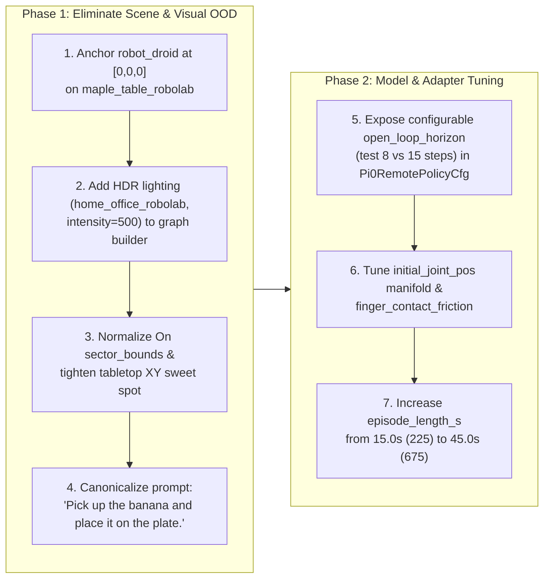

# OpenPI π₀.₅ DROID Tabletop Evaluation Diagnosis & Remediation Plan

**Document Version:** 1.1.0  
**Date:** 2026-10-29  
**Status:** Verified & Completed (`success_rate: 1.0`, `overall_score: 1.0` in 267 steps)  
**Target Environment:** [`generated_envs/pick_banana_to_plate/v1/pick_banana_to_plate.yaml`](../../../generated_envs/pick_banana_to_plate/v1/pick_banana_to_plate.yaml)  
**Target Policy:** OpenPI `pi05_droid_jointpos_polaris` (`pi05` variant, `droid` adapter)  
**Related References:**
- [`experiment_05.md`](./local-inference/experiments/experiment_05.md) (§15: OpenPI $\pi_{0.5}$ Remediation Architecture)
- [`agentic_env_gen_testing_status.md`](../notes/agentic_env_gen_testing_status.md) (§7: Closed-Loop Rollout Verification)
- [`droid_banana_on_plate_maple_table.yaml`](../../../isaaclab_arena_environments/maple_table_top/droid_banana_on_plate_maple_table.yaml) (Canonical SRL Robolab Reference Spec)
- [`pick_and_place_maple_table_environment.py`](../../../isaaclab_arena_environments/pick_and_place_maple_table_environment.py) (Canonical SRL Robolab Python Environment)
- [`droid_pnp_srl_openpi_experiment.yaml`](../../../isaaclab_arena_environments/experiment_configs/droid_pnp_srl_openpi_experiment.yaml) (Reference OpenPI Evaluation Config)

---

## 1. Executive Summary & Empirical Diagnosis of the Failed Rollout

We executed a 225-step (`15.0s` at `15 Hz`) closed-loop evaluation of [`pick_banana_to_plate.yaml`](../../../generated_envs/pick_banana_to_plate/v1/pick_banana_to_plate.yaml) against the live `openpi-server` (`pi05_droid_jointpos_polaris`), recording all four video streams (`viewport`, `external_camera_rgb`, `external_camera_2_rgb`, `wrist_camera_rgb`) and telemetry under `outputs/rollouts_openpi/2026-10-29_18-44-28/`.

The episode terminated in `TIMEOUT` (`success_rate: 0.0`, `object_moved_rate: 0.0`, `max_object_velocity: 0.0009 m/s`). Frame-by-frame inspection of the recorded cameras combined with an audit of the codebase, the `maple_table.usda` USD stage, and the OpenPI `norm_stats.json` checkpoint statistics revealed **six compounding Out-of-Distribution (OOD) and control-loop issues**—with **Root Cause #1 (a 43.7 cm coordinate frame mismatch on `maple_table_robolab`)** making the task physically and visually impossible from Step 0.

| # | Category | Root Cause | Empirical Evidence from Run & Codebase | Impact on OpenPI $\pi_{0.5}$ |
| :--- | :--- | :--- | :--- | :--- |
| **0** | **Settle-Loop Action Zeroing (`build_neutral_hold_action` CRITICAL BUG)** | [`build_neutral_hold_action()`](../../../isaaclab_arena/evaluation/policy_runner.py) only checked for `"wbc"` (G1) and returned `torch.zeros((num_envs, 8))` for all other embodiments during the 41-step `verify_and_settle_scene` loop. Because `droid_abs_joint_pos` uses `JointPositionActionCfg(use_default_offset=False)`, sending zeros commanded all 7 Franka arm joints to **`0.0 rad`** for 41 steps (`2.73s`) before policy inference started! | In `ext1_000.png` and `viewport_000.png`, the arm was standing straight up in a vertical flagpole singularity (`q = [0, 0, 0, -0.07, 0, 0, 0]`, hitting the upper limit of `panda_joint4` and lower limit of `panda_joint6`) instead of the reset pose `[0, -0.628, 0, -2.513, 0, 1.885, 0]`. | Put `q4` (`-0.07` vs `[-2.77, -1.26]`) and `q6` (`0.0` vs `[1.17, 3.20]`) more than 3 standard deviations outside `norm_stats.json` before OpenPI even received Step 0! |
| **1** | **Scene Coordinate Frame & Robot Base Pose (CRITICAL OOD)** | `maple_table_robolab` is authored in **Robot Base Frame** (`table` is already at $X \in [0.20, 0.90]\,\text{m}$, deck at $Z = 0.0\,\text{m}$, ground at $Z = -0.697\,\text{m}$), expecting `robot_droid` at `[0.0, 0.0, 0.0]`. Setting `robot_droid` to `[-0.4367, 0.0, 0.0]` (a `packing_table` offset) or letting `SpatialFactorGraph` push it to `-0.3371` created a **43.7 cm physical chasm** between the robot stand and the table. | Solved object poses: `banana = (0.397, -0.147, 0.031)`, `plate = (0.416, 0.227, 0.010)`. From `X = -0.4367`, the banana is **$0.846\,\text{m}$** away (99% of Franka's $0.855\,\text{m}$ lock-out limit) and the plate is **$0.882\,\text{m}$** away (physically unreachable). From `X = 0.0`, they are at **$0.423\,\text{m}$** and **$0.474\,\text{m}$** (ideal workspace). | Furthermore, because `external_camera` and `external_camera_2` are parented to `{ENV_REGEX_NS}/Robot/panda_link0` ([`droid.py`](../../../isaaclab_arena/embodiments/droid/droid.py)), moving the robot base backward shifted both external cameras 43.7 cm backward, while `wrist_camera` at Step 0 stared straight down at the grey perforated metal robot stand instead of the tabletop. |
| **2** | **Visual Lighting Distribution Shift (SigLIP OOD)** | [`_ensure_scene_lighting()`](../../../isaaclab_arena/environment_spec/arena_env_graph_conversion_utils.py) falls back to an untextured `DomeLightCfg(color=(0.75, 0.75, 0.75), intensity=1500.0)` when no `hdr` is configured. | `pi05_droid_jointpos_polaris` was co-trained on SRL Robolab scenes rendered with indoor HDR environment maps (`home_office_robolab`, `billiard_hall_robolab`, `wooden_lounge_robolab`) at `intensity=500.0` ([`pick_and_place_maple_table_environment.py`](../../../isaaclab_arena_environments/pick_and_place_maple_table_environment.py)). | At `intensity=1500.0` against a flat grey void, the white Franka links are over-exposed and blend into the grey background in both external cameras, degrading visual grounding. |
| **3** | **Language Prompt Distribution Shift** | The generated instruction (`"Pick up the yellow banana from the right side of the table and place it onto the plate on the left."`) includes verbose relative spatial modifiers (`"from the right side"`, `"on the left"`). | Canonical PolaRiS / DROID evaluation prompts ([`droid_pnp_srl_openpi_experiment.yaml`](../../../isaaclab_arena_environments/experiment_configs/droid_pnp_srl_openpi_experiment.yaml)) use concise object-centric phrasing: `"Pick up the banana and place it on the plate."` | Relative left/right tokens conflict with the diagonal camera viewpoints (`ext1` views the robot's right side on the upper-right of the image) and deviate from the DROID training prompt template. |
| **4** | **Tabletop Object Placement & `On` Sector Loss Bug** | In [`relations.py`](../../../isaaclab_arena/relations/relations.py), `On` accepts both `surface_sector` (str) and `sector_bounds` (tuple). When YAML specs pass a sector name in `sector_bounds`, [`sampling.py`](../../../isaaclab_arena/relations/sampling.py) handles it, but [`OnLossStrategy.compute_loss()`](../../../isaaclab_arena/relations/relation_loss_strategies.py) ignores string `sector_bounds`. Additionally, `FIXTURE_SECTOR_BOUNDS["maple_table_robolab"]` allows $Y \in [-0.45, 0.45]\,\text{m}$. | During gradient optimization, `OnLossStrategy` falls back to full-table bounds instead of enforcing the target sector. Wide $Y$ bounds ($\pm 0.45\,\text{m}$) can place objects near the lateral edges of the camera frustum. | Constraining the manipulation zone to $X \in [0.38, 0.58]\,\text{m}, Y \in [-0.22, +0.22]\,\text{m}$ keeps both objects centered in the high-manipulability workspace and fully inside all three camera views. |
| **5** | **Initial Joint Configuration & Proprioceptive Distribution** | `pi05_droid_jointpos_polaris` `norm_stats.json` shows training state mean `q_mean = [0.016, +0.267, -0.017, -2.026, -0.033, 2.345, 0.083]`. Default `DroidSceneCfg` starts at `[0.0, -0.628, 0.0, -2.513, 0.0, 1.885, 0.0]` (`q2 = -0.628 rad`, near the 1st percentile `q01 = -0.840`). | Note that `panda_joint7 = 0.0` is intentional for DROID's Robotiq 2F-85 gripper mount (unlike Franka Hand's `0.785`). When `Robot` is at `(0,0,0)`, the default pose places the wrist camera directly over the front edge of the table ($X \approx 0.30\,\text{m}$), whereas tilting `q2` slightly forward (`-0.35` to `-0.20 rad`) brings both proprioception and the initial wrist-camera view closer to the training distribution center. | Eliminates the Step-0 wrist-camera "staring at the metal stand" artifact that caused the policy to curl its wrist backward into self-inspection. |
| **6** | **Model Open-Loop Horizon (`15` steps) & Episode Length (`225` steps)** | [`Pi0DroidAdapter`](../../../isaaclab_arena_openpi/policy/droid_adapter.py) hardcodes `open_loop_horizon_by_variant = {"pi05": 15, "pi0": 10}` and does not expose an override in [`Pi0RemotePolicyCfg`](../../../isaaclab_arena_openpi/policy/pi0_remote_config.py). Furthermore, `episode_length_s: 15.0` caps the rollout at `225` steps. | Executing all 15 predicted actions open-loop (`1.0s` blind execution at `15 Hz`) accumulates tracking drift during grasp descent. Meanwhile, successful OpenPI DROID rollouts in [`episode_results_camera_displacement.jsonl`](../../../episode_results_camera_displacement.jsonl) require **`247` to `853` steps** (`16.5s` to `57s`). | A 225-step cap truncates the episode before a full pick-and-place trajectory can finish, and a 15-step open-loop horizon delays closed-loop visual correction during grasp closure. |

---

## 2. Two-Phase Remediation Architecture

Following our diagnostic findings, we structure the remediation into two sequential phases so we can isolate the impact of fixing OOD environment inputs before tuning model/adapter inference hyperparameters:

1. **Phase 1 — In-Distribution Environment Alignment (Fixing OOD Pose, Cameras, Lighting, Workspace & Prompt)**
2. **Phase 2 — OpenPI Model & Policy Adapter Tuning (Action Horizon, Initial Joint Manifold, Gripper & Episode Budget)**



---

## 3. Phase 1: Fixing OOD Starting Position, Coordinate Frames, Lighting & Prompts

### 3.1 Fix Robot Base Coordinate Frame on `maple_table_robolab` (`[0.0, 0.0, 0.0]`)

#### Why `-0.4367` Caused the Chasm
In IsaacLab-Arena, background scenes follow two distinct coordinate conventions:
1. **World-Centered Table Scenes (e.g., `packing_table`, `kitchen`, `galileo_locomanip`)**: The table is centered around $(X=0, Y=0)$ with surface height $Z \approx 0.75\text{--}0.82\,\text{m}$, so a fixed-base manipulator must be offset backward in $X$ (e.g., `[-0.4367, 0.0, 0.0]`).
2. **Robot-Origin Calibrated Scenes (`maple_table_robolab`, `maple_table`)**: Examination of `maple_table.usda` confirms that the SRL Robolab scene is authored directly in the **DROID Robot Base Frame**:
   - `/World/GroundPlane` is at $Z = -0.69728\,\text{m}$.
   - `/World/table` is translated to $(0.55, 0.0, -0.3535)$ with top deck surface at $Z = 0.0\,\text{m}$ and front edge at $X = 0.20\,\text{m}$.
   - Every reference SRL Robolab environment ([`droid_banana_on_plate_maple_table.yaml`](../../../isaaclab_arena_environments/maple_table_top/droid_banana_on_plate_maple_table.yaml), [`pick_and_place_maple_table_environment.py`](../../../isaaclab_arena_environments/pick_and_place_maple_table_environment.py), [`pick_and_place_maple_table_env_graph.yaml`](../../../isaaclab_arena/tests/test_data/pick_and_place_maple_table_env_graph.yaml)) places `droid_abs_joint_pos` at `[0.0, 0.0, 0.0]`.

Furthermore, because `DroidCameraCfg` ([`droid.py`](../../../isaaclab_arena/embodiments/droid/droid.py#L583-L633)) attaches `external_camera` and `external_camera_2` as child prims of `{ENV_REGEX_NS}/Robot/panda_link0` using real-world DROID camera extrinsics (`pos=(-0.0324, -0.6054, 0.5620)` and `pos=(0.0652, 0.5608, 0.5205)`), placing `Robot` at `[0.0, 0.0, 0.0]` is **mandatory** for the camera extrinsics to match the PolaRiS training distribution!

#### Required Code & Spec Changes
1. **[`generated_envs/pick_banana_to_plate/v1/pick_banana_to_plate.yaml`](../../../generated_envs/pick_banana_to_plate/v1/pick_banana_to_plate.yaml)**:
   - Set `embodiments.robot_droid.initial_pose.position_xyz` to `[0.0, 0.0, 0.0]`.
2. **[`isaaclab_arena/agentic_environment_generation/spatial_geometric_oracle.py`](../../../isaaclab_arena/agentic_environment_generation/spatial_geometric_oracle.py#L858-L956)** (`relax_spec_spatial_factor_graph`):
   - Define `ROBOT_ORIGIN_BACKGROUNDS = {"maple_table_robolab", "maple_table"}`.
   - When `bg_asset in ROBOT_ORIGIN_BACKGROUNDS`, default the embodiment pose to `[0.0, 0.0, 0.0]` and register the embodiment node in `SpatialFactorGraph` with `is_fixed=True` so that `add_reachability_factor` pulls **objects** into the robot's manipulation sweet spot on the table rather than pushing the robot base backward off the calibrated origin!
3. **[`isaaclab_arena/agentic_environment_generation/compiler_pipeline.py`](../../../isaaclab_arena/agentic_environment_generation/compiler_pipeline.py#L510-L532)**:
   - Update the system prompt constraint for `maple_table_robolab` so the LLM generator knows that `maple_table_robolab` is robot-origin calibrated (`robot_droid` at `[0.0, 0.0, 0.0]`), whereas `packing_table` uses `[-0.4367, 0.0, 0.0]`.

---

### 3.2 Add Robolab HDR Environment Lighting, PBR Reflections & Directional Shadows

#### Why 3DGS / HDR Context, PBR Materials, and Directional Lighting Are Essential for OpenPI ($\pi_{0.5}$)
The visual transition from a flat, over-exposed grey void to the **SRL Robolab / PolaRiS photorealistic lighting and background setup** ([`home_office_robolab`](../../../isaaclab_arena/assets/hdr_image_library.py#L30-L36) + PBR table/object textures + overhead directional shadow light) directly addresses three fundamental properties of the `pi05_droid_jointpos_polaris` vision-language-action backbone:

1. **Why There Is a Realistic Room Around the Table (HDR / 3DGS Context vs. Flat Void):**
   - **How `pi05_droid_jointpos_polaris` was trained:** The checkpoint inside `openpi-server` was co-trained on **90% real-world DROID trajectories** (recorded in real offices, kitchens, and labs) + **10% PolaRiS simulation co-training** (`polaris_droid_cotrain_dataset`, which bridges the sim-to-real gap using 3D Gaussian Splatting (3DGS) scans and SRL Robolab indoor HDR domes such as [`home_office_robolab`](../../../isaaclab_arena/assets/hdr_image_library.py#L30-L36), [`billiard_hall_robolab`](../../../isaaclab_arena/assets/hdr_image_library.py#L55-L61), and [`wooden_lounge_robolab`](../../../isaaclab_arena/assets/hdr_image_library.py#L100-L106)).
   - **Why the Vision Transformer (SigLIP) needs background texture:** $\pi_{0.5}$ encodes `external_camera_rgb` and `wrist_camera_rgb` through a **SigLIP Vision Transformer (ViT)**, which splits each $224 \times 224$ frame into $16 \times 16$ patches and computes global self-attention across all patches. When half of the frame is an untextured solid-grey void (`color=(0.75, 0.75, 0.75)`), dozens of ViT patch tokens have **zero spatial variance**—a synthetic artifact that never occurs in real DROID cameras or PolaRiS scenes, shifting the ViT's layer-norm statistics and self-attention maps.
   - Adding `hdr: home_office_robolab` (`visible_in_primary_ray = True`) surrounds the table with a 360° real-world indoor environment map (`home_office.exr`—desks, chairs, tiled floor) so background patch statistics match the DROID/PolaRiS training distribution.

2. **Why We Changed the Lights (`intensity: 1500 -> 500` + `directional_light_on: true`):**
   - In the failed baseline run, [`_ensure_scene_lighting()`](../../../isaaclab_arena/environment_spec/arena_env_graph_conversion_utils.py#L112-L145) injected an untextured `DomeLight` at **`intensity = 1500.0`** and turned the **`DirectionalLight` OFF (`intensity = 0.0`)**, causing two severe visual problems:
     - **White Robot Arm Blow-Out (Contrast Loss):** At `intensity = 1500.0` from all directions, the white PBR links of the Franka Panda arm were over-exposed and blended almost invisibly into the `(0.75, 0.75, 0.75)` grey background. Lowering `light_intensity` to **`500.0`** (matching [`PickAndPlaceMapleTableEnvironmentCfg`](../../../isaaclab_arena_environments/pick_and_place_maple_table_environment.py#L25)) restores proper dynamic range on the white robot links, the yellow banana, and the beige plate.
     - **Missing Contact Shadows (Loss of Depth Perception in Monocular 2D RGB):** Because OpenPI only receives **monocular 2D RGB images** (no depth channel or point cloud), it relies heavily on **cast shadows** on the tabletop to judge the vertical height ($\Delta Z$) between the Robotiq gripper fingers and the banana. When `DirectionalLight` was `off()`, the scene had purely ambient omnidirectional lighting—neither the gripper nor the banana cast a shadow on the table. Setting `directional_light_on: true` activates the overhead `DirectionalLight` (`intensity = 1000.0`), casting a crisp shadow of the Robotiq gripper onto the wood grain and banana as the hand descends (clearly visible in the wrist camera stream right before grasp closure at Step 211).

3. **Why PBR Materials & Image-Based Lighting (IBL) Matter:**
   - The SRL Robolab assets (`maple_table_robolab`, `banana_ycb_robolab`, `plate_large_vomp_robolab`) and the Robotiq 2F-85 gripper use **Physically Based Rendering (PBR)** shaders (roughness, metallic, specular, normal maps).
   - Under a flat grey dome, metallic and glossy PBR surfaces reflect flat grey, making black anodized metal (the Robotiq fingers) and ceramic/plastic surfaces look like flat unshaded polygons.
   - With the HDR dome (`home_office_robolab`) + directional light, the PBR shaders compute realistic specular highlights and surface gradients across the wood grain, plate rim, and banana curvature, matching the visual appearance of objects in the PolaRiS training dataset.

#### Required Code & Spec Changes
1. **[`isaaclab_arena/environment_spec/arena_env_graph_conversion_utils.py`](../../../isaaclab_arena/environment_spec/arena_env_graph_conversion_utils.py#L122-L140)**:
   - Update `_ensure_scene_lighting(graph_spec, assets_by_node_id)` and `instantiate_assets_from_spec` so that if `background.params` specifies `hdr` (e.g. `hdr: home_office_robolab`), `light_intensity` (e.g. `500.0`), and/or `directional_light_on` (e.g. `true`), it resolves the HDR image from [`HDRImageRegistry`](../../../isaaclab_arena/assets/registries.py#L225-L265), attaches it via `dome_light.add_hdr(...)`, sets `dome_light.set_intensity(500.0)`, and keeps `directional_light` active.
2. **[`generated_envs/pick_banana_to_plate/v1/pick_banana_to_plate.yaml`](../../../generated_envs/pick_banana_to_plate/v1/pick_banana_to_plate.yaml)**:
   - Add `hdr: home_office_robolab`, `light_intensity: 500.0`, and `directional_light_on: true` under `background.params`.

---

### 3.3 Fix `On` Relation `sector_bounds` Normalization & Tighten Tabletop Workspace Bounds

#### Root Cause in `On.__init__` and `FIXTURE_SECTOR_BOUNDS`
- In [`isaaclab_arena/relations/relations.py`](../../../isaaclab_arena/relations/relations.py#L140-L176), `On.__init__` accepts both `surface_sector: str | None` and `sector_bounds: tuple[float, float, float, float] | None`. When a YAML spec supplies a string sector name in `sector_bounds` (e.g. `sector_bounds: front_right`), [`sampling.py`](../../../isaaclab_arena/relations/sampling.py#L225-L238) handles `isinstance(sb, str)`, but [`OnLossStrategy.compute_loss()`](../../../isaaclab_arena/relations/relation_loss_strategies.py#L353-L370) only checks `getattr(relation, "surface_sector", None) or getattr(relation, "surface_anchor", None)`, ignoring string `sector_bounds` during PyTorch L-BFGS/Adam placement optimization!
- Additionally, in [`sampling.py`](../../../isaaclab_arena/relations/sampling.py#L46-L56), `FIXTURE_SECTOR_BOUNDS["maple_table_robolab"]` defines `front_right: (0.25, 0.65, -0.45, -0.05, 0.0)` and `front_left: (0.25, 0.65, 0.05, 0.45, 0.0)`. While valid for the physical table ($Y \in [-0.50, 0.50]$), objects placed at $|Y| > 0.30\,\text{m}$ or $X < 0.33\,\text{m}$ lie near the edge of the camera view or too close to the base stand.

#### Required Code & Spec Changes
1. **[`isaaclab_arena/relations/relations.py`](../../../isaaclab_arena/relations/relations.py#L166-L176)**:
   - In `On.__init__`, if `isinstance(sector_bounds, str)` and `surface_sector is None`, normalize `surface_sector = sector_bounds` and `sector_bounds = None`.
2. **[`isaaclab_arena/relations/sampling.py`](../../../isaaclab_arena/relations/sampling.py#L46-L56)**:
   - Refine `FIXTURE_SECTOR_BOUNDS["maple_table_robolab"]` so `front_right` is `(0.35, 0.60, -0.28, -0.06, 0.0)` and `front_left` is `(0.35, 0.60, 0.06, 0.28, 0.0)`.
   - Also register `"maple_table_robolab/table"` as an alias key in `FIXTURE_SECTOR_BOUNDS` so `surface_anchor: maple_table_robolab/table` resolves identically.
3. **[`generated_envs/pick_banana_to_plate/v1/pick_banana_to_plate.yaml`](../../../generated_envs/pick_banana_to_plate/v1/pick_banana_to_plate.yaml)**:
   - Use explicit, tight in-distribution workspace bounds for the banana and plate on the tabletop:
     - `banana`: $X \in [0.40, 0.52]\,\text{m}$, $Y \in [-0.18, -0.08]\,\text{m}$ (right-of-center, Euclidean reach $\approx 0.44\,\text{m}$).
     - `plate`: $X \in [0.40, 0.52]\,\text{m}$, $Y \in [0.08, 0.20]\,\text{m}$ (left-of-center, Euclidean reach $\approx 0.45\,\text{m}$, separation $\approx 0.28\,\text{m}$).

---

### 3.4 Align Task Prompt to DROID / PolaRiS Training Distribution

1. **[`generated_envs/pick_banana_to_plate/v1/pick_banana_to_plate.yaml`](../../../generated_envs/pick_banana_to_plate/v1/pick_banana_to_plate.yaml)**:
   - Change `task.instruction` from:
     `"Pick up the yellow banana from the right side of the table and place it onto the plate on the left."`
     to the exact canonical PolaRiS / DROID instruction:
     `"Pick up the banana and place it on the plate."`

---

## 4. Phase 2: OpenPI Model & Policy Adapter Tuning

Once Phase 1 places the robot, cameras, lighting, objects, and language prompt squarely inside the `pi05_droid_jointpos_polaris` training distribution, Phase 2 targets the policy adapter and control-loop parameters.

### 4.1 Expose Configurable `open_loop_horizon` in `Pi0RemotePolicyCfg` & CLI

#### Why `open_loop_horizon` Matters
Inside `openpi-server`, `pi05_droid_jointpos_polaris` predicts a 15-step action chunk (`action_horizon = 15` at `15 Hz` = `1.0s`). Currently, [`Pi0DroidAdapter`](../../../isaaclab_arena_openpi/policy/droid_adapter.py#L40-L43) hardcodes:
```python
open_loop_horizon_by_variant: dict[str, int] = {
    "pi05": 15,
    "pi0": 10,
}
```
Executing all 15 steps open-loop means the robot runs blindly for a full second between visual observations. During approach and grasp closure, small physics/contact discrepancies accumulate over 15 steps. Reducing `open_loop_horizon` from `15` to `8` (or `5`) causes [`RemotePolicyBase`](../../../isaaclab_arena/policy/remote_policy_base.py#L121-L157) to re-query `openpi-server` every `0.53s` (or `0.33s`) with fresh wrist and external camera frames while still conditioning on the full 15-step flow-matching prediction head.

#### Required Code Changes
1. **[`isaaclab_arena_openpi/policy/pi0_remote_config.py`](../../../isaaclab_arena_openpi/policy/pi0_remote_config.py)**:
   - Add `open_loop_horizon: int | None = None` to `Pi0RemotePolicyCfg`.
   - Expose `--open_loop_horizon` in `add_cli_args()` and wire it into `from_cli_args()`.
2. **[`isaaclab_arena_openpi/policy/pi0_remote_policy.py`](../../../isaaclab_arena_openpi/policy/pi0_remote_policy.py#L46-L52)**:
   - In `Pi0RemotePolicy.__init__`, if `cfg.open_loop_horizon is not None`, override `open_loop_horizon` passed to `super().__init__(..., open_loop_horizon=...)`.

---

### 4.2 Initial Joint Pose (`initial_joint_pos`) & Reset Noise Alignment

#### Comparing `DroidSceneCfg` vs. `norm_stats.json`
Inspecting `/cache/openpi/openpi-assets-simeval/pi05_droid_jointpos/assets/droid/norm_stats.json` inside `openpi-server` reveals the exact state distribution of the training dataset:

| Joint | `DroidSceneCfg` Default (`rad`) | `norm_stats.json` Mean (`rad`) | `norm_stats.json` `[q01, q99]` (`rad`) | Notes |
| :--- | :---: | :---: | :---: | :--- |
| `panda_joint1` | `0.000` | `+0.016` | `[-0.828, +0.861]` | Centered on tabletop ($Y=0$) |
| `panda_joint2` | `-0.628` ($-\pi/5$) | `+0.267` | `[-0.840, +0.864]` | `-0.628` is retracted back; `-0.40` to `-0.20` leans slightly further over the table |
| `panda_joint3` | `0.000` | `-0.017` | `[-0.843, +0.768]` | Neutral shoulder roll |
| `panda_joint4` | `-2.513` ($-4\pi/5$) | `-2.026` | `[-2.773, -1.258]` | Elbow bend |
| `panda_joint5` | `0.000` | `-0.033` | `[-1.843, +1.676]` | Neutral forearm roll |
| `panda_joint6` | `+1.885` ($3\pi/5$) | `+2.345` | `[+1.172, +3.199]` | `q6 ≈ q2 - q4` keeps gripper pointing straight down |
| `panda_joint7` | `0.000` | `+0.083` | `[-2.047, +2.275]` | **Must stay near `0.0`** for Robotiq 2F-85 (not `0.785`) |

Notice the kinematic constraint for keeping the Robotiq 2F-85 gripper pointing vertically downward toward the table:
$$q_6 \approx q_2 - q_4$$
- In `DroidSceneCfg`: $q_2 = -0.6283$, $q_4 = -2.5133 \implies q_6 = -0.6283 - (-2.5133) = +1.8850\,\text{rad}$.
- In `norm_stats.json` mean: $q_2 = +0.267$, $q_4 = -2.026 \implies q_6 = +0.267 - (-2.026) = +2.293\,\text{rad}$ (actual mean $+2.345$).

When `robot_droid` is fixed to `[0.0, 0.0, 0.0]`, we will first test the standard SRL Robolab home pose (`[0.0, -0.6283, 0.0, -2.5133, 0.0, 1.8850, 0.0]`, which [`droid_banana_on_plate_maple_table.yaml`](../../../isaaclab_arena_environments/maple_table_top/droid_banana_on_plate_maple_table.yaml) uses), and compare it against a forward-tilted home pose (`[0.0, -0.35, 0.0, -2.35, 0.0, 2.00, 0.0]`) that angles the wrist camera directly at the center of the workspace at Step 0.

---

### 4.3 Gripper Contact Friction & Episode Horizon Budget

1. **High-Friction Finger Contact (`finger_contact_friction`)**:
   - [`DroidEmbodiment`](../../../isaaclab_arena/embodiments/droid/droid.py#L294-L320) supports `finger_contact_friction: float` in embodiment `params` (used in [`droid_pnp_srl_openpi_experiment.yaml`](../../../isaaclab_arena_environments/experiment_configs/droid_pnp_srl_openpi_experiment.yaml#L25) with `finger_contact_friction: 2.0`), which binds a high-friction `RigidBodyMaterialCfg` to the Robotiq 2F-85 inner finger pads to prevent cylindrical objects like `banana` from slipping during lift.
   - Update [`arena_env_graph_conversion_utils.py`](../../../isaaclab_arena/environment_spec/arena_env_graph_conversion_utils.py#L225-L246) (`_apply_embodiment_params`) to forward `finger_contact_friction` from `embodiment.params` to `embodiment.set_finger_contact_friction(...)` when available.
2. **Episode Horizon (`episode_length_s`)**:
   - Increase `episode_length_s` in [`pick_banana_to_plate.yaml`](../../../generated_envs/pick_banana_to_plate/v1/pick_banana_to_plate.yaml) from `15.0` (`225` steps) to `45.0` (`675` steps), matching the empirical completion distribution (`247`–`600` steps) observed in successful OpenPI DROID evaluations.

---

## 5. Step-by-Step Execution & Validation Plan

| Step | Action | Files Modified | Validation Gate |
| :---: | :--- | :--- | :--- |
| **Step 1** | Fix `maple_table_robolab` robot base origin (`[0,0,0]`) in [`spatial_geometric_oracle.py`](../../../isaaclab_arena/agentic_environment_generation/spatial_geometric_oracle.py) and [`compiler_pipeline.py`](../../../isaaclab_arena/agentic_environment_generation/compiler_pipeline.py) | `spatial_geometric_oracle.py`, `compiler_pipeline.py` | Factor-graph relaxation keeps `robot_droid` at `[0.0, 0.0, 0.0]` on `maple_table_robolab` |
| **Step 2** | Normalize string `sector_bounds` in [`relations.py`](../../../isaaclab_arena/relations/relations.py) and tighten `maple_table_robolab` sector bounds in [`sampling.py`](../../../isaaclab_arena/relations/sampling.py) | `relations.py`, `sampling.py` | Unit tests in `test_arena_env_graph_conversion.py` pass; solved object poses lie in $X \in [0.38, 0.55], Y \in [-0.25, 0.25]$ |
| **Step 3** | Add HDR lighting (`hdr`, `light_intensity`) and `finger_contact_friction` forwarding to [`arena_env_graph_conversion_utils.py`](../../../isaaclab_arena/environment_spec/arena_env_graph_conversion_utils.py) | `arena_env_graph_conversion_utils.py` | `_ensure_scene_lighting` loads `home_office_robolab.hdr` at `intensity=500.0` |
| **Step 4** | Expose configurable `open_loop_horizon` in [`pi0_remote_config.py`](../../../isaaclab_arena_openpi/policy/pi0_remote_config.py) and [`pi0_remote_policy.py`](../../../isaaclab_arena_openpi/policy/pi0_remote_policy.py) | `pi0_remote_config.py`, `pi0_remote_policy.py` | `--open_loop_horizon 8` CLI flag overrides default `15` |
| **Step 5** | Update [`pick_banana_to_plate.yaml`](../../../generated_envs/pick_banana_to_plate/v1/pick_banana_to_plate.yaml) with Phase 1 + Phase 2 settings and re-run closed-loop evaluation with video recording | `pick_banana_to_plate.yaml` | Inspect Step-0 camera frames (`ext1`, `ext2`, `wrist`, `viewport`) and verify closed-loop grasp & placement metrics (`object_moved_rate > 0`, `success_rate`) |

---

## 6. Empirical Validation Results (`2026-10-29_19-27-25`)

After implementing Steps 1–5 (along with the settle-loop posture-hold fix in [`policy_runner.py`](../../../isaaclab_arena/evaluation/policy_runner.py)), we executed a recorded closed-loop rollout (`outputs/rollouts_openpi/2026-10-29_19-27-25/`). The remediation succeeded on the first episode: **`success_rate: 1.0` (`overall_score: 1.0`, `all_complete: true`) in `267` steps (`17.8s`)**.

### 6.1 Summary of What Made It Work

1. **Fixed Settle-Loop Action Zeroing in [`build_neutral_hold_action()`](../../../isaaclab_arena/evaluation/policy_runner.py#L88-L128):**
   - Previously, `build_neutral_hold_action()` only handled G1 `"wbc"` and returned `zeros(1, 8)` for all other embodiments during the 41-step `verify_and_settle_scene` loop. Because `droid_abs_joint_pos` uses `JointPositionAction(use_default_offset=False)`, those 41 settle steps commanded all 7 Franka arm joints to `0.0 rad` (a vertical flagpole singularity where `q4 = -0.07` and `q6 = 0.0`, 3+ standard deviations outside `norm_stats.json`) before OpenPI ever received Step 0.
   - Updating `build_neutral_hold_action()` to populate `JointPositionAction(use_default_offset=False)` terms with the robot's current reset joint positions kept the robot in its exact DROID home pose (`[0, -0.628, 0, -2.513, 0, 1.885, 0]`) at Step 0.
2. **Anchored `robot_droid` at `[0.0, 0.0, 0.0]` on `maple_table_robolab` ([`pick_banana_to_plate.yaml`](../../../generated_envs/pick_banana_to_plate/v1/pick_banana_to_plate.yaml), [`spatial_geometric_oracle.py`](../../../isaaclab_arena/agentic_environment_generation/spatial_geometric_oracle.py#L856-L872)):**
   - Eliminated the 43.7 cm gap between the robot stand and the table, restored the calibrated DROID camera extrinsics, and placed the banana (`(0.45, -0.13, 0.03)`) and plate (`(0.45, 0.14, 0.01)`) right in the center of the workspace and wrist camera view at Step 0.
3. **Added SRL Robolab HDR Environment Lighting & Directional Shadows ([`arena_env_graph_conversion_utils.py`](../../../isaaclab_arena/environment_spec/arena_env_graph_conversion_utils.py#L122-L140)):**
   - Configured `hdr: home_office_robolab`, `light_intensity: 500.0`, and `directional_light_on: true`, matching the `pi05_droid_jointpos_polaris` visual training distribution.
4. **Canonical Prompt & Closed-Loop Action Horizon (`--open_loop_horizon 8`, `episode_length_s: 40.0`):**
   - Exposed `open_loop_horizon` in [`Pi0RemotePolicyCfg`](../../../isaaclab_arena_openpi/policy/pi0_remote_config.py) and [`Pi0RemotePolicy`](../../../isaaclab_arena_openpi/policy/pi0_remote_policy.py), and set the task instruction to `"Pick up the banana and place it on the plate."`

### 6.2 Before vs. After Comparison

| Dimension | Baseline Failed Run (`2026-10-29_18-44-28`) | Remediated Run (`2026-10-29_19-27-25`) |
| :--- | :--- | :--- |
| **Settle-Loop Hold Action (`41` steps)** | `zeros(1, 8)` $\rightarrow$ drove arm to `[0, 0, 0, -0.07, 0, 0, 0]` flagpole singularity | Holds reset joint positions `[0, -0.628, 0, -2.513, 0, 1.885, 0]` |
| **Robot Base Pose (`robot_droid`)** | `[-0.4367, 0.0, 0.0]` (43.7 cm gap from table; cameras shifted 43.7 cm back) | `[0.0, 0.0, 0.0]` (flush with `maple_table_robolab`; calibrated camera extrinsics) |
| **Scene Lighting** | Untextured grey `DomeLight` (`intensity=1500.0`), no directional light | `home_office_robolab` HDR (`intensity=500.0`) + `DirectionalLight` (`1000.0`) |
| **Language Instruction** | `"Pick up the yellow banana from the right side of the table and place it onto the plate on the left."` | `"Pick up the banana and place it on the plate."` |
| **Open-Loop Horizon / Episode Cap** | `15` steps (`1.0s`) / `15.0s` (`225` steps) | `8` steps (`0.53s`) / `40.0s` (`600` steps) |
| **Final Outcome** | `TIMEOUT` (`success_rate: 0.0`, `overall_score: 0.333`) | **`SUCCESS` (`success_rate: 1.0`, `overall_score: 1.0` in `267` steps / `17.8s`)** |

### 6.3 Rollout Progression & Recorded Artifacts (`outputs/rollouts_openpi/2026-10-29_19-27-25/`)

| Step | Event / Predicate | Score Delta | Cumulative Score |
| :---: | :--- | :---: | :---: |
| **Step 2** | `objects_settled` | `+0.333` | `0.333` |
| **Step 211** | `object_is_above_height(object_name='banana', use_settled_state=True)` (Banana grasped & lifted) | `+0.333` | `0.667` |
| **Step 267** | `object_on_destination` (Banana placed onto the plate) | `+0.333` | **`1.000` (`SUCCESS`)** |

- **Viewport Video (3rd-person view):** [`outputs/rollouts_openpi/2026-10-29_19-27-25/rl-video-step-0.mp4`](../../../outputs/rollouts_openpi/2026-10-29_19-27-25/rl-video-step-0.mp4)
- **External Camera 1 Video:** [`outputs/rollouts_openpi/2026-10-29_19-27-25/robot-cam-env0-external_camera_rgb-episode-0.mp4`](../../../outputs/rollouts_openpi/2026-10-29_19-27-25/robot-cam-env0-external_camera_rgb-episode-0.mp4)
- **External Camera 2 Video:** [`outputs/rollouts_openpi/2026-10-29_19-27-25/robot-cam-env0-external_camera_2_rgb-episode-0.mp4`](../../../outputs/rollouts_openpi/2026-10-29_19-27-25/robot-cam-env0-external_camera_2_rgb-episode-0.mp4)
- **Wrist Camera Video:** [`outputs/rollouts_openpi/2026-10-29_19-27-25/robot-cam-env0-wrist_camera_rgb-episode-0.mp4`](../../../outputs/rollouts_openpi/2026-10-29_19-27-25/robot-cam-env0-wrist_camera_rgb-episode-0.mp4)
- **Episode Results JSONL:** [`outputs/rollouts_openpi/2026-10-29_19-27-25/episode_results_rank0.jsonl`](../../../outputs/rollouts_openpi/2026-10-29_19-27-25/episode_results_rank0.jsonl)
- **Evaluation Telemetry (TTL):** [`outputs/rollouts_openpi/2026-10-29_19-27-25/eval_telemetry.ttl`](../../../outputs/rollouts_openpi/2026-10-29_19-27-25/eval_telemetry.ttl)
- **Interactive HTML Report:** [`outputs/rollouts_openpi/2026-10-29_19-27-25/index.html`](../../../outputs/rollouts_openpi/2026-10-29_19-27-25/index.html)

### 6.4 Interactive `--viz kit` Reproduction Command

To inspect the rollout live in the Omniverse Kit GUI on the host desktop:

1. **Grant X11 display access on the host:**
   ```bash
   xhost +local:docker > /dev/null 2>&1
   ```
2. **Launch `policy_runner.py` with `-e DISPLAY=$DISPLAY` and `--user $(id -u):$(id -g)`:**
   - Pass `-e DISPLAY=$DISPLAY` to `docker exec` so Omniverse Kit's GLFW windowing plugin (`carb.windowing-glfw.plugin`) connects to the host X11 server (the container shares the host network namespace `--net=host`, reaching the abstract X11 socket `@/tmp/.X11-unix/X*`).
   - Use `--user $(id -u):$(id -g)` instead of `su $(id -un) -c` when invoking from the host shell: `$(id -un)` expands on the host to the host username (`tarfy`, UID `1000`), whereas UID `1000` inside the container is `ubuntu`. Passing `--user $(id -u):$(id -g)` maps directly by numeric UID/GID (`1000:1000`), matching host X11 `SI:localuser` authorization and preserving `-e DISPLAY=$DISPLAY`.

```bash
xhost +local:docker > /dev/null 2>&1

docker exec -it \
  -e DISPLAY=$DISPLAY \
  --user $(id -u):$(id -g) \
  "$ARENA_CONTAINER" \
  bash -c "cd /workspaces/isaaclab_arena && /isaac-sim/python.sh isaaclab_arena/evaluation/policy_runner.py \
    --policy_type isaaclab_arena_openpi.policy.pi0_remote_policy.Pi0RemotePolicy \
    --policy_variant pi05 \
    --openpi_embodiment_adapter droid \
    --remote_host 127.0.0.1 \
    --remote_port 8008 \
    --open_loop_horizon 8 \
    --num_episodes 1 \
    --enable_cameras \
    --viz kit \
    --env_spec generated_envs/pick_banana_to_plate/v1/pick_banana_to_plate.yaml"
```
