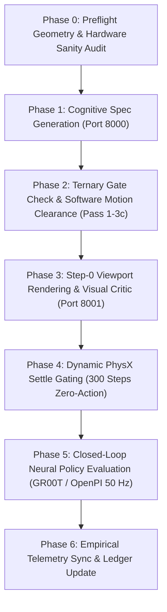

# Arena Local Inference & Simulation Experiments Skill

This skill guides coding agents through executing, benchmarking, and analyzing autonomous environment generation experiments on the local dual-Blackwell workstation (**GPU 0: RTX PRO 6000 96 GB** + **GPU 1: RTX 5090 32 GB**) without commercial cloud API dependencies.

All procedures, scenarios, and model configurations reflect the specification defined in [`.agents/references/plans/local-inference/experiments/experiments.md`](../../references/plans/local-inference/experiments/experiments.md) and the empirical findings in [`.agents/references/plans/local-inference/experiments/experiment_01_findings.md`](../../references/plans/local-inference/experiments/experiment_01_findings.md).

---

## 1. Core Invariants & Hardware Partitioning Rules

To prevent CUDA OOM panics, GPU memory collisions, and process terminations across any experiment:

1. **Strict Functional GPU Partitioning**:
   - **GPU 0 (`device=0`, RTX PRO 6000 96 GB)**: Reserved for Cognitive Spec LLMs (vLLM Port 8000), Colibrì streaming tiers, and the host Xorg display server (`Disp.A: On`).
   - **GPU 1 (`device=1`, RTX 5090 32 GB)**: Reserved for Simulation Physics (`isaaclab_arena:latest` / PhysX 5.4), GR00T-DROID 50 Hz Neural Policy Server (Port 5556), OpenPI 50 Hz Policy Server (Port 8008), and secondary Colibrì expert caches.
2. **Canonical Workstation Port Allocation Invariants**:
   - **Port 8000**: Cognitive Spec LLM (`LOCAL_LLM_BASE_URL` - Qwen, QwQ, GLM). Hardcoded in Arena core workers (`spec_synthesis_worker.py`, `refiner_worker.py`).
   - **Port 8001**: Visual Scene Critic VLM (`LOCAL_VLM_BASE_URL` - Qwen-VL, Cosmos-Reason).
   - **Port 7688 / 7475**: Neo4j Graph Memory (Bolt RPC / Web Dashboard).
   - **Port 5556**: NVIDIA GR00T Policy Server (ZeroMQ IPC).
   - **Port 8008**: Physical Intelligence OpenPI Policy Server (WebSocket IPC). *Never bind to 8000 to avoid colliding with `LOCAL_LLM_BASE_URL`.*
3. **Sequential Model Testing & Zero-Residue Teardown**:
   - Never run multiple multi-gigabyte models concurrently on the same GPU.
   - Always run `python3 .agents/skills/arena-local-inference-experiments/scripts/manage_backends.py stop-all` to ensure complete VRAM release before switching backends.
4. **Mandatory Docker Host Flags**:
   - `--network host`: Eliminates bridge NAT latency, ensuring ZeroMQ/WebSocket policy IPC remains $\le 0.4\text{ ms}$.
   - `--ipc host`: Enables high-throughput PyTorch and Vulkan offscreen shared-memory rings.
   - `-v ~/.cache/huggingface:/root/.cache/huggingface`: Mounts pre-cached model weights without network egress.
5. **Physical Digital Twin Grounding Invariant**:
   - Every floor fixture must satisfy $|Z_{\text{base}} - 0.0\,\text{m}| \le 0.005\,\text{m}$. Floating fixtures ($Z_{\text{base}} > 0.005\,\text{m}$) or floor interpenetration ($Z_{\text{base}} < -0.005\,\text{m}$) are strictly disqualified as reward hacking.
6. **Robot Pedestal SAT Clearance Invariant**:
   - The robot pedestal base must maintain $\ge 0.05\,\text{m}$ 2D/3D SAT OBB clearance from all fixture footprints and prismatic stroke corridors $\mathcal{V}_{\text{prismatic}}$.
7. **Ternary Proposition Gating & Semantic Fidelity Filter**:
   - The cognitive compiler operates under 3-valued Kleene logic $\mathbb{T} = \{\text{True}, \text{False}, \text{Unknown}\}$. If an asset identifier is unregistered in `AssetRegistry`, evaluate proposition to $\text{Unknown}$.
   - Never perform ungrounded cross-domain substitutions (e.g. substituting a kitchen counter into an office prompt, where cosine similarity $\text{Sim} = 0.32 < 0.70$). Such attempts must trigger refusal with code `DEFECT_SEMANTIC_DOMAIN_MISMATCH`.
8. **Bidirectional Motion Corridor Clearance Invariant**:
   - Software motion preflight must verify that manipulands and robot links maintain $\ge 0.10\,\text{m}$ clearance from all motion manifolds ($\mathcal{W}_{\text{revolute}}$ swept annular arcs and $\mathcal{V}_{\text{prismatic}}$ 3D OBB corridors).
   - For reversible tasks (such as Open $\to$ Stow $\to$ Close), verify stowed cavity vertical headroom ($\Delta Z_{\text{headroom}} \ge 0.02\,\text{m}$) to ensure zero-jamming reverse closure.

---

## 2. Master Model Combination Matrix Reference

The workstation supports **twelve modular model combinations**, detailed in [Section 9.0.1 of `experiments.md`](../../references/plans/local-inference/experiments/experiments.md#901-master-model-combination-matrix):

| Combination ID | Primary Spec LLM (Port 8000) | Visual Critic VLM (Port 8001) | Target Use Case & Research Affordance |
| :--- | :--- | :--- | :--- |
| **Comb 1 (Golden Baseline)** | `Qwen2.5-Coder-32B-Instruct-AWQ` | `Qwen2.5-VL-7B-Instruct` | Production baseline; verified in Exp 01 on Franka DROID pick-and-place. |
| **Comb 2 (Frontier 70B)** | `llama-3.3-70b-instruct-awq` | `Qwen2.5-VL-7B-Instruct` | High-parameter reasoning stress test for complex multi-room topologies. |
| **Comb 3 (Long-Context RSI)** | `Qwen2.5-Coder-32B-AWQ` (131k YaRN) | `Qwen2.5-VL-7B-Instruct` | Multi-pass Bayesian self-healing without context eviction (5+ cycles). |
| **Comb 4 (NVIDIA Physical AI)**| `Qwen2.5-Coder-32B-AWQ` | `Cosmos-Reason2-2B` | Humanoid loco-manipulation (Unitree G1) and dynamic physical stability. |
| **Comb 5 (Unified Omnimodal)** | `Qwen2.5-VL-72B-Instruct-AWQ` | *(Integrated Port 8000)* | Unified text spec synthesis and multi-camera rendered frame critique. |
| **Comb 6 (Geometric Oracle)** | `Qwen2.5-Coder-32B-AWQ` | `DA3METRIC` + `MoGe-2` | Ground-truth 3D point cloud and surface normal plane alignment. |
| **Comb 7 (DeepSeek-R1 CoT)** | `DeepSeek-R1-Distill-Qwen-32B` | `Qwen2.5-VL-7B-Instruct` | Extended reinforcement-learned Chain-of-Thought spatial negotiation. |
| **Comb 8 (QwQ-32B Deduction)** | `QwQ-32B-AWQ` | `Cosmos-Reason2-2B` | Test-time spatial deduction paired with physical AI dynamics critique. |
| **Comb 9 (Qwen3 Next-Gen)** | `Qwen3-32B-FP8` | `Qwen3-VL-32B-Instruct-FP8` | Native Blackwell DeepGEMM FP8 spec solver + 32B visual CoT critic. |
| **Comb 10 (High-Throughput MoE)**| `Qwen3-30B-A3B-FP8` | `Qwen2.5-VL-7B-Instruct` | Rapid Bayesian self-healing loops with sub-second decode (0.27s). |
| **Comb 11 (Colibrì GLM-5.3 744B)**| `GLM-5.3` (744B MoE gs64) | `Qwen2.5-VL-7B-Instruct` | 744B reasoning via streaming experts from disk to dual-GPU Vulkan tiers. |
| **Comb 12 (Colibrì Flash 321B)**| `GLM-5.3-Flash` (321B MoE) | *(Integrated Vision/Tools)* | 321B multimodal vision & tool-calling MoE with low host VRAM footprint. |

---

## 3. Benchmark Scenarios Catalog

Scenarios are cataloged in [Section 4 of `experiments.md`](../../references/plans/local-inference/experiments/experiments.md#4-evaluation-benchmark-scenarios-catalog):

### 🍎 Category A: Fresh Food & Kitchen Tabletop (Franka DROID Single-Arm)
- **A1**: Apple to Wooden Bowl (`apple_01_objaverse_robolab` $\rightarrow$ `wooden_bowl_hot3d_robolab`)
- **A2** ⭐: Banana to Red Bowl (`banana_ycb_robolab` $\rightarrow$ `bowl_ycb_robolab`) — Baseline in Exp 01
- **A3**: Lemon to Clay Plate (`lemon_01_fruits_veggies_robolab` $\rightarrow$ `clay_plates_hot3d_robolab`)
- **A4**: Avocado to Serving Bowl (`avocado01_fruits_veggies_robolab` $\rightarrow$ `serving_bowl_vomp_robolab`)
- **A5**: Red Bell Pepper to Blue Bin (`red_bell_pepper_objaverse_robolab` $\rightarrow$ `bin_b03_vomp_robolab`)

### 🥫 Category B: Packaged Groceries & Pantry Sorting (Franka DROID Single-Arm)
- **B1**: Tomato Soup to Blue Bin (`can_tomato_soup_robolab` $\rightarrow$ `bin_b03_vomp_robolab`) — Prismatic challenge
- **B2**: Mustard Bottle to Tray (`mustard_bottle_robolab` $\rightarrow$ `tray_robolab`)
- **B3**: Spam to Wooden Box (`spam_can_robolab` $\rightarrow$ `wooden_box_robolab`)
- **B4**: Coffee Tin to Wire Basket (`coffee_can_robolab` $\rightarrow$ `wire_basket_robolab`)
- **B5**: Sugar Box to Storage Crate (`sugar_box_robolab` $\rightarrow$ `storage_crate_robolab`)

### 🚪 Category D: Articulated & Multi-Domain Intrinsic Manipulation (Experiment 04)
- **D1-C**: Sequential Microwave Open & Stow (Office Breakroom, Type A Placed Prop on `office_table_background`)
- **D2-A**: Prismatic Kitchen Base Cabinet Drawer Stow (Residential Kitchen, Type B Intrinsic Prismatic, ForgeCAD `kitchen_base_cabinet.usda`)
- **D2-NEG**: The Office Desk Anomaly (Office Workspace, False-Positive & Refusal Gating via Semantic Fidelity Filter)
- **D2-B**: Sequential Counter Drawer Open, Stow & Close (Breakroom Counter, Type B Reversible Prismatic, NVIDIA `sm_fixture_counter_a01_01.usd`)
- **D2-C**: Double-Door Healthcare Utility Cabinet Unlatch (Healthcare/Clinical Lab, Type B Dual Revolute, NVIDIA `sm_cart_medical_utility_a03_01.usd`)

---

## 4. The Seven-Phase Experiment Protocol

When executing an experiment, the agent must proceed through all phases sequentially:



### Phase 0: Preflight Geometry & Hardware Sanity
Run preflight checks to ensure zero zombie compute processes and inspect prior runs in Neo4j:
```bash
python3 .agents/skills/arena-local-inference-experiments/scripts/audit_hardware.py
```

### Phase 1: Cognitive Spec Generation
Start the designated model backend for the selected combination:
```bash
# Example: Launch Combination 1 (Qwen2.5-Coder-32B-Instruct-AWQ) on GPU 0
python3 .agents/skills/arena-local-inference-experiments/scripts/manage_backends.py start qwen-coder-32b
```
Dispatch the scenario prompt to the active endpoint (`http://localhost:8000/v1`):
```bash
python3 .agents/references/plans/local-inference/scripts/orchestrate_experiment.py \
  --scenario D1-C --phase spec
```

### Phase 2: Ternary Gating & Software Motion Clearance (Pass 1–3c)
1. **Ternary Proposition Gate Check (Traps False-Positives)**:
   ```bash
   python3 .agents/references/plans/local-inference/scripts/orchestrate_experiment.py \
     --scenario D2-NEG --phase gate_check
   ```
   Evaluates proposition $\mathcal{P} \in \{\text{True}, \text{False}, \text{Unknown}\}$ and enforces the Semantic Fidelity Filter ($\tau = 0.70$) to prevent cross-domain hallucinations.
2. **Deterministic Motion Clearance Verification**:
   ```bash
   python3 .agents/references/plans/local-inference/scripts/verify_articulated_spec.py \
     --spec_yaml generated_envs/exp04_d1c_microwave/latest/exp04_d1c_microwave.yaml
   ```
   - **Pass 1**: Grounding check ($Z_{\text{base}} = 0.0\,\text{m}$) and Pedestal SAT clearance ($\ge 0.05\,\text{m}$).
   - **Pass 2**: SHACL invariant conformity (`PlacedArticulatedPropShape` vs. `IntrinsicFixtureArticulationShape`).
   - **Pass 3c**: Motion manifold non-interference ($\mathcal{W}_{\text{revolute}}$ swept arc clearance $\ge 0.15\,\text{m}$; $\mathcal{V}_{\text{prismatic}}$ stroke corridor clearance $\ge 0.10\,\text{m}$).

### Phase 3: Step-0 Visual Critic Inspection
Render offscreen multi-camera frames (exterior $45^\circ$, wrist, overhead) and inspect for:
- Table perimeter bevels and chamfer roll-off risks.
- Interpenetration with the Franka resting gripper envelope (`[-0.09, -0.10, 0.76]`).

### Phase 4: Dynamic PhysX Simulation Gating (Zero-Action Policy)
Execute 300 steps under gravity ($9.81\text{ m/s}^2$) on GPU 1 using the experiment orchestration script located near the experiment plan:
```bash
python3 .agents/references/plans/local-inference/scripts/orchestrate_experiment.py \
  --scenario D1-C \
  --phase zero_action \
  --env_yaml generated_envs/exp04_d1c_microwave/latest/exp04_d1c_microwave.yaml
```
- **Exit Criteria**: All entities settled ($v_{\text{lin}} \le 0.01\,\text{m/s}$), zero drops (`object_dropped: False`), and zero depenetration catapults.

### Phase 5: Closed-Loop Neural Policy Evaluation
When the physical environment settles flawlessly, launch the policy server on GPU 1 and execute 10 test rollouts:
```bash
# Launch GR00T-DROID policy server on Port 5556
python3 .agents/skills/arena-local-inference-experiments/scripts/manage_backends.py start-policy gr00t

# Or launch OpenPI pi0.5 server on Port 8008
python3 .agents/skills/arena-local-inference-experiments/scripts/manage_backends.py start-policy openpi
```
Execute evaluation rollouts with `policy_runner.py` inside the container:
```bash
docker exec isaaclab_arena-latest-isaaclab-arena-private \
  /isaac-sim/python.sh isaaclab_arena/evaluation/policy_runner.py \
    --env_graph_spec_yaml generated_envs/exp04_d1c_microwave/latest/exp04_d1c_microwave.yaml \
    --policy_type isaaclab_arena_gr00t.policy.gr00t_remote_closedloop_policy.Gr00tRemoteClosedloopPolicy \
    --num_steps 1200 \
    --num_envs 1 \
    --enable_cameras \
    --output_base_dir eval_output/exp04_d1c_microwave/closed_loop
```

### Phase 6: Telemetry Recording & Ledger Update
1. Parse `eval_telemetry.json` and extract mean linear velocity, drop count, and task success.
2. Record execution evidence into `rsi_interaction_ledger.jsonl`.
3. Shut down backends cleanly:
   ```bash
   python3 .agents/skills/arena-local-inference-experiments/scripts/manage_backends.py stop-all
   ```

### Phase 6: Telemetry Recording & Ledger Update
1. Parse `eval_telemetry.json` and extract mean linear velocity, drop count, and task success.
2. Record execution evidence into the [Experiment Execution Ledger in `experiments.md`](../../references/plans/local-inference/experiments.md#917-experiment-1-execution-ledger--empirical-milestone-summary).
3. Shut down backends cleanly:
   ```bash
   python3 .agents/skills/arena-local-inference-experiments/scripts/manage_backends.py stop-all
   ```

---

## 5. Tooling Architecture & Script Placement Invariants

To keep the agent skill reusable, generic, and unburdened by scenario-specific orchestration code, scripts are strictly decoupled:

### 5.1 Generic Skill Utilities (`.agents/skills/arena-local-inference-experiments/scripts/`)
These provide reusable platform management capabilities across all current and future experiments:
1. **`audit_hardware.py`**:
   - Audits GPU 0 & GPU 1 VRAM usage, display state, temperature, Docker containers, fast storage headroom, and probes all 6 platform ports (8000, 8001, 7475, 7688, 5556, 8008).
2. **`manage_backends.py`**:
   - `start <preset>`: Launches any of the 12 cached model presets on GPU 0/1 (`qwen-coder-32b`, `qwen3-32b-fp8`, `qwq-32b`, `deepseek-r1-32b`, `qwen3-30b-moe`, `qwen-72b-awq`, `qwen-vl-7b`, `qwen3-vl-32b`, `cosmos-reason`).
   - `start-policy <gr00t|openpi>`: Launches policy servers on GPU 1 (GR00T on Port 5556, OpenPI on Port 8008).
   - `colibri <glm53|flash>`: Launches Colibrì pure C/Vulkan streaming engines.
   - `stop-all`: Safely stops all containers (vLLM Spec, Visual Critic, GR00T, OpenPI) and Colibrì processes, verifying 100% VRAM release across both GPUs.
   - `status`: Probes endpoint connectivity across inference and policy sockets.

### 5.2 Experiment-Specific Execution Scripts (`.agents/references/plans/local-inference/scripts/`)
Specific experiment scripts are authored and maintained directly **near the experiment plan**, keeping them versioned alongside their respective milestones. A complete catalog and usage guide is maintained in [`.agents/references/plans/local-inference/scripts/README.md`](../../references/plans/local-inference/scripts/README.md):
1. **`orchestrate_experiment.py`**:
   - Manages preflight audits, cognitive spec synthesis, ternary proposition gate checking (`D2-NEG`), oracle self-healing repair, zero-action settling, and camera/viewport video recording.
2. **`verify_articulated_spec.py`**:
   - Multi-pass physical AI and motion clearance oracle evaluating Grounding ($Z_{\text{base}} = 0.0\,\text{m}$), SHACL shape invariants, revolute swept arcs ($\mathcal{W}_{\text{revolute}}$), prismatic stroke corridors ($\mathcal{V}_{\text{prismatic}}$), and affordance facing angles.
3. **`introspect_fixture_affordance.py` & `introspect_usd_affordance.py`**:
   - Introspects Pixar USD stages (`pxr.Usd`, `UsdGeom.BBoxCache`) for static and articulated fixtures to measure physical deck heights, ground contact, prim hierarchies, and joint limits.
4. **`run_experiment_03_rollouts.py` & `run_phase2_5_rollouts.py`**:
   - Orchestrates automated batch execution of closed-loop neural policy rollouts with `nvidia/GR00T` (Port 5556) and `Physical Intelligence OpenPI` (Port 8008) at 50 Hz.
5. **`download_and_verify.py` & `download_openpi_weights.py`**:
   - Automates downloading and isolated smoke-testing of candidate weights on GPU 0/1 with strict VRAM release verification.
